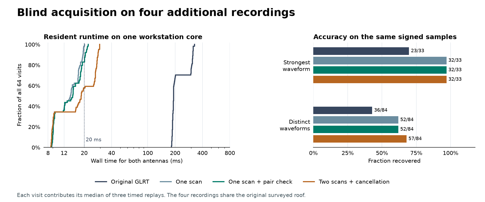
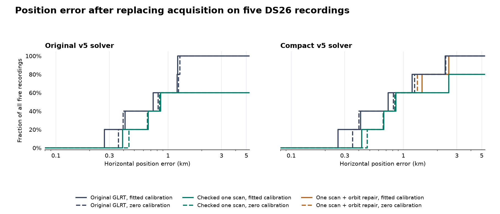

# Algorithm progress on November 20, 2026

**One scan was faster and found more signals than original GLRT on the blind Gauss benchmark.** With the pair check enabled, it took **14.94 ms** per stereo visit versus **192.37 ms** for original GLRT, a **12.9×** median speedup. It recovered **32/33** strongest signals versus **23/33**. Positioning gave a different result. On five complete DS26 recordings, compact v5 returned **5/5** fixes with original GLRT, **4/5** with checked one scan, and **5/5** with two-scan cancellation.

## From radio samples to a position

| Algorithm | Role | What it does |
|---|---|---|
| Original generalized likelihood ratio test (GLRT) | Reference detector | Takes 20 ms of complex radio samples, the known pilot and the tuning. Searches candidate frame start times and carrier-frequency offsets, refines the peaks and compares the pilot score with a shifted control. Outputs a signed frequency, frame time and score for each accepted peak. |
| One scan | Prototype detector | Uses timing correlations at quarter sample rate to shortlist where the pilot begins, estimates frequency at those times, and refines four leading proposals on the original samples. Up to two carriers from that one search can pass the original fractional GLRT verifier. |
| One scan with pair check | Prototype detector | When two peaks pass, fits each pilot while accounting for the other. A carrier must improve prediction on pilot symbols held out of that fit. This adds a verification step without a second search. |
| Two scans with cancellation | Prototype detector | Fits and subtracts the first pilot, then searches the residual samples for a second carrier. It verifies both candidates on the original samples. This can expose a weaker signal under a stronger one. |
| algo07v5 fast, no repair | Reference position solver | Groups detections into Doppler tracks, matches them against satellite orbits available at capture time, and fits receiver position. It carries the solution through late reassociation and produces the scientific archive. |
| Compact v5 | Active position solver | Shares the early satellite search across calibration settings, uses five orbit updates and a bounded secant position fit, and decides whether to publish after checking the influence of individual satellite families. |

The detector measures a waveform. The solver decides which satellite explains it and which measurements support a position. Both one-scan variants and two-scan cancellation retain the original GLRT for final waveform verification. [One-scan protocol](reports/2026_11_20_single_scan_glrt/PROTOCOL.md) · [Pair check](reports/2026_11_20_single_scan_glrt/PAIR-CHECK.md) · [Cancellation and track selection](reports/2026_11_20_two_carrier_glrt/PROTOCOL.md) · [Solver guide and commands](algorithms.md)

## Original and compact v5 on existing GLRT detections

The two calibration settings either fit the radio-frequency calibration coefficient `c` from the measurements or fix it at zero. In the four-option DS26 study, original v5 without repair completed 285 of 318 attempts across two repeats. On the 127 recordings completed by every option on both repeats, allowing two omitted tracks reduced mean fitted-calibration error from 1,232 to 1,211 m and zero-calibration error from 1,252 to 1,228 m. Mean worker wall time rose from 445 to 533 s. The no-repair configuration remains the accuracy reference. [Four-option DS26 study](docs/analysis/algo07v5-ds26-performance.md)

| Recording panel with original GLRT | Original v5 fixes | Compact v5 fixes | Median error, original → compact, fitted calibration | Median error, original → compact, zero calibration |
|---|---:|---:|---:|---:|
| All 159 DS26 recordings | 143/159 | 149/159 | 988 → 1,014 m | 980 → 990 m |
| The 142 DS26 recordings both solved | 142/142 | 142/142 | 994 → 996 m | 982 → 980 m |
| Eight DS29 benchmark recordings | 8/8 | 8/8 | 742 → 748 m | 753 → 759 m |

The first row uses the fixes each solver returned. On the 142 paired DS26 fixes, fitted 95th-percentile error was 3.304 km for original v5 and 3.288 km for compact v5. Four fresh same-core recording pairs gave compact v5 a **3.65× median speedup** from saved GLRT detections to usable solver output. That clock starts after acquisition. [All-recording and paired results](reports/2026_11_19_receiver_screening/deployment/README.md) · [DS29 results](reports/2026_11_19_receiver_screening/secant-full/README.md) · [Same-core solver timings](reports/2026_11_19_receiver_screening/deployment/same-core-baseline/README.md)

## Finding the signal on Gauss

The final blind panel held out 64 visits across four recordings, two DS26 and two DS29. The waveform references cover the ordinary ±800 kHz acquisition window. Gauss ran all four detectors on the same samples in rotating order on one Intel Core Ultra 9 285K performance core. Each visit contributes the median of three in-memory wall times for both antennas. Accuracy uses the selected antenna and independently supported pilot waveforms. Of the 64 visits, 33 had a reference for the strongest signal. [Host and input bindings](reports/2026_11_20_single_scan_glrt/gauss/host.json) · [Raw repeated timings](reports/2026_11_20_single_scan_glrt/gauss/cadence-repeats.csv)

| Detector | Median / 95th percentile | Visits within 20 ms | Strongest recovered | Distinct waveforms recovered | Peaks returned |
|---|---:|---:|---:|---:|---:|
| Original GLRT | 192.37 / 315.82 ms | 0/64 | 23/33 | 36/84 | 49 |
| One scan | 14.16 / 19.63 ms | 63/64 | 32/33 | 52/84 | 57 |
| One scan with pair check | 14.94 / 21.23 ms | 53/64 | 32/33 | 52/84 | 52 |
| Two scans with cancellation | 18.56 / 28.78 ms | 37/64 | 32/33 | 57/84 | 57 |

The pair check removed five extra peaks on this panel while retaining all 52 matched waveforms. On samples with known injected signals it removed all nine extra peaks from the unchecked receiver and kept every true carrier that receiver had found. Cancellation recovered five additional reference waveforms on the blind panel. All four methods withheld on all 64 phase-randomized controls on the scored antenna. Across both timing panels, every one of 2,304 stereo evaluations reproduced the earlier candidate lists. [Timing summaries](reports/2026_11_20_single_scan_glrt/gauss/cadence-summary.csv) · [Waveform and control counts](reports/2026_11_20_single_scan_glrt/receiver-summary.csv) · [Known-signal mixtures](reports/2026_11_20_single_scan_glrt/checked-mixtures.csv)

## What happened to position on five complete recordings

We replayed DS26-0020, 0036, 0066, 0162 and 0237. The replacement detectors processed the full recordings. Their track-selection rule required three earlier supporting visits on the same antenna and channel. Both calibration arms used the same detections, causal orbit catalogue, 25 km search region and solver budgets. The table gives horizontal error medians **among returned fixes**, with all five attempts counted for coverage.

| Acquisition | Original v5 fixes | Original v5 median, fitted / zero | Compact v5 fixes | Compact v5 median, fitted / zero |
|---|---:|---:|---:|---:|
| Original GLRT | 5/5 | 739 / 818 m | 5/5 | 734 / 813 m |
| One scan with pair check | 3/5 | 666 / 656 m | 4/5 | 762 / 749 m |
| Two scans with cancellation | 3/5 | 521 / 513 m | 5/5 | 560 / 561 m |

The 666 m original-v5 result illustrates the effect of missing fixes. On the **same three** recordings, original GLRT gave a 415 m fitted median and checked one scan gave 666 m. Both solvers stopped on DS26-0020 at the edge of the orbit table. Original v5 also stopped on DS26-0066 when the final count of assigned measurements disagreed with the selected solution. A separate compact-v5 retry on DS26-0020 extended the orbit calculation by two one-second time points and recovered the position at 1,465 m fitted error. With that retry, checked one scan gave **5/5 fixes at 857 m fitted and 839 m with zero calibration**, versus **734 and 813 m** for original GLRT. [Checked one-scan outcomes](reports/2026_11_20_single_scan_glrt/replacement-positions.csv) · [Orbit-support retry](reports/2026_11_20_single_scan_glrt/orbit-support-replay.json) · [Two-scan outcomes](reports/2026_11_20_two_carrier_glrt/positions.csv)

Two-scan cancellation had the lowest five-recording compact-v5 median. It improved two individual fitted positions and worsened three. Its median frequency residual RMS increased from 72.51 to 112.76 Hz with fitted calibration and from 72.55 to 112.76 Hz with zero calibration. The RF fit and surveyed position error measure different outcomes. [Per-recording position and frequency residuals](reports/2026_11_20_two_carrier_glrt/positions.csv) · [Cumulative position errors for two-scan cancellation and its track-selection options](reports/2026_11_20_two_carrier_glrt/positions.png)

## Following v5 satellite assignments back to the signal

Neighboring v5 assignments predicted where a missed carrier should appear. On selected visits we searched the raw samples across ±3.18 MHz and all 13,333 integer frame starts, challenged competing pilots, and returned measured times and frequencies to v5 with the proposed satellite IDs withheld. Both calibration fits independently assigned **18 previously missed measurements to 16 predicted satellites** across the five recordings. All 18 agreed within 411 Hz of both track predictions. These visits were selected for suspected misses, so the blind panel above supplies the detection-rate comparison. [Signed frequencies and final assignments](reports/2026_11_20_single_scan_glrt/combined/checked-associations.csv) · [New nominations and controls](reports/2026_11_20_single_scan_glrt/backward/visits.csv)

Adding only those 18 measurements to original GLRT kept all five original-v5 fixes and moved median error from 739 to 736 m fitted and from 818 to 816 m with zero calibration. One older assignment dropped out even though both waveform searches still supported it. When checked one scan replaced acquisition throughout, its track rule passed 17 of the 18 to the solver. Among 16,116 previously assigned measurements it retained the original signed waveform on 15,038, chose another waveform on 615 and withheld on 463. That is where a better per-visit detector can change which evidence reaches the position fit. [Augmented refits](reports/2026_11_20_single_scan_glrt/combined/augmented-v5.csv) · [Dropped assignment](reports/2026_11_20_single_scan_glrt/displaced/original-owner-changes.csv) · [Track retention](reports/2026_11_20_single_scan_glrt/whole-recording-owner-retention.csv) · [Confirmed signals reaching the solver](reports/2026_11_20_single_scan_glrt/whole-recording-satellite-retention.csv)

The DS26 and DS29 recordings in these comparisons share one surveyed roof. The measured speedup applies to acquisition on Gauss. Performance at new locations and real-time latency on an embedded processor remain open.
