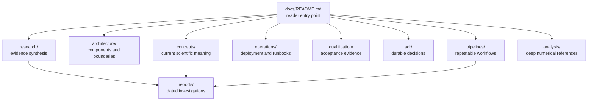
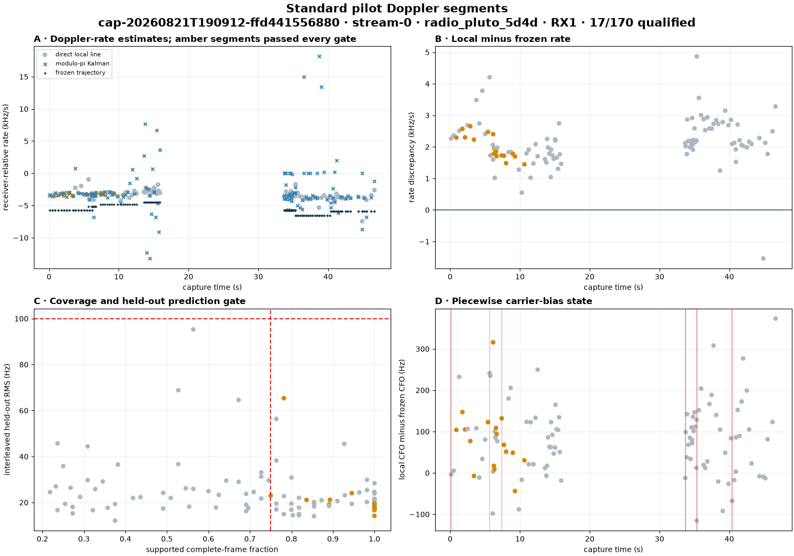

# LEO Tracker documentation

## Motivation

LEO Tracker combines RF acquisition, immutable recording storage, numerical
analysis, scientific controls, operations, and a browser. A reader should be
able to enter the documentation from the question they have instead of first
learning the repository's history.

## Problem

The repository contains detailed design notes, qualification receipts, and
dated investigations, but they serve different purposes. A dated report may be
excellent evidence without describing the current production path. A plan may
explain why a component exists without proving that it is deployed. A figure
may show a real signal while still being candidate-only. Reading those sources
without a map makes it easy to confuse implementation, evidence, and intent.

## Solution

This directory is the stable documentation entrance. It separates current
concepts, architecture, repeatable pipelines, operations, qualification,
decisions, and historical evidence. The canonical scientific claim is
deliberately narrow: the recordings contain strong, repeatable evidence for the
published Qin edge-pilot structure and coherent receiver-relative CFO
trajectories; they do not yet support payload decoding, absolute range, or
secure satellite identity.

## Method

The pages below were synthesized from the current source tree, public
contracts, tests, 45 versioned Markdown report assets, their recorded-data
figures and machine-readable results, the protected corpus inventory, and the
two primary signal-structure papers cited by the implementation. Every
canonical page starts with the same four sections—Motivation, Problem,
Solution, Method—so it remains understandable when read alone.

## Start here

Recent eight-channel likelihood fitting: [six-scan local evaluation and controls](../reports/2026_10_12_fast_likelihood_cohort/README.md).
Alias-aware and track-shape initialization controls improve the conditional
frequency fit, but most strong evidence remains unexplained. The requested
near-reference position minimum and four-scan validation are still open.

Continuous track merging: [DS20 and DS16 study with GLRT curve overlays](../reports/2026_10_12_continuous_track_merge/README.md).
The offline prototype joins consecutive curved segments and rejects injected
steps and slope changes. Corpus positioning comparisons are in progress;
localization improvement and automatic deployment are not yet established.
The [protected orbital-consistency iteration](../reports/2026_10_12_consistent_track_merge/README.md)
separates quota eviction from changed orbital matches and preserves original
discovery candidates while testing joined initialization proposals.
The [band-calibrated cohort and full-search transfer](../reports/2026_10_12_band_calibrated_merge/cohort/README.md)
records 144 stationary local fits. Calibration learned from a development scan
recovers another scan from 156.475/154.073 km to 1.410/2.052 km in matched c arms.
Protected merging reaches 1.303/3.779 km, retaining the c=0 regression. Group
authority bookkeeping is fixed. The [anchored refinement and completed initial
validation](../reports/2026_10_12_band_calibrated_merge/refinement/README.md)
retain four score-improving parent starts, two geographic regressions, a large
raw-merging validation gain, a calibrated-merging validation regression, and
neutral DS16 validation pairs. Corpus qualification remains pending.
Its complete-parent and clock-weight audits show that the sparse regression's
added fragment agrees with its selected parent; adding its rows drives the clock
seed change even when original row weights are preserved. Plots also trace the
changed correction-training support, without claiming a position repair.
The [nested curve census](../reports/2026_10_12_band_calibrated_merge/predictive-curves/README.md)
now covers all 18 DS20 and 63 DS16 recordings: joining predicts better on 244 of
316 testable components, with 146 unsupported components retained. It also
predicts better in the known sparse position-regression case. A same-point probe
shows receiver drift changes 5–7 original orbital candidate preferences; joint
clock/candidate initialization remains to be tested.
The [clock-conditioned bootstrap experiment](../reports/2026_10_12_band_calibrated_merge/clock-conditioned/README.md)
now completes 48 initializer conditions and 96 matched coarse c attempts on the
fixed development panel. Synthetic recovery succeeds, but nine conditions lose
better original seeds and coarse effects remain mixed. The prototype needs
incumbent preservation and less repeated profiling before full-pipeline trials.

The [profile reuse and clock-incumbent follow-up](../reports/2026_10_12_band_calibrated_merge/incumbent-clock/README.md)
now retains original and intermediate seeds. All 96 serial conditions return
valid seeds without worsening original-support coherence; controls reproduce
exactly and duplicate prediction calls fall from 44 to 22. At five seconds,
22 interrupted paths preserve completed seeds, but changed stationary coarse
comparisons improve 22 times and worsen 25 times. The affected suite passes
66 tests. Full geographic comparisons remain necessary; defaults are unchanged.
The [full B7 incumbent comparison](../reports/2026_10_12_band_calibrated_merge/full-incumbent/README.md)
has now frozen the same development panel and started bounded execution using
the complete 400-point search rather than the earlier selected points. Both
final c arms remain matched; no new position improvement is established yet.
Its first raw full control now completes both stationary B7 arms at 3.209 km
(fitted c) and 3.619 km (c=0), reproducing every one of the 400 earlier ordered
bootstrap seeds exactly. The joined mode remains in progress. Report receipts
retain all 48 planned conditions and separate operational fallbacks from
same-stage c comparisons; the new geographic merge effect is not yet available.

Eight-channel position regression: [receiver channel-group offset root cause
analysis](../reports/2026_10_12_fast_channel_root_cause/README.md). On the same
recorded scan, two frozen receiver-specific group offsets change full-channel
reference error from 231.00 km to 1.81 km. The report includes matched c arms,
conditional randomized block controls, RF-mapping alternatives and the limits
of attributing the effect to physical LNB retuning.

Adaptive positioning default: [Hard60 experiment review and rollout](../reports/2026_10_07_hard60_default/README.md),
including N01–N64 comparisons, failure diagnoses, figures and deployment receipts.

Recent recorded-data experiment: [GLRT and shorter-segment confirmation on
sixteen completed scans](../reports/2026_10_07_glrt_recent16/README.md), with
figures, code references, and audit receipts. This is a temporal repeatability
diagnostic, not randomized detection validation.

| Reader question | Canonical page |
|---|---|
| What do we currently know about the transmissions? | [Starlink downlink and known-pilot evidence](concepts/starlink-transmissions.md) |
| How is the software divided and where does data flow? | [System architecture](architecture/system-overview.md) |
| How is a normal recording processed? | [Standard analysis pipeline](pipelines/standard-analysis.md) |
| How should a scientific question be investigated? | [Research analysis pipeline](pipelines/research-analysis.md) |
| Which reports support each conclusion? | [Research evidence ledger](research/evidence-ledger.md) |
| Where is the latest dish-firmware reverse engineering? | [APK firmware workspace and RF receive trace](../starlink_firmware/apk_fw_v1/README.md) |
| What did the Kutkov hardware and firmware review add? | [Source review and download catalog](research/oleg-kutkov/README.md) |
| Where are the PLUTO+ ARM GLRT speed improvements, source, and validation results? | [ARM GLRT performance index](research/arm-glrt-performance.md) |
| What did the complete DS7 benchmark achieve? | [DS7 results, visualizations, and ablation comparisons](../reports/2026_09_27_ds7_publication/README.md) |
| Where is the original sealed DS7 report and evidence? | [Full88 original report](../reports/2026_09_27_ds7_full88/REPORT.md) |
| How do the ten single-scan models perform on DS11? | [Full DS11 benchmark, visualization and 320 results](../reports/2026_09_30_ds11_single10/README.md), [publication audit](../reports/2026_09_30_ds11_publication/README.md) |
| Where are the formerly local research and engineering reports? | [Reviewed report archive and reading guide](../reports/2026_09_28_report_archive/README.md) |
| How should another page be written? | [Documentation standard](contributing/documentation.md) |
| How is production operated? | [Operator runbook](operations/runbook.md) |
| How is a release qualified? | [Release qualification](operations/release-qualification.md) |

## Documentation map

The arrow into `reports/` means “supported by,” not “superseded by.” Reports
remain immutable evidence. Canonical pages state the current synthesis and link
back to the exact report and figure that support it.

## Truth hierarchy

When sources disagree, use this order:

1. **Immutable persisted contracts and source bindings** define what a
   published product means.
2. **Current code and component-owned tests** define what the deployed
   implementation does.
3. **Reviewed qualification receipts and golden fixtures** establish bounded
   behavior for an exact release and input.
4. **Canonical pages in `docs/`** synthesize the current understanding.
5. **Dated reports** preserve the evidence and interpretation available at one
   point in time.
6. **Plans and proposals** describe intended work, not necessarily current
   behavior.

If code and a canonical page disagree, the page is stale. Fix the page in the
same change that establishes the new behavior. Do not alter a golden fixture or
historical report merely to make the narrative agree.

## Scientific claim ladder

The project uses the following vocabulary consistently:

| Level | Meaning | Current status |
|---|---|---|
| Recorded energy | RF energy exists in the selected band | Established for many captures |
| Known-pilot response | Exact Qin pilot beats a matched rolled-pilot control | Established in reviewed windows and scans |
| QAM quality | The 300 × 8 published 4QAM pilot matrix demodulates with useful accuracy | Established, candidate-only |
| CFO trajectory | Independently acquired pilot candidates form reproducible frequency-time structure | Established, with alias and selection caveats |
| Local phase/rate lock | Frame-local pilot phase and CFO pass coverage, control, prediction, and agreement gates | Established intermittently |
| Starlink-format candidate | Evidence is consistent with the published universal Starlink edge pilot | Supported wording |
| Starlink spacecraft identity | A specific emitter is associated securely with a catalogued satellite | Not established |
| Payload decoding | User/header payload bits are recovered | Not implemented or claimed |
| Navigation observable | Absolute phase, code phase, pseudorange, range, or position is qualified | Not established |

“Complete” in a numerical result means the bounded computation completed. It
does not promote the scientific claim to a higher row.

## One real-data view of the current system

*Recorded-data figure: one deployed Standard result for
`cap-20260821T190912-ffd441556880`, `stream-0/RX1`. It shows 17 qualified local
pilot-Doppler windows among 170 evaluated windows. The local rates are
receiver-relative and candidate-only; see the [piecewise pilot-Doppler
report](../reports/2026_08_23_piecewise_pilot_doppler_rate.md).*

This figure illustrates the documentation policy: show accepted and rejected
evidence together, identify the recording and transformation, and state the
limit of the claim next to the image.

## Existing detailed references

The new hierarchy does not discard the repository's detailed material:

- `analysis/` contains numerical deep dives, contracts, and integration plans.
- `operations/` contains deploy, acquisition, retention, soak, and recovery
  procedures.
- `qualification/` contains exact evidence and acceptance receipts.
- `adr/` contains decisions that should not be rediscovered in prose.
- `standard-pipeline-handoffs/` preserves implementation handoff records.
- [`../reports/`](../reports/) contains dated research and operational reports;
  use the [evidence ledger](research/evidence-ledger.md) to find the current
  disposition of each group.
- [`../corpus/`](../corpus/) contains protected-corpus manifests and immutable
  scientific goldens. Raw IQ is intentionally not embedded in documentation.

## Maintenance rule

The [2026-09-28 report publication inventory](../reports/2026_09_28_publication_inventory/README.md)
indexes the receiver-geometry, DS7/DS8 and ARM research backlog, including
visualizations, archived local variants and checksum-verified evidence restoration.
It preserves negative results and distinguishes protocols from completed experiments.

A change that affects a public product, detector meaning, pipeline stage,
scientific gate, CLI workflow, or operator action must update its canonical
page. New pages follow the [documentation standard](contributing/documentation.md).
New scientific figures should be generated by a versioned report tool from
digest-bound evidence, not edited by hand.
