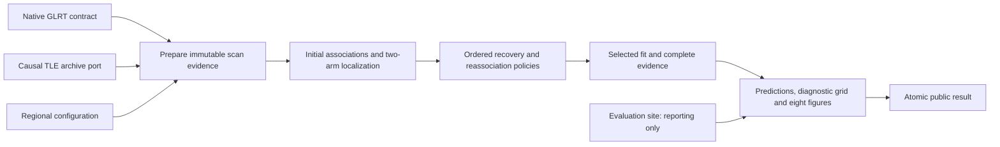

# ALGO07v3: standalone exact-output engine and 10× performance plan

Planning deliverable, 2026-11-04. Implementation and performance qualification
are not complete. This supersedes the ALGO07* coordinator as the intended
architecture; its existing evidence remains useful and its failures remain open.

Current implementation status, 2026-11-05: the owned application is connected
through final guarded numerical reassociation, including causal-history
completion and matched replacement/control fitting. DS26-0066's final numerical
worker and all eight fits match frozen ALGO07 exactly; a connected DS26-0002
prepared-input run completes with its earlier science unchanged. Owned plot
preparation reproduces all eight PNGs and all 179 grid points exactly on
the DS26-0084 retained-baseline fixture. The owned recorded path now passes that
same comparison, and a fresh DS26-0002 run connects numerical recovery through
all eight PNGs with every earlier scientific output unchanged. A new owned native
entry point now connects track construction and causal preparation to that same
numerical and presentation path; prepared and native inputs reproduce the entire
DS26-0002 audit and eight PNGs exactly. See the
[native-engine report](../../reports/2026_11_05_algo07v3_native_engine/README.md)
for independent isolation evidence, 543 passing tests and explicit stage clocks.
The [publication milestone](../../reports/2026_11_05_algo07v3_publication/README.md)
now completes one isolated native run through an owned scientific archive and
the existing atomic WebUI manifest. Reloaded science, eight PNGs and all 179 grid
points remain exact; the unchanged HTTP routes serve these artifacts. A subsequent
scalar-encoding optimization preserves every saved field while reducing measured
encode/decode time 18.501 → 7.400 s and archive size 211.518 → 79.902 MB. That is a
component result, not a full-path speed ratio. The 477.365 s first native-to-publication
observation used the initial encoding and has no matched baseline. There are
588 passing focused tests in that milestone. The subsequent
[owned CLI qualification](../../reports/2026_11_05_algo07v3_cli/README.md) adds
run/resume, pinned requests, tested process cancellation and a fresh isolated
native run. Its full science, 179 grid points and eight PNGs remain exact, with
611 passing tests. Native-to-publication takes 371.153 s (373.342 s including
process startup); saved-result publication succeeds with the input/TLE bundle
hidden. These are unpaired observations, not a speed ratio. Full DS26 equivalence,
ordinary-clock admission qualification and the 10× complete-path metric remain
unfinished or unproven. This is not yet the complete qualified production engine.

The [first fresh reference/native timing pair](../../reports/2026_11_05_algo07v3_pair/README.md)
now observes 675.455 s for the original chain and 504.041 s for native v3. Both
complete identical public outputs, eight PNGs and all 179 grid points. Eight
scientific audit sections match directly, while nine mappings and metadata
bindings remain open. The observed ratio is not a qualified speedup: shared-host
load changed and full intermediate qualification remains incomplete. The full
new native science also matches its previous native qualification. There are
622 passing focused tests. A bit-exact scatter-assembly prototype is measured
only as an external experiment and remains disabled in the runtime.

The subsequent [full-scan assembly experiment](../../reports/2026_11_05_algo07v3_assembly/README.md)
now compares all 6,772 likelihood calls exactly and reproduces the entire native
scientific/figure snapshot. Its 5.80% component saving is not a complete-path
speedup; runtime integration and ordinary timing remain next steps. Three more
fresh-reference mappings pass (ranking, no-admission screening and final fallback),
bringing coverage to 11 of 17 sections on this case. Six mappings, metadata
semantics, accepted branches and population/deadline qualification remain open.
The focused suite now passes 642 tests. No deployment occurred.

The [connected presentation report](../../reports/2026_11_05_algo07v3_connected_presentation/README.md)
records the fresh prepared-input-to-PNG run, exact numerical regression, owned
path projection, and 515 passing tests. Its 484.617-second observation excludes
native preparation and publication; it is not an end-to-end speedup measurement.

Implementation has begun: see the [first extraction and geometry-reuse report](../../reports/2026_11_04_algo07v3_start/README.md).
This is component progress, not completion of the standalone engine or its gates.
The [causal-preparation iteration](../../reports/2026_11_04_algo07v3_preparation/README.md)
reproduces initial scientific preparation and removes repeated TLE text validation.
The [scan-scoring extraction](../../reports/2026_11_04_algo07v3_scan_likelihood/README.md)
also matches the original context and exercised scoring states on three DS26
scans.
The [joint-likelihood and fresh-discovery extraction](../../reports/2026_11_04_algo07v3_position/README.md)
adds independent bounded position fitting and phase refresh. Exact component
comparisons pass. The [initial-search extraction](../../reports/2026_11_04_algo07v3_initial_search/README.md)
now adds full regional branch orchestration, acceptance gates and frozen-calibration
extension. It matches the production-budget initial search on DS26-0084 and bounded
searches on three DS26 cases. The [conservative-recovery extraction](../../reports/2026_11_04_algo07v3_conservative/README.md)
adds causal-width retained fitting, paired rejection, independently calibrated
salvage and exact observation accounting. Initial search through this policy
matches all three replay cases with full production budgets. The
[family/history extraction](../../reports/2026_11_04_algo07v3_history/README.md)
adds family weighting, history-qualified phase priors, predictive linear evidence
and paired fallback. All three full-budget comparisons match both fresh oracles
and archived production scientific values. The
[signed-prior extraction](../../reports/2026_11_04_algo07v3_signed/README.md)
adds signed historical qualification and matched-arm refitting. Its complete
numerical context matches fresh references and archived incumbents on all three
cases. The [family-cavity extraction](../../reports/2026_11_05_algo07v3_cavity/README.md)
adds complete-family exclusion, full-catalogue nomination, paired replacement
trials and the production equal-prior adoption rule. All three scans match fresh
references and archived cavity scientific values. The
[recovery-inventory extraction](../../reports/2026_11_05_algo07v3_inventory/README.md)
adds independent selected-incumbent replay, native-point ownership, protected
publication support and ordered recovery targets. All three scans match the
frozen ALGO03 inventory with production session identities. The
[predictive-annotation extraction](../../reports/2026_11_05_algo07v3_annotation/README.md)
adds timestamp-only distinct holdouts, training-only causal nomination, shared
and new-family predictive covariance, and identity consensus. Complete annotation
of the largest target in each of the three scans matches the frozen reference,
including supported, residual-failing and unstable identities. The
[predictive-inclusion extraction](../../reports/2026_11_05_algo07v3_inclusion/README.md)
adds shared/new-family position trials, exact orbit/owner replay, scoped adoption
and matched numerical retry. DS26-0002's shared rejection and new-family retry
acceptance match the frozen reference exactly, including unchanged earlier
results. The [ordered/joint recovery extraction](../../reports/2026_11_05_algo07v3_joint/README.md)
adds the controller and shared-covariance two-family fits/audits. All six initial
fits and all six matched Powell retries match on a frozen numerical fixture;
the fresh DS26-0002 target loop matches its independently qualified references.
The [numerical-policy extraction](../../reports/2026_11_05_algo07v3_numerical/README.md)
adds centered capped derivatives, bank-checked 30-second references and explicit
stage-specific contraction order. All six numerical fits/audits and numerical
receipts match frozen ALGO04; the original six predictive fits remain exact.
The [conditional replay extraction](../../reports/2026_11_05_algo07v3_replay/README.md)
now owns frozen-competition annotation replay, stage reuse and additive incumbent
adoption. DS26-0044 annotation replay matches exactly; a fresh DS26-0002 prefix
and two-target numerical controller matches independent individual references
and all numerical receipts. Broader replay branches, timeout checkpoints and
ordinary-clock admission remain unqualified.
The [conditional gap components](../../reports/2026_11_05_algo07v3_gap/README.md)
now reproduce DS26-0012 timing-only preparation, fresh independent annotation,
conditional shared-family fits and exact owner/orbit audits in both arms. All
scientific fingerprints and numerical receipts match; 95 points are recovered
with receiver coefficients unchanged. The [owned gap controller and application
checkpoint](../../reports/2026_11_05_algo07v3_gap_controller/README.md) now match the
original controller on that fixture. A fresh DS26-0002 prefix through gap recovery
preserves every earlier numerical result and all 2,783 owners in each arm.
Application imports now avoid unrelated concrete adapters, with public exports
preserved. The [selected-likelihood and residual preflight extraction](../../reports/2026_11_05_algo07v3_selected_incumbent/README.md)
now reconstructs baseline, new-family, joint-family and conditional-gap states
and prepares the remaining native evidence for additional-family recovery. All
four real-fixture branches match frozen ALGO06 exactly in both arms, including
nearby-position likelihood probes, complete residual ranking and corrected target
arrays through the owned application entry point. The joint fixture's 17 incidental
extensions per arm remain uncredited. The [selected checkpoint and residual screen
iteration](../../reports/2026_11_05_algo07v3_residual_screen/README.md) now carries the
actually adopted raw likelihood through predictive, numerical and gap decisions.
The fresh DS26-0002 prefix preserves all earlier science and 2,783 owners per arm;
484 incidental extensions remain uncredited. Its residual screen and two isolated
screen fixtures match exactly on eight targets, including three passes. The owned
72-hour catalogue adapter also matches. The [additional-family position stage](../../reports/2026_11_05_algo07v3_additional_position/README.md)
now reproduces DS26-0086's complete matched control/addition exactly, qualifying
26 points for NORAD 67652 and preserving 3,285 incumbent owners in both arms.
The application is connected through this stage; its fresh DS26-0002 no-addition
branch preserves the entire earlier prefix and correctly excludes an existing
family. Accepted additions from fresh native inputs across the population, final
guarded reassociation and publication remain unqualified or unfinished.
The [final-stage handoff and trigger](../../reports/2026_11_05_algo07v3_reassociation_context/README.md)
now preserve the qualified additional likelihood and owners. DS26-0086's full
handoff, likelihood probes and all 26 influence rankings match frozen final
ALGO07 exactly; both implementations nominate 62116 and 58002. The selector
matches six accepted/fallback/invalid-admission checks. A fresh connected
DS26-0002 prefix preserves all earlier science and 2,783 owners per arm, then
nominates 69265. The [causal screen and receiver-shared admission](../../reports/2026_11_05_algo07v3_reassociation_screen/README.md)
now match the frozen DS26-0066 component exactly, including all 11,133 catalogue
candidates, the full propagation bank/audit, cavity fits and every predictive
partition. Both admit 62025 → 68047 on the same 140 points and ten unique
receiver-shared folds. The connected DS26-0002 run preserves all preceding
science and admits no replacement. Causal-history completion and matched
replacement/control fits remain to be integrated into this final stage.
Production cancellation, final proof
publication and broader gap branches still need qualification. Broader inactive-fragment/shared
inclusion qualification, fresh joint
target-loop qualification, ordinary-clock admission, later recovery policies,
reassociation and publication remained unfinished at that milestone.
The [complete final numerical stage](../../reports/2026_11_05_algo07v3_reassociation_final/README.md)
now owns causal-history completion, family remapping, matched constrained fits
and the guarded decision controller. The DS26-0066 research canary exactly
reproduces the frozen final numerical worker and all eight individual fits,
selecting 62025 → 68047 with 2,770 retained owners per arm and 170 reassigned
points. Its public terminal is unavailable, so publication preflight is explicitly
outside this comparison. The connected DS26-0002 prepared-input run finishes
numerical recovery in 273.407 seconds, preserves all earlier scientific fields
and retains 2,783 owners per arm without replacement. The suite passes 483 tests.
Full DS26 localization/publication parity and complete-path speed remain open.
The [selected-fit presentation adapter](../../reports/2026_11_05_algo07v3_presentation/README.md)
now owns prediction/residual preparation and calibrated orbit lanes while reusing
the existing PNG renderer. DS26-0084 matches the complete frozen plot packet,
179/179 conditional grid locations and all eight PNG bytes. Selected endpoint
likelihoods can be transferred from final fitting without another optimization;
enabling this transfer preserves the complete DS26-0066 accepted-replacement
result exactly. That milestone passed 496 tests and used a path from the public
terminal. The connected-presentation milestone above replaces that path input
with owned decision projection and reaches 515 tests; publication and broader
artifact branches remain to be connected and qualified.

The requested outcome is one independently deployable ALGO07v3 engine, producing
the same scientific and presentation outputs as production ALGO07, ten times
faster. Independence, exact equivalence and speed are three separate release
gates. Passing one does not imply either of the others.

## 1. Scope and definition of independence

Primary input: sealed native GLRT evidence for one fast scan, its acquisition
metadata, an explicit regional-search configuration and the causal TLE archive
view available to that scan. Primary output: both position arms, all associations,
residuals and scientific audit evidence, plus all eight current Web UI PNGs and
their grid/path sidecars. The original acquisition/native detector stays outside
this engine. Track construction is inside it: a completed historical ALGO result
or preconstructed graph is not an input prerequisite.

ALGO07v3 must run in a clean deployment containing **no older ALGO workers,
services, installations, result directories or caches**. It must not import or
launch `algo02_scan`, `algo03_*`, `algo04_*`, `algo05_*`, `algo06_*`, the old
ALGO07 worker, or call their services. It must not construct historical storage
paths, consume their nested terminals, or secretly reconstruct their deployment
tree in a temporary directory. The preceding ALGO implementations are test
oracles only. Renaming a coordinator that still invokes those workers fails.

Reusing the mathematical methods is necessary and permitted. Extract the needed
algorithms into v3-owned, version-neutral components. Preserve the exact
implementation of each numerical operation initially, including version-specific
variants when the installed stages differ. Shared general libraries such as
NumPy and orbit propagation remain dependencies, explicitly pinned. Different
old environments must be reconciled by tests rather than assuming the newest
helper is equivalent everywhere.

The main speed metric starts when native GLRT is ready and ends when the complete
artifact manifest becomes visible. Also report recorded-IQ-ready to publication
with the unchanged detector, and capture-to-publication including queue delays.
A 10× downstream result must never be advertised as a 10× detector or acquisition
improvement. The full raw-recording metric remains a separate requirement to
measure; no baseline for it has yet been established.

## 2. Evidence behind the design

The installed initial worker's `prepare` builds graph/noise/causal prior/history;
it then launches initial localization and a family comparison. ALGO03 explicitly
requires a qualified completed ALGO02 result. The final ALGO07 worker constructs
`FastGraphPositionStoreV5Export` and its preparation opens `algo06-terminal.json`.
These are actual runtime/data dependencies, not just historical names.

Audited source locations and revisions:

| Responsibility | Current source to extract and compare |
|---|---|
| Graph/noise/causal preparation and initial fit | `fast_graph_worker.py`, `algo02_scan.py`, `fast_graph_engine.py` in `/opt/leo-fast-graph-runtime-algo02/f7897f7c9f33cef7d8b46b70a41078091d0f217a` |
| Predictive nomination, partitions, inclusion, exact owner audit | `algo03_shadow_worker.py`, `algo03_production_worker.py` in `/opt/leo-fast-graph-runtime-algo03/f286f3e3029ec17479f4aa2b41312e4220258944` |
| Numerical-only recovery | `algo04_production_worker.py` in `/opt/leo-fast-graph/f9e262f96b6e2e75b397f69d50a0ea9104e293ef` |
| Conditional gap recovery | `algo05_production_worker.py` in `/opt/leo-fast-graph/4675ec446f2889d92eeea902c234f3f91ab48007` |
| Additional-family recovery | `algo06_production_worker.py` in `/opt/leo-fast-graph/cf16ac5bd6a8f1ac65f626eba57326f2a2d2e6b5` |
| Guarded reassociation and final policy | `algo07_frozen_production_worker.py`, `algo07_prepare.py`, `algo07_science` in `/opt/leo-fast-graph-runtime-numerics/336715a398c2e6b9295318261bb63da76aaa2726` |
| Current eight figures, grid and path | `render_standard_fast.py` and its dependencies in `/opt/leo-standard-fast/4cd629cef1e3bb35073d8c39f587ddf3d6d6ebf7` |

These installed paths describe the **reference**. None may appear as a runtime
requirement of v3. Before implementation freeze source hashes, configuration,
numerical dependencies and the complete transitive call graph for each extraction.

The recent DS26-0084 pair provides sizing evidence, not a qualified speed claim:

| Interval | Reference | ALGO07* |
|---|---:|---:|
| Inference including validation/continuation | 817.550 s | 821.556 s |
| Final ALGO07 invocation, included above | 136.173 s | 106.075 s |
| Publication process | 95.025 s | 65.257 s |
| Outer observed trial | 912.576 s | 887.264 s |
| Diagnostic grid locations | 91/179 | 179/179 |

The original reference grid was incomplete and shared-host load differed. These
times cannot establish an exact-output speedup. The six reference worker
invocations total 707.202 seconds. Even eliminating everything **outside** them
would yield only about 1.29× for this observation if their cost stayed fixed.
They contain preparation and repeated I/O as well as numerical work, so profiling
inside them is essential. A nominal 91.3-second target would require those
invocations' work to fall by at least 7.75× even with zero other cost. This is a
sizing calculation, not a promised runtime.

The timing pair subsequently passed exact scientific comparison. A separately
declared 300-second real-grid replay produced all 179 locations and eight
byte-identical PNGs. This isolates the original publication failure to the grid
deadline for that case; it does not qualify the original timings or clear other
scans' scientific admission failures.

Further evidence: [pipeline profile](../../reports/2026_11_04_algo07_pipeline_profile/README.md),
[ALGO07* plan and parity rules](algo07-star-plan.md),
[timing trial](../../reports/2026_11_04_algo07_star_glrt_ready_timing/README.md),
[deadline diagnoses](../../reports/2026_11_04_algo07_star_second_deadline_case/README.md).

## 3. Target architecture



One application job owns the scan. The engine retains necessary scientific
dependencies internally; independent deployment does not mean skipping them.
There is one prepared evidence context and explicit immutable incumbent state,
not six nested persisted result trees. Keep compact, hash-bound checkpoints so
restart and diagnostics remain possible without requiring earlier ALGO services.

Proposed ownership and interfaces, to be implemented rather than assumed present:

| Component | Responsibility and boundary |
|---|---|
| `leo.analysis.localization_v3.prepare` | Graph/polynomial construction, noise, exact catalogue views and priors from supplied evidence; no concrete storage imports |
| `leo.analysis.localization_v3.geometry` | Validated orbit banks and exact time/phase geometry queries; immutable buffers and scan-scoped caches |
| `leo.analysis.localization_v3.likelihood` | Existing calibrated likelihood, phase/nuisance handling and both c arms, with numerical variants explicitly owned |
| `leo.analysis.localization_v3.policies` | Initial solve, predictive recovery, numerical repair, gap recovery, additional-family recovery and guarded replacement, in original dependency order |
| `leo.analysis.localization_v3.solve` | Deterministic candidate order, acceptance, incumbent transitions and saved optimizer path |
| `leo.application.localize_v3` | One job, public input/output ports, bounded resources, restart and final transaction |
| `leo.contracts.localization_v3` | New standalone input/result/checkpoint contracts; preserve all published legacy contracts |
| Storage and presentation adapters | Native/TLE reads, persistence and current Web UI projection, outside numerical analysis |

Use a typed prepared scan, catalogue views, fit state, owner map and audit events.
A catalogue view retains each policy's original age/availability and phase rules;
sharing an orbit bank must not expand its candidate eligibility. A fit state
includes both arms, exact observations, nuisance values, residuals, saved steps,
accepted additions and the required fallback state.

The final renderer consumes this prepared evidence and selected fit directly.
It must not reopen a legacy export and solve the same state again solely to
recover plot arrays. Predictions, grid scores and presentation values still
must match. Persist each scientific array once with bound references. Validate
mutable/untrusted inputs at entry, freeze them, and retain atomic publication
checks; replacing integrity checks with an mtime assumption is prohibited.

## 4. Exact-output gate and the deadline problem

For every available DS26 fast scan require exact agreement in both arms on:

- Input observations, aliases, graph membership/polynomials and causal records.
- Candidate order, eligibility, partitions, gate decisions and incumbent changes.
- Point-to-satellite ownership, endpoints, objectives, nuisance/phase values,
  residuals and optimizer history, including fallback/completion behavior.
- All plot data, grid locations/scores, path, error annotations and eight PNGs
  under pinned rendering dependencies. Titles retain equivalent policy labels;
  implementation provenance identifies v3 separately.

Only explicitly enumerated operational metadata may differ: runtime/process IDs,
physical paths and implementation provenance, with each independently validated.
Do not weaken this into endpoint-only parity or choose tolerances after failure.
New internal checkpoints need a declared semantic mapping to legacy audit events;
they need not fabricate old subprocess executions. Test that mapping with deliberate
owner, candidate, coefficient, prior, gate, grid and missing-artifact mutations.

**A wall-clock-limited algorithm is not a deterministic function of its scan.**
The current ALGO03 discovery loop admits work until `min(600, 0.7 * allowance)`;
the presentation grid defaults to 30 seconds. Identical code has admitted different
hypotheses/grid points under different load. Raising the outer 1,200-second worker
limit alone does not remove the inner 600-second cap.

Therefore the first milestone must resolve this before any exact-output claim:

1. Preserve original ordinary-clock failures and repeatability evidence.
2. Verify exact mathematics and fallback decisions under matched logical work
   and cancellation traces in the test harness only. The candidate must never
   read a reference answer or trace as a production input.
3. Separately test larger, explicitly matched real-time allowances. A complete
   grid can use a declared presentation budget; changing scientific admission
   can change the answer. Report both comparisons to original production.
4. A future deterministic work-limit policy is a possible contract change, not
   an already-approved waiver. If needed, propose it with its full result deltas.
   Do not quietly redefine the oracle to make v3 pass.
5. Keep ordinary-output parity failures in the release gate. Identical final
   positions with different evaluated hypotheses do not qualify strict parity.

There is no defensible guarantee of identical outputs for every possible wall
interruption while also changing execution speed. If the original deadline
semantics cannot be reproduced without pacing away the speed gain, document that
conflict and require an explicit policy decision. Do not claim the three release
gates passed by hiding it. Adding artificial delay is not an optimization.

## 5. Work packages and exit criteria

Each package produces component-owned tests and a report; no new RF collection.
The old reference runs only in isolated test namespaces. Existing ALGO07* jobs
may finish their current bounded invocation; do not start more coordinator
iterations merely to advance a superseded architecture.

| Package | Concrete work | Exit evidence |
|---|---|---|
| P0: contract, oracle and budget | Freeze complete current chain; characterize deadline cases; define semantic audit mapping and exact public output comparison; profile representative complete paths | Repeatability matrix, deliberate comparator failures, immutable input/runtime manifests, declared timing scope |
| P1: standalone vertical slice | Extract graph/preparation and all required scientific policies into v3-owned components; wire one job and direct presentation without calling old workers | Clean isolated run from native GLRT with old installations/results inaccessible; exact representative outputs; import/exec/read audit |
| P2: reuse prepared work | Reuse identical immutable evidence, catalogue preparation, phase geometry, noise/prior construction and unchanged fits across policy calls | Hit/miss/cost counters, bounded memory, mutation/invalidation tests, exact arrays and decisions |
| P3: numerical hotspots | Profile initial fit, predictive partitions, two-family integrations and geometry separately; eliminate repeated identical calculations while retaining arithmetic order | Unprofiled paired runtime gain and exact primitive, policy and full-scan results |
| P4: presentation and persistence | Carry selected-fit arrays into renderer; remove reconstruction/export churn; compute each required grid score once; publish all artifacts atomically | Exact PNG/grid/path comparison, correct evaluation-only error, restart/concurrent publication tests |
| P5: full DS26 gate | Run each optimization iteration on all available DS26 fast inputs, retaining failed/unavailable members; use representative gates first for fast rejection | Full per-scan correctness and runtime table, no unexplained divergence; no subset promoted as the cohort |
| P6: independent performance and rollout | Alternate baseline/candidate timing, reserve new scans before tuning, shadow deployment, rollback | Standalone package, complete artifact parity, demonstrated 10× target and production resource/queue measurements |

P0 precedes the standalone extraction. P1 is a whole-path correctness milestone,
not a thin wrapper around old workers. P2 and P3 target the dominant cost; P4 is
part of the complete latency target. P5 repeats after each proposed optimization;
unit/smoke failures stop that iteration before spending a cohort run. No stage
may be dropped because it usually rejects a candidate.

Extract numerical functions with an origin hash and a focused oracle test before
editing them. Convert file-dependent tools to narrow pure calls at their boundary,
not by embedding ad hoc virtual file trees. Maintain an explicit list of helper
variants until exact equivalence permits consolidation. Profile and deduplicate
that list rather than accumulating an indefinitely duplicated codebase.

## 6. Where 10× could come from, and how to reject weak ideas

| Opportunity | Required evidence before use | Main exactness risk |
|---|---|---|
| Repeated orbit/time/phase geometry | Identical catalogue/time/phase/receiver-state keys, measured reuse rate and cost | Reusing across a changed receiver position, phase, interpolation domain or TLE |
| Repeated partition/control fits | Identical observations, ownership, priors, starts, solver state and evaluation order | An apparently similar fit has a different nuisance model or initial condition |
| Likelihood factorization reuse | Identical matrix bytes/dtype and unchanged solve ordering | Batched BLAS, reassociation or factorization changes rounding and decisions |
| Evidence/ownership preparation | Immutable input hashes and measured decode/export repetition | Hiding mutation or weakening source binding |
| Independent candidate evaluation | Full separation of state and ordered deterministic reduction | Completion-order changes ties, work admission or fallback behavior |
| Plot reconstruction removal | Stored selected-fit arrays exactly reproduce the original renderer's inputs | Publishing stale or differently conditioned predictions |
| Exact early rejection | Mathematical proof of the same existing gate, including finite-precision boundaries | Approximate pruning silently drops a useful hypothesis |

Caches must include every dependency and stay scan-local initially. No training
or inference key may use GPS truth, known error or a special-case scan ID. Audit
new reuse at the first divergent value, not only the final endpoint. Avoid new
solvers, reduced candidate sets, lower polynomial orders, fewer phase samples,
downsampled observations, changed priors, or one-arm-only fitting in the exact
optimization track.

The first performance decision is quantitative: measure exclusive time and
duplicate work coverage, then calculate the remaining attainable speedup. If
the irreducible exact computation exceeds one tenth of complete reference time,
10× is not yet supported. Continue with targeted numerical work; do not rename
a modest coordinator gain as success. Faster hardware or more CPUs must be a
separately reported experiment rather than a hidden baseline asymmetry.

## 7. Verification and timing protocol

Current inventory: 159 DS26 fast members, 158 with native evidence and one
unavailable; adaptive scans are excluded. Recheck availability before execution,
retain the full denominator, and never substitute a partial native capture.
Use the existing seeded cohort order for continuity. Reference answers may be
read by the external comparator, never by the v3 inference process.

Every implementation iteration needs an exact DS26 comparison. Reuse frozen,
hash-verified oracle outputs only for numerical regression where the declared
work schedule remains applicable; obtain fresh paired executions for runtime
and ordinary deadline comparisons. Preserve every prior failure. Missing or
timed-out inputs do not become passes or disappear from summaries.

Standalone tests must run with old runtime/result paths masked, external ALGO
services disabled, and a fresh empty output store. Trace imports, subprocesses
and file reads; allow only native evidence, causal catalogue/configuration, v3
package and declared general dependencies. Test completion, rejected recoveries,
missing/invalid inputs, causal catalogue absence, interruption, restart and
concurrent publication. No production fallback may invoke an older ALGO engine.

Benchmark reference and candidate sequentially in alternating AB/BA order on
the same machine with the same CPU/thread allowance. Control cache conditions
or report cold/warm strata separately. Run profiling separately from timing;
do not infer latency from aggregated CPU time. Reserve performance windows with
low measured contention rather than silently stopping production. Bound research
invocations and checkpoint longer scans; record checkpoint work separately from
human gaps, which cannot be included in a speedup numerator.

Measure these exclusive spans: input verification, graph/catalogue/noise
preparation, initial fit, recovery/reassociation, diagnostic grid, PNG rendering,
persistence. Record total monotonic latency, aggregate CPU, peak memory, I/O and
CPU allowance. Render every artifact before stopping the primary timer.

Report per-scan ratios, median/p90/p95, geometric-mean paired speedup, failures
and slowdowns. Target complete GLRT-ready latency at most 10% of the matched
reference for every qualifying scan, plus median and p90 summaries. Treat a case
that misses 10× as a performance gap even when the mean looks favorable. Keep
every scan visible and require correctness throughout. If only a distribution
target is achievable, present that evidence and obtain an explicit scope decision
rather than silently substituting an average for the requested 10× outcome.

Both c=0 and fitted-c are always evaluated. Geographic error and GLRT association
are regression outputs, not tuning objectives for this task. Confirmed GPS is
available only to reporting. No post-observation TLE may enter inference.

## 8. Proposed developer interface and promotion checklist

Design only; these commands do not exist yet:

```text
leo algo07v3 run --native-input INPUT --causal-catalogue CATALOGUE --config CONFIG --output OUTPUT
leo algo07v3 verify --dataset DS26 --reference-manifest MANIFEST --candidate RELEASE
leo algo07v3 benchmark --dataset DS26 --reference RELEASE --candidate RELEASE --order abba
```

`verify` and `benchmark` may use legacy oracles in the test environment. `run`
must pass the standalone restrictions. Persist command/config/source bindings,
declare exact comparison failures, and distinguish incomplete from failed and
passed. Reuse existing comparators behind a reviewed semantic adapter; avoid a
second, weaker comparator that merely agrees with the new implementation.

Before promotion require: standalone deployment test; complete both-arm scientific
and figure parity on DS26; resolved deadline-policy qualification; matched 10×
measurements; held-back/new-scan checks; no old runtime accesses; artifact/API
compatibility; restart and rollback tests. Do not mutate published legacy
contracts to fit the new engine. Introduce a new owned result contract and a
reviewed projection to the existing UI values. Retained scientific policy names
can remain in audit output without being runtime dependencies.

Deploy initially to a separate output namespace, compare against current
production, then switch the application adapter under a reversible release
selection. Keep old production available for operator rollback, while the v3
process itself remains independent. Implementation, the 10× claim and production
deployment are all unachieved at the time of this planning document.
