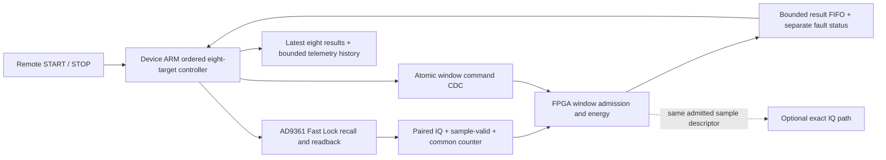

# Standalone FPGA power scanner workstream

Status: proposed independent implementation; no RTL, firmware deployment, or RF
collection is authorized by this document. Companion work is the
[continuous eight channel IQ scanner](fast-eight-channel-scanner-workstream.md);
shared product behavior is in [scan workstreams](scan-workstreams.md).

## Motivation

The device continuously visits the configured eight IF targets in order, wraps
from target 8 to target 1, and stops on an explicit STOP or a visible integrity
failure. Each visit measures exactly 50,000 complex samples per enabled receiver
at 2.5 MS/s. Both physical RX1 and RX2 share the selected LO. A remote computer
issues START/STOP and reads power results; it issues no per-visit tuning commands.

The first implementation keeps profile preparation, Fast Lock recalls, ordered
scheduling, and restoration on the device's ARM. FPGA logic owns sample-domain
window admission, integer power measurement, and result publication. The
standalone mode works with IQ DMA and the host IQ consumer disabled. It needs no
GLRT, orbit service, PostgreSQL, or continuous IQ storage.

An FPGA SPI/Fast Lock pin controller is a separate extension requiring pin
ownership, synthesizer readback, calibration, and recovery qualification.
Track A can ship with software power while this track remains in simulation.
Initially A/B are mutually exclusive device modes; later integration can fan out
the same admitted window to both paths.

## Problem

The inspected local source is
`/home/mouse9911/gits/plutosdr-hdl-gain-timeline-v8/projects/pluto/system_bd.tcl`,
base revision `ff17846a5d9b90c3294bdecb53eaa43617a519a7`, inspected file SHA-256
`64868ad6863d8c30678122ab89560cff6adc40cdcae21153779c3bb267eee357`.
Its receive wiring is:

| Signal | Existing connection | Proposed measurement input |
| --- | --- | --- |
| Receive clock | `axi_ad9361/l_clk` | Same clock domain |
| RX1 I/Q | `rx_fir_decimator/data_out_0/1` to `cpack/fifo_wr_data_0/1` | Those same signed 16-bit words |
| RX2 I/Q | `axi_ad9361/adc_data_i1/q1` to `cpack/fifo_wr_data_2/3` | Those same signed 16-bit words |
| Sample-valid strobe | `rx_fir_decimator/valid_out_0` drives `cpack/fifo_wr_en` | Same strobe, with paired-valid checks |
| Sample counter | 64-bit `counter_timestamp/Q`, clocked by `l_clk`, CE driven by that same valid strobe | Same counter word, sampled with the IQ |
| CPU clock | `sys_cpu_clk` | AXI-Lite and result-consumer domain |

Measurement is before packing and DMA backpressure. The counter also feeds
timestamp packing and tandem gain events. The synchronized ARM-visible GPIO
counter does not identify an individual IQ sample through a later register read.

The inspected design filters RX1 through an optional decimator while RX2 uses
the raw path. Initial paired operation therefore requires an independently
attested factor-one bypass and matching RX1/RX2 I/Q valid/enabled strobes. If
decimation is enabled or paired strobes disagree, reject the configuration or
fail the window. Do not label two different filter/rate paths coherent. Any
future paired decimation needs its own symmetric path and geometry identity.

The inspected project selects `xc7z010clg400-1`. A historical routed v0.56 report
at `/home/mouse9911/gits/plutosdr-fw-v056-artifacts/e39162c7cee17136b2575aadfa4c6802d7cdebed-35960458163/extracted/system_top_utilization_routed.rpt`
uses 13,524/17,600 LUTs, 74/80 DSPs, 8/60 BRAM tiles, and all 4,400 slices. Its
timing report has WNS 0.767 ns and no failing setup endpoints under that build's
constraints. These are historical constraints, not available capacity or timing
proof for the current v0.60 image. Freeze the actual intended baseline, rebuild
its utilization/timing reports, and measure the increment before selecting RTL.

Compare four parallel squarers with two multiplexed squarers, or one if the
clock/sample-valid ratio permits. Four DSP-backed squarers would leave little
historical headroom; placement is unproven. Multiplexing requires a demonstrated
cycle budget and bounded input queue. Keep this raw-IQ core independent of the
pilot correlation power block. Synthesis and sample-strobe simulation select
the implementation; there is no throughput promise from resource arithmetic.

## Solution



Names below specify a new interface; they are not existing register commands.
Use a negotiated block identity and ABI major/minor, with a separately allocated
AXI address. Do not extend old scan wire versions by changing their meaning.
Existing v1 bounded weighted campaigns remain supported during rollback.

The AXI-Lite interface exposes:

- `IDENTITY`, ABI, capabilities, maximum window count, receiver layout, input
  code width/shift, counter identity, FIFO capacity, and build digest.
- Shadow command fields plus an atomic `COMMIT`: session/generation, command
  sequence, visit/sweep sequence, target/profile/CRC and target-table digest,
  sample rate, layout/RX mask, intended start counter, and count of 50,000.
- Command acknowledgement containing the received sequence, admission result,
  sample-domain acknowledgement counter, and accepted start/end bounds.
- Coherent result read/consume, FIFO level, cumulative overrun/error counters,
  and independent sticky fault/terminal state. Reading a result never clears it
  implicitly; consuming a complete identified record advances the FIFO.
- `DISARM`/`STOP` and a completion acknowledgement reachable independently of
  result draining. Reset and fault clearing require an idle owner and establish
  a new generation; an active fault is not cleared by a normal status read.

## Method

Cross multiword commands using a stable snapshot and request/acknowledge
handshake or asynchronous command FIFO. Results use an asynchronous FIFO or
dual-port RAM with synchronized record pointers. Independently synchronizing
data bits is insufficient. Review CDC and reset release in both domains.

### Exact sample-domain window admission

The common tuple is `(sample_valid, counter, I1, Q1, I2, Q2, receiver_mask)`.
For the initial ABI, `counter` tags the pre-increment counter value sampled on
the same receive edge as that tuple. Prove the relationship to the existing DMA
timestamp implementation with tagged-ramp simulation, including its pipeline
delay; never assume a host timestamp or an untested packing offset.

A window admits tuples in `[valid_start, valid_start + 50,000)`. It admits each
counter once, requires consecutive tags and the configured paired-valid mask,
and includes the final tuple before latching its result. A missing, duplicate,
regressed, reset, or unexpected receiver tag makes the window invalid with its
actual admitted count. No zero filling or concatenation across visits is allowed.
Pipeline valid bits, tags, clipping indications, and first/last markers follow
the samples through squaring and addition. Publication waits for the last
contribution to reach the accumulator.

At each visit, ARM waits for the previous window result, issues the next actual
profile recall, checks the active profile and qualified profile/frequency
receipt, and establishes a conservative counter-domain start boundary. Prefer
the existing kernel recall/counter receipt when compatible. Otherwise read the
common counter after acknowledged recall and add the qualified guard to that
upper bound; this is a conservative boundary, not a silicon lock-time measure.
The validity/guard receipt states whether the guard is already included. The
tested firmware's 20 ms allowance begins at its selection counter and includes
recall time. Adding 20 ms after recall acknowledgement defines a different,
longer timing profile; it cannot inherit that profile's measured sweep bound
or guard qualification. Name, measure, and negotiate each interpretation.

ARM then submits the whole descriptor. FPGA accepts only if the descriptor
arrives before its required start edge with the declared pipeline lead time.
An acknowledgement counter greater than or equal to the requested start means
`LATE_ARM`, with zero admitted samples and an UNKNOWN outcome. ARM may explicitly
request a later start for the same still-tuned visit; it records the rejection
and added gap. It cannot reconstruct missed samples or silently claim the
original boundary. A sample-clock stall has a bounded control-domain timeout.

Profile recall and register readback do not by themselves establish RF settling.
The initial kernel timing option is the separately identified experimental
20 ms total transition profile in the [loopback evidence](short-window-scan-implementation.md).
Keep a conservative alternative and negotiate the profile explicitly. Held-out
raw-transient qualification is required before calling that guard production
qualified or reducing it. FPGA power does not remove this RF requirement.

### Integer arithmetic and activity

For each receiver keep unsigned 64-bit energy, unsigned sample count, signed
64-bit I/Q sums, component clipping counts, and integer peak magnitude. Widen
signed inputs before multiplication; add nonnegative squares with sufficient
width before accumulating. For CI16 rails, the maximum per-sample energy is
`2 * 32768^2`; 50,000 such contributions fit below `2^47`. Overflow still sets a
sticky arithmetic fault rather than wrapping into plausible power.

The result preserves the software definition:

```text
energy = sum(I*I + Q*Q)
mean_component_power = energy / (2 * sample_count)
power_dbfs = 10 * log10(mean_component_power / 32768^2)
```

Emit exact sums; ARM computes display logarithms with explicit zero power.
Preserve codes without scaling ADC12 up to CI16 full scale. Report CI16 tap
saturation separately from ADC-overrange evidence. Values -2048/+2047 prove
ADC12 rail contact only after format, scaling, bypass, and sign extension are
qualified. A direct ADC-overrange signal can have a different pipeline delay;
align its quality indication with the admitted samples or mark attribution
UNKNOWN. Qualified clipping blocks activity even without a CI16 rail hit.

For a configured threshold, ARM computes an integer minimum energy for the
fixed count and binds its rounding rule, threshold policy, and calibration ID.
FPGA compares complete valid energy against that integer threshold; equality is
ACTIVE. QUIET is below threshold. An invalid/partial/clipped window is UNKNOWN
while retaining its observed energy. Freeze integer-threshold boundary tests
against the software classifier, including values immediately below/at/above
the boundary. An energy decision does not assert Starlink detection.

### Continuous results, STOP, and optional IQ

Use a distinct versioned power-result contract, never a zero-length IQ record.
Start with a combined dual-RX result bounded to 256 bytes and an internal
16-record FIFO. Each carries session/generation, sweep/visit/target,
profile and frequency authority, counter bounds, actual count, both receivers'
sums/clipping/decision, threshold and guard identities, and fault/loss counts.
Freeze byte layout, endianness, reserved fields, and framing integrity checks
before implementing a driver. Version negotiation is independent of old IQ
recording formats.

The on-device ARM drains that FIFO and keeps the latest result for each of the
eight targets plus a bounded telemetry history. Remote consumption is optional
per hop: a slow/disconnected client does not prevent continued measurement.
An expired history cursor returns the exact lost telemetry sequence range and
cumulative overrun count, plus current snapshots. This is declared finite
telemetry retention, not a claim of complete recording. Reliable metadata
journaling is a separate output policy with bounded chunks and visible failure
on exhausted capacity.

The internal FPGA-to-ARM FIFO must not silently overwrite unread measurement
results. A full FIFO stops new window admission, latches `RESULT_OVERFLOW`, and
stores terminal identity and loss counters outside the normal FIFO so ARM can
always inspect them. Publish any partial in-flight result with actual count.
Reserve control/fault capacity; STOP cannot wait for a remote result reader.
This visible fault stop is distinct from normal continuous-until-STOP operation.

Graceful STOP prevents the next target recall, completes the admitted window,
drains accepted internal results, and reports stopped/restored. Forced STOP
disarms immediately, reports the partial count and cancellation reason, drains
the multiplier pipeline, and restores owned radio settings. A later START gets
a new generation even if the free-running hardware counter continues. Rate,
layout, gain, reset, or clock changes also require an explicit new generation.
Maintain bounded state rather than an ever-growing per-session visit ledger.

Power-only mode emits no IQ and needs no armed IQ DMA. A later power-plus-IQ
mode fans out the same admitted tuples to both paths, so integer power can be
recomputed from exactly those recorded samples; it retains quiet IQ under track
A's recording policy. An activity decision arrives after the measured window.
Conditional retention of that same window therefore requires prearmed DDR
staging, explicit payload admission, and matching counter/hash receipts. It
cannot be implemented by enabling IQ DMA after the decision. One dual-RX window
is 400,000 bytes; the entire 60-tile Z7010 BRAM capacity is only 276,480 bytes
before existing allocations. Whole-window BRAM staging does not fit this target.
Alternatively, a separately named trigger can capture a subsequent window with
its own bounds; it must not be presented as the window that caused the trigger.

At the capture-only limit of 50 windows/s, 256-byte power records are 12.8 kB/s
versus 20 MB/s dual-RX IQ. These are payload calculations, not achieved timing
or transport guarantees. The 16-record internal FIFO holds 4 KiB; measure ARM
drain latency and headroom rather than relying on it to absorb indefinite stalls.

### Independent implementation and qualification gates

1. Freeze versioned ports, latest/history semantics, STOP outcomes, and an
   integer reference model. Coordinate the shared descriptor with A while
   preserving independent release capability.
2. Implement RTL/AXI/CDC in the firmware owner project. Simulate randomized valid
   strobes, signed extrema, clipping, zero/DC, counts 49,999/50,000/50,001,
   pipeline flush, late ARM, duplicate commands, mid-window retune, clock/reset,
   FIFO full, disconnected readers, cursor expiry, and STOP at every boundary.
   Exact sums, counter support, and fault identity must match the reference.
3. Compare both RX taps with tagged-ramp DMA simulation and prove bypass/layout
   invariants. Check CDC/reset, synthesize and route the full frozen Z7010 image,
   and publish incremental resources/timing. Core-only timing is insufficient.
4. Build driver/PPU ports. Long radio-free tests cover ordered wrap, bounded
   state, reconnect, stuck consumers, reachable STOP, discontinuities, and
   restoration. Chaining existing 300-second campaigns is not continuous mode.
5. Separately authorize a bounded fixed-gain known-waveform loopback. Compare
   FPGA sums exactly to corresponding saved IQ; measure result latency from
   the last accepted sample, spacing, losses, and STOP/restoration. Verify
   power-only mode with DMA off and remote readers disconnected. Every new RF
   collection remains at most 30 minutes; this increment performs none.
6. Deploy readers/negotiation first, then one selected hashed firmware/driver.
   Require exclusive ownership, bounded outputs, rollback, and restoration
   receipts. Preserve published contracts. Review a bounded canary before
   wider activation.

Completion means continuous ordered device operation, exact qualified 20 ms
per-RX power evidence, bounded memory, useful results without IQ streaming,
visible failures, and reachable verified STOP. No sweep-rate or microsecond
settling promise is made before those measurements exist.
