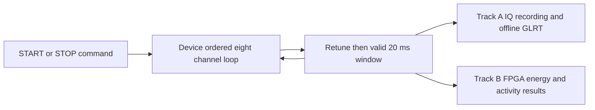

# Continuous eight channel scanning workstreams

Implementation progress and measured development-radio results are tracked in
[continuous scanner implementation](continuous-scanner-implementation.md).

## Motivation

The device should continuously visit the configured eight channels in order,
repeat the loop, and stop when explicitly requested. Each visit has a valid
20 ms measurement window. The host starts and stops the device and consumes
results; it does not issue a tuning command for every visit.

Two independently deliverable workstreams implement this behavior: an IQ
recorder for offline analysis, and a standalone FPGA power scanner. The FPGA
work must not delay delivery of the IQ scanner.

As of 2026-10-09, delivery is explicitly sequential: the fast IQ scanner is
[released as firmware v0.62](https://github.com/misko/plutosdr-fw/releases/tag/v0.62-plutoplus-spf-continuous-fast-scan)
first, retaining the existing FPGA image. FPGA acceleration
is paused; its saved source and simulation evidence will be revisited after
the scanner release. Software power and offline GLRT remain the first delivery.

## Problem

The planning-baseline prototype records exact 20 ms windows, retains quiet IQ,
and computes per-receiver power. Its PPU provider uses weighted scheduling and
finite campaigns capped at 300 seconds. It does not yet implement a continuous,
ordered eight-channel loop. Repeated finite campaigns introduce preparation
and restoration boundaries and are not a substitute for continuous operation.

The measured approximately 20.2 ms gap between changed-channel windows is an
experimental local-loopback result. Smaller gaps and other frequency plans need
their own qualification. See the [existing implementation and measurements](short-window-scan-implementation.md).

## Solution

| Workstream | Primary deliverable | Output for each visit | Initial timing objective |
| --- | --- | --- | --- |
| [Fast eight channel IQ scanner](fast-eight-channel-scanner-workstream.md) | Device-owned ordered loop, persistent capture, explicit stop | 50,000 complex samples per receiver, counters, target and quality; software power remains available | Corrected post-recall guard implementation measured approximately 353 ms per sweep; earlier total-allowance version measured 322 ms |
| [Standalone FPGA power scanner](fpga-power-scanner-workstream.md) | FPGA windowed energy measurement with device-owned tuning and control | Per-receiver energy, sample count, clipping, threshold result and window identity; IQ streaming optional | Decision at window completion plus the implemented FPGA pipeline latency |

The FPGA track initially places channel switching on the device's ARM and power
measurement in FPGA logic. This satisfies autonomous device operation between
START and STOP commands. Moving the tuning controller itself into FPGA logic is
a separate extension; it is not required for the host-independent loop.

The selected capture duration is **20 ms per channel** for both workstreams.
The previously discussed 30 ms option is outside this first increment.



The diagram describes the shared behavior, not a requirement to run both
implementations together. The standalone power path must work without a host
IQ consumer or GLRT process.

## Method

### Shared behavior and evidence

1. START specifies the eight requested IF targets, receiver layout, sample rate,
   gain, timing profile, output mode and any threshold policy. The device validates
   the table, prepares tuning profiles once, and returns a session identity.
2. The device visits targets 1 through 8 in order, recording one complete window
   for each before starting the next sweep. Both receivers observe the selected
   IF simultaneously. Switching samples are excluded from every valid window.
3. Each result identifies session/generation, sweep, visit, target, actual
   provider-attested IF, valid-start counter and exclusive end counter. Host
   arrival time does not become an RF sample timestamp. RF/LNB mapping remains
   explicitly known, hypothetical or unknown.
4. Graceful STOP prevents admission of another visit, finishes or explicitly
   marks the in-flight visit, drains accepted results, and restores radio state.
   A STOP acknowledgement distinguishes request acceptance from fully stopped
   and restored. Forced cancellation reports partial data and cleanup failures.
5. Continuous operation uses bounded memory, queues and result history. Storage
   rotates into sealed recording segments without re-preparing the radio or
   resetting the source counter. Disk-full, output overflow and integrity loss
   have visible terminal outcomes; they never silently remove quiet windows.

START/STOP names here are intended control semantics, not commands already
available in the current CLI. Existing public wire and persisted contracts keep
their meaning; additional control and result capabilities require explicit
version negotiation.

For standalone power operation, result consumption cannot be mandatory for
every hop. The design must specify a bounded latest-result/queue policy, visible
overrun counts, and a reachable STOP control path under slow or disconnected
consumers. Retaining every IQ window in track A instead requires sufficient
local storage or consumer throughput and a visible stop on exhausted capacity.

### Timing and capacity

At 2.5 MS/s, a 20 ms dual-RX CI16 window is 400,000 bytes. Eight windows contain
3.2 MB of raw IQ. A recurring complete scan includes eight captures and eight
switching gaps, including the wrap from channel 8 to channel 1:

```text
recurring sweep time = 8 × (20 ms + measured valid-window gap)
                    ≈ 8 × (20 ms + 24.11 ms)
                    ≈ 353 ms
```

That is approximately 2.83 sweeps per second and 9.1 MB/s raw dual-RX IQ.
The corrected ordered-loop implementation measured a 352.866 ms median sweep
on the development radio. Earlier 322 ms measurements used a total transition
allowance rather than a minimum post-recall guard and are historical only.
Initial profile preparation and final restoration are separate measurements.
The 160 ms capture-only floor does not include any tuning or settling time.

Keep the initial 20 ms transition profile until its complete-window validity is
qualified on the intended targets. First improve ordering and eliminate repeated
setup; then reduce transition allowance with measured evidence. FPGA power
calculation does not by itself shorten the RF settling requirement.

### Independent delivery sequence

Track A first implements and tests ordered, continuous device scheduling and a
reliable STOP path, then connects the existing recording/GLRT reader to continuous
segments. Track B first implements a standalone simulated measurement core and
register/result interface, then integrates it with the device counter and tuning
controller. Both use the same window-boundary and quality vocabulary, with
independent implementation and release tests.

Integration compares FPGA energy sums and sample counts exactly against software
recomputation on the corresponding saved IQ. An activity threshold detects energy,
not Starlink identity; GLRT remains offline in track A.

Track B publishes a separate, versioned power-result contract. A complete power
measurement with no IQ payload is not represented as an empty or incomplete IQ
window. Optional simultaneous IQ capture provides the exact-integer oracle for
qualification, with both outputs bound to the same sample interval.

### Qualification and completion

The first joint acceptance exercise is a bounded, ordered eight-target run that
demonstrates no repeats within a sweep, exact 20 ms windows, stable memory use,
visible loss accounting, and STOP with verified restoration. The FPGA path also
passes exact integer equivalence and counter-boundary tests before hardware
integration. Tail latency and sweep period are reported with sample counts and
the complete frequency plan.

Product behavior is continuous-until-STOP. Development RF collections remain
explicitly authorized and individually bounded to at most 30 minutes under the
repository rules; simulation and replay exercise long-duration rollover cases.
Creating these workstreams does not start a radio campaign or deploy firmware.

Completion is independent: track A can ship with software power while track B
is in simulation. FPGA power can ship in metadata-only mode without making
continuous IQ storage or offline GLRT a runtime dependency.
