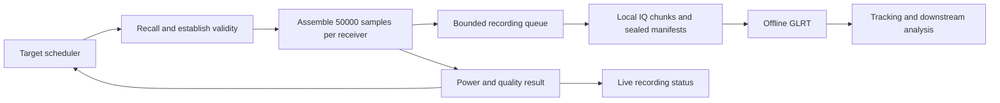

# Development and deployment plan for 20 ms scanning

Status: experimental implementation and local-radio smoke qualification completed,
2026-10-09. The implementation is opt-in; production deployment and the full
settling qualification below remain separate gates.

The additive `leo scan windows` command now records exact 20 ms windows with
per-receiver power and retains quiet IQ. Its PPU backend consumes firmware-owned
weighted visits through the public campaign API; it does not promise a strict
round-robin sweep. The native detector has standalone 20 ms offline APIs and a
verified recording analyzer. See [implementation and qualification notes](short-window-scan-implementation.md)
for commands, measured results, and remaining gates. The design below retains
the intended release requirements, including mandatory sweep coverage.

Capture exactly 20 ms of valid IQ at each selected tuning, calculate received
power from those same samples, publish activity immediately, and retain the IQ
for offline GLRT and tracking. The acquisition process owns tuning, sample
validity, power, and recording admission. Offline analysis starts from sealed
recordings and does not control whether a window is saved.

The first release uses 2.5 MS/s, manual gain, and complete round-robin sweeps.
After that baseline passes qualification, activity may prioritize additional
visits while preserving a deadline for every target. Active and quiet visits
both remain 20 ms. Faster settling is a measured optimization after recording
correctness is established.

## Current implementation boundaries

The following describe checked repository sources, not an inspection of the
currently running services or attached USB devices.

| Component | Current behavior | Planned change |
| --- | --- | --- |
| [Native scanner](../../native/adaptive/scanner/scanner.cpp) | Requires 120/240/360 ms dwells, fixed energy threshold, and detector bindings | Add a capture and power composition that accepts 20 ms without a detector |
| [Capture policy](../../native/adaptive/policy/spf-scan-policy.c) | Adaptive dwell versions have a 120 ms minimum and an eight-target limit | Add a separately identified fixed 20 ms policy; retain old behavior |
| [Local source](../../native/adaptive/device/local/README.md) | Firmware counter, profile recall, validity receipts, and borrowed DMA blocks | Reuse ownership and clipping; measure block alignment and discarded tails |
| [USB source](../../native/adaptive/device/usb/README.md) | Generic Soapy backend cannot attest post-retune validity or dual-RX coherence | Qualify a device-specific provider before admitting production-quality windows |
| [Native detector](../../native/adaptive/detector/native_glrt.c) | 20 ms internal probes behind a 120/240/360 ms input contract | Add an explicit standalone 20 ms offline entry point |
| [Projection](../../native/adaptive/ingest/ingest.cpp) | Assumes 120 ms probe offsets, restricted dwell lengths, and channels 1–4 | Add projection from explicit window bounds and qualified frequency metadata |
| [Scanner recording](../../src/leo/storage/scanner.py) | Framed IQ with hashes and atomic publication; ordered single-sweep model | Reuse publication discipline behind a repeated-visit recording port |
| [Scheduled runner](../../tools/run_adaptive_capture_cycle.py) | 120 ms visits, selected lower or upper edge, four low-band targets | Add an opt-in capture profile after readers and analysis support it |

Do not route this mode through the online tracking/location application. It
would require detector workers and unrelated services. Reuse the source and
capture mechanics through narrow ports instead of copying the entire scanner
or introducing a second recording backend.

## Frequency plan and hardware identity

Use an explicit target table with up to eight prepared Fast Lock profiles. Each
entry identifies the requested IF frequency and, when known, its RF channel,
edge, LNB LO, polarization, and band. Record actual tuned IF separately.

The existing eight low-band edge targets represent two edges of channels 1–4.
Eight distinct RF channels and eight candidate frequencies under two LNB
hypotheses are different plans. The dry run and UI must distinguish them.

Resolve the LNB model and control state before assigning authoritative RF
labels. On a standard universal LNB, 13/18 V selects polarization and the
22 kHz tone selects band, as illustrated by these
[manufacturer specifications](https://inverto.tv/download/file/64d4e97874f14-1691675000.pdf).
Unknown LO or band remains an explicit hypothesis;
energy at an IF frequency does not resolve it. A fixed LNB cannot expose the
band it filters out. Offline power inspection can proceed with unknown RF
mapping, but channel-specific GLRT and tracking require a supported mapping.

Record radio serial, firmware, provider, gain, filters, sample format, buffer
geometry, and calibration settings. Keep USB development and on-device
production qualification separate. A speed measured over USB does not qualify
the local DMA path, or vice versa.

## Capture and recording design



At 2.5 MS/s, 20 ms is exactly 50,000 complex samples per receiver. For dual RX,
CI16 `[sample][receiver][I,Q]` occupies 400,000 bytes per window. A window starts
at the provider's attested valid-sample boundary. If a receipt reports only
recall completion, apply the qualified settling guard to establish that boundary;
if validity already includes the guard, do not add it again. Persist which
meaning applies. Settling samples and delivery gaps are not part of the 20 ms
duration.

The acquisition owner copies clipped samples into preallocated window buffers,
accumulates power, releases the source lease, and submits the completed window
to a bounded writer queue. It must handle windows crossing DMA boundaries;
one 20 ms window is not necessarily one delivered 20 ms block. The writer owns
compression, hashing, chunk finalization, and storage publication.

Store multiple windows in bounded chunks using existing local recording
facilities. Avoid a file, fsync, or PostgreSQL transaction for every window.
Start with the established writer's chunk policy and measure it before adding
new indexing or compression schemes. Seal chunks so offline readers can consume
completed chunks while later acquisition continues, if the existing publication
port supports that lifecycle. Otherwise start with session-final analysis.

Retain ACTIVE, QUIET, and diagnostic UNKNOWN visits. Missing samples must never
be concealed by zero filling or concatenating samples across retunes. Partial
payloads have their actual length and failure reason and are ineligible for
the complete-window GLRT path.

If the writer cannot accept a completed window, record an explicit integrity
failure and stop admitting new visits. Drain accepted writes and finalize an
incomplete session. Reserve capacity for a terminal failure record. Do not
silently discard quiet windows or change the sweep rate to hide overload.

Use a byte limit and a window limit for the queue. As an initial configurable
value, 32 dual-RX windows use 12.8 MB of payload memory, plus acquisition,
compression, and metadata buffers. At 25 windows/s this buffers approximately
1.28 seconds; at 50 windows/s, 0.64 seconds. Benchmark sustained writer capacity
above the admitted capture rate instead of relying on a queue to fix overload.

## Immediate power classification

For each receiver independently, retain the integer energy sum, sample count,
mean I and Q, clipping count, and mean-component power:

```text
mean_component_power = sum(I*I + Q*Q) / (2*N)
power_dbfs = 10*log10(mean_component_power / 32768^2)
```

Use a 64-bit energy accumulator and an explicit representation for zero power.
Preserve this normalization; changing CI16 packing or scaling must not silently
shift the meaning of dBFS. Optional DC-removed power is a separately named
metric, not a replacement of the established quantity.

Publish one decision per receiver per complete window. ACTIVE means measured
energy is at or above the configured threshold; QUIET means it is below. UNKNOWN
means invalid support, unsettled data, or a quality condition that prevents a
trustworthy decision. Retain the observed power even when quality blocks a
decision. Activity is not Starlink confirmation.

First qualify the established -38 dBFS threshold as a named comparison policy
on 20 ms windows. It is not a universally calibrated threshold across radios,
gains, LNBs, or frequencies. Select production thresholds from fixed-gain
loopback/background evidence and recorded-data comparisons; bind the threshold
table and calibration identity to each session. If an adaptive noise baseline
is later justified, specify its update/freeze rules so sustained signals cannot
be learned away as noise.

Keep the current physical RX1 as the initial explicit scheduling receiver, and
persist results for both receivers. A later either-receiver policy gets its
own identity and false-alarm evaluation. Use an explicit mapping between
physical RX labels and software receiver indexes.

Emit power as soon as the final samples are available, independently of disk
commit. Expose capture-complete, writer-accepted, and durable states separately.
An initial software target is p99 classification/emission within 1 ms of final
sample delivery under the declared load. This does not include USB delivery
latency and is not a hard real-time guarantee.

## Scheduling without losing coverage

Release the baseline with one complete round-robin pass over all targets before
repeats. Measure actual valid-start spacing per target. If repeatable burst
aliasing is observed, evaluate a recorded-seed permutation or bounded timing
jitter while preserving target deadlines.

Add activity-driven scheduling only after the fixed sweep passes. Use a small
bounded state machine with configurable hysteresis and evidence expiry;
persist per-window decisions separately from the scheduler's smoothed state.
Reserve mandatory visits for all targets before granting active-target bonus
visits. Derive the feasible revisit deadline from target count and qualified
transition allowance. UNKNOWN evidence does not demote a target to QUIET.

No power outcome suppresses recording or permanently removes a target. Leave
dwell length fixed at 20 ms. Repeated visits to an already tuned target can
produce consecutive 20 ms windows, but any skipped recall and contiguous sample
support must be explicit. Add bounded bonus visits rather than an unbounded
lock on the loudest channel.

## Contracts and offline analysis

Introduce an additive short-window recording/configuration contract where the
published schemas cannot represent repeated 20 ms visits or uncertain RF
mapping. Do not relax or reinterpret an existing major version. Install readers
before writers emit the new format, and retain old readers during rollback.

Each window or its bound session manifest must identify:

- Session, generation, window sequence, target, physical receivers, and policy.
- Requested/actual IF, known or hypothetical RF mapping, and profile attestation.
- Actual sample count, layout, rate, sample/counter bounds and counter authority.
- Retune receipts, discard/guard policy, continuity, gaps, and quality flags.
- UTC bracket/uncertainty when supported, separately from host arrival times.
- IQ location through the storage port, payload length, and content digest.
- Per-receiver power, thresholds, decisions, and classifier/calibration identity.

Software delivery ordinals must not be promoted to hardware counters. Source
clock discontinuities start a new generation. Arrival time cannot replace the
sample support needed for Doppler and tracking.

The offline entry point accepts exactly one real 20 ms window per receiver and
the same template/search configuration as the chosen GLRT baseline. Reuse the
current detector kernel with explicit bounds. Do not pad a 20 ms record to
120 ms and claim that the padding was captured. Keep server-reference and native
fast detector qualifications distinct; this project does not establish parity
between previously different algorithms.

Bind analysis to recording hashes and explicit window geometry. Run one GLRT
probe per recorded window, on quiet windows as well as active ones. Make jobs
resumable and idempotent. Project observations from actual recorded sample
support, not `visit_index * 120 ms` or a nominal sweep cadence. Update readers,
projection, tracking handoff, API, and UI together for the new geometry.

Exact-IQ replay should preserve the selected detector's candidates and numerical
outputs within its existing declared tolerances. A faster live schedule changes
which sky samples are observed; equal tracking or localization performance
cannot be inferred from replay parity alone.

## Timing and capacity budget

Let `g` be the measured interval from one window's valid end to the next
window's valid start, including recall, guard, discarded buffer tails, and
scheduling. For a uniform round-robin pass over `K` targets:

```text
sweep_ms = K * (20 + g_ms)
windows_per_second = 1000 / (20 + g_ms)
dual_rx_payload_MB_per_second = 0.4 * windows_per_second
```

| Assumed total gap | Four targets | Eight targets | Dual-RX payload rate |
| --- | --- | --- | --- |
| 100 ms | 480 ms | 960 ms | 3.33 MB/s |
| 20 ms | 160 ms | 320 ms | 10.00 MB/s |
| 5 ms | 100 ms | 200 ms | 16.00 MB/s |
| 1 ms | 84 ms | 168 ms | 19.05 MB/s |

These are calculations, not timing guarantees. Budget setup and finalization
separately. Use measured total gap without adding the guard twice. The present
100 ms scheduling allowance was based on loaded capture with online analysis;
measure the proposed recorder without GLRT rather than assuming that allowance
is still necessary or that the 20 ms guard is the entire gap.

At zero gap the dual-RX payload ceiling is 20 MB/s: 6 GB for five minutes, or
36 GB for 30 minutes, before metadata and headroom. At a 20 ms gap those values
are 3 GB and 18 GB. Reserve for uncompressed data; do not assume noise-like IQ
will compress well. Account for simultaneous writers and free-space changes.

The existing 16,384-visit limits must be audited: five minutes at zero gap needs
15,000 windows, while 30 minutes needs 90,000. Validate duration and visit limits
together, with bounded metadata/chunks and an explicit stop reason.

At a 20 ms gap, replacing 120 ms visits with 20 ms visits increases GLRT jobs
per wall-clock second by 3.5 times, while each IQ record is six times smaller.
Size offline worker throughput and storage retention for that increased job
rate. Expose backlog age and bytes without putting GLRT back on the capture
critical path.

## Development milestones and gates

### 1 Freeze the short-window contracts and replay baseline

Implement the new target/window/configuration types, fake source, manifest
reader, and standalone offline probe adapter. Select a bounded, hash-verified
panel of existing intact visits spanning receivers, channel edges, powers, and
observed candidate outcomes. Include both first and later 20 ms slices where
available, keeping training and evaluation sessions separate for threshold work.

Gate: the first 20 ms of an old 120 ms visit round-trips byte for byte and
produces the same selected-baseline GLRT outputs and support timestamps. Both
recording versions remain readable. Existing scientific goldens are unchanged.

### 2 Build capture and power recording without hardware

Implement the bounded acquisition/writer composition, round-robin policy,
per-receiver power, dry run, cancellation, and durable publication. Extend the
existing recordings CLI/API/UI rather than introducing a separate dashboard.
Show target, power, activity, age since last valid window, integrity, writer
status, and offline-analysis progress. Keep operator controls focused on target
plan, gain, capture limits, and output destination.

Gate: injected uneven DMA blocks, stale samples, gaps, overflow, retune failure,
disk-full, slow writer, crash, and cancellation never produce a falsely complete
window or session. A recording reads back identically through the offline port.
Power appears without loading GLRT, templates, orbit data, or a database in the
capture computation. Catalog publication remains outside numerical components.

### 3 Qualify switching on the USB development loopback

First inspect device identity, firmware capabilities, actual TX2-to-RX wiring,
attenuation, and provider support without enabling transmission. Use fixed gain
and a nonclipping level. The harness has explicit radio selection, output root,
TX level, duration and hop limits, cancellation, TX-off cleanup, and restoration.
Building the harness and doing dry runs are separate from authorizing RF use.

With an explicitly authorized bounded run, keep TX fixed at the destination
plus a nonzero baseband tone while RX recalls from another profile. Retain raw
transients rather than applying the production discard guard. Test both RX
paths, short and long jumps, the sweep wraparound, and all 56 directed pairs for
eight distinct profiles over bounded follow-ups. Include a known coded waveform
to detect old or repeated buffers, and known-pilot inputs for GLRT checks.

Measure command latency, sample-domain transient duration, first usable data
arrival, and complete valid-window spacing separately. Microsecond settling
claims require a recall marker in the sample clock domain; host timestamps alone
support only application-visible latency. A provider unable to establish that
boundary remains a diagnostic path until its validity contract is qualified.

Start with an authorized two-minute smoke; use individually bounded runs of at
most ten minutes for the transition matrix, weaker inputs, and loaded repeats.
Every new collection requires explicit authorization and must stay within the
repository's 30-minute maximum. No overnight campaign is a release gate.

Gate: freeze amplitude/frequency/correlation tolerances against a steady-state
baseline, then evaluate separate repeats. Select a guard from held-out tails
plus explicit margin; report failures and counts by directed transition and RX.
Validate the complete next 20 ms, not only the first apparently stable bin.
Do not infer production Starlink sensitivity or LNB behavior from cable loopback.

### 4 Qualify the intended production transport and capacity

Run radio-free writer/replay stress at the admitted rate and a proposed 25%
throughput headroom. Exercise the actual file system, compression, UI/status
reader, and planned offline concurrency. Then run a separately authorized short
canary on the production source/provider with the selected guard and buffer size.
Do not transfer USB timing bounds to local DMA without measuring that path.

Initial performance goal: eight complete 20 ms windows per 320 ms sweep when a
20 ms total-gap profile can be qualified. Report p50, p95, p99 when supported by
sample counts, maximum, deadline misses, and integrity failures. Label a slower
functional build as such; never lower the sample-validity gate to meet speed.

Gate: zero corrupt or silently missing windows, zero unreported overflow,
bounded queues, no sustained writer growth, complete offline replay, correct
per-window timestamps, and declared revisit/latency criteria met under load.
Choose any smaller guard only through another measured profile.

### 5 Deploy readers first and activate one radio

Use the repository's [test and deployment front door](fast-test-and-deploy.md)
and [immutable deployment procedure](production-deployment.md). Audit component
ownership and test selection for new paths. Freeze the exact clean release
revision and build/configuration hashes, including any separately deployed radio
provider or firmware. Do not assume the application deployment helper also
upgrades external radio software.

Ship new-format readers, offline analysis, and UI support before enabling capture.
Stage the capture profile disabled by default, with a dry-run preview of tuning,
window counts, storage budget, timing authority, and expected limits. For the
first activation, prevent overlapping acquisition owners and let the current
recording finish. Run one explicitly authorized bounded capture on one radio,
inspect its power/results and replay it offline, then review wider activation.

The currently documented adaptive runner is an immutable separately selected
runner. Record the actual service/selector used on the destination host before
cutover; do not assume the standard application selector controls that service.
Keep existing timer cadence unless a separate scheduling change is authorized.
Historical authorization described in a runbook is not new collection approval.

Rollback on sample-integrity failure, invalid timing, restoration failure,
writer overload, unrecoverable analysis incompatibility, or repeated budget
violations. Disable new admissions, finalize accepted data, restore the prior
capture binary/configuration, and preserve new recordings and their reader.
Do not downgrade schemas in place or delete evidence. Rollback rehearsal uses
fake sources before a physical canary.

### 6 Enable adaptive revisit priority

Compare fixed sweeps with bounded bonus visits using saved-data/fake-source
scheduling tests first. Hold the target plan, 20 ms window size, threshold
policy, capture duration, and timing allowance explicit. Evaluate coverage,
maximum revisit, active-window yield, starvation, and recording throughput.
Only enable priority after it preserves mandatory coverage and bounded load.
Changes in tracked evidence must be measured, not inferred from higher power.
If a later qualification includes large localization comparisons with fitted
RF coefficient `c`, include the repository-required matched `c = 0` ablation
and report fit effects separately from position accuracy.

## Component owned test coverage

| Owner | Required evidence |
| --- | --- |
| Source/provider | Lease ownership, counter authority, retune validity, stale blocks, discontinuities, cancellation and restoration |
| Window assembler | Exact 50,000-sample windows across arbitrary blocks; no retune crossing, duplication, implicit padding or false completeness |
| Power classifier | CI16 scaling, integer bounds, zero/full-scale/DC cases, receiver mapping, thresholds, invalid evidence and decision replay |
| Scheduler | Four/eight targets, first-sweep coverage, deadlines, hysteresis/expiry, bounded bonus visits and overload stops |
| Storage/contracts | Version compatibility, payload hashes, bounded chunks, crash/ENOSPC recovery, atomic publication and incomplete-session visibility |
| Offline detector/projection | Exact 20 ms parity, explicit physical support, quiet-window analysis, resumability, unsupported RF mapping and timing rejection |
| CLI/API/UI | Dry run without radio access, limits, status versus durability, partial recordings, reader-version errors and artifact access |
| Deployment | Exact-revision receipts, provider compatibility, exclusive ownership, reader-first cutover and rollback |

Hardware, QNAP corpus, and PostgreSQL requirements are explicit test markers
and prerequisites; unavailable requirements fail or are deliberately deselected,
never silently skipped. Add a QNAP marker if a selected corpus adapter needs one.
Use synthetic owned fixtures and existing recorded data first. QNAP stays
read-only. Each implementation change ships with its component-owned tests.

## Release evidence and acceptance

Publish one compact qualification receipt binding source/build versions,
hardware/firmware, configuration, target table, input hashes, timing profiles,
test results, loss counters, throughput and bounded-run receipts. Include a
transition-to-stable plot, sweep-gap distribution, per-target coverage, and
writer backlog under load. Report sample counts with tail statistics: zero
failures in `n` independent trials gives only an approximate 95% upper bound
of `3/n` on failure probability; correlated transitions need separate treatment.

The release is complete when all of these are demonstrated:

1. Every successful visit records exactly 20 ms of valid IQ for each configured RX.
2. Each window has immediate, reproducible power and activity/quality metadata.
3. All scheduled targets retain measured coverage, including quiet targets.
4. Recording remains bounded and every loss or failure is visible.
5. Offline GLRT consumes those exact bytes and tracking uses their true support.
6. Historical recordings remain readable, and rollback preserves new evidence.
7. The selected hardware/transport meets its declared timing and storage profile.

The next implementation increment is milestone 1 plus a fake-source recorder,
not a firmware rewrite. The first hardware decision is whether the actual USB
provider can attest valid post-retune samples. Smaller guards, activity-driven
bonus visits, and firmware acceleration follow measured bottlenecks.
