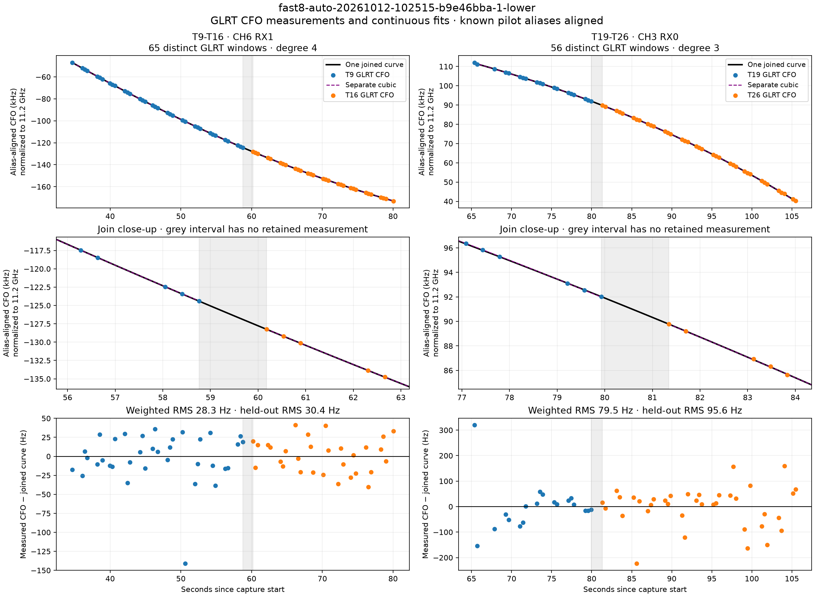
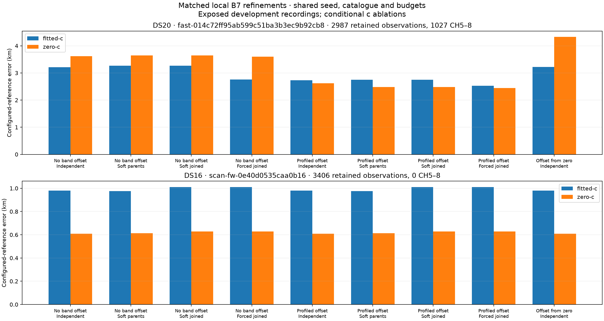
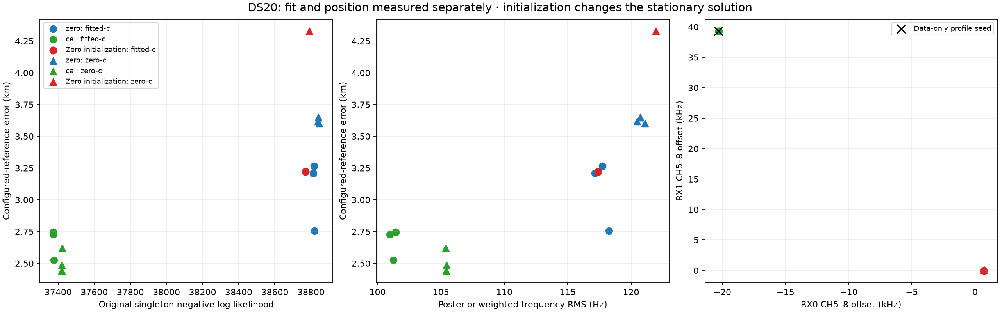
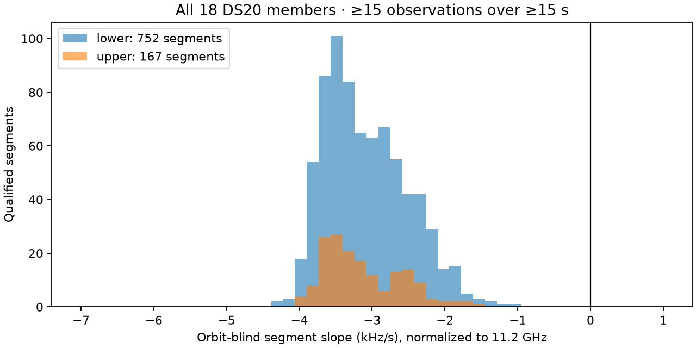

# Band calibration and continuous track merging

Joint receiver/band calibration improves the first exposed DS20 local example in both RF-coefficient arms. Soft joining adds essentially no benefit over keeping the original parent groups once that calibration is fitted. A generally improving merge algorithm is **not yet qualified**: full-search transfer and randomized whole-recording comparisons remain necessary, and DS15 still lacks an authoritative membership manifest.

This update records all 36 stationary fits in the matched local panel, including the poor zero-initialization results and the DS16 regressions. Automatic analysis defaults and recording products are unchanged. No RF collection was started.

## What the measured curves support

The two investigated pairs from `fast8-auto-20261012-102515-b9e46bba-1-lower` still support continuous same-lane proposals. The plot below uses the exact saved curve coefficients and deduplicated measured GLRT CFO rows. Weighted residual RMS was independently recomputed and agrees with the evaluated receipts. It also corrects the earlier figure's small held-out-label discrepancies: the evaluated values are 30.4 Hz and 95.6 Hz.



T9/T16 on CH6 RX1 has fitted RMS 28.3 Hz with a quartic; T19/T26 on CH3 RX0 has 79.5 Hz with a cubic. Both have approximately 1.42 seconds between their retained boundary measurements. T19/T26's original supports share a boundary probe, but deduplication keeps its stronger candidate, so the resulting retained gap differs from the original support-gap receipt. The grey intervals contain no retained measurement; continuity there is inferred. Known integer pilot aliases are aligned, without independent offsets or slopes for the halves. These are trajectory proposals, not confirmed satellite identities. See [the verified summary](verified-anchor-summary.json) and [the original merge study](../2026_10_12_continuous_track_merge/README.md).

## Controlled local experiment

The panel uses the first DS20 and first DS16 recordings in the previously frozen development cohort, with no readiness or error filtering:

| Corpus | Recording | Retained observations | CH5–8 observations | Joined groups / parent groups |
|---|---|---:|---:|---:|
| DS20 | `fast-014c72ff95ab599c51ba3b3ec9b92cb8` | 2,987 | 1,027 | 7 / 15 |
| DS16 | `scan-fw-0e40d0535caa0b16` | 3,406 | 0 | 4 / 8 |

These are exposed development examples, not independent validation. Corpus membership remains all 18 DS20 and all 63 DS16 recordings. The earlier whole-recording randomized split uses NumPy PCG64 seed `20261012`; this local panel does not change those roles or claim that a random block check validates geographic accuracy. DS15 is retained as missing rather than substituted with another corpus.

Each condition starts from the same reference-free fitted-c B7 state and initial clock parameters, uses the same final catalogue, original prepared observation rows, RF carriers, timing, geographic prior, 25 km local box, and 90-second/600-iteration fit limits. A prepared observation contains the previously selected candidate for its window; this study does not recover every alternative from upstream GLRT products. All retained observations remain in the downstream likelihood, whether or not they belong to a proposed group.

The shared mark model compares independent rows, separate original parent groups, continuous joined groups with shared prior 0.5, and forced shared identity with prior 1.0. This is the experimental mark correlation model from [the consistency study](../2026_10_12_consistent_track_merge/README.md), with singleton detection-count terms retained. It is not a fully new physical detection-count model. Raw objectives from differently normalized group models are not interpreted as equivalent frequency-fit improvements.

Band calibration adds a prediction term

`predicted_CFO += gamma[receiver] * (channel >= 5)`.

Each receiver has its own high-versus-low constant offset in physical CFO Hz. This differs from the learned RF stretch coefficient `c`. The two band parameters have 25 kHz Gaussian priors and numerical scale 25, allowing ±50 kHz under existing generic coefficient bounds. They appear before the existing final two RF-time coefficients, preserving all satellite parameter slices and the established c=0 locks. Only receivers with both channel groups get parameters; the DS16 control has no high-band rows and therefore no added parameters.

A reference-free frequency-likelihood profile supplies a common gamma seed: RX0 −20,320 Hz and RX1 +39,315 Hz. It evaluates a ±50 kHz grid at 500 Hz spacing, then 50 Hz and 5 Hz refinements, with the same 25 kHz prior. Every enabled condition uses that seed. The additional zero-seed control fits the same independent calibration model from gamma=0.

Both `c=0` and fitted-c are evaluated for every condition. The c=0 arm locks the RF stretch and both RF-time terms to zero; it does not disable independent band calibration. Both arms share the fitted-c upstream discovery and final bank. This is a **conditional c ablation**, not a separate zero-c discovery run. Reference coordinates are read only after all 18 numerical fits per recording are sealed.

## Position results

Distances use the configured operator/pipeline reference, not a surveyed capture GPS fix. The original reference authorities and result hashes are recorded in the receipts.

| DS20 condition | Fitted-c error (km) | c=0 error (km) |
|---|---:|---:|
| No band offset, independent | 3.209 | 3.619 |
| No band offset, soft parents | 3.266 | 3.648 |
| No band offset, soft joined | 3.265 | 3.648 |
| No band offset, forced joined | 2.755 | 3.604 |
| Profiled band offset, independent | **2.728** | **2.621** |
| Profiled band offset, soft parents | 2.747 | 2.484 |
| Profiled band offset, soft joined | 2.747 | 2.484 |
| Profiled band offset, forced joined | 2.525 | 2.444 |
| Band offset fitted from zero, independent | 3.221 | 4.328 |



Fitting band calibration with independent marks reduces the DS20 error by 481 m with fitted-c and 998 m with c=0. That is a directly evaluated improvement on this local example, not a general localization guarantee.

With band calibration, the soft parent and joined conditions differ by less than 0.4 mm in reference error. Their original singleton likelihoods also agree to approximately 10⁻⁶. Their differently normalized shared objectives differ; that score change supplies no measurable localization gain. The useful change in this example is chiefly calibration, rather than joining itself.

Forced sharing gives the lowest DS20 errors in this panel, but is not promoted. On DS16, independent marks give 981/608 m, soft parents 976/614 m, and soft or forced joining 1,011/627 m. Thus joining worsens this control by approximately 30/19 m. Every corresponding enabled/disabled calibration result is exactly identical on DS16, as expected when there are no high-band observations. That is a compatibility control, not high-band validation.

## Frequency evidence and numerical initialization

| Independent DS20 condition | Fitted-c singleton NLL | c=0 singleton NLL | Fitted-c frequency RMS (Hz) | c=0 frequency RMS (Hz) |
|---|---:|---:|---:|---:|
| No band offset | 38,814.197 | 38,840.001 | 117.140 | 120.480 |
| Profiled band offset | 37,375.152 | 37,422.216 | 100.969 | 105.362 |
| Band offset from zero | 38,769.414 | 38,792.474 | 117.394 | 121.947 |

Frequency RMS is posterior-weighted at each solution. Responsibilities change, so it is not a residual comparison on a fixed subset. The expected signal responsibility mass rises from approximately 1,336 to 1,609 in the calibrated fitted-c independent condition; it is neither a count of new detections nor a count of satellites. The original singleton NLL provides a common mark formulation across group variants, with their actual calibrated parameters.



The fitted independent offsets are RX0 −20,290.7 Hz / RX1 +39,264.4 Hz with fitted-c, and −20,276.6 / +39,270.5 Hz with c=0. Their agreement across arms supports testing a constant band term separately from RF-dependent stretch. It does not prove the physical cause or long-term stability of those offsets.

The zero-seed control is stationary but finds RX0 approximately +718 Hz and RX1 approximately 0–114 Hz. Its c=0 position error is 4.328 km, worse than the original 3.619 km. Adding parameters alone is insufficient: the frequency likelihood has multiple stationary branches, and data-only profiling matters. Better in-sample likelihood does not imply better position accuracy; both are reported separately.

## Recovered reference and the full-search failure

The earlier report could not evaluate `fast-1836ee948f30c7b7a28a28c5b596dac2` because its reference product was absent from the global adapter root. Its own recovery directory contains a valid offline B7 product. The new read-only evaluator verifies that product's input digest against this recording before using its configured reference. It never borrows another recording's reference or changes an inference result.

The original and protected-join full searches both have **156.475 km fitted-c error and 154.073 km c=0 error**, despite frequency RMS approximately 127/134 Hz. They are identical results. This is a retained failure, not a missing-data exclusion; [the evaluation receipt](recovered-reference-evaluation.json) identifies the legitimate authority.

Local 25 km refinements cannot assess recovery from that basin. A separate frozen full-search experiment transfers the independent fitted-c band offsets from the first development recording into discovery, receiver-line calibration and all later B7 stages. Subtracting gamma from measured CFO is analytically equivalent to adding it to predicted CFO; component tests compare likelihood, gradients and responsibilities. RF carriers, times, marks, window IDs and stored raw products remain unchanged.

Four conditions cross fixed calibration on/off with protected joining on/off. They share the original full catalogue, 400-point search, priors and stage budgets. Each includes both conditional c arms. The donor fit uses no reference. A matching radio ID is required where high-band data exists, but stable LNB wiring and offsets remain explicit assumptions to test. Final candidate sets may change as an intervention consequence. The four searches for the recovery recording are running in bounded resumable slices; **no transfer accuracy result is claimed yet**.

The B7 cascade can retain different fallback stages for its two c arms. Final-stage and satellite-bank equality must therefore be checked before interpreting a controlled c comparison. If they differ, operational accuracy and failure outcomes will be reported separately, and a further matched-bank refinement is required for the c ablation. The completed local panel above already uses common banks and stationary models in both arms.

## Edge-sign check



Across every DS20 member, all 752 qualified lower-edge and 167 upper-edge segments have slopes below −200 Hz/s. Their median normalized slopes are −3,173 and −3,265 Hz/s. A simple uniform upper-versus-lower sign inversion is therefore not supported by these measured segments. This does not certify RF labels, alias choices, or every candidate. [The audit](edge-slope-sign-audit.json) retains per-recording tracks and source hashes.

## Reproduction and remaining work

[All 36 outcomes](local-ablation-results.json), [source hashes](source-provenance.json), and the compact [DS20](receipts/DS20/protocol.json) / [DS16](receipts/DS16/protocol.json) protocols bind executed code and inputs. Large raw-derived inputs and checkpoints stay under ignored `local/`. Executed sources extend commit `802fb26c43b40305d7974f1077a805f2c195266b`; publication preserves that scientific worktree rather than rebasing it onto unrelated newer code.

Use the existing scientific Python environment with `PYTHONPATH=src:tools` and one BLAS thread. The local tool refuses authority changes and output overwrites. Do not rerun `freeze` over existing protocols:

```bash
python setup.py build_ext --inplace
python tools/band_calibrated_merge_study.py freeze DS20 SESSION_ID
python tools/band_calibrated_merge_study.py execute DS20 SESSION_ID --variant cal-independent --arm fitted-c
python tools/band_calibrated_merge_study.py evaluate DS20 SESSION_ID
python tools/global_band_merge_study.py freeze DS20 SESSION_ID
python tools/global_band_merge_study.py execute DS20 SESSION_ID --mode cal-original --maximum-seconds 420
python tools/report_band_calibrated_merge.py
```

`execute` resumes verified checkpoints after a yielded slice. All four global conditions must finish and be sealed before their reference evaluator runs. `--reference-products` identifies an explicit public product root for recovery cases. The same prepared source and bank authorities must be available at the paths in the protocols.

The [recorded component check](test-results.txt) passes **59 tests**, covering band gradients, coefficient placement, c=0 locks, calibration-transform equivalence, continuous joins, shared marks, B7 model controls, bootstrap behavior and input preservation. Ruff passes for the new source and tools. No public persisted schema or production default changed.

Next work must complete calibration-transfer searches, compare merging after calibration on the fixed broader development cohort, and test an explicitly frozen candidate on randomized whole-recording validation. All failures and fallback stages stay in the denominator. DS15 needs its original membership authority before it can be included. Neither the attractive anchor curves nor one improved local DS20 case fulfills the requested corpus-level improvement.

The [initial validation batch](validation-selection.json) is now frozen: the first two session IDs per corpus within the existing randomized validation role, with no readiness or accuracy filtering. The DS20 members have 1,407 and seven high-band rows respectively; both remain included. Their four conditions use the same development-only donor calibration. Both DS16 members have zero high-band rows, so the fixed calibration transformation is exactly identity; their baseline and protected-join comparisons use the already frozen consistency runner. One DS20 validation member's four searches have started in bounded slices. No validation result is yet claimed. These exposed-data checks do not replace full corpus evaluation or the missing DS15 authority.
