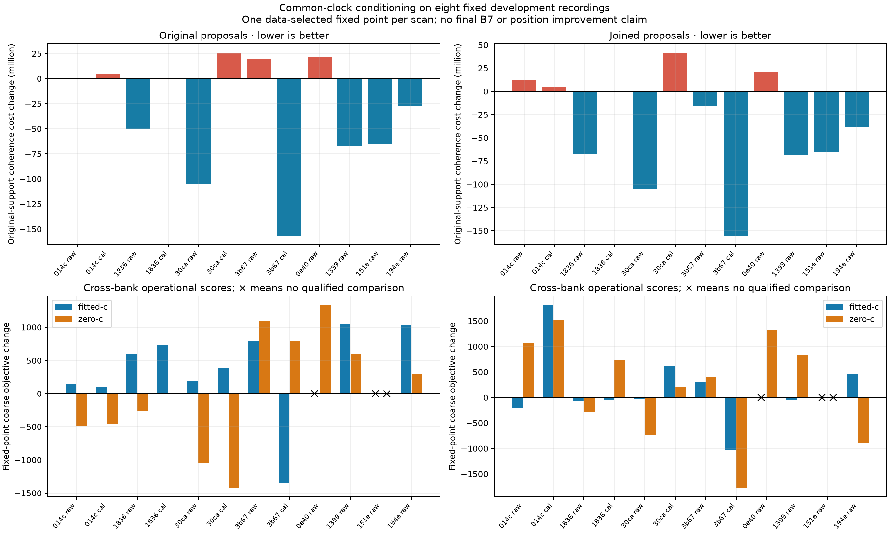

# Common clock conditioning and protected joins

The [profile-reuse and incumbent follow-up](../incumbent-clock/README.md) now retains original and intermediate states. All 96 fixed conditions return valid seeds without worsening their original coherence score; previous controls reproduce exactly. Profiling work is reduced, while 22 five-second explorations remain interrupted and coarse-frequency effects are mixed. Those improvements do not yet qualify localization.

Joint consideration of receiver drift and orbital shape resolves a constructed ambiguous-candidate example, but the first recording prototype remains unqualified. On eight fixed development recordings, all 48 initializer conditions execute; 87 of 96 subsequent coarse fits meet stationarity. Conditioning loses a better original clock seed in nine paired conditions, gives mixed coarse-frequency effects and exceeds the existing initializer budget in this experiment. These findings identify concrete requirements for the next version, rather than establish position improvement.

The [full-population curve census](../predictive-curves/README.md) showed that improved withheld curve prediction would still accept the known sparse position-regression join. Its receiver-drift probe changed 5–7 candidate preferences elsewhere in that scan. This experiment tests a coupled initializer in response. The full requested DS20/DS16 position comparisons and DS15 membership remain outstanding.

## The bounded initializer

Each pass subtracts a common slope for each receiver, profiles orbital shapes on the same original-plus-joined proposal pool, applies the existing protected-join rule, and estimates the receiver line from the selected matches. The returned seed restores the subtracted physical slope, preserving the original centered-time intercept convention. Absolute seed slopes are capped at ±50 Hz/s and clipping is recorded.

A zero-start alternating loop initially failed the synthetic test: a wrong candidate drove RX0 toward −50 Hz/s and reinforced itself. The tested prototype retains three starts, `(0,0)`, `(−20,−20)` and `(+20,+20)` Hz/s, with three passes and damping 0.5. No-conditioning controls perform the same nine passes with zero subtracted slope. Both use the same total bound and observation/proposal inventory.

Branch selection compares the **final pass** of each start using a common physical-frequency coherence cost. It uses the original selected proposal supports and fixed weights `sqrt(min(n,100))/n`, a 200 Hz soft-L1 residual loss, one common receiver intercept/slope and each proposal's preferred orbital candidate. Unqualified or invisible support receives a fixed penalty. A free constant for every individual track is not allowed in this branch comparison. Added joined support cannot lower this cost by changing the scoring inventory or weights.

This cost is a seed-selection diagnostic, not the subsequent singleton mixture likelihood. The coarse model permits soft candidate/clutter assignments and fitted RF stretch; lower coherence cost need not yield a lower coarse objective or a more accurate position.

## Matched recording experiment

The [protocol](protocol.json) retains the same first four DS20 and first four DS16 development members used previously. Each uses one common point selected by its earlier raw fitted-c baseline, including a recovered point for one DS16 recording. No reference position restricts inference. The initial orbit catalogue, observations, original/joined pool, priors and budgets match within comparisons.

Four modes cross original/protected-joined proposals with no-conditioning/alternating conditioning. DS20 additionally crosses raw CFO with the existing development-learned band correction, approximately −20.291/+39.264 kHz for RX0/RX1. The same-radio check is enforced; time-invariant correction and unchanged wiring remain assumptions. DS16 has no high-band rows, so redundant identity-correction runs are omitted.

Every initializer gets a 120-second bound. Both coarse c arms start from the same returned seed and candidate bank, fix the same trial point and use the same 20-second/600-iteration fitting bounds and priors. The c=0 coefficient and fixed positions are checked in the results. The shared point and donor correction previously came from fitted-c inference, so this is a conditional c comparison. This stage does not execute a full search, final B7 analysis or geographic validation.

## Results and failures stay in the comparison

| Measurement | Result |
|---|---:|
| Completed initializer conditions | 48 / 48 |
| Coarse fits meeting stationarity | 87 / 96 |
| Paired initializer comparisons | 24 |
| Conditioned seed has worse original-support coherence | 9 / 24 |
| Coarse comparisons with both fits stationary | 42 / 48 |
| Conditioning lowers coarse objective among those | 16 / 42 |
| Stationary comparisons retaining the same candidate bank | 8 |
| Lower coarse objective in those same-bank comparisons | 2 / 8 |
| Initializer wall time under two concurrent offline workers | 8.57–10.88 seconds |
| Passes recording slope clipping | 10 |

The plot displays coarse deltas only when both fits are stationary; crosses retain the unqualified comparisons. The [complete results](results.json) include all 96 attempts, stop reasons, stationarity values, branch scores, candidate sets, slope traces and a [numerical seal](numerical-seal.json). Cross-bank coarse differences are operational model effects, not same-bank fitting improvements. No failed state is relabeled as converged.

The nine nonstationary attempts occur in DS16 `0e40d053` and `151ee2be`. Several stop after the numerical optimizer reports success while the returned state fails the independent stationarity check. Others have large residual stationarity. They remain failures despite an attractive raw objective or successful initializer execution.

The nine coherence regressions expose a selection limitation: choosing the best **final** alternating branch can discard a better first-pass/original state. That original state is available at the zero-start branch's first pass. The report also records a retrospective incumbent rule choosing the lower-coherence original or conditioned seed before inspecting either c arm's coarse scores. It retains the control in those nine cases. This audits a safeguard using already-computed states and shared preprocessing work; it is not an executed production initializer, new geographic estimate or independent validation.

## Verification and next iteration

Five component tests verify recovery of known RX0/RX1 drifts and an ambiguous synthetic candidate, exact reproduction of the old initializer by no-conditioning controls, physical seed restoration, explicit invalid-budget handling and preservation of the original discovery alternatives in protected joins. The affected suite passes **55 tests** in 4.04 seconds; component and study/report tools pass Ruff checks. Original production defaults, persisted contracts and scientific fixtures are unchanged.

The next version must retain original and intermediate-pass incumbents, report rejected/failed branches, and avoid duplicated profiling work. The observed wall time exceeds the current five-second initializer bound under this experimental workload; an isolated timing check and optimization are required before a matched full-pipeline trial. Existing executed sources stay frozen, so that iteration needs a new module/protocol.

A better coherence score alone cannot qualify localization. Full trials must retain matched evidence, candidate/search policies and both c arms, then separately measure geographic outcomes on the preserved whole-recording split. No RF collection, hardware modification, QNAP mutation or production promotion occurred. Reproduction requires the built native orbit extension, scientific release Python, `PYTHONPATH=src:tools`, one BLAS thread and `clock_conditioned_merge_study.py`.
