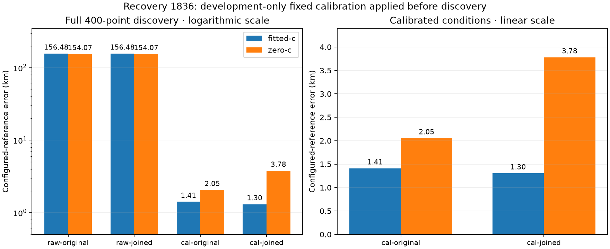
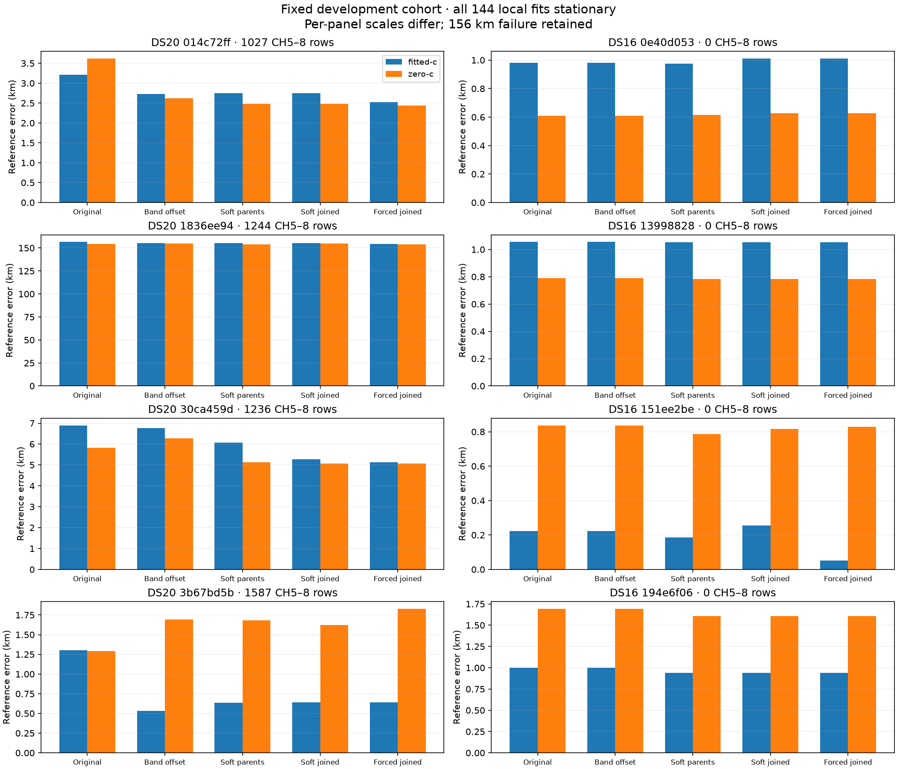
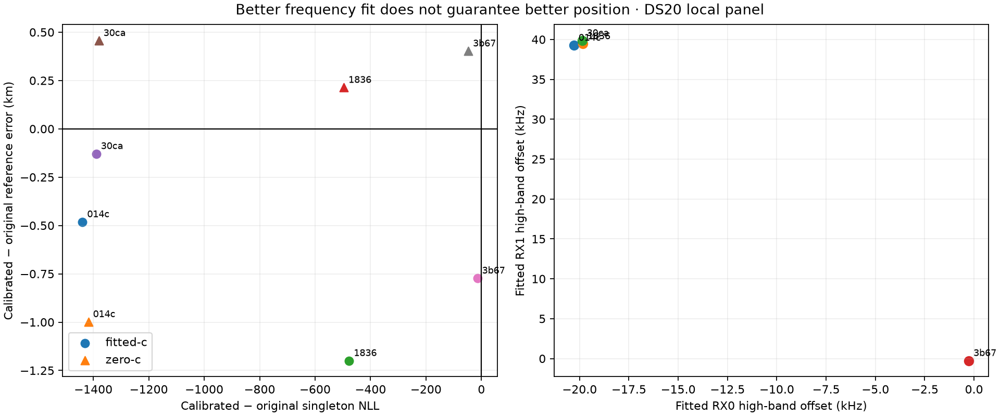

# Complete local cohort and first full calibration transfer

Applying development-learned band calibration **before discovery** recovers a failed DS20 full search: fitted-c reference error drops from 156.475 km to 1.410 km, and c=0 drops from 154.073 km to 2.052 km. Protected merging further improves fitted-c to 1.303 km but regresses c=0 to 3.779 km. This is one exposed development transfer, not a qualified corpus-wide merge algorithm.

The fixed eight-recording local panel also completes with **144/144 stationary fits**. It exposes improvements, regressions, and four inferior joined-model stationary solutions for which a feasible parent-model state already scores better under the exact same joined objective. No case is omitted. DS15 remains unavailable pending its original membership authority.

## Full-search transfer separates calibration from merging

The calibration donor is development recording `fast-014c72ff95ab599c51ba3b3ec9b92cb8`. Its independent fitted-c band model supplies RX0 −20,290.721 Hz and RX1 +39,264.367 Hz. Those values are fixed for every calibrated condition and both c arms of recipient `fast-1836ee948f30c7b7a28a28c5b596dac2`. They are learned from frequency evidence, never from the recipient's reference position. Radio IDs match; physical stability of the wiring and offsets remains an explicit assumption.

All conditions use the same 2,659 retained observations, initial full catalogue, 400-point discovery budget, priors, and stage budgets. The calibration is an exact measured-CFO translation equivalent to adding a prediction intercept for CH5–8; RF carriers and raw products remain unchanged. It enters discovery, receiver-line calibration, association, recovery, and final fitting rather than only the final local optimizer. The original and joined branches use the same proposal pool; the protected join gate preserves original local discovery candidates.

| Full pipeline condition | Fitted-c error (km) | c=0 error (km) | Final bank size |
|---|---:|---:|---:|
| Raw, original proposals | 156.475 | 154.073 | 14 |
| Raw, protected joined proposals | 156.475 | 154.073 | 14 |
| Fixed band calibration, original proposals | **1.410** | **2.052** | 23 |
| Fixed band calibration, protected joined proposals | **1.303** | 3.779 | 22 |

All eight outputs are stationary B7 fits. Each condition's two c arms have identical satellite banks and accepted stages, verified in [the bank checks](global-recovery/c-arm-bank-checks.json). Both arms share fitted-c discovery, and fixed calibration remains available in the c=0 arm. This is a conditional RF-coefficient ablation, not independent zero-c discovery. The initial catalogue is common across interventions; final candidate sets differ as a downstream consequence. These catalogue numbers are numerical model choices, not independently confirmed satellite identities.

The same recording's verified offline B7 product supplies its configured operator/pipeline reference after all four numerical searches are complete and sealed. It is not a surveyed capture GPS fix. [The evaluation](global-recovery/evaluation.json), [protocol](global-recovery/protocol.json), and [seal](global-recovery/evaluation-seal.json) retain that authority and every result.

| Condition | Fitted-c frequency NLL | c=0 frequency NLL | Fitted-c posterior RMS (Hz) | c=0 posterior RMS (Hz) |
|---|---:|---:|---:|---:|
| Raw original | 35,771.673 | 35,816.252 | 127.303 | 133.955 |
| Calibrated original | 30,510.208 | 31,057.187 | 108.229 | 137.067 |
| Calibrated joined | 30,078.233 | 30,848.285 | 107.289 | 144.589 |

These are operational frequency metrics with each condition's actual final bank and responsibilities. They are not a fixed-subset residual comparison. In particular, calibrated merging lowers c=0 NLL while worsening both position error and posterior RMS. Lower frequency score alone cannot justify the join.

Local calibration at the old bad state left approximately 155 km of error. Full calibration-aware discovery instead selects a different region and bank and reaches approximately 1–2 km. That distinction is direct evidence that calibration must be tested upstream of the initial basin selection in this case.

## Fixed eight-recording local panel

The cohort remains the first four session IDs per corpus within the already frozen development role, independent of readiness or accuracy. It extends the [first two-case experiment](../README.md) using exactly the same nine variants, two c arms, common data-selected fitted-c B7 seed per recording, common final bank, 25 km local box, priors, and 90-second/600-iteration budgets. All 144 fits are stationary. These previously exposed development recordings are not independent validation.

The table reports independent marks before/after band calibration and soft joined marks after calibration. Complete parent, forced-sharing and zero-initialization controls are retained in [the results](results.json) and per-case receipts.

| Recording prefix | Fitted-c original → calibrated → joined (km) | c=0 original → calibrated → joined (km) |
|---|---|---|
| DS20 `014c72ff` | 3.209 → 2.728 → 2.747 | 3.619 → 2.621 → 2.484 |
| DS20 `1836ee94` | 156.475 → 155.276 → 155.229 | 154.550 → 154.764 → 154.962 |
| DS20 `30ca459d` | 6.891 → 6.762 → 5.271 | 5.824 → 6.280 → 5.067 |
| DS20 `3b67bd5b` | 1.305 → 0.532 → 0.640 | 1.290 → 1.693 → 1.625 |
| DS16 `0e40d053` | 0.981 → 0.981 → 1.011 | 0.608 → 0.608 → 0.627 |
| DS16 `13998828` | 1.054 → 1.054 → 1.051 | 0.789 → 0.789 → 0.784 |
| DS16 `151ee2be` | 0.223 → 0.223 → 0.256 | 0.837 → 0.837 → 0.815 |
| DS16 `194e6f06` | 1.002 → 1.002 → 0.937 | 1.692 → 1.692 → 1.605 |

The local c=0 fits always start from the common fitted-c state with RF terms projected to zero. They can find a different stationary solution from the deployed c=0 cascade, explaining the recovery recording's 154.550 km local control versus its 154.073 km operational control. These are distinct experiments, not interchangeable baselines.

Calibration reduces original singleton NLL for all four DS20 cases in both c arms. Fitted-c position error improves in all four, but c=0 accuracy improves in only one. All four DS16 cases have zero high-band observations and calibration is exactly a no-op; they test compatibility rather than high-band behavior.

To isolate joining itself, compare soft joined groups with soft original parent groups under the same band calibration. In DS20 `30ca459d`, joining improves error by 789 m fitted-c and 56 m c=0. In recovery `1836ee94`, its c=0 error worsens by 1,167 m. DS16 `151ee2be` worsens by 71/28 m. Several remaining differences are effectively zero. These outcomes do not support unconditional joining or universal forced sharing.

The fitted independent band offsets cluster near −20/+39 kHz in three DS20 recordings. The fourth, `3b67bd5b`, has 1,587 high-band rows but prefers offsets near −264/−262 Hz in this conditional local model. Its profile seed is zero. Therefore one data-selected calibration fit cannot establish universal physical offset stability. Candidate bank, existing clock/RF/satellite nuisance terms and initialization can affect the preferred band parameters; the cause of this discrepancy still needs investigation.

## A real group-authority bookkeeping error

The previous shared-mark experiment helper identified a proposed join by checking whether it was absent from the baseline's selected bootstrap tracks. That selected inventory is limited to the longest 12 tracks per receiver. Joining can free a quota slot and admit a previously unselected **original segment**. Absence from the baseline selection does not imply that the segment was merged.

This caused preparation errors in DS20 `30ca459d` and DS16 `194e6f06`: one and two newly selected original segments respectively were mistaken for joins with unknown parents. The corrected helper compares against the full original segment inventory, then requires explicit parent identities for actual joined components. Unknown or ambiguous true joins still fail. Shared boundary rows stay independent, and both parent and joined groupings cover the same rows. All observations remain in the likelihood.

The fix is a new pure analyzer with five component tests and a new group freezer. Already executed source files, protocols and first-case results are unchanged. The corrected cases' `group-authority.json` receipts record the newly admitted originals. This repairs the experiment preparation; it is not claimed as a production localization improvement.

## Joined optimization can lose a better feasible state

The [same-objective start audit](joined-parent-start-audit.json) evaluates the saved soft-parent state and saved soft-joined state under the identical joined model, bank, observations, priors and c locks. No geographic reference participates. Four of 32 comparisons have a better feasible parent state even though the joined fit is stationary:

| Recording | Band calibration | c arm | Joined objective improvement already available at parent state |
|---|---|---|---:|
| DS20 `1836ee94` | Off | c=0 | 34.616 |
| DS20 `1836ee94` | On | c=0 | 66.639 |
| DS20 `30ca459d` | On | Fitted-c | 0.725 |
| DS20 `30ca459d` | On | c=0 | 4.652 |

This verifies a start-dependent optimization limitation; stationarity does not certify the best available solution. Transporting and scoring feasible incumbent states is a concrete next experiment. A parent state is not automatically stationary under the joined model, so it must not simply be relabeled as a converged joined result. Refinement must preserve the original local bounds, candidate bank, priors and budget, and measure geographic effects separately from its guaranteed opportunity to improve frequency objective.

## Validation and remaining scope

The [fixed validation batch](../validation-selection.json) retains two DS20 and two DS16 members from the existing whole-recording random split, seed `20261012`. All four comparisons are now running: four calibration/join conditions per DS20 member, and original/protected-join conditions per DS16 member. DS16 has no high-band rows, so redundant identity calibration runs are avoided. The sparse DS20 member with seven high-band rows remains included. Calibration preprocessing for these comparisons uses the single frozen development donor, never a validation fit or reference.

The full original scope remains all 18 DS20 and all 63 DS16 recordings, plus DS15 once its authoritative manifest is supplied. This initial development/validation panel does not replace those populations. No validation accuracy claim, general calibration-transfer claim, or automatic merge promotion is made here.

The affected component suite passes **64 tests**. Sources and inputs are pinned in the receipts; numerical outputs were sealed before their reference evaluation. Tools are `freeze_band_cohort_groups.py`, `evaluate_band_cohort_case.py`, `audit_joined_parent_starts.py`, and `report_band_merge_cohort.py`. Run with the scientific Python environment, built native orbit extension, `PYTHONPATH=src:tools`, and one BLAS thread. Reusing frozen cases must verify their bindings rather than overwriting them. Production defaults, public schemas, QNAP paths, and hardware were unchanged.
