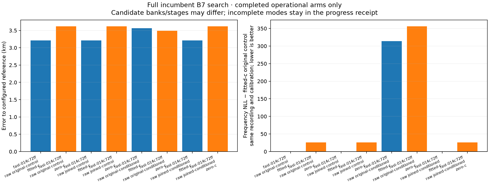
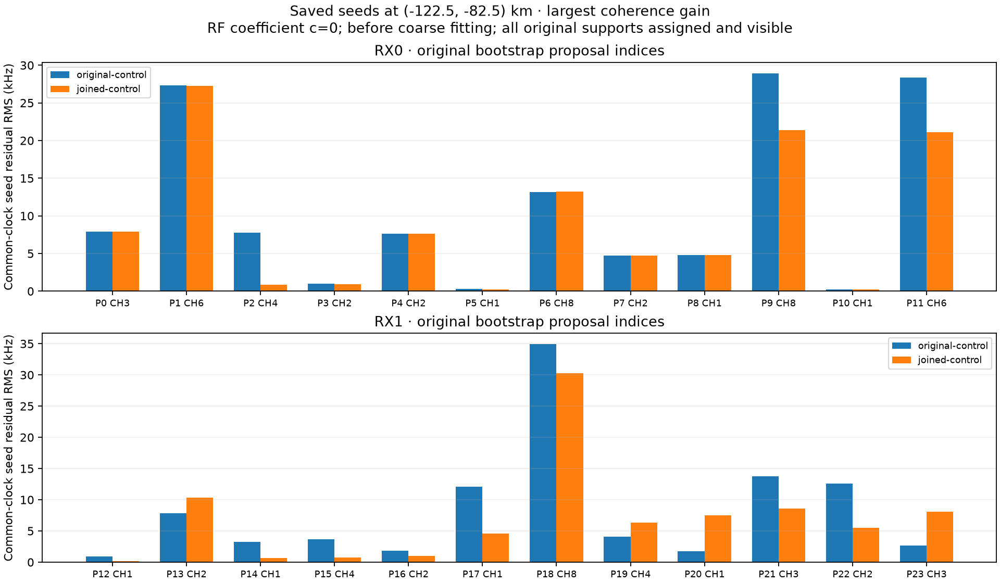

# Full position comparison of retained clock seeds

This experiment moves the [seed-retention repair](../incumbent-clock/README.md)
from fixed-point frequency checks into the full B7 position pipeline. The first
full unmerged/joined pair is complete and produces identical final positions and
scores in both c arms. The unmerged control also reproduces all 400 previous
bootstrap seeds exactly. The conditioned unmerged mode is also complete, with
mixed position effects and worse operational frequency objectives. The joined
conditioned mode remains in progress; no general geographic improvement is
established yet.

## First completed pair

For DS20 `fast-014c72ff95ab599c51ba3b3ec9b92cb8`, the raw original-control
and raw joined-control conditions complete the full search. All four final arms
accept stationary B7 solutions with the same 17-candidate bank:

| Mode | Arm | Error to configured reference | Frequency NLL | Total objective |
|---|---|---:|---:|---:|
| Original | Fitted c | 3.209 km | 38,814.197 | 38,882.695 |
| Joined | Fitted c | 3.209 km | 38,814.197 | 38,882.695 |
| Original | c=0 | 3.619 km | 38,840.001 | 38,904.946 |
| Joined | c=0 | 3.619 km | 38,840.001 | 38,904.946 |

These are control results, not a merge gain. All 400 shared search points have
the same ordered catalogue identities and exact seed vectors as the earlier
unmerged full control: zero bank differences, zero vector differences and zero
failed prior points. The [progress receipt](progress.json) pins that oracle's
terminal, bank, protocol and per-point input hashes. It also retains every one
of the 48 planned conditions, including all unfinished modes. Current progress
is three completed/evaluated conditions and no terminal failures.

Across the joined search's 400 bootstrap points, 276 retain the original seed
and 124 choose a joined pass, without interruption. Both final arms come from
the same baseline basin, `point:-77.5:-82.5`, whose initializer retains the
original seed. The joined pass at that point has slightly worse coherence
(380,564,909.520 versus 380,523,687.713), so incumbent selection preserves the
control route. Other point-level improvements therefore do not change the
winning final solution in this recording.



The frequency panel shows NLL relative to the fitted-c original control for the
same recording and calibration. It separates frequency-fit changes from error
to the configured receiver reference, which is evaluation metadata rather than
surveyed ground truth. No incomplete condition is plotted as a completed result.

The [numerical seal](numerical-seal.json) is written before opening reference
stores. The report independently retains operational accepted stages and the
latest stage at which both c arms are stationary, selected by the frozen stage
order rather than accuracy. If an operational fallback differs, a same-stage
comparison remains explicit instead of conflating the two models.

## Conditioning without joining

The raw original-conditioned mode completes all 400 search points and accepts
stationary B7 solutions in both arms, with the same 19-candidate bank within
that mode. It produces mixed changes relative to the unconditioned control:

| Arm | Original control error | Conditioned error | Error change | Conditioned frequency NLL |
|---|---:|---:|---:|---:|
| Fitted c | 3.209 km | 3.567 km | +358 m | 39,128.071 |
| c=0 | 3.619 km | 3.489 km | −129 m | 39,170.204 |

Operational frequency NLL rises by 313.874 / 330.204 and total objective by
311.677 / 330.824 for fitted-c / zero-c. The final bank changes from 17 to 19
candidates, losing 48356 and 67334 and adding 54102, 55302, 56547 and 61204.
Those are inferred assignments, not verified emitters. Cross-bank differences
are operational effects, not isolated fitting gains under an identical model.
Within each mode, both c arms retain the same observations, final bank, priors
and budgets and accept the same B7 stage. Conditioning alone is therefore not
a qualified repair. The corresponding joined-conditioned comparison is pending.

The conditioned mode needs four bounded slices, totaling 2,257.646 seconds of
recorded worker execution, compared with 537.935 seconds for the unconditioned
control. This is observed work for this case, not a controlled host-performance
benchmark or a strict wall-time guarantee. Full nine-pass exploration usually
does not fit the five-second per-point allowance; completed incumbents remain
valid and interruption events stay explicit.

## A point-level gain is not a position gain

The [saved-seed diagnostic](seed-score-audit.json) selects the largest coherence
gain among the first joined search's 400 points, at `(-122.5, -82.5)` km. It is
a posthoc development diagnostic and uses no geographic reference or refitting.
Both seeds retain the same 14-candidate bank; every original support is assigned
and visible, so neither has an unmatched/invisible penalty contribution.

| Quantity | Original seed/path | Joined seed/path |
|---|---:|---:|
| Fixed-support coherence cost | 592,016,185.077 | 494,242,970.657 |
| Actual mixture seed frequency NLL | 43,983.182 | 43,469.528 |
| Saved stationary coarse objective | 42,248.932 | 41,761.381 |
| RX1 clock-seed slope | −50.000 Hz/s | +8.369 Hz/s |
| Candidate 66484 timing seed | −14 s | −12 s |

Joining changes coupled timing and clock initialization at this point. RX1 moves
off its drift bound, while some original proposal residuals improve and others
worsen. Those are numerical seed estimates, not measurements of the physical
clock or proof of correct satellite identities. The joint seed's frequency NLL
improves by 513.654 and its saved coarse objective by 487.552, but this point does
not become the winning position route.



These are residuals before coarse fitting, with c=0 in both seed vectors, and
no separately fitted constant for each proposal. They are not the residuals of
the smooth joined CFO curves or the final B7 solution. The saved production
coarse fits allow fitted c; their comparison is a same-bank operational path
diagnostic, not an additional paired coarse c ablation. Both final c arms remain
matched in the full experiment above. All numeric contributions reproduce the
frozen coherence function and saved point scores with explicit closure checks;
the diagnostic source, snapshot inputs and figure hashes are retained.

## Matched inference and scope

The [frozen protocol](protocol.json) retains the same eight development
recordings, original whole-recording roles, observation inventories, initial
catalogues and priors. It excludes the earlier data-selected points and runs
the original 400-point search and recovery policy. Four modes cross original
versus guarded joined bootstrap proposals with unconditioned versus conditioned
clock initialization. Every mode retains original and completed intermediate
seeds, with the existing five-second bootstrap allowance per search point.

DS20 runs both raw and fixed development-donor band corrections; DS16 runs raw
observations because these recordings have no high-band rows. The donor and
same-radio/time-invariance assumptions are inherited from the earlier experiment.
Raw persisted measurements and RF tags remain untouched. Candidate banks may
change across modes as a consequence of initialization and discovery.

Within each condition, c=0 and fitted-c final arms share observations, the final
candidate bank, priors and fitting budgets. Upstream discovery uses fitted c,
so this is a conditional final-stage ablation. Different accepted fallback stages
must be identified and compared at a common stage where available; an operational
fallback is not a controlled model comparison by itself. Frequency scores and
geographic errors will be reported separately after the numerical terminals are
sealed. Reference coordinates do not enter protocol creation or execution.

Workers run in bounded resumable slices of 30–600 seconds. Immutable, checksummed
checkpoints preserve completed work between slices; a yielded slice is not a
completed position search. Compact per-point bootstrap audits retain all events,
interruption status, selected catalogue order and seed vectors. Failed numerical
conditions stay explicit. The first condition is DS20
`fast-014c72ff95ab599c51ba3b3ec9b92cb8`, raw original-control.

Four tool checks verify original observation/RF identity, audit preservation,
whole-recording roles, exclusion of earlier selected points and refusal to replace
a frozen protocol. They pass in the scientific and publication checkouts, alongside
69 previously verified affected analysis/application checks. The frozen numerical
components, production defaults, golden fixtures and hardware remain unchanged.

Reproduce with the built native orbit extension, scientific release Python,
one BLAS thread and `PYTHONPATH=src:tools`:

```bash
python tools/full_incumbent_merge_study.py freeze
python tools/full_incumbent_merge_study.py execute \
  --dataset DS20 --session-id fast-014c72ff95ab599c51ba3b3ec9b92cb8 \
  --calibration raw --mode original-control --maximum-seconds 300
```

The protocol already exists in the executed scientific tree; resume with
`execute`, and do not repeat `freeze` there. The current panel is exposed
development evidence, not a fresh validation set or whole-corpus qualification.
Full DS20/DS16 geographic comparisons and the authoritative DS15 membership
remain outstanding. No new RF collection or QNAP write is required.

The [posthoc report tool](../../../tools/report_full_incumbent_merge.py) has
four additional checks for common-stage fallback selection, matching parameter
inventories and locked RF terms, append-only numerical sealing, and catalogue
identity in control comparisons. These pass in both checkouts. Reports can be
regenerated as terminals accumulate; changing a previously sealed terminal
fails verification. Numerical sources and inference protocols remain frozen.
