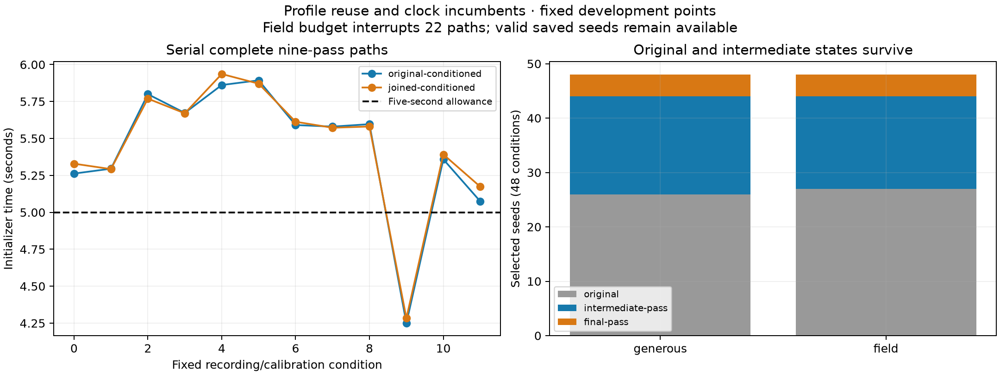

# Profile reuse and clock incumbents

The initializer now retains a complete original seed and every completed intermediate clock pass. On all 96 fixed development conditions it returns a seed with no greater original-support coherence cost than its original witness. Shape/seed separation also reproduces the previous control seeds exactly while removing repeated profiling. This fixes the measured seed-loss defect. It does **not** qualify position improvement: subsequent coarse objectives improve in some cases and worsen in others, and most conditioned paths exceed the five-second allowance if completed in full.

The [previous clock experiment](../clock-conditioned/README.md) lost better original seeds in nine conditions because it scored only final passes. The new implementation leaves that executed source untouched and uses separate pure analysis modules. Full DS20/DS16 geographic comparisons and DS15 membership remain outstanding.

## Preserve the original and all completed alternatives

The common original-plus-joined pool is profiled once per distinct conditioning slope. Selected matches are reused to build a clock seed; the unused pool clock and second selected-track shape profile are removed. Tests require the same candidates, timing gauge, alias behavior and seed vector as the existing public bootstrap oracle. The continuity-pass prediction count falls from 44 to 22.

Before joining or conditioning, the original unmerged seed is constructed and scored. Every completed policy pass then enters selection using the same original supports, fixed weights and physical common-clock coherence cost as before. Near-ties retain the earlier state. Exact repeated conditioning slopes reuse completed passes and their scores. The no-conditioning control therefore needs one real profile rather than nine identical repetitions.

The first complete original seed has priority. A failed branch is recorded; an exhausted work allowance can return an already completed incumbent, with `complete_path=false` and its interruption retained. That is a valid initialization proposal, not a completed exploration or a certified optimum. A call with no completed seed still fails explicitly.

## Matched serial benchmark

The [frozen protocol](protocol.json) keeps the same eight development recordings, earlier data-selected fixed points, initial catalogues, priors, raw/calibrated observations and common proposal pools. Three starts and three damped passes remain unchanged. Both generous 120-second and five-second allowances run serially on the same host.

Incumbent and final-pass choices use **one realized exploration path**, before inspecting either coarse c arm. Both arms share their choice's observation inventory, bank, seed, point, priors and 20-second/600-iteration bounds. Exactly identical coarse inputs reuse their paired outputs and are counted separately from unique optimizations. The point and band-calibration donor came from earlier fitted-c inference, so these remain conditional c comparisons.

| Measurement | Generous allowance | Five-second allowance |
|---|---:|---:|
| Valid returned seeds | 48 / 48 | 48 / 48 |
| Complete exploration paths | 48 / 48 | 26 / 48 |
| Complete conditioned paths | 24 / 24 | 2 / 24 |
| Interrupted paths retaining completed seeds | 0 | 22 |
| Previous control seeds reproduced | 24 / 24 | 24 / 24 |
| Maximum control-vector difference | 0 | 0 |
| Worse coherence than original witness | 0 | 0 |
| Selected original / intermediate / final state | 26 / 18 / 4 | 27 / 17 / 4 |
| No-conditioning wall time | 0.480–0.683 s | 0.477–0.686 s |
| Conditioned wall time | 4.250–5.936 s | 4.308–5.029 s |

The five-second checks occur between numerical operations; atomic operations can finish slightly beyond the allowance, as the measured maximum shows. No strict real-time guarantee is claimed. The earlier prototype took 8.57–10.88 seconds under two concurrent workers. That workload differs from this serial benchmark, so the exact timing ratio is not a controlled speedup estimate; the eliminated duplicate prediction calls are verified independently.

All 96 numerical receipts, including every interrupted path and completed packet, remain in the [numerical seal](numerical-seal.json). The [compact results](results.json) retain execution events, scores, selected origins, candidate sets, coarse fits, exact-input reuse and oracle checks. Full candidate packets remain in the sealed local authorities. Unsupported states are not silently promoted.

## Coarse frequency effects remain mixed

| Incumbent versus final-pass comparison | Generous | Five-second |
|---|---:|---:|
| Logical coarse attempts | 192 | 192 |
| Unique optimizations after exact-input reuse | 148 | 148 |
| Stationary unique optimizations | 138 / 148 | 136 / 148 |
| Paired comparisons with both fits stationary | 86 | 84 |
| Changed stationary comparisons: lower / higher objective | 25 / 24 | 22 / 25 |
| Changed same-bank comparisons: lower objective / total | 11 / 16 | 10 / 14 |

The remaining stationary comparisons reproduce exactly reused inputs. Candidate sets can change between selected seeds, so cross-bank objective differences are operational effects rather than pure fitting gains. Within each selected state, c=0 and fitted-c use the same bank and other conditions; c=0 locks the RF coefficient and both fixed points are checked. All nonstationary attempts remain in the results.

A hard preferred-candidate coherence cost is not the subsequent soft candidate/clutter likelihood with optional RF stretch. Consequently, preserving the best coherence state can still give a worse coarse objective. Neither metric establishes geographic accuracy. This experiment executes no global search or new final B7 position estimate.

## A separate reliability question in the known sparse failure

A [posthoc margin audit](sparse-margin-audit.json) checks the previously exposed validation recording `fast-43ce59233fe914e1d273ee584efcd405`, outside this development experiment. Its 4,267 low-band rows have median fractional GLRT margin **0.485**, while seven high-band rows have median **0.0283**. Five of those seven are below 0.033. These margins are not calibrated signal probabilities.

Inspection confirms that the frozen Hard60 frequency likelihood accepts measured frequency, predictions, visibility and a common score configuration; it does not directly consume GLRT margins. Margins do influence upstream winning-candidate selection and curve weights. Effective frequency responsibilities still vary with residual and visibility, so this is not a claim that all rows have equal final weight.

The quality contrast motivates testing calibrated observation reliability and RF-state uncertainty alongside initialization. It does not establish that weak rows are false, justify dropping them automatically, or prove a physical retuning fault. The current RF/LNB reference hypotheses remain unchanged and actual switch state is not attested by these numeric-equivalence tests.

## Verification and next work

Eleven new component tests cover exact profiling/seed reconstruction across aliases, visibility and the timing gauge; reduced prediction work; early-state retention; deteriorating later estimates; interrupted branches; pure repeated-pass reuse; and invalid inputs. The affected suite passes **66 tests** in 5.28 seconds. The model, study and report tools pass Ruff checks. Existing executed algorithms, contracts, golden fixtures and production defaults remain unchanged.

This repairs numerical seed retention and reduces profiling work. A bounded full-pipeline comparison must now test geographic effects, retaining both c arms and the preserved whole-recording roles. Further source-reliability and RF-state diagnostics should use the existing corpus and independent signal evidence. No new RF collection, hardware change or QNAP write occurred. Reproduce with the built native orbit extension, scientific release Python, one BLAS thread, `PYTHONPATH=src:tools` and `incumbent_clock_merge_study.py`.
