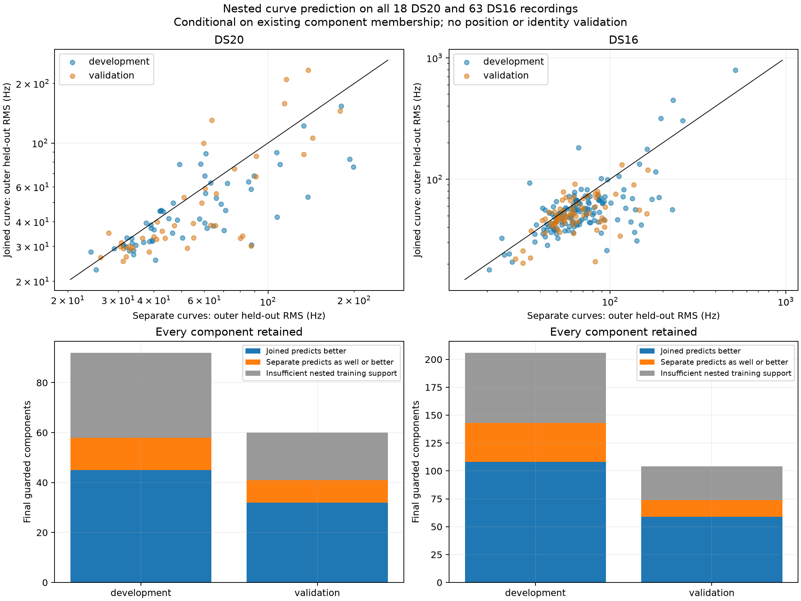
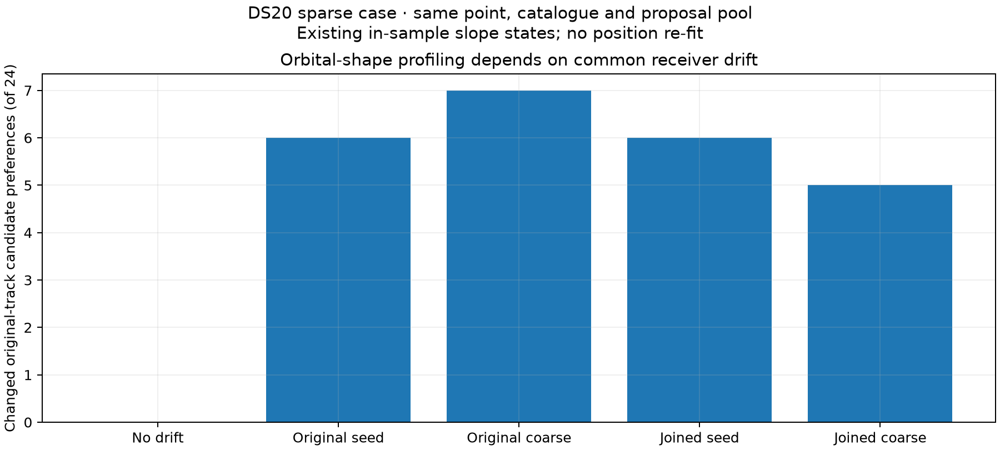

# Nested curve prediction and receiver drift

Continuous joins often improve withheld frequency prediction across the pinned DS20 and DS16 populations, but that improvement does not identify the known sparse-case position regression. The stricter curve test supplies trajectory evidence, not a reliable rule for selecting the better position solution. A separate fixed-point probe shows that common receiver drift changes several orbital candidate preferences, motivating joint clock and candidate profiling as the next algorithm experiment.

This comparison covers **all 18 DS20 and all 63 DS16 recordings** in the original membership authority. It does not expand the earlier position experiment to all 81 recordings. DS15 still needs its original membership authority. The [previous downstream investigation](../refinement/README.md) retains the position comparisons and their controlled c=0/fitted-c arms.

## A separate outer prediction test

The existing continuity guard selects degree 2, 3 or 4 using blocked prediction errors. This diagnostic adds an outer split so that degree selection occurs wholly inside training data. Joined and separate curves use identical withheld observations and fixed GLRT weights.

Outer validation uses five folds and two repeats over whole 2-second time blocks, NumPy PCG64 seed `20261013` plus repeat index. Blocks remain shared across all parents in a component. Inner selection uses three folds over the outer training blocks, seed `20262013` plus repeat index. Each arm chooses the least flexible degree within 10% plus 5 Hz of its best inner RMS. Separate parents have separate coefficients but one common selected degree.

Unwrapping and integer alias alignment use training observations only. Predictions use circular CFO residuals at the lane's known pilot alias spacing; the joined curve has no independent segment offset or slope. Shared source probes are deduplicated by fixed GLRT weight and candidate ID before splitting. The downstream observation inventory remains unchanged.

Original track/component selection and passing GLRT membership were already computed from the whole recording. These are therefore **conditional curve prediction checks**, not independent discovery validation or unbiased end-to-end holdout error. The whole-recording development/validation roles remain the original randomized assignments, seed `20261012`; these exposed corpora are not untouched validation data. No validation reference position trains a threshold.

The [protocol](protocol.json), [numerical seal](numerical-seal.json) and [complete compact results](results.json) retain every recording, component, fold assignment, degree choice, score and unsupported case. Full per-row predictions remain in the sealed local authorities. Multi-parent component counts differ from pairwise join counts.

## All corpus members are retained

| Corpus and role | Recordings | Components | Testable / unsupported | Joined predicts better | Median separate minus joined RMS (Hz) |
|---|---:|---:|---|---:|---:|
| DS20 development | 12 | 92 | 58 / 34 | 45 / 58 | +5.97 |
| DS20 validation | 6 | 60 | 41 / 19 | 32 / 41 | +5.95 |
| DS16 development | 42 | 206 | 143 / 63 | 108 / 143 | +9.26 |
| DS16 validation | 21 | 104 | 74 / 30 | 59 / 74 | +6.91 |

Of 462 final guarded components, 316 support the nested test and 244 predict better when joined. Gains exceed 5 Hz in 186 components; separate curves beat joined curves by more than 5 Hz in 40. The 146 unsupported components all lack a trainable degree in at least one outer fold after the inner split. They remain in the denominators and are not classified as successful joins. This demanding split limits coverage of short fragments; it does not establish different satellite identities.

Components within a recording are correlated. These counts and medians are not independent sample counts, confidence intervals, geographic gains or measured false-join rates. This census fits no position, orbit bank or RF-dependent `c` term.

## Better curves do not repair the sparse position regression

The previously investigated CH2 RX1 join in `fast-43ce59233fe914e1d273ee584efcd405` has nested RMS **38.32 Hz joined versus 65.60 Hz separate**, a 27.28 Hz gain. Both repeats favor joining: 37.61 versus 74.48 Hz and 39.04 versus 56.71 Hz. The [sparse receipt](sparse-regression.json) retains its folds and selected degrees.

Nevertheless, the previously sealed calibrated position results regress from 0.842/0.051 km with original proposals to 1.735/1.820 km with joined proposals, for fitted-c/c=0 respectively. Those comparisons use stationary B7 stages and matching banks within each c pair. No new position is inferred here: a rule requiring improved withheld curve prediction would still accept this problematic initialization change. Complete-parent candidate agreement and preserved inherited weights also failed to isolate it in the preceding audits.

The originally inspected anchors are retained separately because they were selected examples outside this census:

| Pair | Joined outer RMS | Separate outer RMS | Interpretation |
|---|---:|---:|---|
| T9–T16, CH6 RX1 | 29.66 Hz | 28.50 Hz | Smooth join remains plausible; no predictive advantage in this split |
| T19–T26, CH3 RX0 | Unsupported | Unsupported | Insufficient nested training support; not a demonstrated discontinuity |

Original fitted RMS values and visual continuity are unchanged. The initial anchor runner terminated on the unsupported second pair before saving a receipt; a separate receipt runner preserves both outcomes and both source hashes. The small 1.16 Hz disadvantage on CH6 does not establish that the join is wrong.

## Common receiver drift changes candidate preferences

The bootstrap profiles each track against orbital predictions after removing a free constant, then estimates a common receiver line from the selected matches. Its shape match does not first account for common receiver drift. The [sensitivity probe](clock-shape-probe.json) holds the initial catalogue, proposal pool, timing search and trial point fixed, and subtracts existing RX0/RX1 drift states before rerunning shape profiles.

| Existing drift source | RX0 slope removed (Hz/s) | RX1 slope removed (Hz/s) | Changed preferences among 24 original tracks |
|---|---:|---:|---:|
| No drift | 0.000 | 0.000 | 0 |
| Original bootstrap seed | −12.834 | +15.960 | 6 |
| Original stationary coarse fit | −11.909 | −6.164 | 7 |
| Joined bootstrap seed | −12.834 | +13.804 | 6 |
| Joined stationary coarse fit | −9.814 | −4.957 | 5 |

The selected CH2 parent, added parent and joined proposal retain candidate 59296 at zero relative timing in all five profiles. Changing preferences occur elsewhere. Neither drift state is declared physically correct, and preferred candidates are not confirmed satellite identities. These are in-sample states from shared fitted-c discovery, not new clock fits, independent validation or a c ablation. The downstream calibrated c comparisons remain separately controlled.

This supplies a measured reason to test clock and orbital shape jointly. A bounded joint or alternating profile should retain competing original and joined starts, estimate common receiver drift consistently across tracks, and assess grouped predictive stability. Evaluation must preserve observations, initial catalogue, priors and work budgets, include both final c arms, and measure geographic accuracy separately from frequency fit. Preserving the original seed alone would reproduce the baseline: that is a causal control, not an improving algorithm.

## Verification and status

Five new component tests cover smooth versus stepped curves, integer-alias/input-order invariance, deterministic whole-block splits, invalid lane/configuration rejection, and unchanged training predictions and degree choices when only an outer fold's measured values change. The affected suite passes **50 tests** in 1.94 seconds. The component, tests and new receipt/report tools pass Ruff checks; the frozen census runner retains one descriptive-string length warning. Executed numerical models remain unchanged.

All 81 recording receipts complete in one bounded 497-second offline slice. No RF collection, hardware change, QNAP mutation, default change or golden-fixture update occurred. Reproduction uses the scientific release Python, `PYTHONPATH=src:tools`, one BLAS thread and `predictive_merge_census.py`. Frozen protocols reject changed sources/inputs, and existing numerical receipts are skipped. Report generation verifies all source bindings and seals outputs before publication.

Curve evidence now covers the full DS20/DS16 populations. A generally improving position estimator, full-corpus position comparisons and DS15 remain open. The next iteration should address coupled clock/candidate initialization; stricter curve prediction alone is insufficient for this regression.
