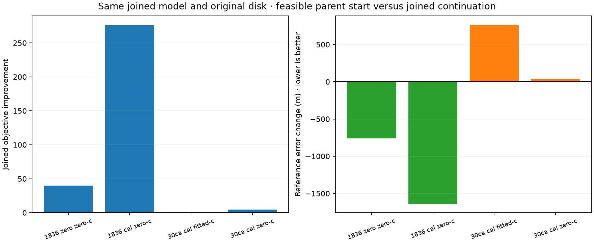
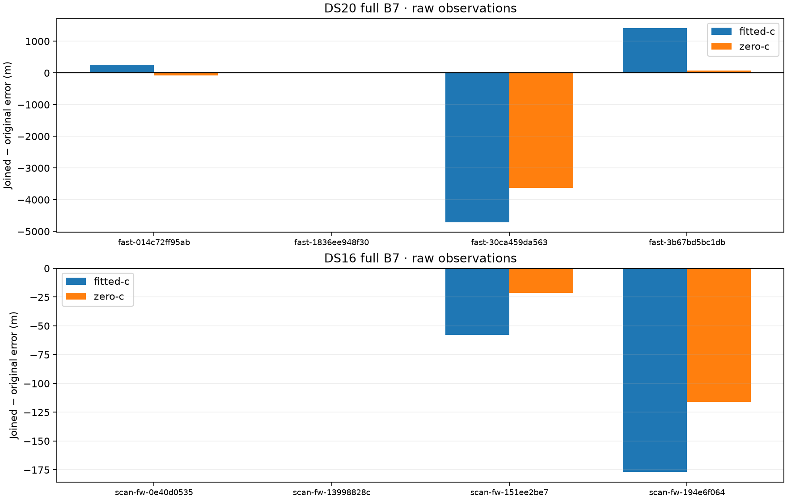
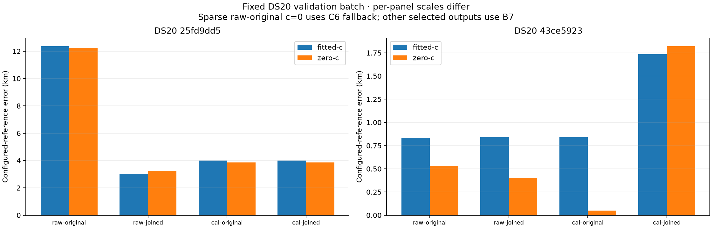

# Anchored incumbent refinement and initial validation

A feasible parent state can repair a worse stationary joined solution without changing the observation inventory, candidate bank, priors or geographic domain. All 64 matched refinement fits converge, and all four transported parent starts improve the same joined objective. However, position accuracy improves in only two of those four cases. The optimizer repair is verified; a generally improving merge estimator remains unqualified.

The eight development recordings' complete raw full-pipeline comparisons are now consolidated here. All four fixed validation recordings have completed and are retained below, including the sparse high-band case and its fallback-stage exception. The full requested scope is still all 18 DS20, all 63 DS16, and DS15 after its original membership authority is available.

## A controlled initialization repair

The [previous audit](../cohort/joined-parent-start-audit.json) found four cases in which a saved parent-model state had a better joined objective than the saved stationary joined state. This experiment compares continued fitting from that joined state against fitting from the lower-scoring feasible parent/joined state. Selection uses only the joined objective, never geographic reference error.

Every branch uses the same joined mark model, RF arm, final satellite bank, original observations, band parameters, priors and original local search domain. Each gets one additional 90-second/600-iteration fit. The two previously computed source states are common preprocessing; this does not claim equal total work to a pipeline that never computed parent states. Both c arms are evaluated for band calibration enabled and disabled on all eight fixed development recordings.

The original solver centers its 25 km local domain on the supplied start. Passing a parent state directly would move that domain. The new `fit_anchored_joint` takes the original center independently of the start. Inspection and tests verify that the existing local domain is a **disk**, despite earlier study descriptions calling it a box. The original 250 km prior disk and all timing, slope, RF, clock and stationarity constraints also remain in force.

The original qualified joined result is retained if a new attempt is nonstationary or has a worse objective, within a 10⁻⁶ numerical tolerance. A feasible parent state is not merely relabeled as a converged joined fit. In the completed panel every attempt is stationary, so no fallback was needed.

| Recording | Band term | c arm | Joined objective gain | Original → refined error (km) |
|---|---|---|---:|---|
| DS20 `1836ee94` | Off | c=0 | 39.711 | 154.936 → 154.175 |
| DS20 `1836ee94` | On | c=0 | 275.794 | 154.962 → 153.323 |
| DS20 `30ca459d` | On | Fitted-c | 0.816 | 5.271 → **6.034** |
| DS20 `30ca459d` | On | c=0 | 4.768 | 5.067 → **5.104** |

All four score improvements exceed those already available at the parent states before refinement. Continuing from the original stationary joined starts produces essentially no change. The other 28 paired conditions select the existing joined state and reproduce their controls to numerical precision.

This separates two failures. Initialization can lose a demonstrably better feasible solution, and the joined frequency objective can favor a geographically worse solution even when it is optimized more carefully. The 763 m regression accompanying a score improvement of only 0.816 is especially clear. It does not prove a specific physical fault: RF labels, nuisance priors, candidate ambiguity, measurement modeling and incomplete search remain possible contributors. These are common-objective comparisons on exposed development data, not a calibrated geographic posterior or independent satellite-identity validation.

[The protocol](incumbent/protocol.json), [all 64 outcomes](incumbent/evaluation.json), [numerical seal](incumbent/evaluation-seal.json), and [four changed conditions](incumbent-changes.json) preserve the evidence. Reference coordinates enter only after all 64 numerical results are complete and sealed, using the previously recorded per-recording reference authorities.

## Full raw-pipeline merging on the fixed development cohort

These are separate full B7 searches using original versus protected joined bootstrap proposals. They are not the local shared-mark experiment above. Every condition keeps the original prepared observations, initial catalogue, priors and 400-point budget. Proposal profiling uses the common original-plus-joined pool. Final satellite sets and calibrations may change as intervention consequences.

| Recording prefix | Fitted-c original → joined (km) | c=0 original → joined (km) |
|---|---|---|
| DS20 `014c72ff` | 3.209 → 3.465 | 3.619 → 3.544 |
| DS20 `1836ee94` | 156.475 → 156.475 | 154.073 → 154.073 |
| DS20 `30ca459d` | 6.891 → 2.181 | 5.824 → 2.197 |
| DS20 `3b67bd5b` | 1.305 → 2.722 | 0.617 → 0.693 |
| DS16 `0e40d053` | 0.981 → 0.981 | 0.608 → 0.608 |
| DS16 `13998828` | 1.054 → 1.054 | 0.789 → 0.789 |
| DS16 `151ee2be` | 0.223 → 0.165 | 0.837 → 0.815 |
| DS16 `194e6f06` | 1.002 → 0.825 | 1.692 → 1.576 |

All 32 operational outputs are stationary B7 results. Within every condition, c=0 and fitted-c have the same final satellite bank and stage. Their upstream discovery remains shared with fitted-c, so these are conditional c ablations rather than separate c-free discovery. Frequency metrics and scores are retained in [the complete results](full-development-results.json). Different final banks across merge interventions prevent interpreting a cross-mode score difference as a pure fixed-bank fit change.

The two DS16 gains and large DS20 `30ca459d` gain are retained alongside the DS20 `3b67bd5b` regression and unchanged 156 km failure. Neither a favorable average nor a selected successful example qualifies automatic merging. The [calibration-before-discovery recovery](../cohort/README.md) is a distinct intervention that repairs the large failure; it must not be credited to raw merging.

## Initial randomized validation batch

Membership is frozen in [validation-selection.json](../validation-selection.json): the first two session IDs per corpus within the existing whole-recording randomized validation role, seed `20261012`, independent of readiness or accuracy. These corpora were exposed in earlier investigations, so this is not an untouched-data claim. Fixed calibration comes from one development recording; no validation reference or fitted validation offset trains that preprocessing.

For DS20 `fast-25fd9dd564a789d071beddbf64e9760d`, all four full searches complete:

| Condition | Fitted-c error (km) | c=0 error (km) | Frequency NLL, fitted-c / c=0 |
|---|---:|---:|---|
| Raw original | 12.352 | 12.245 | 43,096.093 / 43,098.882 |
| Raw protected joined | **3.025** | **3.236** | 43,112.578 / 43,118.432 |
| Fixed band calibration, original | 4.000 | 3.860 | 34,806.163 / 34,874.106 |
| Fixed band calibration, joined | 4.000 | 3.860 | 34,806.163 / 34,874.106 |

Raw merging improves this recording by approximately 9.33/9.01 km. Fixed calibration also improves the raw original result, but merging adds no measurable benefit after calibration. The calibrated solution has a much lower frequency NLL yet worse position accuracy than raw merging. Final bank identities differ across conditions; these are operational model outcomes, not a same-bank objective comparison. Within each condition the c arms share stationary B7 stages and final banks.

Both DS16 validation pairs are effectively neutral:

| Recording prefix | Fitted-c original → joined (km) | c=0 original → joined (km) |
|---|---|---|
| DS16 `0b8d0887` | 1.165 → 1.165 | 0.907 → 0.907 |
| DS16 `0ffe1eed` | 0.134 → 0.134 | 0.211 → 0.211 |

These also have stationary B7 outputs and matching final banks within c pairs. They contain no high-band rows, so calibration is exactly identity and redundant calibrated replays are not performed. Their neutral results do not establish the method's high-band behavior or false-join rate.

The sparse DS20 member `fast-43ce59233fe914e1d273ee584efcd405`, with seven retained high-band rows, also completes:

| Condition | Fitted-c operational error (km) | c=0 operational error (km) |
|---|---:|---:|
| Raw original | 0.836 | 0.530 (C6 fallback) |
| Raw protected joined | 0.842 | 0.400 |
| Fixed band calibration, original | 0.842 | **0.051** |
| Fixed band calibration, joined | **1.735** | **1.820** |

The approximately 893 m / 1,769 m regressions from calibrated original to calibrated joined occur with matching stationary B7 stages in each c pair. They stay in the comparison despite the attractive 51 m original c=0 result. Calibration changes only seven high-band rows here, yet bootstrap selection and downstream candidate association can change substantially. More aggressive consistency of the initialization still does not guarantee the correct geographic minimum.

The raw original c=0 run falls back to C6 because its B7 attempt has stationarity 0.001451, above the 0.001 requirement. The fitted-c output is B7. Those operational outputs therefore **do not constitute a same-model c ablation**. The existing common C6 attempts provide the controlled comparison: fitted-c error 1.156 km versus c=0 error 0.530 km, with frequency NLL 48,364.060 versus 49,525.927. Both are stationary, share the same bank, non-RF start, priors and stage budgets, and are independently recorded in [the common-stage receipt](validation/DS20/fast-43ce59233fe914e1d273ee584efcd405/common-stage-raw-original.json). No failed B7 fit is promoted or silently excluded.

All other validation conditions' c arms share stationary B7 stages and final banks. [Validation status and receipts](validation-status.json) record every selected member, numerical state, fallback and common-stage check. These results support a large improvement on one raw DS20 validation recording, neutral DS16 results, and a calibrated-merging regression on the second DS20 recording. They do not qualify unconditional calibrated merging. Distances throughout use the configured operator/pipeline reference, not a surveyed capture GPS fix.

## The sparse regression changes the clock seed without changing the initial bank

A [read-only bootstrap audit](seed-sampling-and-weight-audit.json) compares the calibrated branches at their common data-selected winning basin, `point:-92.5:-82.5`. The initial candidate indices and per-match timing estimates are identical. Both contain 24 accepted shape matches and use 288 sampled shape rows. One selected support grows from 73 to 113 rows, incorporating 40 observations outside the original selected support; the downstream observation inventory itself is unchanged.

The receiver-line bootstrap uses per-row squared weights `sqrt(min(track_length,100))/track_length` before its robust residual loss. Thus changing the grouping also changes the nominal weights of existing observations. The full receiver-line support increases from 1,751 to 1,791 distinct rows, while its total nominal squared weight changes from 200.338 to 201.794. The resulting RX1 seed intercept shifts by +76.481 Hz and its slope by −2.156 Hz/s. RX0 and all initial timing parameters remain unchanged.

At the same fixed point and same initial bank, the two coarse fits are both stationary but have objectives 54,662.491 and 53,469.707. Receiver-clock calibration then follows those different coarse solutions, and downstream association produces different final candidate sets and positions. This supplies a concrete initialization path for the regression even though the original discovery bank was protected. It does not by itself prove that the additional rows or the join are physically incorrect. The next audit should distinguish complete-parent orbital agreement, support weighting, and subsequent candidate reassociation rather than simply increasing the curve RMS limit.

## Verification and next work

The affected suite passes **68 tests**, including four new anchored-fit tests: exact reproduction of the old solver when start and anchor agree, a transported start that must stay in the original disk, preservation of c=0 locks, and rejection of a false convergence claim for an unfinished feasible state. The original executed models, fitter and public persisted contracts are unchanged.

The initial four-recording validation comparison is complete. The next scientific decision must use both frequency evidence and separately measured geographic outcomes. Incumbent transport is useful numerical hygiene, but its verified regressions prevent treating it as a localization guarantee. Further work should investigate objective and association bias rather than attributing every failure to convergence.

The full DS20/DS16 populations and DS15 requirement remain open. No RF collection, hardware modification, production promotion, QNAP mutation or default change occurred. Reproduce using the built native orbit extension and scientific Python environment with `PYTHONPATH=src:tools`, one BLAS thread, `incumbent_joined_study.py`, and `report_incumbent_validation.py`. Frozen protocols reject changed authorities and existing output overwrites.
