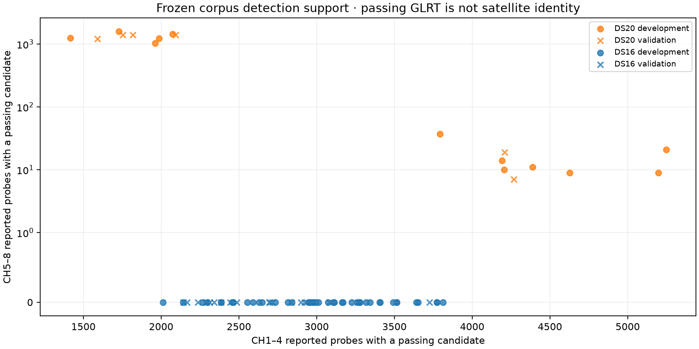
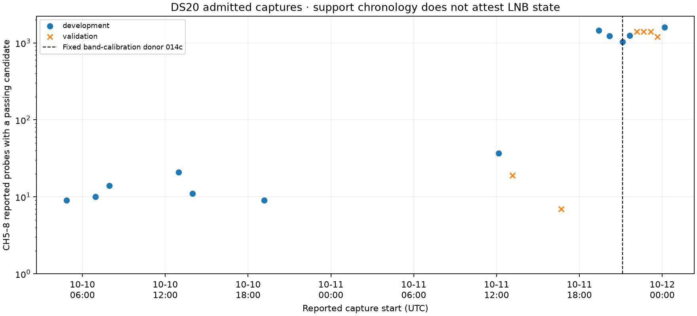

# Reported window identity and detection support

All 81 frozen DS20/DS16 recordings have been checked, with no missing or failed
sources and **zero repeated reported-window metadata keys**. In particular, no
exact key is reused across the low/high channel boundary. This check finds no
evidence for an exact duplicate-report explanation of the combined-band
regression; it does not verify LNB state or physical RF assignments.

The key contains receiver, valid-start device counter, payload-start sample and
probe-start milliseconds. Independent receivers remain distinct. Equal keys
with different RF/channel labels are flagged, and multiple passing candidates
within one probe count as one passing probe. Sources and recording digests are
checked against the original census, and [results.json](results.json) pins the
membership, every source/census file and the audit script.

| Dataset | Recordings | Reported probes | Repeated keys | Channels with passing candidates per recording |
|---|---:|---:|---:|---:|
| DS20 | 18 | 133,712 | 0 | 8 |
| DS16 | 63 | 277,882 | 0 | 4 |

DS20's all-eight-channel membership criterion does not imply equally strong
support from both bands. Nine recordings contain only **7–37** high-band passing
probes; the other nine contain **1,027–1,587**. Their low-band counts are
3,792–5,248 and 1,415–2,092 respectively. All DS16 members have zero reported
high-band passing probes. These are detector outputs, not independent satellites,
validated tracks or calibrated signal probabilities.

Reported probe allocation also varies: the first development recording has
3,444 reported high-band probes and 1,027 passing ones, whereas the known sparse
regression has 1,008 reported high-band probes and seven passing ones. Unreported
or power-gated opportunities are absent from this census. These counts therefore
do not establish a causal hardware change or provide an unconditional detection
rate. The original whole-recording roles are retained; the corpora are already
exposed development/validation evidence.

The two support groups are separated in reported capture time. All nine sparse
high-band members start between **October 10, 04:50:55 UTC and October 11,
16:39:59 UTC**. All nine strongly supported members start between **October 11,
19:23:29 UTC and October 12, 00:09:40 UTC**. No admitted DS20 member lies between
those groups; this does not establish an absence of other RF recordings.

The fixed band-calibration donor `014c` starts at **October 11, 21:08:06 UTC**,
after every sparse member, including the known `43ce` regression. Random
whole-recording roles permit later development donors in a conditional study,
but same-radio identity does not establish that band support, wiring, settings
or calibration remain comparable across these periods. The observed chronology
therefore calls for qualifying calibration against the recording's own support
and configuration, with all original members retained. It does not prove a
particular switch phase, identify false detections, or establish a hardware cause.

Distinct metadata keys do not prove disjoint IQ support, independent frequency
errors, correct carrier hypotheses or an attested switch phase. This is a
read-only identity check, with no deduplication, new calibration, position
refitting, collection or default change. Three focused tests cover cross-band
collisions, independent receiver/counter/payload/probe keys, and candidate-to-probe
counting; they pass in both scientific and publication checkouts. The tool is
[audit_reported_window_identity.py](../../../tools/audit_reported_window_identity.py).

DS15's authoritative membership remains unlocated. Full position comparisons
continue in the [frozen incumbent experiment](../full-incumbent/README.md);
this census does not qualify geographic merge improvement.
