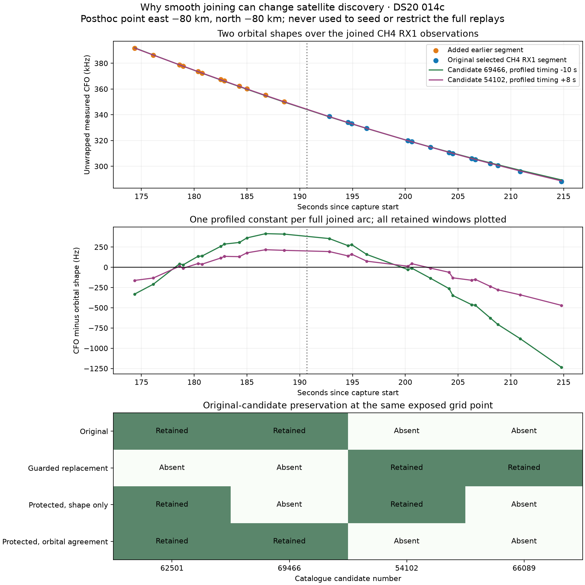
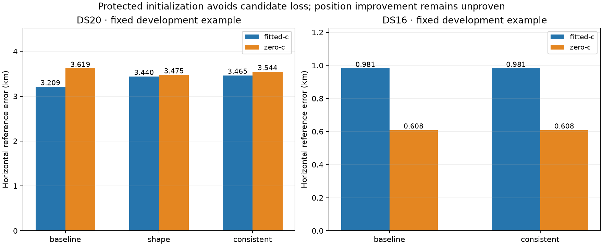
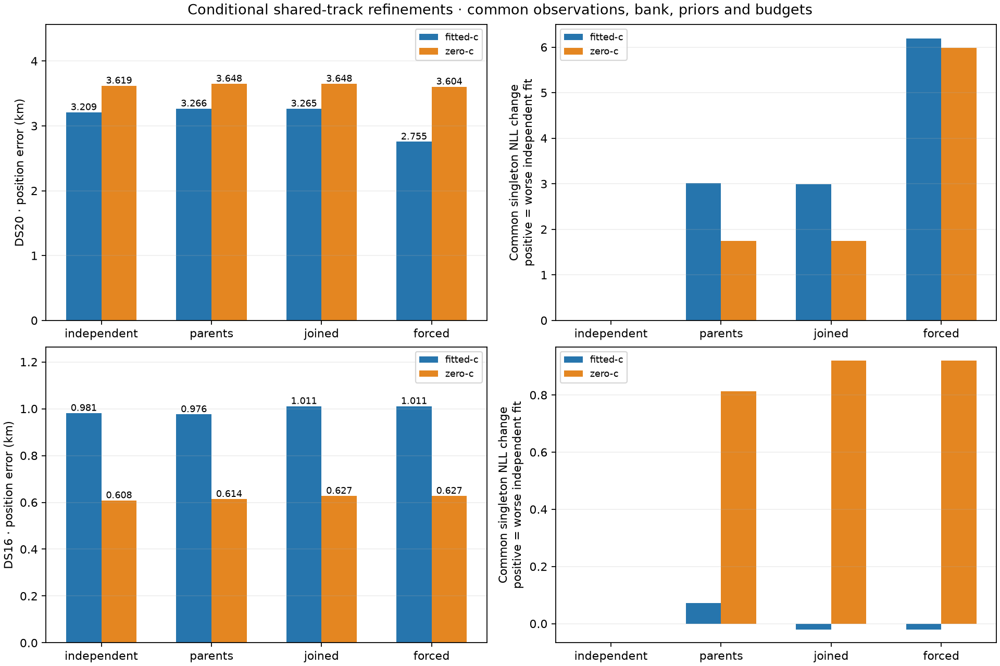

# Protected orbital-consistency track merge experiment

The first continuous-curve prototype can worsen localization by changing initialization rather than by changing the recorded observations. This iteration preserves the original selected discovery tracks and tests whether a joined trajectory agrees with their orbital candidate matches before replacing them. It repairs the two identified candidate-loss mechanisms in the exposed DS20 diagnostic. The first two complete matched replays do not demonstrate better fitted-c position accuracy: DS20 changes from 3.209 km to 3.465 km and DS16 remains effectively unchanged.

This experiment follows the [continuous track merge study](../2026_10_12_continuous_track_merge/README.md), whose complete proposal census includes all 18 DS20 and 63 DS16 recordings. The same sealed membership and random whole-recording development/validation roles apply. DS15 still lacks an authoritative manifest; no other dataset is substituted for it. Initial full replays use the same two development recordings as the preceding experiment, not an independently held-out sample.

## Two distinct ways that discovery candidates disappear

On DS20 `fast-014c72ff95ab599c51ba3b3ec9b92cb8`, guarded replacement retains 17 of the 24 original selected bootstrap proposals. At the previously exposed grid point east −80 km, north −80 km:

* The unmerged CH1 RX0 segment from 14.56 to 48.96 seconds supplies candidate 62501 with 56.3 Hz sampled shape RMS. Longer joined proposals displace it under the longest-12-per-receiver quota. The resulting selected replacement set has no observations from this original segment.
* A CH4 RX1 segment from 192.80 to 214.80 seconds supplies candidate 69466 with 75.5 Hz sampled shape RMS. A guarded join adds an earlier segment, extending support to 27 windows over 40.44 seconds. The joined bootstrap prefers candidate 54102 with 193.7 Hz sampled shape RMS, removing 69466 from its discovered bank.

The first mechanism is competition under a quota; the second is a changed preferred orbital shape. They require different controls. Candidate numbers here identify numerical hypotheses, not established transmitting satellites. This grid point is an exposed posthoc diagnostic near the evaluation reference. It never seeds or restricts the full geographic searches.



The upper panels profile each candidate's timing over the existing −20 to +20 second grid and one constant over the entire joined arc, using all 27 retained windows. Candidate 69466 gives 432.4 Hz RMS and candidate 54102 gives 177.4 Hz RMS. These differ from the bootstrap's 12-sample statistics. Both residual trajectories have visible structure: a smooth measured CFO curve does not establish a correct orbital assignment or noise-only orbital residuals. The bootstrap removes a constant while selecting orbital shapes and estimates shared receiver drift afterwards, so calibration ordering remains an additional mechanism to investigate.

The lower panel separates protection of original proposals from the orbital-agreement gate. Original-candidate preservation plus a shape-RMS limit retains 62501 but still substitutes 54102 for 69466. Enabling orbital agreement retains both original candidates and excludes both substitutions. [Plot receipt](candidate-substitution.json) and [point diagnostics](point-diagnosis.json) record these exposed comparisons.

A matched local [receiver-drift sensitivity check](clock-ordering-sensitivity.json) does not resolve the CH4 disagreement by simply subtracting the original fixed-point fit's affine drift. RX1's fitted drift is +0.257 Hz/s, and the same parent/join candidate pair persists: 69466 and 54102, at 75.6 Hz and 195.7 Hz sampled shape RMS. Subtracting the original bootstrap seed's much larger −15.784 Hz/s RX1 drift instead changes both candidates to 67928 and 62498; they still disagree. Thus the initial candidate ordering is drift-sensitive, but these controls do not establish drift as the cause or a correction as the remedy. The vectors are exposed baseline estimates at the same fixed grid point and are not used in the protected-merge full replays.

## A conservative candidate-preserving merge rule

The new analyzer profiles the same pool of original selected tracks and guarded joined proposals at each trial position. DS20's initial example has 24 original proposals and seven additional joined proposals; the DS16 example has 24 originals and four additions. All conditions use the same pool, 12 samples per proposal, existing timing grid, and five-second total bootstrap budget.

A join can replace original proposals only when it contains every observation of each overlapping selected parent, has a qualified orbital match, and has sampled shape RMS no greater than the larger of 200 Hz and 1.25 times the worst parent RMS. Orbital-consistency mode additionally requires its preferred catalogue candidate to agree with every selected parent's candidate. Unrelated original proposals always remain selected. Orphan joins and partial-parent replacements are rejected, so an added long proposal cannot evict an unrelated original via the quota.

Every accepted replacement rechecks the discovery bank after recomputing the initializer. Consistent mode requires exact equality with the bank discovered by the original selected proposals at that trial position. This condition deliberately preserves alternatives; it does not assert that the original candidate identities are correct. Timing and receiver-line initialization may still change. It can also prevent a longer arc from correcting a mistaken short-arc assignment, which requires a later alternative-hypothesis comparison rather than silent replacement.

The fixed modes are:

| Mode | Common proposal pool | Selected proposal rule |
|---|---|---|
| Baseline | Original plus guarded joins | Recompute using original selected proposals |
| Shape ablation | Same pool | Protected replacements with shape-RMS limit |
| Consistent | Same pool | Protected replacements with shape-RMS limit and candidate agreement |

At the prior origin, all three modes discover the same 11 candidates; shape and consistent each accept two joins. At the exposed −80/−80 km point, baseline and consistent retain the same 13 candidates, while shape mode substitutes 54102 for 69466. Consistent accepts two joins there, rejects two for increased orbital RMS, rejects two orphan proposals, and rejects the CH4 candidate disagreement. Thus the candidate guard is active and does not reject every join.

The numerical analyzer uses contracts and an injected bootstrap port. The B7 and Hard60 runners default to their original bootstrap behavior; using a custom initializer requires an explicit configuration binding. No production defaults or hardware settings are changed.

## Matched positioning and remaining work

Full default B7 replays have completed for the first DS20 development example in all three modes and for the first DS16 example in baseline and consistent modes. They preserve original observations, RF frequencies, timing, initial satellite bank, priors, 400-point search budget, and per-stage fitting budgets. Each mode includes the existing conditional `c = 0` versus fitted-`c` final comparison, sharing fitted-`c` discovery/calibration and the final bank within that mode. Geographic evaluation references enter only after complete numerical outputs are sealed. Frequency fit and position accuracy must be assessed separately.

| Dataset and mode | Fitted c error | Zero c error | Fitted c frequency NLL | Final bank size |
|---|---:|---:|---:|---:|
| DS20 baseline | 3.209 km | 3.619 km | 38,814.20 | 17 |
| DS20 protected shape ablation | 3.440 km | 3.475 km | 38,609.59 | 20 |
| DS20 protected orbital agreement | 3.465 km | 3.544 km | 38,644.00 | 18 |
| DS16 baseline | 0.981 km | 0.608 km | 37,371.42 | 34 |
| DS16 protected orbital agreement | 0.981 km | 0.608 km | 37,371.42 | 34 |



All ten accepted outputs are stationary B7 fits and each mode's two c arms share its final bank. Both new baseline controls exactly reproduce the earlier numerical reference errors. The consistency guard removes the earlier 319 km DS20 regression, but increases fitted-c error by 8.0 percent relative to the original baseline. Zero-c error decreases by 2.1 percent. Shape mode similarly increases fitted-c error while modestly reducing zero-c error. Neither constitutes a qualified general improvement. DS16 differences are below 0.2 millimeters and have no practical significance.

Discovery-bank preservation applies to each coarse trial point; subsequent regional discovery, timing, and association can still produce different final banks. The DS20 final bank grows from 17 to 18 candidates in consistent mode and to 20 in shape mode. Lower NLL across these interventions therefore accompanies both changed candidate sets and slightly worse fitted-c positions. [Compact results](first-position-results.json) include evaluation and image hashes.

The next paired cohort is fixed in [cohort-selection.json](cohort-selection.json): the first four session IDs in each previously assigned development role, without readiness or accuracy filtering. Its initial banks and experiment protocols are prepared before reading new replay outcomes. The next DS20 and DS16 baseline/consistent pairs are running. This remains exposed-data development; whole-recording validation roles in the original membership remain reserved.

## Continuity inside the downstream likelihood

Initialization-only merging adds no constraint to the final independent-window likelihood. A second experimental component now tests whether a shared catalogue identity across a guarded episode can add useful information while retaining an independent-window alternative for incompatible joins. It preserves a clutter alternative for each window. The mixed model retains the original singleton count terms and changes only conditional mark correlation; it is not a new physical model of correlated transmission or detection counts.

Writing each independent mark term as `H_n = C + sum_k S_nk`, a group's shared-versus-independent ratio is `B_g = (1/K) sum_k product_n [(C + K S_nk)/H_n]`. A fixed mixture uses `(1-p) + p B_g`. `p = 0` and single-window groups reproduce the original score exactly. A posterior shared-branch weight near zero retains independent assignment for an incompatible join. This differs from removing a parent's candidate during initialization.

The [likelihood](../../src/leo/analysis/shared_track_likelihood.py) and [B7 objective adapter](../../src/leo/analysis/shared_track_objective.py) pass 15 component tests, including complete position/calibration/timing/clock gradients, exact disabled-model reproduction, long-group numerical stability, disjoint evidence ownership, and a synthetic conflicting-identity control. These establish numerical properties, not localization improvement.

A [conditional refinement study](../../tools/shared_track_refinement_study.py) freezes one common data-selected fitted-c B7 seed, candidate bank, receiver calibration, clock and timing priors, observations, and local 25 km search box. It compares independent windows, separate parent groups, joined groups with `p = 0.5`, and joined groups with `p = 1`. Every condition includes both c arms with matched 90-second/600-iteration fitting budgets. Parent and joined structures cover the same original windows; ambiguous shared boundary rows are independently scored in both. Thus this experiment separates grouping itself from joining and from availability of the independent alternative. References enter only after all results are sealed. It is a conditional local refinement, not a full geographic-search or untouched-validation result.

All sixteen conditional fits have completed and are stationary. DS20's seven joined groups and fifteen parent groups cover the same 461 windows. DS16's four joined groups and eight parents cover the same 331 windows. Cached DS20 timing uses the version 1 authority at 5 MHz; DS16 uses the version 3 authority at 10 MHz. Preparation dispatches to their original public contracts without changing sample rates, timestamps, or measurements. Initial preparation retries were archived before any numerical fits started.

| Dataset and mark model | Fitted c error | Zero c error |
|---|---:|---:|
| DS20 independent | 3.209 km | 3.619 km |
| DS20 separate parents, p = 0.5 | 3.266 km | 3.648 km |
| DS20 joined, p = 0.5 | 3.265 km | 3.648 km |
| DS20 joined, shared branch only | 2.755 km | 3.604 km |
| DS16 independent | 0.981 km | 0.608 km |
| DS16 separate parents, p = 0.5 | 0.976 km | 0.614 km |
| DS16 joined, p = 0.5 | 1.011 km | 0.627 km |
| DS16 joined, shared branch only | 1.011 km | 0.627 km |



Soft joining does not improve either example over independent windows. Removing the independent alternative improves DS20 fitted-c error by 14.1 percent but barely improves its zero-c result, and increases both DS16 errors. It cannot be promoted from this mixed evidence. The forced-state DS20 solution also has a higher objective under the soft model than the soft model's own solution, so choosing it solely for better reference accuracy would contradict reference-free model selection.

The raw shared-model score includes changes in label-correlation probability and normalization. It must not be interpreted as a comparable independent-window frequency-fit gain. The right panels instead re-evaluate every fitted state with the same original singleton likelihood, original observations, and common bank within each dataset. DS20's forced shared solution worsens this common frequency NLL by 6.18 while improving fitted-c position error. DS16's softly joined fitted-c solution changes singleton NLL by only −0.020 while worsening position error by 29.6 meters. Those small frequency changes and heterogeneous accuracy effects point to sensitivity of the fitted calibration/geometry, rather than proof of a better frequency or localization model.

In DS16 the soft and shared-only joined states are effectively identical: all four groups strongly favor sharing and the score difference is approximately four times `log(2)`, the mixture normalization. This is an example of a lower score without new position information. The [sealed conditional results and common-metric receipts](shared-refinement-results.json) include both c arms, source hashes, stationary flags, common banks, and the continuation diagnostic. Across the affected existing and new components, 47 tests pass. Further cohort evaluation and calibration-model diagnostics remain necessary; the active goal is not achieved.

The prototype and affected components pass 32 tests, including native numerical parity, injected discontinuities, protected-parent replacement, differing orbital candidates, rejection of partial/orphan joins, original-baseline numerical reproduction, checkpoint resumption, and forwarding of the explicitly bound bootstrap through B7. Scientific fixtures remain unchanged.

Reproduction uses the new [study tool](../../tools/continuous_merge_consistency_study.py). Existing numerical evidence remains in the original study worktree; large derived inputs and checkpoint data are Git-ignored. Use the scientific NumPy/SciPy environment, one BLAS thread, and the existing compiled native orbit extension:

```bash
PYTHONPATH=src:tools python tools/continuous_merge_consistency_study.py freeze DS20 SESSION_ID
PYTHONPATH=src:tools python tools/continuous_merge_consistency_study.py diagnose DS20 SESSION_ID
PYTHONPATH=src:tools python tools/continuous_merge_consistency_study.py execute DS20 SESSION_ID --mode consistent --maximum-seconds 420
```

The tool freezes input and source hashes and refuses to overwrite a protocol. Repeating `execute` resumes immutable completed checkpoint stages after a yielded worker slice. Run baseline and shape with the same protocol, then call `evaluate` only after the desired matched conditions complete. No new RF collection is needed. Broader DS20/DS16 positioning comparisons, calibration-ordering diagnostics, sensitivity checks, and authoritative DS15 inclusion remain required before claiming that this merge algorithm improves results.
