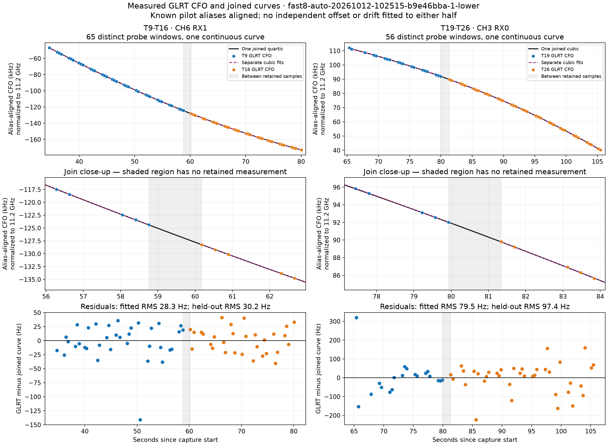
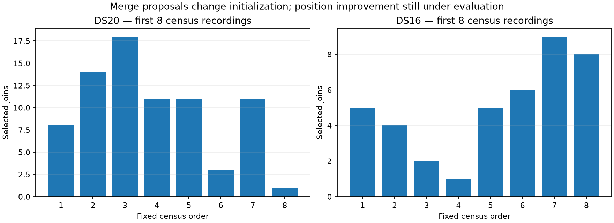
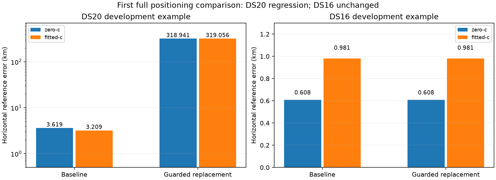

# Continuous track merging study

Continuous curves describe the two investigated track pairs without a separate frequency offset or drift for either half. The prototype also rejects injected frequency steps and slope changes that a residual RMS limit alone accepts. Improvement in localization remains under evaluation.

The pinned study includes all 18 original DS20 recordings and all 63 DS16 recordings. DS15 is awaiting an authoritative manifest and is not replaced by another corpus. The implementation is an explicit offline bootstrap intervention; automatic tracking and localization defaults are unchanged.

## Measured trajectories

Colored points are original passing GLRT CFO candidates assigned to the investigated segments. Black curves span both segments; purple dashed curves fit each separately. Frequencies are aligned by known integer pilot aliases and normalized to 11.2 GHz. Shaded intervals contain no retained measurement, so continuity there is a prediction.



T9 and T16 on CH6 RX1 require a fourth-order curve to remove the systematic residual structure left by a cubic. T19 and T26 on CH3 RX0 are adequately described by one cubic. These examples support continuous trajectory proposals; they do not establish satellite identity.

## Joining algorithm

The implementation considers consecutive segments on the same channel, edge, receiver, and actual RF tuning, with a gap of at most eight seconds. Overlap of up to 50 ms permits a shared boundary probe; the union retains one existing candidate per probe. Different RF lanes retain the existing grouping behavior.

Local quadratic extrapolation selects an integer pilot alias, without a freely fitted frequency shift. Boundary predictions must agree within 2,500 Hz. A single joint polynomial of degree two, three, or four is then fitted. Reproducible five-fold partitions hold out whole two-second capture-time blocks, with eight repetitions and seed 20261012. Curve coefficients are fitted only on training observations. The least flexible curve within ten percent plus five hertz of the best predictive RMS is selected.

The residual audit compares that continuous curve with a model that additionally permits a frequency step and slope change at the boundary. Provisional checks require:

| Check | Limit |
|---|---|
| Median held-out RMS | 500 Hz |
| Boundary step | Larger of 200 Hz and twice fitted RMS |
| Boundary slope change | Larger of 20 Hz/s and twice fitted RMS divided by the shorter segment span |
| Predictive improvement with a step and slope change | Larger of 20 Hz and twenty percent of continuous held-out RMS |
| Mean residual in either segment | Larger of 100 Hz and fitted RMS |
| Quadratic residual trend range in either segment | Larger of 100 Hz and twice fitted RMS |

These are development choices, not established false-join guarantees. Every later union rechecks the whole combined trajectory, so a chain of individually acceptable pairs cannot bypass the tests.

The application adapter changes bootstrap proposals while preserving the original observation object, candidate IDs, CFO, RF frequencies, device timing, and window membership. It retains the existing requirement of 15 observations over 15 seconds and the longest-12-per-receiver quota.

## Boundary checks detect faults that RMS alone misses

| Pair and perturbation | Continuous held-out RMS | Checks enabled | Checks disabled |
|---|---:|---|---|
| T9 and T16 original | 30.4 Hz | Accept | Accept |
| T9 and T16 plus 2 kHz step | 467.5 Hz | Reject | Accept |
| T9 and T16 plus 100 Hz/s slope change | 56.8 Hz | Reject | Accept |
| T19 and T26 original | 95.6 Hz | Accept | Accept |
| T19 and T26 plus 2 kHz step | 405.3 Hz | Reject | Accept |
| T19 and T26 plus 100 Hz/s slope change | 114.8 Hz | Reject | Accept |

The earlier plots selected these pairs before this study. Their block tests are conditional development evidence rather than independent validation. The injected controls validate these particular perturbations and amplitudes; smaller faults and unrelated satellites need broader testing. Receipts are in [anchor-results.json](anchor-results.json).

## Corpus evaluation

[membership.json](membership.json) pins the original DS20 and DS16 authorities and records a random whole-recording split: one third of each dataset is assigned to validation using seed 20261012 and NumPy PCG64. Membership does not depend on readiness or accuracy. Missing and failed analyses remain explicit. Both corpora were examined in earlier investigations, so these are exposed-data comparisons rather than untouched validation.

One DS20 member lacks a published tracking input in the original manifest. The study uses its previously sealed recovery input, preserving original counters and recorded clipping omissions. Original DS20 membership remains unchanged. Large derived inputs and checkpoints stay in Git-ignored `local/` storage.

The first census batch completed eight DS20 and eight DS16 recordings with no preparation failures. It selected 77 joins in DS20 and 40 in DS16, changing the selected bootstrap proposals in all 16 recordings. These are proposal counts, not additional satellites or localization improvements.



Full default B7 replays compare no merging, replacement with guarded joins, retention of original segments alongside guarded joins, and joins with residual guards disabled. Conditions share original observations, initial satellite bank, prior, and the default 400-point search budget. Final satellite sets and calibration may change as consequences of the intervention.

Each condition includes `c = 0` and fitted-`c` arms. The two arms share fitted-`c` upstream conditioning and the final candidate set within that condition, matching the deployed pipeline's conditional ablation. This does not refit discovery with `c = 0`. Frequency likelihood and score changes will be reported separately from horizontal position error. Reference coordinates enter evaluation only after numerical results are recorded.

## First full positioning comparison

The first two fixed development examples do not demonstrate a localization improvement. Guarded replacement causes a major regression in DS20 and produces an effectively unchanged result in DS16. All eight accepted outputs are stationary B7 fits; each condition's `c = 0` and fitted-`c` arms share its final satellite bank. Full numerical results were sealed before applying the published evaluation reference.

| Dataset and condition | Fitted c error | Zero c error |
|---|---:|---:|
| DS20 `fast-014c72ff95ab599c51ba3b3ec9b92cb8`, baseline | 3.209 km | 3.619 km |
| Same DS20 recording, guarded replacement | 319.056 km | 318.941 km |
| DS16 `scan-fw-0e40d0535caa0b16`, baseline | 0.981 km | 0.608 km |
| Same DS16 recording, guarded replacement | 0.981 km | 0.608 km |



The DS20 baseline reproduces its published fitted-`c` reference error. Replacement reduces frequency likelihood NLL from 38,814.20 to 38,268.49 and raises posterior signal mass from 1,336.4 to 1,532.9 windows, despite the much worse position. Its final bank has 19 candidates compared with 17 in the baseline. A lower frequency score is therefore not evidence of better localization.

The DS20 divergence occurs before the final refinement stages: B3 already starts near east 107 km and north 173 km, compared with east −83 km and north −82 km in the baseline's local coordinate system. Replacement retains only 17 of the 24 previously selected bootstrap proposals. The append ablation also retains 17 under the same longest-12-per-receiver quota, although its complete selected proposal set differs from replacement. Thus adding original segments to the proposal pool does not guarantee that the selected initialization retains them.

At the same previously evaluated grid point, east −80 km and north −80 km, both conditions have a stationary coarse fit with 13 candidates. The score changes from 38,701.43 to 42,060.76. The merged initializer substitutes candidates 54102 and 66089 for 62501 and 69466. This is a posthoc reference-neighborhood diagnosis of changed candidate selection, not a truth-seeded localization run or proof of those satellites' identities.

The next iteration must test preservation of discovery hypotheses and orbital consistency before replacing initialization segments. Smooth polynomial residuals alone are insufficient. The planned append and guard-disabled comparisons are running; their settings were fixed before reading these position errors. Receipts are in [first-position-results.json](first-position-results.json) and [first-coarse-bank-comparison.json](first-coarse-bank-comparison.json).

## Full census and first four condition ablation

Source preparation and the merge-proposal census have completed for all 81 pinned recordings without failures: 18 DS20 recordings produce 160 selected joins, with a median of 9.5 per recording; 63 DS16 recordings produce 326 joins, with a median of five. Every recording's selected bootstrap proposals change. This is a complete proposal census, not a complete positioning evaluation. Receipts are in [full-census-totals.json](full-census-totals.json) and [census-summary.json](census-summary.json).

The four predetermined conditions have now completed on the first DS20 development recording. All eight accepted results are stationary B7 fits, with a common final bank for the two c arms within each condition.

| Condition | Fitted c reference error | Zero c reference error | Fitted c frequency NLL |
|---|---:|---:|---:|
| Baseline | 3.209 km | 3.619 km | 38,814.20 |
| Guarded replacement | 319.056 km | 318.941 km | 38,268.49 |
| Guarded append before the unchanged quota | 4.264 km | 4.564 km | 37,967.52 |
| Replacement with residual guards disabled | 1.994 km | 2.097 km | 41,035.63 |

The append condition avoids the catastrophic replacement result but still worsens accuracy. It has a different proposal set despite retaining the same count of original selected proposals. The guard-disabled condition improves this recording's position while worsening its frequency likelihood, but it accepts the injected faults in the earlier controls. It is therefore not a qualified alternative. The condition with the best frequency NLL is also not the condition with the best position accuracy. Full receipts are in [full-first-ds20-ablation.json](full-first-ds20-ablation.json).

The next iteration needs to preserve useful discovery alternatives and use orbital consistency before forcing shared identity. Another question is whether the downstream likelihood should use track continuity explicitly: the current prototype changes initialization, while the final fit still treats the original windows independently. Receiver channel-group calibration remains a separate model issue documented in the [eight-channel root cause report](../2026_10_12_fast_channel_root_cause/README.md).

## Reproduction and remaining evaluations

Nine new component tests cover alias alignment, discontinuity rejection, gap and lane limits, deterministic unions, observation preservation, and the append ablation. Three existing position-input tests verify baseline behavior. No new RF collection is required.

The tools are [continuous_merge_study.py](../../tools/continuous_merge_study.py) and [continuous_merge_positions.py](../../tools/continuous_merge_positions.py). Use a NumPy/SciPy environment, `PYTHONPATH=src:tools`, and one BLAS thread. Build the existing native orbit extension before positioning:

```bash
python setup.py build_ext --inplace
python tools/continuous_merge_study.py mint
python tools/continuous_merge_study.py census --limit 16 --maximum-seconds 420
python tools/continuous_merge_positions.py freeze DS20 SESSION_ID
mkdir -p reports/2026_10_12_continuous_track_merge/local/DS20/SESSION_ID/positions/baseline
python tools/continuous_merge_positions.py execute DS20 SESSION_ID --variant baseline --maximum-seconds 420
```

The checkpoint adapter requires the variant output root to exist. Repeating `execute` resumes verified stages after a yielded worker slice. `mint` freezes membership and source hashes and refuses to overwrite an existing study. Local authority paths identify input artifacts; reference repositories are not runtime dependencies.

The complete census and first development positioning comparisons are available. Remaining evaluations cover improved merge iterations on the full DS20 and DS16 populations, DS15 after its authority is located, accuracy and failure rates, regressions, and sensitivity to curve flexibility, residual limits, and gap length. The first prototype is not qualified for automatic use: its guarded replacement can cause a catastrophic regression, and its guard-disabled improvement fails the fault controls.
