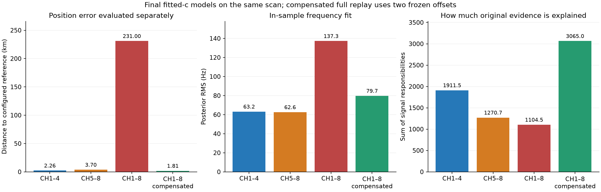
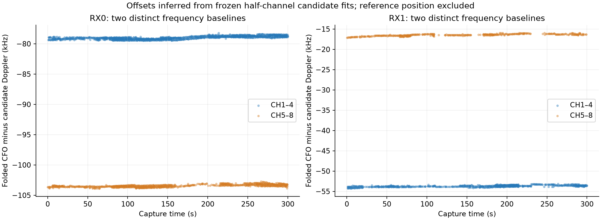

# Receiver channel group offsets explain the eight channel position failure

## Motivation

On the recorded scan `fast-4b6fff793fba610ed2674dcc6d2908ba`, separate CH1–4 and
CH5–8 analyses gave 2.26 km and 3.70 km error against the configured receiver
reference. Combining the same observations gave 231.00 km. This investigation
tests whether a missing frequency term causes that regression and whether the
recording supports an explanation involving LNB retuning.

## Problem

The combined calibration assumes one frequency baseline per receiver across
all eight channels. The two channel groups instead need different baselines,
with opposite differences on RX0 and RX1. A smooth receiver clock correction
and a shared linear RF coefficient cannot represent those differences. The
satellite mixture can conceal the mismatch by assigning observations to other
candidate satellites or to clutter, leaving an apparently moderate RMS on the
small fraction it explains.

## Solution

**The demonstrated numerical cause is a missing receiver-specific frequency
offset between the two channel groups.** A full replay that compensates only
those two frozen offsets changes the final position error from **231.00 km to
1.81 km**. It retains all 3,433 original usable windows, the same 836-satellite
candidate bank, the same TLE snapshot, geographic prior and solver settings.
Its 31 candidate satellites contain 24 of the 25 CH1–4 candidates and 21 of the
22 CH5–8 candidates. The two halves collectively proposed 32 satellites; the
compensated result contains their union except catalogue number 67644.

The physical cause of the offsets is unresolved. The acquisition path retunes
the Pluto IF and assigns 9.75 GHz and 10.6 GHz **LNB reference hypotheses** to
the two groups. It does not command or attest a physical LNB band switch. This
result supports a calibration term for the receiver and recorded tuning group;
it does not establish an LNB switching transient, actual LO state, satellite
identity or an independently validated position fix. No production numerical
code or radio configuration was changed for this investigation.

## Method

All experiments use saved GLRT candidates from the same five-minute capture;
no new RF was collected. The CH1–8 replay reproduces the published method
results exactly. Each replay uses the deployed Hard60/B7 implementation whose
configured scientific source hashes match repository commit `32736a415`.
The source comparison, input hashes and verification checks are in
[provenance.json](provenance.json). Numerical results, controls and satellite
lists are in [results.json](results.json).

The 7,136 saved probes divide into 3,662 CH1–4 probes and 3,474 CH5–8 probes.
The normal quality selection leaves 2,065 and 1,368 usable windows respectively.
Both receivers remain present in both groups. Capture timestamps, RF values,
quality margins, geographic prior, original candidate inventory and search
budgets are retained. The counterfactual translates every candidate CFO on
CH5–8 by a fixed value for its receiver; CH1–4 remains the baseline group. The
quality gate and observation selection are unchanged.

Errors below use the pipeline's configured reference, latitude
37.84903264307456 degrees and longitude −122.4856541910174 degrees. The
reference is applied only after inference. All published estimates remain
diagnostic and all satellite lists remain candidate associations.

## Position and association results

| Input | Usable windows | Associated windows before final timing pruning | Final candidate satellites | Final fitted-c frequency RMS | Reference position error |
|---|---:|---:|---:|---:|---:|
| CH1–4 | 2,065 | 1,888 | 25 | 63.21 Hz | 2.259 km |
| CH5–8 | 1,368 | 1,220 | 22 | 62.62 Hz | 3.703 km |
| CH1–8 original | 3,433 | 2,282 | 22 | 137.26 Hz | 231.002 km |
| CH1–8 with two frozen offsets compensated | 3,433 | 3,129 | 31 | 79.74 Hz | 1.813 km |

The compensated estimate is latitude 37.846039668 degrees, longitude
−122.465357764 degrees. The original estimate is latitude 39.330771587 degrees,
longitude −120.622569819 degrees. Both fits pass the implementation's
stationarity check and are interior solutions. Thus convergence alone does not
make the original estimate accurate.



The original and compensated full-channel runs have the same observation
count. Their posterior signal responsibilities sum to 1,104.51 and 3,065.01
windows respectively, about 32.2% and 89.3% of the input. This soft count differs
from the upstream discrete associated-window count in the table. The original
137 Hz RMS is conditional on those signal responsibilities; it does not mean
that the original model fits the complete observation inventory to 137 Hz.

The two half-channel fits share 15 candidate satellites. Only three CH1–4
candidates and seven CH5–8 candidates appear in the original full fit. The
compensated full fit shares six candidates with the original full fit and
recovers almost the complete union of the two halves. This directly links the
frequency correction to a changed association solution and a separately
measured reduction in position error.

## The missing frequency term

The current [position score](../../src/leo/analysis/regional_position_score.py)
uses the following receiver correction, in addition to candidate Doppler and
orbit timing terms:

```text
receiver offset a[r]
  + receiver drift b[r] × (receive_time − time_center)
  + shared c × (RF − RF_center) / 1 GHz
  + smooth receiver clock correction
```

The [bootstrap](../../src/leo/analysis/regional_position_bootstrap.py) estimates
one initial line per receiver. The
[calibration](../../src/leo/analysis/regional_position_calibration.py) adds a
30-second piecewise-linear clock correction. The
[association](../../src/leo/analysis/regional_position_association.py) then
discovers satellite timing modes using that calibration and freezes a
candidate set for the final RF arms. The
[joint clock model](../../src/leo/analysis/hard60_joint_clock.py) can refine
smooth clock terms later, but it has no receiver-by-channel-group offset.

The term needed by this scan is:

```text
  + d[r] × indicator(CH is 5–8)
```

This adds one frequency difference per receiver, taking CH1–4 as the reference
group. Equivalently, four receiver/group offsets can be used with a gauge that
avoids duplicating the existing two receiver intercepts. A production design
should bind the group to attested RF/tuning metadata or an explicit recorded
hypothesis, rather than silently treating channel labels as proof of physical
LNB band state.

Reconstructing the half-channel B4W fits gives the following corrections at
receive time 150 seconds and a common RF reference of 11.5846875 GHz. B4W is the
joint-clock stage before dynamic RF-time terms; using the same RF reference
removes the difference between the halves' RF centering conventions.

| Receiver | CH1–4 correction | CH5–8 correction | CH5–8 minus CH1–4 |
|---|---:|---:|---:|
| RX0 | −79.460 kHz | −103.147 kHz | **−23.687 kHz** |
| RX1 | −54.108 kHz | −16.244 kHz | **+37.864 kHz** |

The corresponding group differences in affine drift are only −0.252 and
+0.648 Hz/s. They are secondary to the tens-of-kilohertz offsets over this
300-second capture. The within-group RF coefficients are −594.59 and
−571.73 Hz/GHz. A shared RF term cannot create oppositely signed group steps
for the two receivers. Even the allowed ±5,000 Hz/GHz coefficient range cannot
represent these steps without introducing large within-group errors.

These frequency offsets are representatives under the pipeline's pilot alias
convention, with period `1 / 4.4 µs = 227,272.727 Hz`. They are not direct
measurements of absolute LNB oscillator error. The same folding convention
is used in the residual controls and the figure below.



The figure subtracts Doppler predictions from frozen half-channel candidate
fits. The offsets persist across the capture and across candidate satellites.
For candidates with at least ten strong windows in each group on the same
receiver, 11 RX0 candidate comparisons give median steps from −24.111 to
−23.722 kHz; eight RX1 comparisons give +37.652 to +37.910 kHz. The repeated,
oppositely signed receiver pattern supports a receiver/tuning-group calibration
effect. It is not evidence that those spacecraft identities are established.

## Random grouped controls

The nuisance-model control freezes the candidate positions, satellite sets,
orbit shifts and high-responsibility support from the exploratory half-channel
B4W fits. It then fits nuisance coefficients on training blocks only. Whole
five-second blocks, containing both receivers and all channels, are randomized
with seed `20261012`; 12 of the 60 blocks are held out. There are 2,425 training
and 656 held-out strong windows. The same rows and weights are used for every
model and c arm. Split assignments, per-lane metrics and coefficients are in
[offset-controls.json](offset-controls.json).

This is a **conditional calibration validation**. The frozen candidate models
and support were derived from the complete exploratory dataset, so these
holdouts do not independently validate satellite discovery or localization.
Only the nuisance coefficients and preprocessing in this control are learned
from the training blocks. The full compensated replay is also an all-data
causal counterfactual: its offsets come from the complete half-channel fits,
and its candidates and position are freshly inferred afterward.

| Nuisance model | Held-out RMS with c = 0 | Held-out RMS with fitted c |
|---|---:|---:|
| Original receiver lines and shared RF term | 18,961.0 Hz | 18,003.4 Hz |
| Separate RF coefficients per receiver, within original coefficient bounds | 18,961.0 Hz | 15,438.2 Hz |
| One band step shared by receivers | 22,510.4 Hz | 22,544.8 Hz |
| One band step per receiver | 179.8 Hz | **102.7 Hz** |
| One band step and additional group drift per receiver | 177.0 Hz | 98.3 Hz |

The fitted receiver-step control estimates −23,883.2 Hz and +37,786.0 Hz from
training blocks, close to the independently reconstructed half-fit steps used
for the counterfactual. The common RF coefficient is −597.47 Hz/GHz. Adding
group drift gives a small further reduction to 98.3 Hz; it does not explain the
large failure of the original model. A single shared step prioritizes one
receiver and worsens the other because the required signs differ.

## Why the original model selects different satellites

The [Hard60 likelihood](../../src/leo/analysis/hard60_score.py) uses 125 Hz
signal width and a nonzero clutter component. The missing steps are about 190
and 303 times that signal width. Candidate predictions with the half-channel
identities are therefore far from the combined model's frequency baseline.
Smooth clock knots and a linear RF coefficient cannot follow a discontinuity
that recurs as the scanner alternates between groups.

The likelihood consequently gives signal weight to other frequency coincidences
and drops much of the original evidence into clutter. The geographic search
then follows the score of that reduced, differently associated evidence and
retains northern/eastern basins. Downstream position fitting starts from those
calibrations and already frozen satellite sets. It cannot recover omitted
candidates merely by reaching a stationary optimum.

The responsibility counts at the original B4W stage make the evidence loss
visible:

| Receiver and group | Usable windows | Strong assignments in original full fit | Strong assignments in separate half fit |
|---|---:|---:|---:|
| RX0 CH1–4 | 1,330 | 568 | 1,189 |
| RX0 CH5–8 | 911 | 179 | 832 |
| RX1 CH1–4 | 735 | 235 | 655 |
| RX1 CH5–8 | 457 | 67 | 405 |

Strong means the leading candidate has responsibility at least 0.8. The
combined failure affects both groups, with CH5–8 most heavily discarded. It is
a frequency-model and association failure, not an intentional extra channel
weight in the input. The missing term must be available during bootstrap,
calibration and association, before final satellite selection is frozen.

## Controlled static c ablation and position accuracy

Each B4W comparison below holds observations, candidate set, upstream
calibration, clock priors and fitting budgets matched within that input. The
zero-c arm locks the downstream static RF coefficient to zero. Upstream
calibration and association retain fitted c in both arms; this is not a
complete end-to-end c-free pipeline. B4W precedes the RF-time terms enabled in
later fitted-c stages, so it isolates the static coefficient more cleanly than
the final B7 comparison.

| Input | Frequency RMS, c = 0 → fitted c | Reference error, c = 0 → fitted c |
|---|---:|---:|
| CH1–4 | 103.31 → 66.74 Hz | 4.236 → 2.680 km |
| CH5–8 | 98.65 → 66.25 Hz | 4.479 → 3.916 km |
| CH1–8 original | 151.51 → 138.66 Hz | 234.516 → 230.777 km |
| CH1–8 compensated | 128.21 → 84.42 Hz | 4.163 → 2.301 km |

Static c improves frequency fit in each case, but it does not repair the
original 231 km association failure. The compensated zero-c result is already
within 4.16 km at B4W. This distinguishes the effect of the missing group
offsets from the additional benefit of the continuous RF coefficient. Position
accuracy is evaluated separately; neither lower in-sample RMS nor convergence
is used as proof of a better physical location.

## What the recording establishes about LNB retuning

The saved target plan assigns 9.75 GHz to CH1–4 and 10.6 GHz to CH5–8. The
recorded IF readbacks exactly match the requested IFs. The capture segment
metadata records `physical_lnb_control_changed=false`. The qualified target
preparation calls the Pluto center-frequency writer; the continuous source
passes an IF frequency table to the device. It does not pass an LNB band or
tone command. The original preparation policy explicitly states that physical
LNB LO state is neither switched nor attested.

The recorded target table, IF readbacks, radio metadata and source digests are
retained in [capture-metadata.json](capture-metadata.json).

The mapping caveat is also part of the
[eight-channel scanner documentation](../../docs/operations/fast-eight-channel-scanner-workstream.md):
using a 10.6 GHz reference does not establish that the physical LNB was in that
band. Thus the reference-label boundary and an actual LNB retuning event must
remain distinct claims.

As a conditional check, the same frozen candidates and nuisance fitting were
evaluated with alternative RF mappings. An actual fixed 9.75 GHz LO would
shift the CH5–8 RF labels down by 850 MHz; an actual fixed 10.6 GHz LO would
shift the CH1–4 labels up by 850 MHz. Both receiver combinations were tested.

| RF mapping hypothesis, retaining receiver-specific steps | Held-out fitted-c RMS |
|---|---:|
| Recorded mixed reference hypotheses | **102.7 Hz** |
| Fixed 9.75 GHz for both receivers | 3,248.9 Hz |
| Fixed 10.6 GHz for both receivers | 3,570.4 Hz |
| RX0 fixed low, RX1 fixed high | 3,297.0 Hz |
| RX0 fixed high, RX1 fixed low | 3,523.5 Hz |

Those alternatives are poor explanations **conditional on these frozen
satellite candidates**. They were not complete fresh association searches and
cannot establish the actual LO state. The persistent group offset is
demonstrated; attributing it specifically to LNB oscillator errors, a switch
transient or another receiver-path effect requires attested hardware state
and an independently controlled measurement.

## Implementation consequence

The appropriate next implementation is a research calibration term keyed by
receiver and recorded tuning group, estimated upstream and carried consistently
through bootstrap, full-window calibration, association and final scoring.
Each receiver needs its own group difference. Fit it with an identifiable
baseline gauge, retain c = 0 versus fitted-c controls, and expose explained
signal mass alongside conditional RMS so a fit cannot look healthy simply by
discarding most observations. A final-stage-only correction would leave the
original candidate selection failure intact.

The frozen −23.687/+37.864 kHz values are evidence for this scan, not reusable
production calibration constants. Promotion requires independent recordings,
training-only preprocessing and fresh association on randomized held-out
groups, plus an attested RF mapping. Existing public persisted contracts must
remain immutable; any new persisted calibration state requires an additive
versioned contract. No additional RF collection is authorized by this report.

## Reproduction and verification

The retained artifacts are compact derived evidence; raw IQ, the 51 MB orbit
bank and numerical checkpoint trees remain in the local evidence workspace.
The saved TrackingInput export is
`/srv/bulk/leo/fast-scan-tracking-inputs/fast-71516d43f9396e83ca99f4d42136a84a.json`.
Its source binds capture digest
`sha256:4b6fff793fba610ed2674dcc6d2908ba7f430d2b839c2dc7730dbb82e6036754`
and analysis digest
`sha256:a984b64cfddba6cc1886a2c8b80dce64a70de1c4648c6d9014157dc3f5604c3f`.
The causal TLE snapshot is
`sha256:0991ae24a5a8a49c760dfa0e5ce9687cae4516253ae3200b32ca514c72d88c08`.

The reproducible scripts are [diagnose.py](diagnose.py),
[offset_controls.py](offset_controls.py),
[replay_compensation.py](replay_compensation.py) and [assemble.py](assemble.py).
They consume the prior channel-split evidence workspace and the pinned
production scientific environment; they do not import a reference checkout.
The deployed TrackingInput adapter is explicitly selected at
`/opt/leo-fast-auto/20261011-r3/bin/fast_scan_standard_pipeline.py`. Read access
to the private TLE archive and saved scientific inputs is required. PostgreSQL
and radio hardware are not required for these replays.

From a qualified Python environment with the pinned `leo` package:

```bash
python diagnose.py --parent /path/to/channel-split-evidence --output /path/to/work
python offset_controls.py --arrays /path/to/work/diagnostic-arrays.npz --output /path/to/work
python replay_compensation.py --parent /path/to/channel-split-evidence --diagnostics /path/to/work/diagnostics.json --output /path/to/work/compensated
python assemble.py --parent /path/to/channel-split-evidence --work /path/to/work --output /path/to/report
python -m pytest -q test_controls.py
```

The compensated replay is bounded to three 500-second resumable worker slices
and completed in two slices, 542.24 seconds total. The synthetic tests passed
4/4: opposite receiver steps, no held-out response leakage into nuisance
coefficients, matched zero-c design, and preservation of all candidate quality
and timing evidence during compensation. Assembly additionally checks exact
full-run reproduction, candidate-bank and configuration equality, frozen
observation counts and the reference-only evaluation boundary. Every configured
scientific source digest matches the published baseline. This report becomes
stale for a pipeline that already models receiver/tuning-group frequency
offsets or for a different capture/calibration/RF mapping.

The final test and artifact checks are recorded in
[validation.json](validation.json). Re-running the nuisance controls after
formatting the retained recipes produced exactly identical numerical results.
