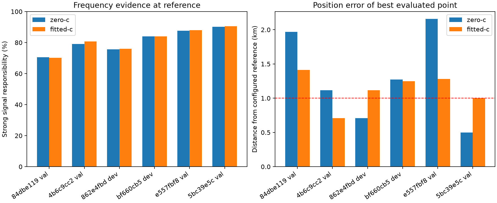
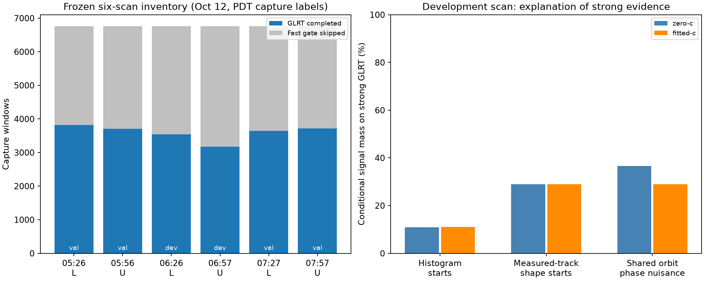
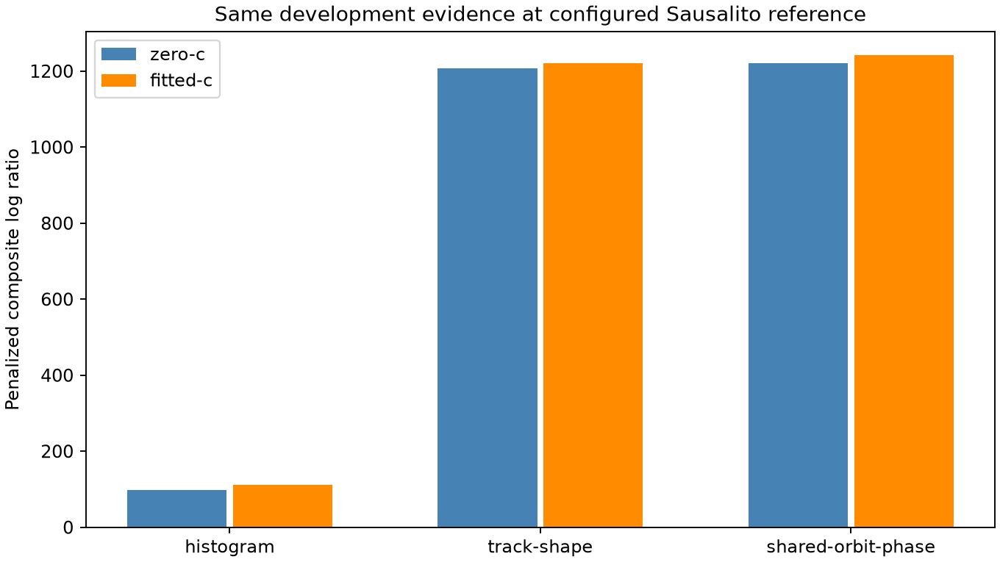
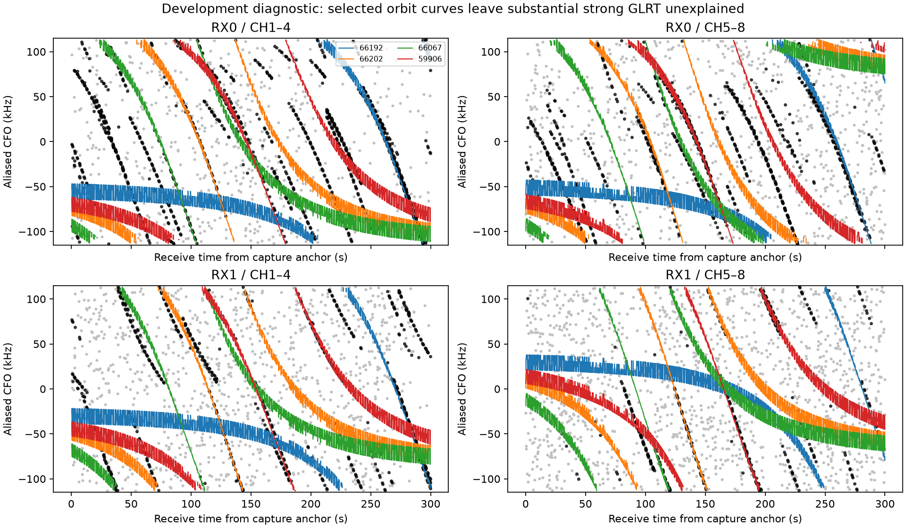
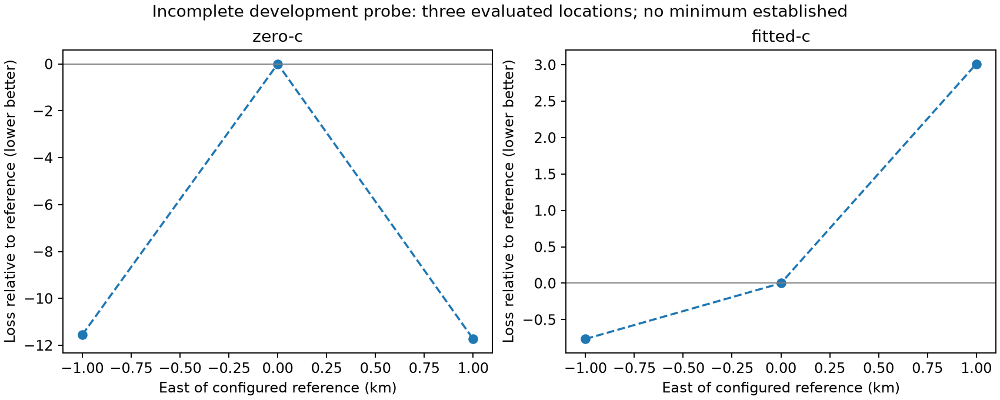

# Recent eight-channel GLRT likelihood: six-scan evaluation

## Motivation

The requested evaluation needs a likelihood minimum near the configured receiver
position across recent eight-channel recordings, with repeatable reports and
visualizations. Frequency-fit improvement and position accuracy need separate
evidence.

## Problem

Independent-window initialization can converge while leaving most strong GLRT
evidence in background. Pilot aliases, receiver/channel-group frequency terms,
ephemeris uncertainty, and the exact reference convention must be explicit.

## Solution

**The accuracy objective remains open.** The completed
[six-scan evaluation](relative-phase/README.md) now explains 70–91% of strong
GLRT evidence at the configured reference. Penalized satellite-specific timing
corrections and better initialization resolve much of the earlier failed fit.
The fitted-c best evaluated points are 0.71–1.41 km from that reference, but
none of the four randomly assigned validation scans passes the preregistered
combined distance/score-gap target. Full-catalogue audits retain that negative
conclusion. The earlier development attempts below remain as measured history.



## Method

Use verified existing recording exports and past-only archived elements. Freeze
the cohort and random whole-scan split before validation. Fit normalized alias
densities, shared hardware nuisance and sparse activity; retain failed fits and
compare zero-c and fitted-c arms on matched evidence and budgets.

## Cohort and reference

The six most recently completed scans at inventory time span 05:26–07:57 PDT on
October 12, 2026, alternating lower and upper channel edges. The inventory is
frozen in [panel.json](panel.json); later captures do not change it. Whole scans
were randomly split, stratified by edge, with seed `20261012`: the 06:26 lower
and 06:57 upper scans are development; the other four are validation. All
correlated windows and receiver channels from a scan stay in the same group.

Every scan has all eight channels, no invalid capture windows, and a sealed
tracking-input export. Each source contains about 6,760 physical capture windows;
3,175–3,821 completed GLRT windows yield 6,350–7,642 receiver factors. Fast-gate
skips remain missing GLRT results, with no invented negative detections. All
distinct completed candidate peaks are retained, including weak alternatives.

The configured recording reference is **37.84903264307456°, −122.4856541910174°**,
as used by the published [receiver channel-group investigation](../2026_10_12_fast_channel_root_cause/README.md).
It is an operator/pipeline reference, not a surveyed capture GPS fix. The
Spinnaker preset used by the earlier exploratory likelihood is a different point.
New preparation requires an explicit search origin instead of silently selecting
that preset. Height is fixed to the pipeline's 0 m convention in this checkpoint.



## Corrected numerical model

The earlier unwrapped Cauchy frequency model omitted the pilot alias circle.
The revised normalized signal density uses the declared **227,272.727 Hz** alias
period, with uniform circular clutter. Equivalent same-epoch frequency aliases
collapse to one peak. Candidate alternatives remain one factor per receiver
window; their normalization prevents treating repeated peaks as independent IQ.

The model fits four receiver/channel-group offsets, two receiver drifts, and
an optional common RF-dependent coefficient. The RF design is centered within
each band so that the coefficient cannot substitute for a missing band step.
The actual scalar objective is a penalized conditional composite log-density
ratio; it is not a calibrated position posterior.

Satellite activity weights and a background component lie on one simplex.
The current sparsity cost is 30 score units per selected satellite, with a
40-satellite work cap. The final signal width is a 250 Hz wrapped-Cauchy scale;
it is not a standard deviation. Receiver-drift and RF-coefficient Gaussian prior
scales are 10 Hz/s and 2,000 Hz/GHz. These are explicit development assumptions.

A cubic opportunity taper from 0° to 5° elevation makes the signal/clutter
transition continuous above the geometric horizon. The transition width is
fixed, not selected using location error. Detector-mark weights remain provisional:
softmax(margin / 0.1), and signal probability
`0.05 + 0.9 * clip(maximum margin / 0.1, 0, 1)`.

Initialization now includes measured, orbit-blind track shapes through the
repository's public trajectory ports. Shape matches propose nuisance starts
and candidate identities; every original candidate-set factor still enters the
final likelihood. No labels from a winning published satellite fit are imported.

The optional shared ephemeris-time nuisance has a 3 s Gaussian prior and a
±10 s bound. It uses directly propagated, padded ephemerides at 0.25 s spacing.
The recorded receiver UTC anchor remains fixed. Both RF-coefficient arms receive
the same timing prior, candidate universe, other nuisance priors, observations,
starts and iteration budgets.

## Earlier measured development result

These comparisons use the lower-edge development scan
`fast-bf660cb5200c4a27c3a2181a6dfc7132` at the configured reference position.
There are **7,092 receiver factors**, including **3,272 strong-mark factors**.
The three endpoint experiments use the same 250 Hz signal scale and evidence.
The broad 1,000 Hz initialization scores are excluded from the comparison.

| Numerical treatment | c=0 score ↑ | Fitted-c score ↑ | c=0 strong signal fraction | Fitted-c strong signal fraction |
|---|---:|---:|---:|---:|
| Independent frequency-histogram starts | 98.66 | 112.24 | 10.96% | 11.09% |
| Orbit-blind measured-track shape starts | 1,207.36 | 1,220.07 | 28.92% | 28.99% |
| Shape starts plus shared ephemeris phase | 1,220.03 | 1,242.30 | 36.58% | 29.01% |

The shared-phase zero-c attempt reached its eight-iteration budget without
convergence. The other displayed endpoint attempts report convergence. A
convergence flag establishes a numerical stopping condition, not correct
identity, a complete likelihood search, or accurate localization.

The fitted-c shared-phase solution selects four explanatory satellites and
assigns about **84.96% of total receiver-factor mass to background**. Its RF
coefficient is −368.76 Hz/GHz; its shared ephemeris shift is −0.144 s. Most strong
evidence remains unexplained under the assumed model. The increased fit score
therefore does not justify a position-accuracy claim.





The last figure plots the strongest peak for readability; all distinct peaks
enter the objective. Black points indicate the recorded strong-margin category.
Colored curves are selected explanatory hypotheses, not confirmed spacecraft.

### Bounded geographic probe

A planned nine-location, 1 km local-grid diagnostic used a common pool of
endpoint starts and matched c arms. The process terminated with exit code 143
under its external 450-second bound after recording three complete paired
locations. The partial result is retained in [partial-local-probe.json](partial-local-probe.json);
uncomputed locations are absent, not failures silently replaced by other scans.

| Evaluated location | c=0 score ↑ | Fitted-c score ↑ |
|---|---:|---:|
| Configured reference | 1,220.03 | 1,267.84 |
| 1 km east | 1,231.76 | 1,264.83 |
| 1 km west | 1,231.58 | 1,268.60 |



The pooled starts raise the fitted-c reference score by about 25.5 units, more
than the east/west geographic contrasts. This again identifies optimization
quality as material to any claimed position minimum. The three points do not
establish a minimum or validate the 1 km accuracy target. Efficient, consistent
nuisance refitting is required before completing broader geographic comparisons.

## Earlier checkpoint provenance, checks, and remaining gates

All six orbital banks select each object's newest eligible element from a
declared 48-hour archive window. **Both collection time and element epoch must
precede the earliest capture-start bracket bound.** No nearest-future fallback
is used. The source reader verifies immutable archive digests. Conservative
whole-region sky screening retains 949–1,138 candidates depending on capture;
the same candidate universe is available to both c arms. The shared-phase bank
verifies that its per-object element selections match the original bank.

The prepared bundles, including source exports and large state arrays, remain
on local bulk storage. Compact endpoint receipts, source hashes, evidence counts,
model parameters and numerical results are published here:

- [Development comparison](development-comparison.json)
- [Histogram endpoint](histogram-result.json)
- [Track-shape endpoint](track-shape-result.json)
- [Shared-phase endpoint](shared-orbit-phase-result.json)
- [Frozen whole-scan split](panel.json)

The focused check set passes **69 tests**. It covers exact numerical density
normalization, alias invariance, duplicate-peak collapse, future-TLE rejection,
injected band/drift/RF recovery, shared-phase recovery, null-model behavior,
smooth horizon opportunities, and phase derivatives against independent finite
differences. Ruff passes for the owned changes. Scientific golden fixtures were
not changed; no RF collection or production publication occurred.

Before claiming validated position minima, development must explain substantially
more of the strong evidence or establish a calibrated background explanation for
it. Small, bounded geographic probes can still diagnose the current model; their
results alone do not pass the accuracy gate.
The next measured questions are satellite-specific ephemeris mismatch and
receiver clock shape, with constrained priors and explicit numerical controls.
Model choices must be frozen before evaluating the four validation scans.

The preregistered operational target is
a best point within 1 km of the configured reference, and reference loss within
one composite score unit of the evaluated minimum, on at least three of the four
validation scans. All scans and failures remain in the denominator. At this
earlier checkpoint it had not been evaluated. The completed evaluation now
records **0/4 passes**; frequency-fit changes and position errors remain separate.

## Reproduction

Use a local output directory and a completed, sealed run identity from the
frozen panel. Preparation uses read-only public source/archive ports:

```bash
python -m tools.evaluate_sparse_glrt prepare \
  --session-id <session> --run-id <run> --output <bundle> \
  --latitude 37.84903264307456 --longitude -122.4856541910174 --altitude 0
python -m tools.prepare_glrt_orbit_phase --bundle <bundle>
OPENBLAS_NUM_THREADS=1 python -m tools.evaluate_wrapped_fast_scan initialize \
  --bundle <bundle> --output <initialization> --phase
OPENBLAS_NUM_THREADS=1 python -m tools.evaluate_wrapped_fast_scan sweep \
  --bundle <bundle> --initial <initialization>/initialization.json \
  --output <new-output> --points 0 --refine 0 --iterations 8 --seconds 230 --phase
```

The endpoint receipts identify their executed source hashes. Source snapshots
for the baseline and shared-phase kernels accompany the report; subsequent model
iterations must retain new receipts rather than replacing these failed fits.
