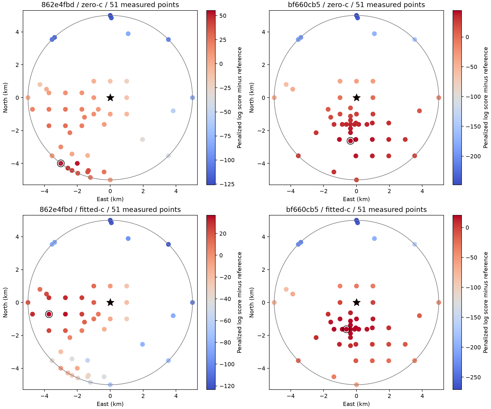
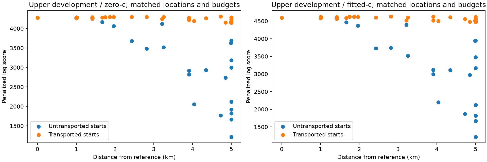
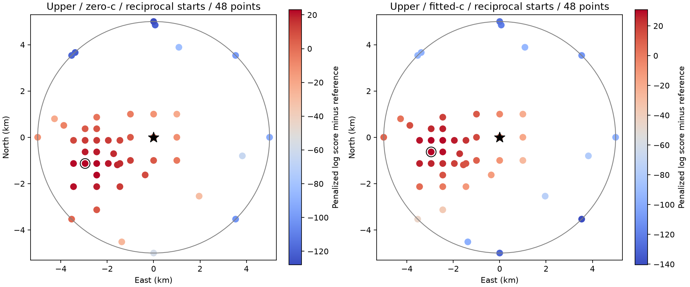
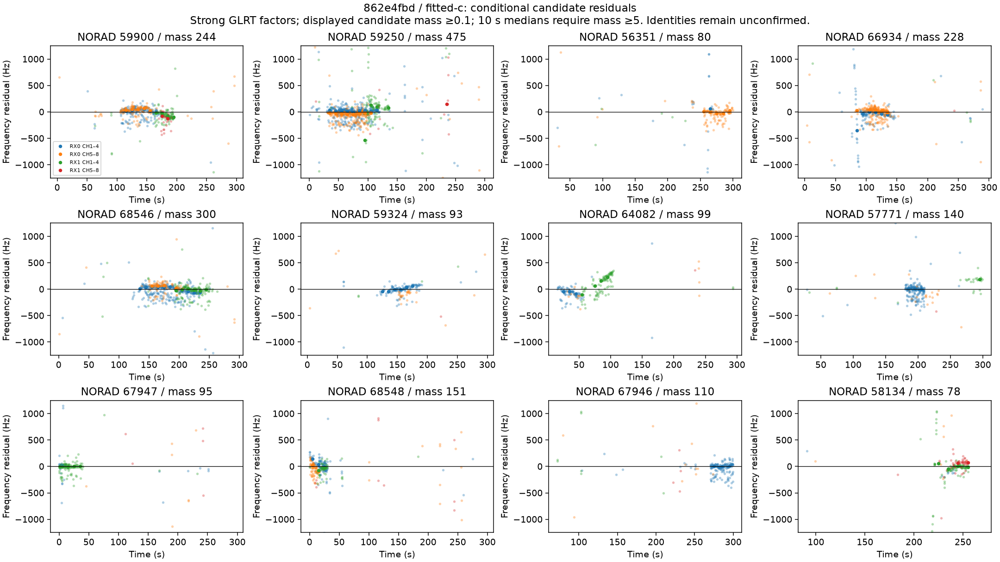
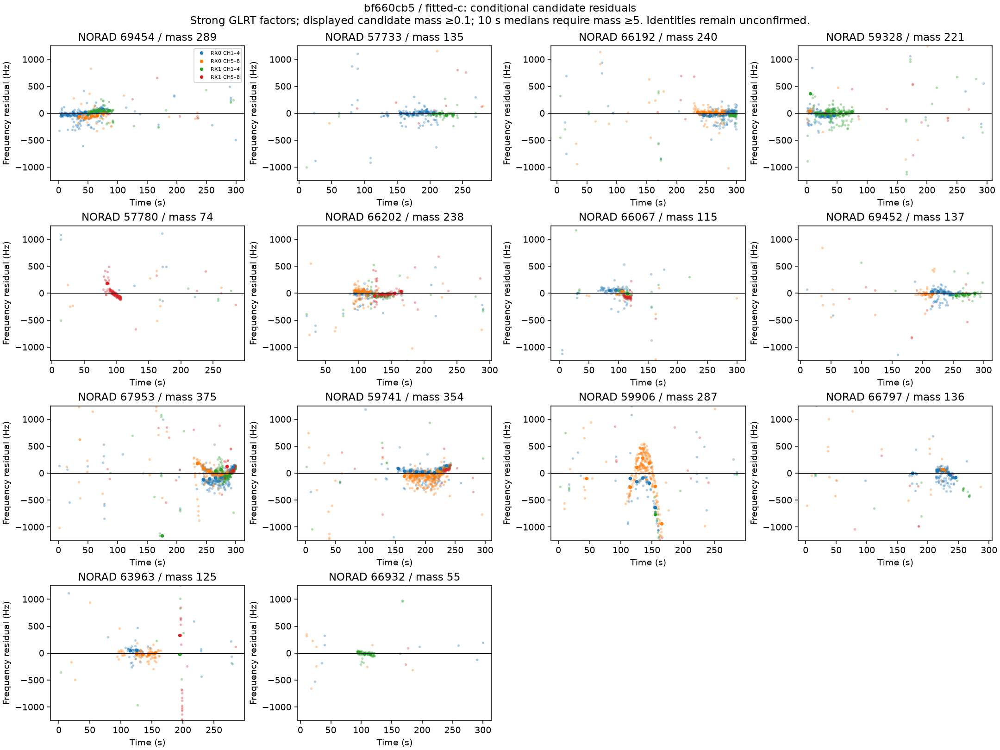

# Source-frequency starts and spatial optimizer checks

## Motivation

The [joint additive-bias experiment](../residual-audit/README.md) improves
frequency fitting without consistently improving location. Check whether its
reference fit and spatial profile are numerically comparable before interpreting
their preferred points as position estimates.

## Problem

The original shape matcher already fits a free track intercept. Its initializer
then retains proposals close to a shared receiver/band frequency mode. That can
discard plausible source-bias starting states even when their identities are in
the proposal inventory. Separately, sparse selection runs before continuous
nuisance fitting: moving a receiver several kilometres while retaining its old
frequency parameters can delete satellites before their biases are refitted.

## Solution

Retain bounded source-bias and orbital-phase proposals after subtracting the
learned receiver calibration. Reopen the full prepared catalogue at the
reference. Then compare identical spatial evaluations using original starts
and starts transported to approximately preserve their frequency curves at the
trial position. Transport changes initialization only: the likelihood, original
Gaussian priors, cardinality penalty and target-position orbital predictions
are subsequently refitted.

**Better starts substantially improve the upper development frequency fit, but
do not establish the requested near-reference minimum.** Transport exposes
plausible fits several kilometres away that the previous initialization lost.
The accuracy objective remains open. This is development-only evidence; the
four validation scans and their original denominator are unchanged.

## Method

Use the two frozen whole-scan development assignments, upper `862e4fbd` and
lower `bf660cb5`, without new RF collection. Preserve their sealed GLRT factors,
alternative peaks, nominal RF mapping hypothesis, latest eligible past-only
TLEs and fixed-reception-frame orbital phase banks. The configured reference is
37.84903264307456°, −122.4856541910174°, height 0 m; it is not a surveyed fix.

Source-frequency starts use the original measured tracks, with no winning
satellite labels or position errors as matcher inputs. Keep all original warm
starts as well as the new shape starts. The source-bias prior remains 2,000 Hz
with ±20,000 Hz bounds, individual orbital phase 1 s with ±10 s bounds, common
phase 3 s, Cauchy scale 250 Hz and penalty 30 per selected satellite. Source bias
is additive Hz, preserving the separately ablated within-band RF coefficient.

At each spatial point both c arms receive the same transported non-RF states,
observations, candidate pool, other priors and iteration budgets. Preserve the
nested zero-c feasible solution in fitted-c. Transport regresses the difference
between old and trial-position Doppler curves onto a constant bias and the
orbital-phase derivative, weighted by the seed's candidate-marginalized signal
mass. It uses no position-error objective and charges the original priors after
the move. The declared source position is part of the resume protocol.

## Initialization and convergence results

The new shape proposals introduce **no new identities** into either original
proposal pool. They instead offer different source-frequency/phase starts.
The subsequent full-catalogue upper reference fit selects two identities outside
that pool; its spatial pool therefore expands from 25 to 27. The lower pool stays
at 25. Prepared full catalogues contain 1,040 and 1,066 candidates respectively.

| Scan / arm | Earlier joint-bias reference | New full-catalogue reference | Later 80-step reference |
|---|---:|---:|---:|
| Upper / c=0 | 3,476.87 | 4,118.88 | 4,274.88 |
| Upper / fitted-c | 3,719.08 | 4,519.32 | 4,598.19 |
| Lower / c=0 | 5,031.29 | 5,031.57 | 5,031.57 |
| Lower / fitted-c | 5,325.78 | 5,327.36 | 5,327.87 |

These stages change starts and, where stated, candidate universe or numerical
budget. Their gains are not isolated causal estimates of one initializer step.
The upper full reference selects 12 candidates, replacing several earlier
conditional assignments. They remain inferred identities, not confirmed emitters.

Increasing nuisance iterations from 20 to 80 raises the already warmed upper
local-reference scores by 47.94 / 46.99 units, larger than several spatial gaps.
An independent joint L-BFGS reference run gives 4,274.48 / 4,598.13, within
0.394 / 0.052 score units of IRLS and with the same 12 identities. The higher
budget is chosen from this frequency-convergence check, then used at every
point in both spatial arms. Reference solver agreement does not certify every
other point or a globally optimal satellite subset. Reopening the full prepared
catalogue from these converged reference states changes each score by less than
5.1e−7 units and retains all 12 upper / 14 lower selected identities. This audit
does not introduce the later displaced states as reciprocal starts.

## Measured spatial comparison

The declared search uses 12 points uniform in disk area (seed `20261012`), eight
1 km grid probes, eight points on the 5 km boundary and three local refinement
rounds for each c arm. Every visited point receives both arms. Each invocation
is bounded to 300 seconds and resumes immutable checkpoints. The
[machine-readable summaries](summary.json) record completion, point counts,
best sampled distances and reference gaps; incomplete controls remain labelled.

Both transported 80-step searches complete with 51 measured points, including
all 12 random points. Neither passes the conditional distance/gap target.

| Scan / arm | Best sampled distance | Reference gap | Selected candidates at best |
|---|---:|---:|---:|
| Upper / c=0 | 5.00 km (boundary) | 55.31 | 13 |
| Upper / fitted-c | 3.79 km | 36.66 | 12 |
| Lower / c=0 | 2.65 km | 44.45 | 14 |
| Lower / fitted-c | 1.74 km | 20.24 | 14 |

A boundary best point does not identify an interior minimum. Reopening the
complete prepared catalogues at both preferred points preserves all fitted-c
best scores to within 5e−7 units. Upper zero-c at the fitted-c preferred point
gains 2.00 units from the paired nuisance states; its boundary score remains
higher. All six reference/preferred-point audits retain their selected identities.



These are measured points, with no interpolated surface or calibrated confidence
contour. A black star marks the configured reference; the ring marks the best
sampled score for that arm. The color is a penalized composite log score, not
position error or a normalized geographic posterior. Restricted candidate pools
and bounded subset search make the results conditional diagnostics.



For example, at the upper scan's first random point, 3.907 km from the reference,
the untransported fit loses satellites and fitted-c scores about 3,120. Transport
retains all 12 reference candidates and reaches 4,621.04 with the same model and
budget, exceeding the reference by 22.86. This is a better feasible explanation
at that point, not evidence of a physically correct distant location. It
demonstrates that earlier steep rejection of distant points was partly an
optimizer artifact. Broadening the profile does not imply improved localization.

The low-budget upper search is complete: its best sampled distances are
2.00 / 2.06 km with gaps 15.83 / 13.88 for zero-c / fitted-c. Its preferred
locations should not be mixed with the later 80-step profile. Newly discovered
states also need reciprocal starts and full-catalogue endpoint audits before
claiming a stable position minimum.

The completed upper reciprocal test is a stronger counterexample to the old
profile: moving its best displaced states back to the reference and refitting
raises the reference to **4,337.29 / 4,657.19**, above the entire earlier map's
zero-c / fitted-c maxima of 4,330.19 / 4,634.85. Both reference arms now select
13 candidates, including 67801. This comparison changes the starting inventory
from two to six common non-RF states. It does **not** prove a near-reference
minimum: the same improved states must be made available at the other locations.
No spatial accuracy gate is evaluated for this single-point experiment.

The same reciprocal test changes the lower reference by less than 5e−7 units
and retains the same 14 identities. Thus the upper missing-start explanation
does not resolve the lower scan's spatial discrepancy.

### Matched search after the reciprocal fit

At the improved upper reference, one outer iteration from the two optimized
states reproduces the three-iteration scores within 2e−7 units. Use that
frequency-only convergence check to choose a smaller per-point budget, then
freeze one outer / 80 nuisance iterations for **both c arms** at every new
position. This does not establish convergence away from the reference, or make
the new search budget identical to the earlier three-iteration search.

The new search completes **48 paired points**, retaining all 12 random points,
the grid/boundary inventory and three refinement rounds. It selects the same
13 candidates throughout. Better reference fitting still does not establish
the location target:

| Upper arm | Best sampled distance | Best score | Reference gap | Density gain | Charged-cost change |
|---|---:|---:|---:|---:|---:|
| c=0 | 3.16 km | 4,360.32 | 23.03 | 23.94 | +0.91 |
| fitted-c | 3.02 km | 4,688.01 | 30.82 | 31.70 | +0.88 |

The spatial advantage is mostly in the normalized frequency density, not a
reduction in nuisance-prior cost. It remains conditional on the surrogate
frequency likelihood and inferred identities. All earlier higher feasible
scores remain published; a smaller budget is not proof that a lower score is
the true profile at any position.

Full-catalogue audits with three outer / 80 nuisance iterations reproduce the
new reference within 2e−7 units and improve the new preferred-point scores by
at most 0.002 units. They retain the same 13 identities. These checks support
the measured endpoint scores while retaining the failed position target; they
do not globally certify the profile or satellite set.



## Residual structure

[Conditional residual receipts](residuals/conditional-residual-summary.json)
and four plots retain the earlier 80-step reference fits, before the upper
reciprocal fit adds candidate 67801. Ten-second medians require
signal mass at least five and are not connected through missing observations.
They use all candidate alternatives for summaries and do not turn inferred
satellites into hard measurement labels.





Some assignments still have band-dependent residuals. In the fitted-c reference,
upper candidate 68548 has two matched receiver/time-bin lower-minus-upper
differences of about 123–138 Hz; lower candidate 59906 has six differences
spanning approximately −581 to +168 Hz. These are conditional descriptive
comparisons, not independent clock estimates or a calibrated nuisance prior.
Source/channel frequency behavior, orbital error and incorrect associations
remain possible explanations.

## Verification and reproduction

Synthetic component tests recover ±6 kHz source-bias starts separately from
receiver offsets and preserve frequency curves under known geometric bias/time
changes. They check bounds, neutral unsupported columns and resume rejection
when the source position, transport method or numerical kernel changes.
The focused component/tool suite passes **56 tests** and Ruff. A report guard
prevents a reference-only fit from passing a spatial accuracy gate by construction.
Every retained spatial fit replays its normalized density and charged priors
within 1e−6 score units. Summaries record the observed maximum replay error.
No scientific fixture or production default changes.

The [start receipts](fast-862e4fbdc0d1b5b03a0ef5e12422eaf0/starts/) and per-study
results retain learned weights, complete nuisance states, candidate mappings and
executed-source hashes. Code snapshots accompanying this report are publication
versions; each slice's receipt records its executed wrapper hash. Core likelihood
and phase kernels remain unchanged throughout these spatial comparisons.
Published JSON copies are whitespace-compacted without changing parsed scientific
values. [Serialization receipts](receipt-serialization.json) retain both original
and publication byte hashes; original source-file hashes in summaries refer to
the local receipts, rather than the compact copies. Original receipts remain on
local bulk storage. JSONL rows retain their original bytes.

An [analytic OFDM injection](doppler-frequency-injection.json) independently
generates the absolute eight pilot subcarriers, applies propagation time
dilation and carrier Doppler, and mixes at the nominal pilot RF. Coarse
acquisition uses channel-carrier Doppler rounded to 10 kHz, without supplying
the pilot correction to the fine scorer. At injected ±3,000 m/s, the scorer's
frequency changes agree with effective pilot-RF predictions within 14 Hz;
channel-center RF predictions differ by over 1 kHz. Both edges have exact
scores above 0.99 in this noiseless control. The synthetic check uses a dense
131,072-bin grid, rather than the recording's 512-bin grid, and does not
calibrate recording precision, front-end filtering, sample clocks or the LNB LO.
The analytic pilot centroid is 117,187.5 Hz below the nominal pilot-tuning RF
on both edges, giving only 1.17 Hz of Doppler difference at this injected speed.
This check does not support replacing pilot RF by the full channel-center RF
to repair the geographic results.

```bash
OPENBLAS_NUM_THREADS=1 PYTHONPATH=src python -m tools.prepare_glrt_bias_shape_starts \
  --bundle <scan>/bundle --surface <scan>/joint-satellite-bias-expanded-v1 \
  --track-initial <scan>/relative-shape-initial/initialization.json --output <new-starts>
OPENBLAS_NUM_THREADS=1 PYTHONPATH=src python -m tools.evaluate_wrapped_fast_scan sweep \
  --bundle <scan>/bundle --initial <scan>/bias-shape-starts-v1/converged-initial.json \
  --candidate-pool <scan>/bias-shape-starts-v1/refined-pool.json --output <new-surface> \
  --phase --inertial-phase --relative-phase-sigma-s 1 --satellite-bias-sigma-hz 2000 \
  --transport-bias-starts --iterations 3 --nuisance-iterations 80 \
  --points 12 --probe-grid --refine 3 --seconds 300 --seed 20261012
OPENBLAS_NUM_THREADS=1 PYTHONPATH=src python -m tools.report_glrt_bias_transport \
  --data-root <local-data-root> --output <report>
```

Sealed recording/orbit banks remain on local bulk storage. The numerical starts
used by these runs are published alongside their originating full-reference and
convergence fits. Add `--resume` only to an incomplete surface with an identical
scientific protocol. The reference-accuracy target and independent four-scan
validation remain outstanding.
