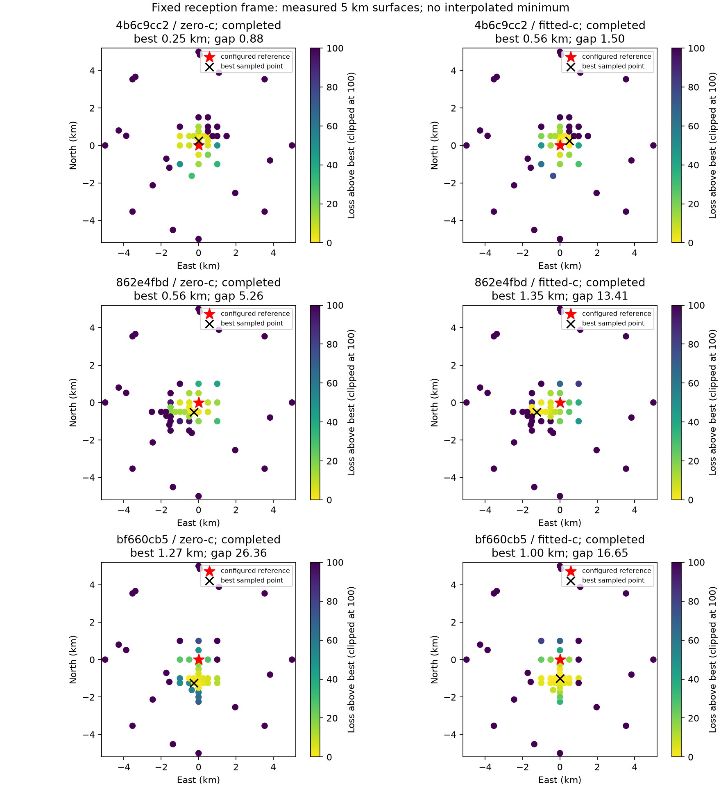

# Clock and orbital-phase diagnostics on the frozen eight-channel cohort

## Motivation

The [completed six-scan evaluation](../relative-phase/README.md) explains
70–91% of strong GLRT evidence, but the configured Sausalito reference remains
below the best evaluated likelihood. Better frequency scores alone do not meet
the position objective. This update tests two physical interpretations of the
nuisance parameters and retains their negative results.

## Problem

A shared receiver drift can miss differences between CH1–4 and CH5–8. Also,
querying ECEF states at a shifted time changes both satellite orbital phase and
Earth rotation. An orbital-phase perturbation at a fixed reception time has a
different transformation. Neither interpretation establishes a measured clock
error. Published signal measurements distinguish frame, carrier and sample
clocks; they do not establish a constant carrier correction throughout these
five-minute captures. See [Qin et al., 2026](https://www.nature.com/articles/s44459-026-00075-6).

## Solution and result

Two optional variants now permit an explicit comparison. Defaults retain the
previous model. Band drift adds an upper-minus-lower slope per receiver, with
a 1 Hz/s Gaussian prior. Fixed-reception-frame orbital phase rotates the queried
ECEF position and velocity by the additional Earth angle, holding reception-time
Earth rotation fixed. Both have component-owned synthetic and derivative checks.

**The accuracy objective remains unmet.** Band drift improves the frequency
score at the reference, but leaves the fitted-c preferred development positions
about 1.1–1.3 km away. The orbital-phase variant improves one development score
gap and worsens the other. These are bounded probes, not certified minima.

## Method

Keep the same frozen observations, original candidate alternatives, prepared
past-only TLEs, candidate pools, two nuisance starts, priors and iteration budgets.
Both c=0 and fitted-c use each variant at every position. The baseline and each
variant evaluate the identical seven points: the reference, both previous arm
minima, and four 500 m cardinal neighbors. Each position receives three outer
iterations, 20 nuisance steps per iteration and 60 EM steps per weight solve.
The report rejects mismatched evidence, starts, priors, budgets or point sets.

The reference remains 37.84903264307456°, −122.4856541910174°, height 0 m.
This is the configured pipeline reference, not a surveyed antenna position.
The wrapped-Cauchy scale is 250 Hz, satellite penalty 30, common phase prior
3 s and individual phase prior 1 s. The receiver drift prior is 10 Hz/s and
the c prior is 2,000 Hz/GHz. No new RF collection was made.

## Frequency gain and position effects

Positive score gain means improved frequency fit at the reference. Reference
gap is the best sampled score minus the reference score. Both quantities include
the declared penalties; neither is a calibrated position confidence interval.

| Development scan | Variant | Fitted-c reference gain | Best sampled distance | Reference gap |
|---|---|---:|---:|---:|
| `bf660cb5` | Baseline | 0 | 1.25 km | 27.86 |
| `bf660cb5` | Band drift | +6.99 | 1.27 km | 26.15 |
| `bf660cb5` | Fixed reception frame | +16.73 | 1.25 km | 14.43 |
| `862e4fbd` | Baseline | 0 | 1.12 km | 11.31 |
| `862e4fbd` | Band drift | +2.00 | 1.12 km | 10.77 |
| `862e4fbd` | Fixed reception frame | −7.37 | 1.12 km | 12.30 |


The [paired comparison](paired-comparison.json) includes the matched c=0 results.
A further 15-point fixed-frame probe uses east offsets −500, 0 and 500 m and
north offsets −1,000 to 0 m at 250 m spacing. On `bf660cb5`, the union of those
points and the original seven prefers (0, −1,000 m), with fitted-c gap 16.65.
On `862e4fbd`, the union still prefers (−1,000, −500 m), gap 12.30. Its finer
grid alone prefers a 559 m point, but that score is lower than the known feasible
1.12 km point. Restricting the grid would falsely suggest improved accuracy.

## Expanded 5 km searches

Both development scans subsequently completed broader fixed-frame searches,
with 12 uniform-area random points within 5 km, eight boundary points, eight
1 km neighbors, the seven original probe points, and three refinement rounds
per arm. The same two starts initialize both arms at every evaluated position.
These expanded searches are conditional on the original frozen candidate pools;
the [subsequent full-catalogue audits](../residual-audit/README.md) now cover
the reference and both preferred points for all three completed expanded searches.
They reproduce fitted-c scores, but find a better zero-c fit on the upper
development scan at its fitted-c preferred point. Its best audited zero-c
distance becomes 1.35 km. The table below retains the original conditional
surfaces, rather than relabeling them as the audited profile.

| Scan | Paired positions | c=0 best distance / reference gap | Fitted-c best distance / reference gap |
|---|---:|---:|---:|
| `bf660cb5` | 50 | 1.27 km / 26.36 | 1.00 km / 16.65 |
| `862e4fbd` | 54 | 0.56 km / 5.26 | 1.35 km / 13.41 |
| `4b6c9cc2` (retrospective validation) | 49 | 0.25 km / 0.88 | 0.56 km / 1.50 |



The broader upper-scan search finds a higher score outside its original seven
points. This worsens its fitted-c preferred distance, rather than confirming
an improvement. The plotted cross marks the best evaluated point; no continuous
or exhaustive-subset minimum is certified. Complete and incomplete runs are
identified separately in [the surface summary](fixed-frame-full-summary.json).

Every saved endpoint in this expanded report is replayed against its bound GLRT
and phase-bank arrays. The report reconstructs the normalized activity mixture,
frequency density and all nuisance/cardinality penalties, requiring agreement
with both saved log density and score to within 1e−6 units. It also rejects
unnormalized activity weights or changed input/phase-bank provenance. This checks
stored-score consistency, not calibrated probabilities or a global optimizer.

The first two broader-search invocations failed before fitting because their
bundle arguments named a parent directory. Corrected invocations use `bundle/`.
The lower development search required three bounded computation slices and the
upper search two; each slice allows 300 seconds and retains all completed pairs.
The retrospective validation scan likewise finishes in three slices.
These bounds concern re-analysis, not RF collection. Initial slices that stop
early remain in the final result's execution history and cannot pass a gate.

## Retrospective checks on the four original validation scans

The four validation labels were already inspected in the prior report. These
new seven-point checks are **retrospective**, not fresh randomized validation,
and do not replace the completed 5 km searches or their 0/4 result.

| Scan | Fixed-frame fitted-c best sampled distance | Reference gap |
|---|---:|---:|
| `4b6c9cc2` | 0.71 km | 0.90 |
| `5bc39e5c` | 1.00 km | 29.48 |
| `84dbe119` | 1.41 km | 24.56 |
| `e557fbf8` | 1.28 km | 17.42 |

One small probe reaches the numerical 1 km / one-unit criterion. It has not
passed a full fitted-c surface search: the subsequent 49-point search on
`4b6c9cc2` prefers (500 m east, 250 m north), with gap 1.50, exceeding the one-unit
criterion. Its matched c=0 search prefers (0 m east, 250 m north), gap 0.88,
and passes the conditional sampled-surface criterion. Three other original
validation scans fail even the small probe. Thus there is at most one
retrospective c=0 pass among four and no fitted-c pass, with new preferred points
subsequently audited for the three expanded searches. No fresh validation or cohort success is
claimed. All four original validation assignments remain in the denominator.

## Other measured diagnostics

At fixed reference fits, extra quadratic receiver terms improve fitted-c scores
by less than one unit each. A frequency-dependent drift term improves them by
0.25 and 1.08 units. Individual constant satellite biases also show little gain
for the principal supported candidates. These limited conditional profiles do
not prove that transmitter clock errors are absent; they provide little reason
to add many unconstrained clock parameters now. Height probes from −25 to 150 m
also do not explain the reported horizontal displacement. These short-budget
profiles are retained as diagnostics, not convergence certificates.

For 25 selected development candidates, compare the newest eligible element
set with the next older distinct-epoch set from the **same provider**. Both epoch
and collection precede the capture. Keep the newest set as the nominal orbit.
After empirical time alignment and removal of a constant, linear drift and
frequency timing derivative, the older-minus-newer predicted frequency has
median residual RMS 62.6 Hz and 38.1 Hz for the two scans, with maxima 337.4 Hz
and 144.7 Hz. This is forecast disagreement, **not measured error of the newest
orbit**. The alignment shifts ECEF query time and is a consistency diagnostic,
not an exact orbital-element perturbation. The residual motivates testing a
causal orbit-uncertainty model before claiming overly precise location scores.

Extrapolating the same historical alignment rates by current TLE age gives only
moderate correlation with fitted total phase (0.40 and 0.42 on selected
development identities). After a common centering shift, phase disagreement RMS
remains 3.77 s and 1.96 s. This selected-identity check does not establish an
archive-derived correction or uncertainty prior. No coefficients were chosen
using position error. The [cross-provider inventory](cross-provider-latest-inventory.json)
also finds **no newer eligible epoch** for any of the lower development scan's
1,066 prepared sky candidates when considering both archived providers under
the same capture cutoff. A missing newer-provider element is not an explanation
for that scan's bias.


A joint-score sanity check exposed a numerical hazard: adding one retained
surface per scan makes the reference appear best among 29 common points.
Taking the envelope of previously computed compatible fits at each point instead
prefers (0, −1,000 m), with a fitted-c reference gap of 54.14 units. The first
sum discards known feasible fits. Neither sum certifies a joint minimum; the
envelope is a diagnostic using historical scalar scores, not a newly optimized
joint result. A future joint fit must preserve and re-evaluate feasible states.

## Evidence and reproduction

Each scan directory retains paired evaluations, result and protocol files,
including the c=0 arm, selected identities, activity weights and nuisance values.
Source hashes in those protocols identify execution versions; the separate
[publication hashes](publication-source-digests.json) identify the current code.
The one-off conditional profiles and past-forecast calculations retain their
numeric outputs and declared protocols; they are not packaged as a complete
standalone replay of the protected archive. Original GLRT exports and orbital
arrays remain on local bulk storage. No golden fixture was modified.

The focused likelihood, orbit, initialization, solver and report checks pass
**40 tests**, and Ruff passes for changed files. Existing defaults remain the
legacy ECEF time-shift model with no additional band drift. Example paired run:

```bash
PYTHONPATH=src OPENBLAS_NUM_THREADS=1 python -m tools.evaluate_wrapped_fast_scan sweep \
  --bundle <frozen-scan-bundle> --initial <two-known-initial.json> \
  --candidate-pool <warm-local-pool.json> --positions-json <paired-positions.json> \
  --output <local-output> --phase --relative-phase-sigma-s 1 \
  --iterations 3 --nuisance-iterations 20 --seconds 300
```

For the band variant add `--band-drift-sigma-hz-s 1`; for the frame variant add
`--inertial-phase`. Use identical inputs, starts, points and other settings.
Regenerate this report with `python -m tools.report_wrapped_physical_diagnostics
--data-root <frozen-data-root> --output <report-directory>`.
