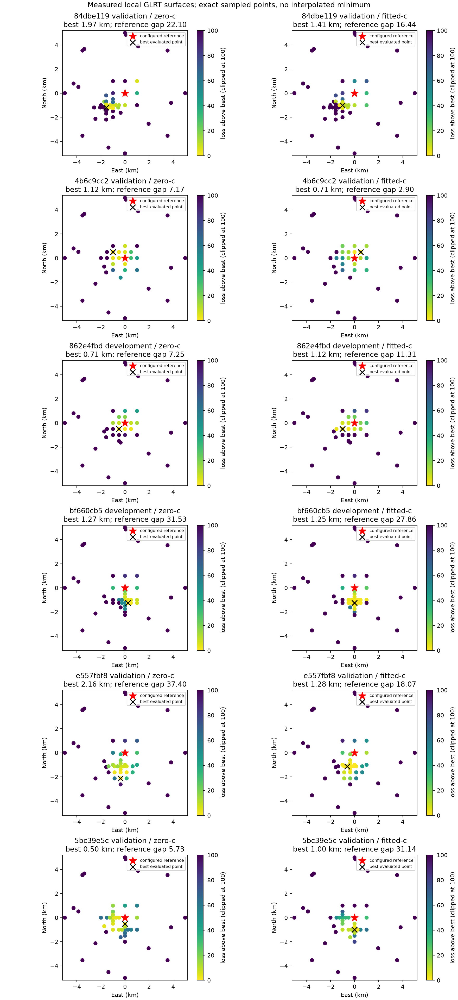

# Penalized satellite timing: completed six-scan local evaluation

## Motivation

Fit every completed GLRT candidate-set observation at a specified receiver
position/time, then compare the configured Sausalito reference with nearby
positions. A better frequency fit must have a separately measured position result.

## Problem

The earlier shared-timing model explains only 29–37% of strong evidence.
Its starts sometimes choose orbit curves requiring excessive receiver drift.
Sparse reselection also discarded previously learned activity weights, and an
RF restart could lose a known feasible solution. These numerical defects can
obscure small geographic score differences.

## Solution

Satellite-specific timing corrections and orbit-blind measured-track starts
increase modeled strong-evidence responsibility to **70–91%** at the reference.
The six completed searches find nearby preferred positions, but **the reference
is not the evaluated minimum**. The stricter operational target remains unmet:
**0/4 randomized validation scans pass**, with every failure retained.
No calibrated position posterior, confirmed satellite identity, or production
promotion is claimed.

## Method

Keep the frozen six-scan panel and whole-scan random split, seed `20261012`.
Use exactly the prepared past-only elements and original GLRT receiver factors.
Fit normalized alias densities with circular uniform clutter, four receiver/band
offsets, two receiver drifts, sparse activity, common timing and individual timing.
Evaluate zero-c and fitted-c at every sampled position with matched observations,
candidate pool, non-RF starts, priors and per-position iteration budgets.

The configured reference is 37.84903264307456°, −122.4856541910174°, height 0 m.
This is an operator/pipeline reference, not a surveyed capture GPS fix. Local
station configuration also leaves antenna altitude unspecified. Horizontal
coordinates in that configuration differ by only about 9 m; that alone cannot
explain the kilometre-scale displacements. Position distances below use the
declared configured reference and fixed-height convention.

## Model and bounded search

The final wrapped-Cauchy scale remains 250 Hz, alias period 227,272.727 Hz,
activity penalty 30 per selected satellite, and satellite work cap 40. The
receiver-drift prior remains 10 Hz/s and RF coefficient prior 2,000 Hz/GHz.
Common ephemeris-time correction has a 3 s Gaussian prior; independent corrections
have a **1 s Gaussian prior**. Common and individual corrections each have a
±10 s bound. Both arms receive the same timing model and priors. Receiver UTC
stays fixed, and unselected individual corrections are zero. Their prior cost
participates in satellite additions and removals.

Time corrections query the same directly propagated 0.25 s ephemeris bank.
This is the declared empirical ephemeris-time model; it does not establish
physical transmitter clock errors or exact orbital-element uncertainty.

Each full catalogue contains 949–1,138 prepared sky candidates. Local searches
freeze the union of measured-track proposals and both reference endpoint
selections: **22–33 candidates**, depending on scan. Every original GLRT factor
and every retained alternative still enters the likelihood. These are conditional
candidate-pool searches, with subsequent full-prepared-catalogue audits at the
reference and preferred points; neither is an exhaustive subset certificate.

Each search evaluates the reference, eight 1 km neighboring points, **12 uniform
area random points within 5 km**, eight boundary points, and three adaptive
refinement rounds per arm. Both arms are evaluated at every requested location.
There are 40–51 unique paired positions per scan. Each position uses three outer
iterations, at most 20 nuisance steps per outer iteration, and 60 EM steps per
weight solve. Searches initialize from the same non-RF endpoint parameters and
weights; the RF coefficient is projected to zero only in the fixed-c arm.
The free-c profile retains every computed zero-c solution as a feasible baseline.

## Frequency fit versus position

Times identify capture starts on October 12, 2026 in PDT. Prefixes identify the
full session IDs in [the summary](cohort-summary.json); no scan was substituted.
The distances and score gaps in this table describe the conditional sampled
surfaces, before any higher full-catalogue audit score is substituted.

| Capture / session prefix | Split | Strong signal fraction, fitted-c | c=0 best distance | Fitted-c best distance | Fitted-c reference score gap |
|---|---|---:|---:|---:|---:|
| 05:26 / `5bc39e5c` | Validation | 90.51% | 0.50 km | 1.00 km | 31.14 |
| 05:56 / `e557fbf8` | Validation | 87.97% | 2.16 km | 1.28 km | 18.07 |
| 06:26 / `bf660cb5` | Development | 84.01% | 1.27 km | 1.25 km | 27.86 |
| 06:57 / `862e4fbd` | Development | 76.09% | 0.71 km | 1.12 km | 11.31 |
| 07:27 / `4b6c9cc2` | Validation | 80.82% | 1.12 km | 0.71 km | 2.90 |
| 07:57 / `84dbe119` | Validation | 70.28% | 1.97 km | 1.41 km | 16.44 |

Score gap is best penalized composite log-density ratio minus the reference
value; smaller is better for the reference. These are not calibrated posterior
odds. The fitted RF coefficients range from −590.90 to −647.84 Hz/GHz and increase
reference frequency scores by roughly 184–564 units over matched zero-c fits.
This frequency improvement does **not** consistently improve position error:
the fitted-c distances increase on some scans and decrease on others.




Plots show exact sampled points; colors clip loss above the best at 100 units.
The black cross marks the best evaluated point, not a certified continuous
minimum. The red star marks the configured reference. Density values farther
away can be limited by local subset optimization as well as physical mismatch.

The preregistered operational target was a best point within 1 km and a
reference score gap no greater than one unit on at least three of four validation
scans. **Neither arm reaches that combined target on any validation scan.**
The target is our explicit operational test, not a calibrated confidence bound.

## Full-catalogue audits and numerical controls

Audits reopen the complete prepared candidate universe at each arm's preferred
point and at the reference. They reproduce both development fitted-c scores and
all four validation fitted-c preferred-point scores. One validation zero-c audit,
`4b6c9cc2` at (−1 km east, +0.5 km north), increases its score from 4,233.51 to
4,244.90 by finding an additional explanatory candidate. Thus a small local pool
does not certify the all-catalogue profile. Its audited position is still 1.12 km
from the reference; the fitted-c preferred point and failed combined gate persist.
Audit receipts are retained under each session directory, including the extra
audit of the final `e557fbf8` points.

The independent joint L-BFGS solver reproduces near-reference fitted-c scores
closely, but gives different, sometimes inferior subset fits at distant points
and did not improve runtime. IRLS remains the default. Earlier solver attempts
and time-bounded incomplete searches remain alongside the final results.

Sparse reselection now starts from the learned feasible weights and never
deliberately replaces them with a worse cold weight solve. Resume checks reject
changed evidence, candidate pools, priors, seeds or likelihood/subset kernels.
They replay the deterministic search using cached paired results and retain
the source hashes for each execution slice.

## Failures, split integrity and provenance

The first six-start initialization attempt on **all four validation scans**
exhausted a 180 s external bound without saving a result. Both development scans'
best broad start was the zero common-phase start. Before inspecting validation
position errors, the initialization policy retained the two measured offset
modes at that common-phase start and checkpointed each result. The original
[protocol](validation-protocol-v1.json), [bounded initialization revision](validation-protocol-v2.json),
and [incumbent-weight correction](validation-protocol-v3.json) remain published.
The weight/RF restart correction was motivated by discarded known-feasible
frequency scores, without changing the mathematical model or priors.

All four validation local searches reached their first 290 s slice limit before
finishing refinement. Cached paired results were resumed in bounded slices.
One `e557fbf8` slice also exhausted its external 150 s bound. Its completed pairs
were retained and the search subsequently finished. No incomplete search passes
the accuracy gate. [Execution failures](execution-failures.json) record these
attempts; all four original validation assignments remain in the denominator.

The orbital element collection time **and epoch** precede the earliest
capture-start bracket bound. The original catalogue choices and phase-bank
digests are verified before fitting. No future-element fallback, RF collection,
QNAP write, scientific golden update, or production activation occurred.

Published receipts include source/input/orbit hashes, candidate identities,
all paired-point fits, nuisance values, activity weights, prior settings,
source snapshots and the frozen random split. Result JSON retains every value
with compact whitespace; pool files retain their original bytes for digest
verification. Original receipts, large source exports and orbital arrays stay
on local bulk storage. The focused component check set passes
**81 tests** and Ruff. SciPy 1.18.1, already declared by the repository, was used
only for the optional optimizer cross-check and its tests.

The remaining work is physical model/calibration validation, stronger all-catalogue
subset checks and a defensible position reference. Frequency-score improvement
alone cannot close the accuracy objective.

## Reproduction

Preparation and original source binding are described in the parent report.
Use one completed frozen scan, a local output directory, and matching source
hashes. Do not run against future or relabeled capture inputs.

```bash
OPENBLAS_NUM_THREADS=1 python -m tools.evaluate_wrapped_fast_scan initialize \
  --bundle <bundle> --output <initialization> \
  --phase --relative-phase-sigma-s 1 --phase-starts 0
OPENBLAS_NUM_THREADS=1 python -m tools.evaluate_wrapped_fast_scan sweep \
  --bundle <bundle> --initial <warm-common-initial.json> \
  --candidate-pool <warm-local-pool.json> --output <new-output> \
  --points 12 --refine 3 --iterations 3 --nuisance-iterations 20 \
  --seconds 290 --phase --relative-phase-sigma-s 1 --probe-grid
```

Resume an incomplete output with identical scientific options and `--resume`.
The warm start and pool documents are provided per session; they must match its
input and orbital bank. Full audits omit `--candidate-pool` and use
`--positions-json` with the recorded preferred coordinates. External process
bounds and every incomplete attempt must also be recorded.
