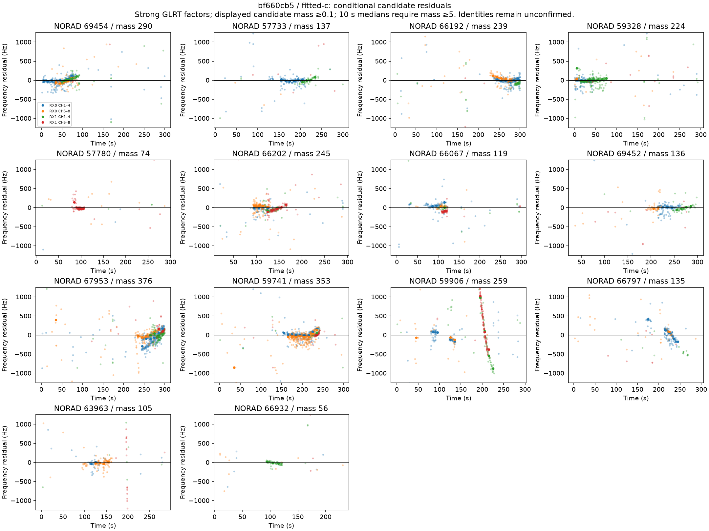
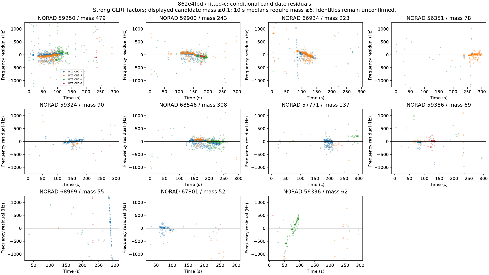
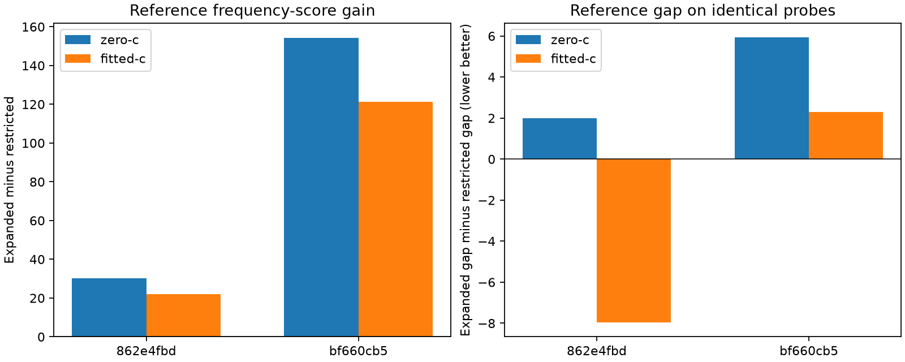

# Full-catalogue audits and joint source-frequency nuisance

## Motivation

The [broader local searches](../physical-diagnostics/README.md) still favor nearby
points over the configured Sausalito reference. Before accepting their position
results or adding orbital flexibility, check the complete prepared satellite
universe and inspect the residual frequency structure. Better frequency fitting
must remain separate from improved position accuracy.

## Problem

A frozen local candidate pool does not certify the full-catalogue profile.
Different nuisance starts can also find different scores for the same satellite
set. In addition, some selected curves retain sloped residual arcs even after
receiver/band offsets, drift, RF c and satellite-specific timing are fitted.
Candidate identities are conditional model assignments, not confirmed transmitters.

## Solution and measured result

Nine bounded full-catalogue audits reopen the reference and each arm's preferred
point for three completed searches. All fitted-c scores reproduce to within
3e−6 units, with the same selected identities. One zero-c audit finds a better
fit from the other arm's nuisance state, changing its best audited position.
The initial cause is therefore not simply a missing satellite in these pools.

An optional **additive per-satellite frequency bias**, fitted jointly with timing,
improves development reference frequency scores. Its geographic effects remain
mixed. **The accuracy goal remains open.** No fresh validation, production
promotion, calibrated posterior, or globally certified minimum is claimed.

## Full-catalogue audit

Keep the original observations, latest eligible past-only TLE choices and
phase banks. Embed each conditional endpoint into the larger identity universe,
preserving its learned activity weights and timing corrections. Both arms use
the same two non-RF endpoint states at each point; the RF coefficient is
projected to zero in the c=0 arm. Preserve every known feasible score and the
nested zero-c solution. Reconstruct density and prior costs before and after
the fit. Budgets remain three outer iterations, 20 nuisance steps per iteration
and 60 EM steps per weight solve, with an external 200-second limit per point.
All nine audits finish within their bound; no interrupted audit is promoted.

| Scan | Prepared candidates | Audited points | Main effect |
|---|---:|---:|---|
| `4b6c9cc2` | 1,092 | 3 | Both arms reproduce; c=0 prefers 250 m, fitted-c 559 m |
| `862e4fbd` | 1,040 | 3 | Zero-c gains 14.86 units at the fitted-c preferred point |
| `bf660cb5` | 1,066 | 3 | Both arms reproduce their preferred-point scores |

On `862e4fbd`, zero-c at (−1,250 m east, −500 m north) rises from 3,437.81 to
3,452.67. It retains the same 11 identities and exceeds the earlier zero-c
best score 3,451.89 at 559 m. The best among the three audited zero-c points is
now **1.35 km away**, with reference gap 6.04; the earlier conditional 559 m
result is not a robust position improvement. The audit changes both the candidate
universe and the nuisance starts, so it does not isolate those two numerical
effects. It proves a better feasible fit exists, not that the catalogue alone
caused it. The unchanged final identities favor investigating initialization.

The other completed retrospective scan remains close: `4b6c9cc2` has zero-c
distance 250 m and gap 0.88, and fitted-c distance 559 m and gap 1.50. One
retrospective conditional pass does not meet the original three-of-four target.
All four original validation assignments remain in the denominator. The complete
[audit summary](full-catalogue-audit-summary.json) and per-point receipts retain
both arms, source hashes, selected identities, weights and nuisance states.

## Residual diagnostics without hard identities

For every retained candidate alternative k and selected satellite j, compute
the conditional signal mass

`w_j q_ij a_ik K(f_ik − predicted_ij − nuisance_i) / mixture_i`.

The kernel is the same normalized wrapped Cauchy used in fitting. Clutter plus
all candidate/satellite signal masses must sum to one per physical receiver
factor. Equivalent aliases remain one alternative and multiple peaks are not
counted as independent observations. Tests check mass conservation, invisible
and null factors, alias invariance and alternative-weighted summaries.

The plots display strong GLRT factors and candidate masses at least 0.1.
Ten-second per-receiver/band medians require signal mass at least five; they
are separate points, with no line drawn through an unobserved gap. The vertical
view clips at ±1,250 Hz. JSON summaries retain all factors and all weighted
alternatives, including tails outside the plotted view. These conditional
residuals are **not independent measurement error**, and their identities remain
unconfirmed. They cannot calibrate a physical clock or orbit prior by themselves.





Most principal curves have relatively tight residual clusters. A few assigned
arcs show substantial remaining slope. In the fitted-c model, conditional
median absolute residuals are about 419 Hz for lower-scan NORAD 59906, and
921 Hz / 346 Hz for upper-scan NORAD 68969 / 56336. These can reflect incorrect
associations, source-frequency dynamics or orbital mismatch; the plots do not
identify a unique cause. The matched zero-c plots are retained:
[lower](bf660cb5-zero-c.png), [upper](862e4fbd-zero-c.png).

## Joint additive bias and timing experiment

Earlier one-at-a-time bias profiles held timing fixed. The new model estimates
an additive `b_j` jointly with common/individual timing, receiver/band offsets,
receiver drift, sparse activity and optional RF c. Each selected satellite's
bias has a 2,000 Hz Gaussian prior and ±20,000 Hz bound, declared in the
[development protocol](joint-satellite-bias-development-protocol.json) before
this geographic comparison. Inactive biases are zero, and their prior cost
participates in satellite additions/removals. A common additive shift is
confounded with receiver offsets; the bias prior centers that gauge. Bias
contrasts are interpretable conditionally, not as measured absolute clocks.

The bias is **additive Hz across receivers/channels**, not an additional
RF-dependent slope. This preserves the explicit zero-c versus fitted-c
comparison. It is a deliberately simple source-frequency hypothesis, not a
complete beam/channel clock model. Published measurements report distinct CFO
behaviors between channels and spot beams; they motivate testing source terms
but do not validate this constant-bias law or its prior scale for these captures.
See [Saroufim, Hayek and Kassas, 2026](https://www.ion.org/publications/abstract.cfm?articleID=20898).

Both development scans receive restricted and expanded runs with identical
seven-point sets, original candidate pools, two starts and other priors/budgets.
Both c arms are evaluated at every point. All four runs complete within their
300-second slice. The original frozen validation scans are not refitted with
this new model. The reference remains the pipeline coordinate
37.84903264307456°, −122.4856541910174°, height 0 m, rather than a surveyed fix.

| Scan / arm | Reference score gain | Old best distance | New best distance | Old gap | New gap |
|---|---:|---:|---:|---:|---:|
| `862e4fbd` / c=0 | +30.24 | 0.71 km | 0.50 km | 4.97 | 6.98 |
| `862e4fbd` / fitted-c | +21.92 | 1.12 km | 1.12 km | 12.30 | 4.33 |
| `bf660cb5` / c=0 | +154.13 | 1.25 km | 1.27 km | 24.83 | 30.76 |
| `bf660cb5` / fitted-c | +121.38 | 1.25 km | 1.25 km | 14.43 | 16.73 |



The upper fitted-c reference gap improves substantially; its preferred distance
does not. The lower gap worsens despite a much better reference frequency score.
These seven-point probes cannot certify a local minimum or a complete 5 km
surface. The model also leaves the conspicuous residual arcs unresolved:
their conditional median absolute residuals change to roughly 368, 887 and
378 Hz respectively. [Expanded-model residuals](joint-bias-residuals/conditional-residual-summary.json)
and matched plots retain this limitation.

## Checks and reproduction

Both IRLS and joint L-BFGS recover synthetic timing and bias contrasts, charge
the correct Gaussian/cardinality priors and retain null solutions without
charging unobservable seeded biases. Independent finite differences verify the
joint gradient. The focused component/tool suite passes **51 tests** and Ruff.
The original no-bias control scores reproduce exactly on the repeated development
probes. Every new probe's saved density, prior costs and responsibility mass are
replayed against the bound arrays before reporting. No golden was changed,
QNAP write made, new RF collected, or production feature activated.

Defaults leave satellite bias disabled. Example full-catalogue audit:

```bash
PYTHONPATH=src OPENBLAS_NUM_THREADS=1 timeout 200s \
  python -m tools.audit_wrapped_full_catalogue \
  --bundle <frozen-bundle> --surface <completed-fixed-frame-surface> \
  --point fitted-c --output <new-local-output>
```

For the joint development model, use the same `evaluate_wrapped_fast_scan sweep`
inputs/points as its restricted control, adding `--satellite-bias-sigma-hz 2000`.
Retain `--phase --inertial-phase --relative-phase-sigma-s 1`, three outer iterations
and 20 nuisance steps. Generate the baseline residuals and audit/bias comparison
with `python -m tools.report_wrapped_glrt_residuals --data-root <data-root>
--output <report>`. For expanded residuals add
`--surface-directory joint-satellite-bias-expanded-v1` and use a separate output.

Execution receipts identify their own source versions, while generated diagnostic
summaries identify the publication-time code. Later source changes do not relabel
earlier runs. Large GLRT exports and orbital arrays remain in local bulk storage.
Remaining work includes stronger nuisance initialization, joint candidate
association under the new source-frequency model, and physically constrained
orbital uncertainty. Improved in-sample frequency scores alone cannot establish
better localization.
