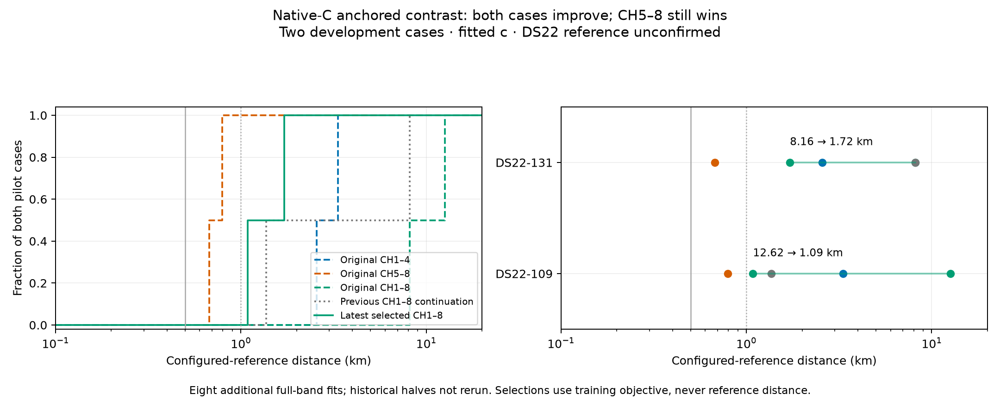

# Native-C anchored contrast: selected results on two DS22 cases

The latest selected CH1–8 states improve both pilot cases, but still lose to CH5–8. This is development evidence, not a new full-cohort result. All estimates use fitted c. DS22 distances use the configured, unconfirmed station reference.

| Case | Original CH1–4 km | Original CH5–8 km | Original CH1–8 km | Previous CH1–8 km | Latest selected CH1–8 km |
|---|---:|---:|---:|---:|---:|
| DS22-109 | 3.331478 | 0.794920 | 12.624524 | 1.366035 | 1.086041 |
| DS22-131 | 2.562646 | 0.674606 | 8.158713 | 8.158713 | 1.718268 |

## What changed

Each source state retains its position, slopes, fitted c, timing, candidate bank and native calibration representation. We transfer the inter-band offset from a donor state while compensating receiver intercepts to preserve the source band's entire calibration function. The opposite band changes by the intended offset contrast. Four declared transfers per case cover both half-derived sources receiving the full-state contrast and both reverse transfers. All use the original bounds and local search domains.

The fixed-state qualification verified anchor-band calibration closure below 5.83e-11 Hz and likelihood closure below 1e-7. The eight fresh fits all passed independent stationarity checks. They consumed 2,251 objective calls, including 16 audit calls, plus eight separate source replays. Each fit allowed 60 seconds including audit, 600 iterations and one optimizer invocation. All eight completed before reference evaluation; the evaluator used no objective calls or optimization.

DS22-109 selects high-from-all at objective 33,011.894187 and stationarity 0.000372. DS22-131 selects low-from-all at objective 32,981.214863 and stationarity 0.000115. Selection minimizes training objective over eligible states, including the prior incumbent. It never minimizes reference distance.

## Root-cause evidence and remaining gap

The improvement demonstrates consequential coupling between inter-band calibration and the optimization basin: transporting the position alone, or copying offset numbers without preserving the calibrated band, misses useful states. The previous fixed-state audit also showed DS22-131's near high-band-derived state incurred a 4,985.63 low-band NLL penalty while improving high-band NLL by 1,194.30. Conditional visibility normalization did not reverse that ranking, nor did the tested empirical background density.

Offset transport repairs a substantial part of the failure, but does not establish that a single shared association/detectability model explains both bands. The remaining high-half gaps are 0.291 km for 109 and 1.044 km for 131. Further work must distinguish association/detectability weighting from additional band-dependent calibration, using qualified nested controls and selection independent of reference distance.

DS22-131 has an unselected new candidate at 1.004504 km, and a previous unselected candidate at 0.212503 km. Neither belongs on selected-performance curves. These examples continue to expose a ranking problem as well as an initialization problem.

Historical halves were not rerun with the extra full-band search budget; half views also share discovery and initialization. The two selected worst cases are not representative cohort estimates. No pilot substitutions have been made into the DS21/DS22 cohort curves, and the sub-km / below-0.5-km-median objective remains unmet.

## Reproducibility

- Control: `tools/ds22_anchored_contrast_control.py`, commit `463e4b7bf`.
- Post-seal evaluator: `tools/ds22_anchored_contrast_evaluate.py`, commit `edfbecd56`.
- Source receipts: `/srv/bulk/leo-research-ds21-ds22/2026_10_14/ds22-anchored-contrast-control-v1`.
- Evaluated receipt, hashes, candidate results and limitations: [data.json](anchored-contrast-pilot/data.json).
- Prior mechanism audit: [fixed-state likelihood audit](DS22_CONTAINED_LIKELIHOOD_AUDIT.md).
