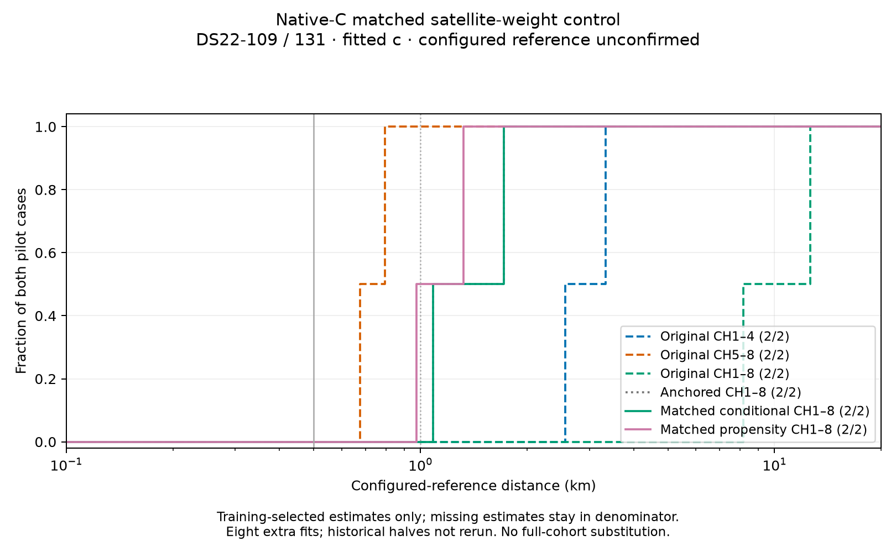

# Shared native satellite weights improve both selected pilot estimates

The matched shared-propensity model improves selected CH1–8 configured-reference distance on both DS22 pilot cases. DS22-109 crosses below1km, while131 remains above1km. Both still lose to their historical CH5–8 estimates. These are development results using an unconfirmed configured station reference, not verified accuracy or full-cohort promotion. All estimates use fitted c.

| Case | Original CH1–4 km | Original CH5–8 km | Original CH1–8 km | Anchored / matched conditional CH1–8 km | Shared-propensity CH1–8 km |
|---|---:|---:|---:|---:|---:|
| DS22-109 | 3.331478 | 0.794920 | 12.624524 | 1.086041 | **0.974226** |
| DS22-131 | 2.562646 | 0.674606 | 8.158713 | 1.718268 | **1.323056** |

## What this tests

Starting from both complete forward anchored-calibration states, we compare the existing conditional native likelihood against the same likelihood with learned shared satellite mixture weights. Original observations, candidate banks, native branches, calibration parameters, priors and each source's own25km disk remain fixed across arms. The propensity extension uses zero-sum logits, standard-normal prior and bounds±2. Every fit receives the same60-second allowance including5seconds for audit,600iterations and one optimizer invocation. No reference-derived seed, candidate, tuning or selector is used.

Actual qualification passed328objective evaluations and0fits:158on109 in32.983seconds and170on131 in36.699seconds. Legacy objective and gradients replayed, conditional mass accounting and zero-q objective/gradient/posterior nesting passed, and every original group plus new propensity nuisance derivative was checked at deterministic nonzero q. Maximum derivative discrepancies were1.77e-7 and1.30e-7. This qualification reuses the existing physical prediction implementation; it does not claim a new full physical-coordinate finite-difference audit.

All8fresh fits returned;7passed strict independent stationarity. They consumed1546objective evaluations including15audits, with no restart or repeated call. All four conditional controls passed, as did three of four propensity fits. Both matrices sealed before reference comparison. The comparator performed0objective calls and0fits. Twelve driver, wrapper and evaluator tests passed; the plot's missing-denominator test also passed, with Ruff clean.

## Likelihood improvement is distinct from position improvement

| Case / selected arm | Training objective | NLL | Prior penalty | KKT |
|---|---:|---:|---:|---:|
|109 conditional |33011.894187|32917.297060|94.597126|0.000349|
|109 propensity |31031.160765|30905.668310|125.492456|0.000721|
|131 conditional |32965.594239|32655.177173|310.417066|0.000115|
|131 propensity |30971.629598|30769.391796|202.237802|0.000560|

These numbers describe separate models; cross-model training objective is not used to choose a winner. Each arm selects its own minimum-objective strictly accepted state. Conditional normalization alone leaves both selected positions unchanged. Allowing satellite mixture weights to adapt improves both training likelihood and selected distance in this pilot, but does not demonstrate predictive generalization or correct band fusion.

## The remaining ranking failure is explicit

For131, the high-origin propensity fit is strict atKKT0.000478 and reaches0.467465km, but has objective35498.333043. It loses4526.703445objective units to the selected low-origin propensity fit at1.323056km. The closer fit is not on the selected-performance curve. This shows that the model can represent a substantially closer stationary solution yet still ranks a farther one first.

For109, the low-origin propensity fit is unavailable despite a completed optimizer call: its best feasible objective33137.970696 has KKT0.003363500. That objective is worse than the accepted high-origin winner31031.160765, so this specific rejected endpoint does not expose a lower-score selection gap. It remains excluded without relaxing stationarity or retrying.

Shared weighting therefore repairs part of the mismatch but leaves band-dependent association/detectability or calibration as live hypotheses. The next model comparison should preserve this shared model as a nested control while allowing a regularized difference between lower- and upper-band satellite weights, and should explicitly test whether ranking changes. A lower fit score alone must not be treated as a localization gain.

Historical halves have not received these additional fits and share discovery/initialization; matched new-model half views and a consistent78-case evaluation remain required. No pilot result was substituted into the published full-cohort curves. The below0.5km median and superiority over both halves remain unproven.

## Provenance

- [Prospective protocol](DS22_ANCHORED_PROPENSITY_PROTOCOL.md), driver/source freeze`64b04477e`.
- Post-seal evaluator`03fd6e486`.
- Scientific namespace:`/srv/bulk/leo-research-ds21-ds22/2026_10_14/ds22-anchored-propensity-v1`.
- Evaluation namespace:`ds22-anchored-propensity-evaluation-v1` under the same bulk root.
- [Evaluated selections, all outcomes and pinned source receipts](anchored-propensity-pilot/data.json).
