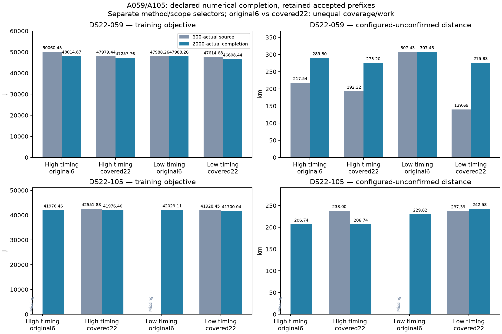

# A059/A105: numerical completion lowers scores without a localization repair

The prespecified2000-actual-objective completion adds69 calls,65 strictly accepted, while retaining all97 accepted600-cap source stages exactly. It unblocks both previously missing A105 original-six final selectors. Nevertheless A059's covered22 selectors move **192.316703→275.197215km** with high timing and **139.687078→275.830672km** with low timing, despite lower training J by721.676090/1006.241771. A105 high timing improves237.998632→206.740188km, while low timing regresses237.394539→242.579662km. These are configured-unconfirmed distances, not validated accuracy. No case, method or budget is promoted or chosen by reference distance.

Root ran the scientific completion under source `7c220811a` and the paired postseal evaluator `f6df4bc73`; this report/figure adds **zero objective evaluations and zero fits**. The original [coverage-handoff protocol](model_a_ds22_coverage_handoff_protocol.md) defines fixed unions75/92, original six25km disks plus all16 deterministic coarse cells with100√2km disks, intersected with the unchanged250km global prior. The union, source observations, physical model, candidate/frame/calibration policies, learned shift handoff, fitted RF coefficient, priors, domains, starts and strict KKT≤.001 are unchanged between600-source and2000-completion within each case/method/scope. Original-six versus covered22 still has different search coverage and work; it is not an equal-budget comparison.

Completion raises the per-call **actual objective-evaluation ceiling** from600 to2000, retaining20s and600 solver iterations. Reserve one evaluation for independent terminal J/NLL/domain/KKT audit. Only previously rejected or newly unblocked stages run; accepted source prefixes are reused exactly. An existing rejected stage must receive exactly its failed original seed and options. A newly unblocked high/final stage receives the declared accepted prerequisite handoff. This is additional optimization work, not a retry hidden inside the original budget and not a generic whole-matrix rerun.

Each training selector is separate for high-stage timing versus restored low-stage timing, and original-six versus covered22. Original A's path-specific learned high-minus-low receiver shift remains fixed in each final model. Objectives therefore follow the original A selection convention with path-specific frozen shifts; they are not a newly calibrated common generative evidence score across all paths. No minimum distance chooses the path, timing method, search scope or budget.

| Case / timing / scope | Source unit | Completion unit | J600 | Jcompletion | Configured km600 | Configured kmcompletion |
|---|---|---|---:|---:|---:|---:|
| 059 / high / original6 | original-4 | original-0 | 50060.445364 | 48014.872928 | 217.542323 | 289.803028 |
| 059 / high / covered22 | coarse-10 | coarse-11 | 47979.436723 | 47257.760633 | 192.316703 | 275.197215 |
| 059 / low / original6 | original-0 | original-0, reused | 47988.256711 | 47988.256711 | 307.428230 | 307.428230 |
| 059 / low / covered22 | coarse-06 | coarse-11 | 47614.681716 | 46608.439945 | 139.687078 | 275.830672 |
| 105 / high / original6 | **missing** | original-0 | **missing** | 41976.458247 | **missing** | 206.740188 |
| 105 / high / covered22 | coarse-13 | original-0 | 42551.831026 | 41976.458247 | 237.998632 | 206.740188 |
| 105 / low / original6 | **missing** | original-5 | **missing** | 42029.106061 | **missing** | 229.818073 |
| 105 / low / covered22 | coarse-13 | coarse-03 | 41928.451828 | 41700.041152 | 237.394539 | 242.579662 |

The missing A105600-cap original-six selectors are **not zero-valued distances or failed endpoints eligible for selection**: all6 low prerequisites exhausted the old objective cap, preventing their high/final calls. Preserve those missing source rows rather than replacing history with the newly completed results. A105's completed high covered22 selector is the same original-0 endpoint as its original-six selector, not an independent second fit.

| Completed selector | Training NLL | Reported prior J−NLL | KKT |
|---|---:|---:|---:|
| 059 high original6 | 47370.282998 | 644.589930 | .000120818 |
| 059 high covered22 | 46848.041154 | 409.719479 | .000653311 |
| 059 low original6 | 47443.041741 | 545.214970 | .0000767321 |
| 059 low covered22 | 46059.150634 | 549.289310 | .000790173 |
| 105 high original6 | 41428.667994 | 547.790253 | .000768633 |
| 105 high covered22 | 41428.667994 | 547.790253 | .000768633 |
| 105 low original6 | 41283.122351 | 745.983710 | .0000704021 |
| 105 low covered22 | 41298.866495 | 401.174658 | .0000196332 |

A059 covered22 high loses82.880512km of configured position while improving NLL832.137332 with prior110.461241 **higher**; low loses136.143594km while improving NLL1011.405140 with prior5.163369 higher. A105 covered22 high improves NLL769.384483 despite prior194.011704 higher; low improves NLL250.663574 despite prior22.252898 higher while its configured error worsens5.185123km. Thus these score changes are driven by likelihood improvements, not stronger prior rewards. Better in-sample fit does not imply better localization.

The potential omitted learned-offset prior is too small to reverse these comparisons. Source inspection confirms `SequentialHighObjective` uses default sigma50000Hz and two physical RX offsets each bounded±ALIAS/2, where ALIAS=227272.727273Hz. The final fixed-shift objective omits that constant offset penalty. Its entire possible two-RX penalty is bounded by2×½×(113636.363636/50000)²=**5.165289**. Even the largest possible ledger correction is much smaller than721.676090/1006.241771 or575.372779/228.410676 completed covered22 J gains. This bounded accounting observation does not make path-specific shift objectives a common calibrated model or prove exhaustive global search.

| Case | Original calls / actual objectives | New calls / accepted / actual objectives | Exact accepted source stages reused | Unique executed total calls / objectives |
|---|---:|---:|---:|---:|
| 059 | 75 / 38044 | 14 / 11 / 9145 | 67 | 89 / 47189 |
| 105 | 48 / 26911 | 55 / 54 / 33809 | 30 | 103 / 60720 |
| Pair | 123 / 64955 | **69 / 65 / 42954** | **97** | **192 / 107909** |

Unique executed totals include preserved rejected original calls and extra completion calls; reused prefixes are not charged twice as new work. All8 A059 and18 A105 rejected original calls exhausted599 optimizer evaluations before the reserved independent audit. Completion changes this measured bottleneck and unlocks downstream stages without grandfathering a rejected endpoint.

| Case / stage | Accepted/attempted600 | Accepted/attempted completion inventory |
|---|---:|---:|
| 059 low | 19/22 | 21/22 |
| 059 high | 17/19 | 19/21 |
| 059 high-timing final | 15/17 | 19/19 |
| 059 low-timing final | 16/17 | 19/19 |
| 105 low | 12/22 | 21/22 |
| 105 high | 7/12 | 21/21 |
| 105 high-timing final | 5/7 | 21/21 |
| 105 low-timing final | 6/7 | 21/21 |

All97 previously accepted source rows are independently confirmed byte-identical in completion entries. All original eligible final candidates therefore remain available to their declared selectors. The four new rejected calls remain rejected: A059 original-1/high KKT1.795971, original-2/high9.158407, original-3/low11.998389; A105 coarse-02/low1.595056. They use662,676,720,736 actual objectives respectively and do not fail at the new evaluation ceiling; no acceptance relaxation or repeated continuation is applied. Their blocked descendants remain absent. Completion does not establish a fully successful or globally exhaustive search.

New A059 calls use484–949 actual objectives and3.534–12.495 numerical seconds; A105492–1542 and3.252–14.855s, including audits. Maximum complete path times49.578/55.429s stay below165s internal and180s TERM/185s KILL limits including preparation. Both full case matrices and all four selectors per case sealed before the reference join. The configured reference remains unconfirmed, and neither predictive holdout evidence nor original held/locked data is added.

The controlled result separates two problems: the old cap caused real search attrition, particularly A105 original-six; removing much of that attrition uncovers lower-score but still distant candidates, and substantially worsens both A059 training-selected configured distances. The model/association/calibration ranking of these sampled states therefore needs diagnosis beyond merely increasing optimizer evaluations. This does not prove every physically compatible basin has been found or justify selecting the old lower-error results retrospectively. Keep the negative outcomes, older plots and cohort baseline unchanged.

Scientific roots `/srv/bulk/leo-research-ds21-ds22/2026_10_14/model-a-ds22-budget-completion-v1/{DS22-059,DS22-105}`. Paired postseal comparison sibling `model-a-ds22-budget-completion-v1-comparison/report.json`, SHA256 `afbba43ce55a7b5f4d185f71091b35284b0abf45673ad724023447a73bea8408`. A059 completion terminal/seal `5e70c260c40cc740a4655e11d5913ead7535321234510772594f9586c15248ed` / `26bb58a1e7e139371f9a67202d7425a754f0330348d9c818e9dac3defb2d3557`; A105 `c7a670a4909c8945e213cc991055366aca7e351a78bb10c3975bc9d9d1bef1ca` / `c657de7170fc6c3e10a46bc34f0acbf2bc11be998ec6897ae4f838fcd0346b01`. The baseline report and both source/target bindings are recorded in `model-a-ds22-budget-completion-figures-v1/manifest.json`. Plot source626e0015d passes4 owned tests/Ruff and reads only the postseal reports and bound metadata; separate PNG/PDF preserve missing source selectors and both methods/scopes without reference selection.
