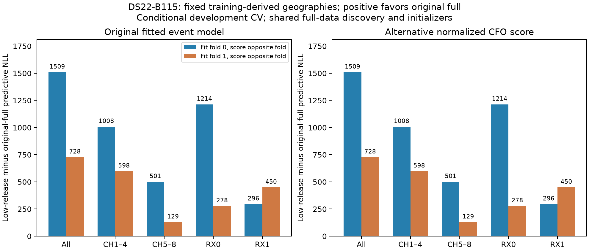

# B115: opposite-fold scores retain the original full location

All four fixed-position fits pass the unchanged independent KKT≤.001 check. The low-origin release location loses opposite-fold NLL by **1509.438010 and727.589908**, totaling **2237.027919** across2782 windows. Both bands and both receivers favor the original full location in each fold. Normalizing the conditional CFO density changes both locations' scores by the same amount, so it does not change any paired ranking here. No localization improvement, new selection or cohort promotion follows.

This is the four-call experiment prespecified in [the protocol](DS22_B115_PROFILE_CV_PROTOCOL.md), source `6054a92f7`. Fit the unchanged original B joint-event likelihood plus priors, with fitted RF coefficient, original bank38, full frame and original calibration/timing constraints. The alternative normalized conditional-CFO likelihood is **scored after fitting**, not a fitted second model. Every predictive NLL excludes priors. Both locations start from the identical original selected-full complete non-geographic state. Only XY changes: original selected full `[-51.55244079588947,-53.57795270583527]` in original start0's25km disk centered `[-50,-50]`; accepted low-origin FREE release `[-90.37079082619036,-80.49143867081717]` in its original half-path start4 disk centered `[-74.10352779093445,-80.74705091108163]`. Source path identities determine the inventory, not postseal distance. Raw starts are feasible and unchanged; no clipping or timing margin adjustment occurred.

Random whole20s groups use seed20261014. Fold0 contains blocks0,1,2,3,11,14 with1416 training windows; fold1 contains5,6,8,9,10,12 with1366. Both locations use exactly the same masks. Opposite-fold scoring therefore has1366/1416 windows. Full-data discovery, bank/frame, both geographic locations and the common complete warm start precede this split and use all original training data: this is **conditional development CV**, not independent validation or an untouched accuracy estimate. Within-recording20s groups do not establish physical independence of emissions. Original held and locked observations and reference comparisons are untouched.

| Source fold / fixed location | Own-fold J | Own-fold NLL | Prior | KKT | Actual objectives | Numerical seconds | Whole worker seconds |
|---|---:|---:|---:|---:|---:|---:|---:|
| 0 / original full | 17324.219621 | 17010.481124 | 313.738498 | .0000855654 | 299 | 1.003 | 18.361 |
| 0 / low release | 19342.787641 | 19146.927170 | 195.860471 | .000476248 | 391 | 1.313 | 18.710 |
| 1 / original full | 16765.752132 | 16407.040685 | 358.711447 | .0000502229 | 295 | .959 | 18.367 |
| 1 / low release | 19639.941256 | 19329.038672 | 310.902584 | .000126701 | 329 | 1.066 | 18.500 |

No accepted endpoint exceeds its own feasible initializer score. All4 source-fold fits are accepted, so both two-fold predictive totals are eligible; none are diagnostic-only substitutes. Four additional calls consume1314 actual objective evaluations including independent terminal audits, each below20s/600. They are additional to original18 B calls, prior8 profiles/releases and upstream work, not matched end-to-end cost against the historical baseline.

| Source fold / fixed location | Opposite windows | Event NLL | Normalized CFO NLL | Signal mass | Clutter mass |
|---|---:|---:|---:|---:|---:|
| 0 / original full | 1366 | 18322.958161 | 16637.456960 | 587.160472 | 778.839528 |
| 0 / low release | 1366 | 19832.396172 | 18146.894970 | 218.657557 | 1147.342443 |
| 1 / original full | 1416 | 20151.104854 | 18403.908880 | 322.186361 | 1093.813639 |
| 1 / low release | 1416 | 20878.694763 | 19131.498788 | 134.200384 | 1281.799616 |
| Both / original full | 2782 | **38474.063016** | **35041.365840** | **909.346833** | **1872.653167** |
| Both / low release | 2782 | 40711.090934 | 37278.393758 | 352.857941 | 2429.142059 |

The integrated-event logmass correction is exactly−1685.501201450416 for both fold0-trained states and−1747.195974563535 for both fold1-trained states. This is an observed equality at these endpoints, not a proof of constant mass over all feasible timing/visibility states. It rules out normalization alone as a way to reverse these fixed paired predictive scores. The model's greater signal mass at original full is descriptive posterior support, not independent evidence of correct satellite identity or location.

| Predictive group | Fold0 low-release minus original-full NLL | Fold1 gap | Combined gap |
|---|---:|---:|---:|
| CH1–4 | +1008.459629 | +598.341904 | +1606.801533 |
| CH5–8 | +500.978381 | +129.248004 | +630.226386 |
| RX0 | +1213.714636 | +277.913545 | +1491.628181 |
| RX1 | +295.723375 | +449.676363 | +745.399738 |

Event and normalized CFO gaps in this table agree to numerical precision. Combined channel gaps CH1–8 are respectively+273.228213,+309.118872,+647.721286,+376.733163,+34.269555,+117.369257,+449.477291,+29.110282, with322,427,422,522,223,300,243,323 windows. Every channel loses in aggregate; CH3 andCH7 contribute1097.198577 of the2237.027919 gap. No band or receiver cancellation produces the result.

| Opposite20s block | Windows | Low-release minus original-full NLL |
|---|---:|---:|
| 0 | 217 | −32.368722 |
| 1 | 234 | −10.341422 |
| 2 | 209 | +43.545851 |
| 3 | 184 | +97.521003 |
| 5 | 196 | −59.376247 |
| 6 | 198 | +199.596351 |
| 8 | 185 | +123.103033 |
| 9 | 285 | +253.254501 |
| 10 | 291 | +649.901833 |
| 11 | 301 | +642.939711 |
| 12 | 211 | +342.958539 |
| 14 | 271 | −13.706513 |

Blocks10/11 contribute1292.841544 (57.8% of the net gap) across592 windows; four blocks favor the low release, eight favor original full. This identifies temporal structure for subsequent observation/association diagnosis without proving correlation or authorizing selected block weighting. The two folds fit different nuisance states; block differences are not scores under a single common calibration.

The earlier full-data experiment retained the original44.838979km location, while its accepted low-origin release3.372063km lost training J5016.644914, mostly likelihood. Those are historical postseal configured-unconfirmed distances, not new measurements here. This CV weakens the specific explanation that the original location wins only through in-sample overfitting relative to these matched-start fixed profiles. It does not establish a global optimum: both fits use one common complete warm start per fold, and another compatible calibration/association basin could exist. It also does not validate the configured station reference, candidate identities, native alias interpretation, or the event model for selected CFOs.

No new fit is justified solely by these scores. A discriminating next proposal is a zero-fit observation/association audit at all4 accepted endpoints, preserving RX/channel/RF/native times: determine whether CH3/CH7 and blocks10/11 contain stable candidate-specific residual tracks and usable native alternative modes, rather than treating greater posterior signal mass as truth. Compare raw CFO continuity and available alternative scores separately from state-dependent satellite assignments, retain all channels/blocks and actual gaps, and do not add temporal persistence weights without support. This proposal is not executed here; more continuation from the same losing states or truth-chosen reweighting is unsupported.

Seven component tests passed2.08s and Ruff before freezing; actual qualification passed8 objectives/0 fits18.478s, including exact original-model nesting, fold additivity corrected for priors, posterior/residual closure, normalization identity, same complete state and own domains. All4 outcomes sealed before opposite-fold scoring. Postseal evaluation completed4 objectives/0 fits16.154s. Internal120s guards have independent monotonic completion checks, with external135s TERM/140s KILL authoritative; no unit exceeded19s. Plot generation adds0 objectives/0 fits and has one owned test1.40s/Ruff.

Runtime `/srv/bulk/leo-research-ds21-ds22/2026_10_14/ds22-b115-profile-cv-v1`; qualification SHA256 `6ac4b7d676fc46b01fd6e6ce62db74f523359668c6f5709547a4a37b994ddf21`; all-four seal `a9d8ac0480a5acd52227f6d723ddca64d6a0c742e86a198e92092e4c12dd038a`; evaluation `002a6d3ddbe620844d3d03d6c07997e35b0473605a493bfa31c5a4a6942249e8`. Figure PNG/PDF and zero-fit manifest are preserved under sibling `ds22-b115-profile-cv-figures-v1`; earlier RCA, profile/release, plots and baseline histogram remain unchanged.
