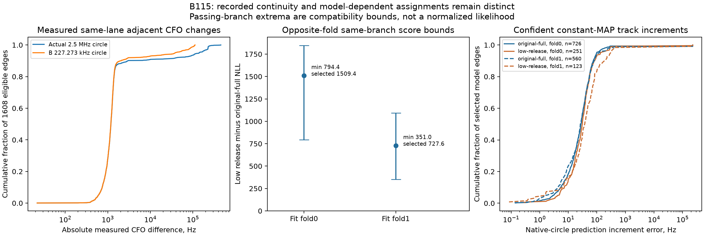

# B115: coherent fitted tracks and no passing-peak rescue

At all4 accepted CV endpoints, the original-full location has substantially more coherent, confident model support than the low-origin release. Even selecting the **same recorded passing peak most favorable to the low release in every window** cannot reverse either opposite-fold likelihood comparison: minimum gaps remain **+794.375118/+351.023702 NLL**. The observed support is not explained solely by selecting one bad peak or by widespread folded-alias jumps. It remains **model-dependent evidence**, not verified satellite identity or localization correctness.

This is a zero-fit descriptive audit of all2782 original training windows at the four accepted states from [the fixed-profile CV](DS22_B115_PROFILE_CV_RESULTS.md). Both geographic path identities and all complete parameters are frozen; no new seed, coefficient, weighting, candidate reselection, held/locked measurement or reference is used. Each fold's two states are evaluated on **all** training rows, with own/opposite masks retained separately. Source-fold acceptance is not full-target stationarity or eligibility; these full-target replays do not create new selectable localization endpoints.

**Frozen-protocol erratum:** the first protocol prose incorrectly calls B's alias125kHz. The executed code imports `ALIAS_HZ = 1/4.4e-6 = 227272.72727272726Hz`;125Hz is the Gaussian residual sigma. The recorded sampling rate is2500000Hz. All tests, integer lifts, wrapping, native-circle residuals and saved numeric metadata use those actual constants. Frozen source/protocol bytes are preserved; this correction has no numerical effect. The v1 freeze separately failed a tuple/list JSON policy guard before preparation or any objective call; namespace/source7c7e63fc6 remain intact. V2 source5fd84c7aa changes only schema/list serialization and adds a regression test; scientific bounds/core remain unchanged.

Measured inventory uses the public scanner projection at each branch's **own native receive/support times and RF**, requiring exact selected window ID/CFO/RX/channel/RF/margin/time identity. There are7267 passing projected branches, median2/p90 4/max7 per selected window;725 selected windows use a nonzero-ranked passing branch. Every selected observation and recorded passing alternative is retained, with recorded rejected-alternative metadata also preserved. No nearest-score or reference filtering occurs.

Adjacent raw observations are paired only within identical RX/channel/RF lanes with positive gap≤1s and nonoverlapping support. Of2766 adjacent lane pairs,1608 qualify and1158 exceed1s; no nonpositive/overlap exclusions. All-lane gap median.356005s/p90 1.775139s/max90.630574s. This censoring does not assert same emitter. Raw/native-circle absolute CFO-change median1184.104584Hz/p90 2970.846999Hz/max453158.067184Hz; B wrapping gives1181.375708/2005.942563/112186.507211Hz. A provisional15kHz/s+5kHz gate fails146 eligible edges; another passing native pair meets it on37. CH3 has11 failures/6 alternative rescues; CH7 has9/0. Blocks10/11 together have33 failures/7 rescues. These gates are descriptive plausibility checks, not identity tests or measurement selectors.

| Fitted state, evaluated on all original training rows | Confident signal windows | Confident signal edges | Same confident MAP edges | Confident MAP changes | Alias-integer changes on same-MAP edges | Native-circle increment p90 Hz |
|---|---:|---:|---:|---:|---:|---:|
| fold0 original full | 1482 | 764 | 726 | 38 | 5 | 75.306 |
| fold0 low release | 626 | 275 | 251 | 24 | 2 | 84.466 |
| fold1 original full | 1169 | 577 | 560 | 17 | 6 | 79.465 |
| fold1 low release | 354 | 132 | 123 | 9 | 2 | 188.072 |

Confidence requires satellite posterior≥.9 at both endpoints; MAP includes clutter. Same-MAP increments additionally require the left candidate visible at the right observation. No observed both-signal edge loses the left MAP through visibility. Increment errors use the selected left satellite's orbit **plus the complete fitted correction**, at the actual two recorded times; native-circle and B-folded errors are reported separately. Original-full same-MAP rates726/764 and560/577 are95.0%/97.1%; corresponding low-release rates251/275 and123/132 are91.3%/93.2%, from much smaller confident subsets. Same-MAP folded-increment p90 for original full is74.629/78.359Hz, close to native75.306/79.465Hz. A few large native errors persist, so coherence is not universal.

At CH3/7, original-full same-confident-MAP edges230/205 compare with low-release54/39. Only1 original-full same-MAP alias-integer change occurs per fold over those channels; none occur on CH7. Blocks10/11 have original-full182/192 same-confident-MAP edges versus20/8 for low release, with original-full native increment p90 62.530/76.135Hz. Thus the adverse score strata contain broad coherent **fitted** support rather than mostly discontinuous peak hops. Learned orbital timing shifts and receiver calibration contribute to those predictions, and a coherent interferer or wrong satellite model can still fit; no known pilot, QAM identity or independent emitter verification is added.

Receiver-wide modal227272.727Hz integer lifts are−1/+2 for RX0/RX1 at all4 states, computed descriptively from the original folded posterior>.5, with no new fitting. Modal fractions are original-full .92567/.86028 and .85797/.86616, versus low-release .76091/.49761 and .53546/.48980. Among confident signal windows, native-circle residuals exceed375Hz at89/1482 and117/1169 original-full windows versus173/626 and159/354 low-release windows. This exposes alias contamination at both locations; it does not favor the low release under this deterministic gauge. A receiver-wide modal gauge cannot prove all observations share one native branch or replace a native detector likelihood.

| Rows / source fold | Selected common-branch NLL gap | Minimum common-branch gap | Maximum common-branch gap |
|---|---:|---:|---:|
| All / 0 | +3645.884057 | +2215.590037 | +4334.505926 |
| All / 1 | +3649.587895 | +2344.733960 | +4241.001348 |
| Opposite / 0 | +1509.438010 | **+794.375118** | +1847.932711 |
| Opposite / 1 | +727.589908 | **+351.023702** | +1092.425336 |
| CH3 / 0 | +792.182719 | +441.463429 | +869.435944 |
| CH3 / 1 | +825.497650 | +529.207850 | +953.163346 |
| CH7 / 0 | +471.948387 | +382.165500 | +491.412559 |
| CH7 / 1 | +498.744816 | +409.037450 | +521.344603 |
| Blocks10/11 / 0 | +1283.075893 | +903.895955 | +1428.791529 |
| Blocks10/11 / 1 | +1479.626057 | +1103.157190 | +1640.405624 |

Positive means low release loses. Min/max sum each window's extrema of the likelihood ratio while both states evaluate the **same** recorded branch. A positive minimum proves that no common passing-branch choice within this recorded inventory reverses that fixed comparison under unchanged folded B physics. These counterfactual extrema are not normalized detector-set likelihoods, cannot be compared to independently optimized branch choices, and are not deployable selectors. Most-favorable branches can alter some smaller strata (e.g. fold0 CH8 minimum−10.560949), while full, opposite, both bands/RX and the designated focus strata remain positive. This is a bounded negative test, not a proof excluding missing/unrecorded emitters, alternative model states or different detector physics.

The supported next discriminator, if pursued, is exact fixed-state **native sampling-circle/detector-history likelihood** scoring at all4 complete states with these deterministic receiver lifts and unchanged correction/orbits/priors. That would test whether absolute native-frequency/detector support overturns a ranking robust to recorded common-peak choices; this audit deliberately retains original folded B physics. It requires its own source/transport qualification and bounded protocol. No new native fit, temporal persistence weight, arbitrary dispersion/clutter scan, or continuation from losing endpoints is justified here. If native scores preserve the conflict too, calibration/orbital-timing likelihood mismatch and incomplete compatible-state search remain distinct possibilities; reference position alone cannot choose between them.

All full-target J/NLL replays close against sealed own+opposite scores; selected-to-native branch NLL errors are0 and maximum responsibility/clutter discrepancy1.23e−15. Native ephemeris query slack is4.986/4.923s in fold0 and4.027/2.820s in fold1; no clipping or unsupported query. Both slices complete23.300/23.211s including preparation and postchecks. Total8 objective replays (each with internal orbit evaluation),12 **additional explicit** predictors,12 auxiliary likelihoods and0 fits match the frozen finite inventory, below120/135/140 limits. Eight component/runner/policy tests passed1.51s and Ruff; plot test passed1.40s/Ruff. Plot generation adds0 objectives/0 fits.

Runtime `/srv/bulk/leo-research-ds21-ds22/2026_10_14/ds22-b115-revisit-audit-v2`; fold0 terminal SHA256 `b142662f2efade2c26f59e2f2ae1cc92cb5989c319a99b7e6c5d84953c57e9e1`, seal `0d16b50546f5e1bfe392b9366fd0faee55d6f0f71d6d3390283e34e4afb036a6`; fold1 terminal `306035e6bf95cdefc3a91691d375956c30a80e1ef0b15c86e71ff809a27ad862`, seal `69787f3523b1301a8ca2f1c517151a7c268cb142b770d8f7ccac37b0ba89ad3d`. Separate PNG/PDF and zero-fit manifest are under sibling `ds22-b115-revisit-figures-v1`; original plots, scientific sources and failed v1 remain preserved.
