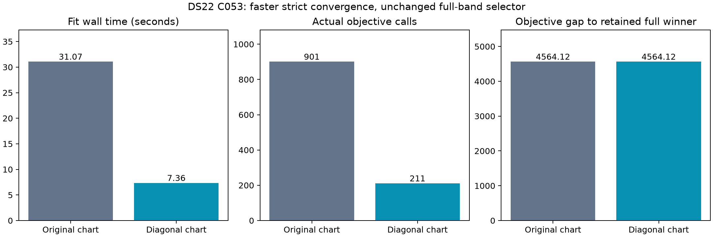

# DS22 C053: faster convergence does not improve the full-band selector

The matched FREE controls reached the same strict endpoint. Diagonal preconditioning reduced fit wall time from **31.069 to 7.358 seconds** and actual objective calls from **901 to 211** (4.22× and 4.27× respectively). Both endpoints lose to the retained original full-band training winner by **4564.120327 objective units**. This repairs numerical efficiency, not the model's position ranking.

| Same seed, model and 25 km disk | Original chart | Diagonal chart |
|---|---:|---:|
| Training objective | 50177.297607277 | 50177.297607278 |
| Frequency NLL | 49849.198703637 | 49849.198703173 |
| Independent original-scale KKT | 0.000850781 | 0.000531605 |
| Iterations | 126 | 64 |
| Actual objective calls, including audit | 901 | 211 |
| Fit wall seconds | 31.069090 | 7.357794 |
| Final radius, km | 25.000000000054 | 25.000000000003 |
| Configured-reference distance, km | 27.513025 | 27.513025 |

Both used the same accepted fixed-LOW-geography profile, unchanged native C likelihood, fitted c, calibration/timing priors and original 25 km disk. The diagonal transform prepended unit geographic scales to the frozen 51-coordinate Hessian-derived scaling; objective values, constraints and gradients were transformed exactly. Each arm had 60 seconds including a five-second independent-audit reserve and 600 total iterations. Actual objective calls are reported separately: this was not a 600-objective cap. External unit deadlines remained independent of nested slice timers. The 205-objective Hessian qualification and earlier searches are additional cost, so this is a matched per-fit efficiency comparison, not an end-to-end cost saving claim.

Admission used exact circular arcs because straight tangent probes leave the disk. A 1 m arc decreased objective by 0.000697359 with unchanged visibility and endpoint-derivative consistency; the 10 m arc increased it by 0.243850119. Both retained the original radius within original feasibility tolerance. No truth-derived direction, domain expansion or seed was used. The preceding fixed-profile control had made a previously nonstationary lower-score trajectory strict; it still did not beat the original full winner.

The retained original full winner has objective **45613.177281**, NLL **45191.849983**, and configured distance **75.781770 km**. Historical shared-discovery LOW/HIGH distances are **27.083146/30.491824 km**. The new lower-distance endpoint is ineligible to replace the full winner because its training score is worse. These distances use an explicitly configured, unconfirmed DS22 station reference, joined only after global sealing; they are not verified ground-truth accuracy. Historical halves did not receive these matched solver continuations. No held or locked observations were used.

Sources: FREE core/driver `54c783c02`, evaluator `1197cd210`, arc admission `1a58bbe7a`; four FREE component tests, two evaluator tests and two arc tests passed, with Ruff checks. Runtime namespaces under `/srv/bulk/leo-research-ds21-ds22/2026_10_14`: `ds22-c053-arc-admission-v1`, `ds22-c053-precondition-release-v1`, and `ds22-c053-precondition-release-comparison-v1`. Figure metadata pins exact sealed result bytes. Existing failures and all earlier receipts remain preserved. No further optimizer cycle on this basin is proposed.
