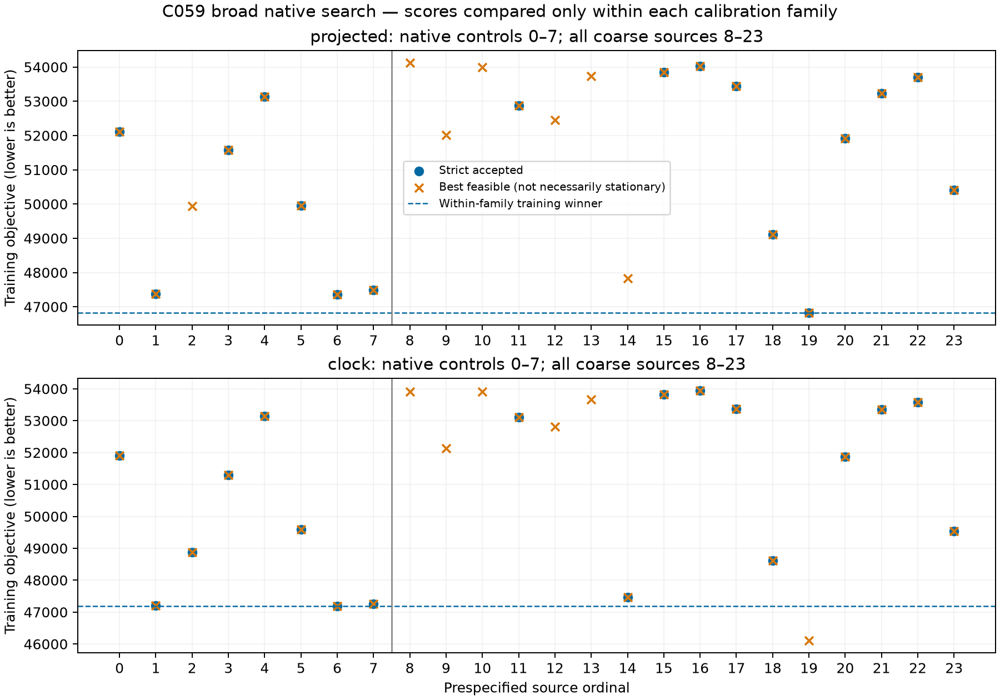

# C059 broad native search remains inaccurate; clock selector has a numerical gap

All **48 prescribed fresh calls** returned and were sealed before configured-reference evaluation. **35 passed strict independent stationarity**: 17/24 projected no-clock and 18/24 exact-clock. No source claim, initializer or external deadline failed, and no attempted call was repeated. The complete no-clock search improves its training winner and configured distance, but both calibration families remain hundreds of kilometers from the unconfirmed configured station. No original cohort selector is promoted.

| Calibration family / eligible inventory | Strict / declared | Training-selected source | Objective | NLL | Configured distance, km |
|---|---:|---|---:|---:|---:|
| Projected no-clock / native eight | 7/8 | Original-chart continuation, ordinal6 | 47356.137342 | 46923.101385 | 311.694088 |
| Projected no-clock / complete24 | 17/24 | Coarse ordinal19, source center(50,150) | 46830.287428 | 46508.753883 | 277.894228 |
| Exact clock / native eight | 8/8 | Original-chart continuation, ordinal6 | 47191.836555 | 46698.856988 | 311.714228 |
| Exact clock / complete24 | 18/24 | Same ordinal6 | 47191.836555 | 46698.856988 | 311.714228 |

Objectives are compared **within each family only**. Each family's sixteen coarse starts include ten strict results. The native eight comprise all six original raw endpoints plus both later strict continuation states, on the same new75-satellite bank. The grid-defined broader disks cover the original prior, unlike the historical six small disks. Covering the prior geometrically is not proof that every relevant basin converged.

## A lower feasible clock score was rejected

Exact-clock coarse ordinal19 has independently replayed feasible **J=46116.275400**, **1075.561155 lower** than its accepted family winner. Its NLL is45544.247167 and KKT **0.008057196**, above the unchanged0.001 threshold. SLSQP reported success after31.342seconds,453 actual objective calls and135 solver iterations (134 callbacks), so this is **not a wall-clock timeout**. It is only4.071km from its source center inside its141.421km local disk. It remains excluded; feasibility and a lower score do not establish stationarity.

This demonstrates an optimization gap in the accepted clock selector. The current clock result cannot be interpreted as a validated rejection of the broad-source basin or a global likelihood-ranking failure. A separately authorized zero-fit derivative/support/conditioning audit will examine this training-selected failed endpoint before any proposed numerical continuation. The present48 outcomes remain immutable.

The other twelve unavailable outcomes do not beat their own family's accepted winner. Eleven coarse calls exhausted the55-second optimization allowance. Projected original ordinal2 instead reported solver success but retained KKT0.001963348 and remained excluded. No strict selected result is materially worse than its own recorded minimum-feasible trajectory objective (maximum differences below1e-7). All13 unavailable outcomes remain visible in the sealed inventory and plot.

## Historical halves are context, not the missing matched control

Original-bank C-all was unavailable. Its historical shared-discovery LOW/HIGH distances were **312.824461/307.991885km**. The later original-bank strict continuations were311.996473km in the original chart and312.559486km in the diagonal chart. The new projected result is closer than those historical halves, but **own75-union half views have not been fitted**. Bank, search and calibration-family differences prevent calling this a matched full-versus-half improvement. All distances are configured-unconfirmed, not verified station accuracy.

## Budget and provenance

The48 single-invocation calls used **23345 actual objective evaluations**, including independent audits, and6371 callback iterations. Each call retained60seconds including5seconds reserved for audit and600iterations;600 was not an evaluation cap. Actual fit/audit elapsed times were23.908–55.400seconds, summing to2091.270seconds across the parallel calls. Process-CPU/wall ratios were0.99046–1.00000; this argues against CPU starvation during those fits, but does not exclude memory or clock-frequency effects.

Six finite eight-unit waves took173.388,162.692,203.023,196.926,184.403 and190.462seconds respectively. The final four-worker wave overlapped only the previous wave's last two calls, preserving an aggregate ceiling of six. Every unit had independent195/200-second external TERM/KILL bounds around its180-second preparation/fit/audit envelope. No automatic restart, no old-bank fit reuse and no reference-derived starts were used.

Fit source/protocol **6c7e641e1**, seven fitter/driver tests and Ruff passed. Post-seal evaluator **3bc56012d**, two barrier tests passed. Qualification source7402d119f and receipt5b6c87571 remain unchanged. Pilot namespace:`/srv/bulk/leo-research-ds21-ds22/2026_10_14/ds22-c059-coverage-pilot-v1`; evaluation:`ds22-c059-coverage-evaluation-v1`. Complete seal SHA256:**565d5b76507b1fcbcf2c64b1f9a2ac4313b2275737f225fd6be8a27d79c4cd78**; terminal SHA256:**b54cc6bb3164af9273519329ac07588c6d4c834409f40b135895a9cc0b83ecf4**. The configured station source is pinned in the evaluation receipt, with accuracy-target permission explicitly false. Original held and locked data remain unused.
