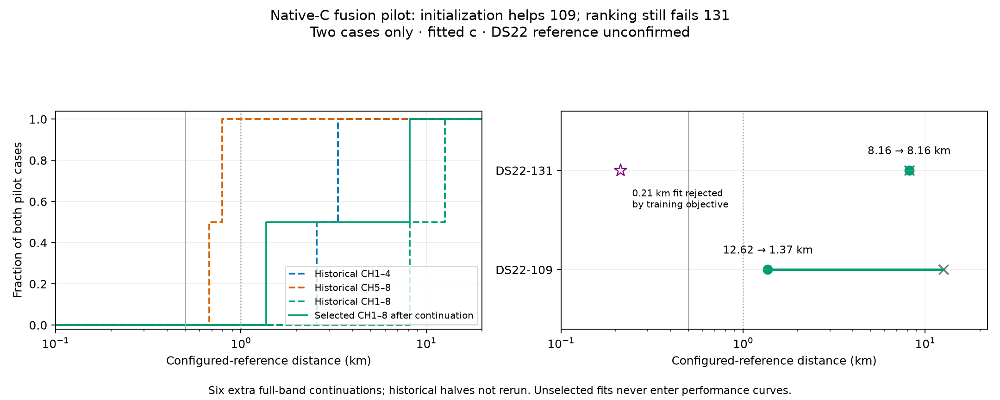

# Native fusion: initialization improves 109, objective ranking still fails 131

All six full-band continuations converge under strict independent stationarity checks. The unchanged training-objective selector improves DS22-109 from 12.624524 to 1.366035 km, but DS22-131 remains at 8.158713 km. A converged 0.212503 km combined fit exists for 131 and loses the training-objective comparison. It is a diagnostic result, not selected performance. DS22 distances remain relative to the unconfirmed configured reference; all fits use fitted c.

| Case | Historical CH1–4 km | Historical CH5–8 km | Historical CH1–8 km | Selected CH1–8 after km |
|---|---:|---:|---:|---:|
| DS22-109 | 3.331478 | 0.794920 | 12.624524 | 1.366035 |
| DS22-131 | 2.562646 | 0.674606 | 8.158713 | 8.158713 |

The 109 selected error falls by 89.2%, but remains worse than its high half and above 1 km. Neither case meets the requested combined-band target. The original full-cohort curves are unchanged.

| Case / initializer | Full-band objective after continuation | Configured distance km | Independent stationarity | Actual objective calls |
|---|---:|---:|---:|---:|
| 109 original full | 43565.507238 | 12.624524 | 0.000180519 | 19 |
| 109 low half | 37538.408075 | 4.560632 | 0.000099738 | 263 |
| **109 high half, selected** | **36513.117764** | **1.366035** | **0.000139932** | **244** |
| **131 original full, selected** | **36903.016133** | **8.158713** | **0.000751433** | **17** |
| 131 low half | 38773.816094 | 2.317144 | 0.000306079 | 263 |
| 131 high half, unselected | 40578.679222 | 0.212503 | 0.000085396 | 245 |

For 109, exact half-derived physical states already beat the original full objective before fitting. Continuing the original full solution leaves it unchanged, while half-derived initializers converge to better full-band basins. This establishes an initialization/search deficiency in the original comparison, without changing the likelihood or candidate bank. The remaining 1.366 km error still requires modeling investigation.

For 131, an accurate combined endpoint is both found and accepted numerically, but loses by 3675.663089 objective units. Its likelihood NLL is worse by 3791.334244; its prior penalty is actually lower by 115.671154. Thus the prior penalty does not explain this particular rejection. The next diagnostic should partition the likelihood difference by band, receiver and observation, then test whether the qualified native conditional/background model changes the preference at identical physical states. A better training score must still be checked against localization and held-out prediction; choosing the 0.212 km candidate using reference error would be invalid.

## Controlled scope and receipts

The [preceding exact-transport qualification](DS22_CONTAINED_FUSION_QUALIFICATION.md) preserves each saved half's complete physical calibration, satellite timing, receiver alias representatives and observation/native-branch identity. Each continuation uses the original full native model and unchanged 36/39-satellite bank. Its original 25 km local disk and original global prior remain active. There is no restart, diagonal scaling, new RF collection or reference-informed seed. The original accepted full incumbent remains eligible under the same objective.

All six calls use the same 60-second total cap, five-second independent-audit reserve and 600 iterations. Actual numerical times are 0.46–9.96 seconds, with 1,051 objective evaluations including 12 independent-audit evaluations, plus six separately recorded source replays. Qualification previously used 14 objectives and eight additional explicit orbit predictions. Each scientific process had an independent 135-second TERM/140-second KILL bound. Both complete three-call matrices sealed before the reference join, which uses zero objectives/fits. Historical half fits did not receive the additional continuation budget.

Continuation source `923e08f56`; post-seal evaluator `b8cf56801`. Owned tests and Ruff pass, including the pair-seal reference barrier and a plot test preventing an unselected near solution from replacing the selected curve. The rendered figure was inspected. Receipts are under `/srv/bulk/leo-research-ds21-ds22/2026_10_14/ds22-contained-fusion-control-v1/{DS22-109,DS22-131}` and `/srv/bulk/leo-research-ds21-ds22/2026_10_14/ds22-contained-fusion-evaluation-v1/report.json`.
