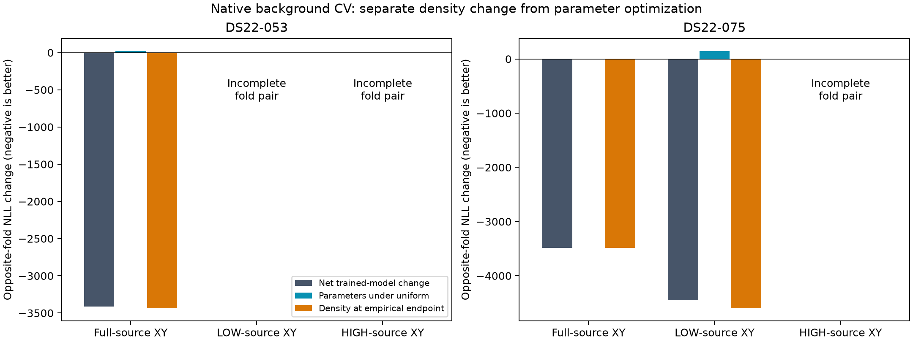

# Native background CV: predictive density improves; localization remains untested

All **24 fixed-position calls** completed and were globally sealed before opposite-fold prediction: **17 passed strict independent stationarity and seven remained unavailable**. Three complete two-fold comparisons improve predictive native frequency NLL. Unlike the folded-B experiment, the gain here comes from the changed density itself: substituting the empirical density improves the opposite-fold score at **all17 accepted endpoints**, holding every fitted parameter fixed. No free-position fit, reference join, original held or locked evaluation was performed.

Negative changes below mean better predictive NLL; predictive scores exclude priors. Each complete row uses the identical opposite-fold observations under both arms.

| Case / fixed source geography | Net empirical-trained change | Parameter change under uniform density | Direct density change at empirical endpoint |
|---|---:|---:|---:|
| C053 full | −3412.350080 | +20.589240 | −3432.939320 |
| C053 LOW | Incomplete | — | — |
| C053 HIGH | Incomplete | — | — |
| C075 full | −3485.926156 | +2.439205 | −3488.365360 |
| C075 LOW | −4448.929610 | +146.082113 | −4595.011723 |
| C075 HIGH | Incomplete | — | — |

The decomposition is exact: `empirical(E)−uniform(U) = [uniform(E)−uniform(U)] + [empirical(E)−uniform(E)]`, where U/E denote the separately trained endpoints. Parameter changes slightly worsen uniform predictive scores in all three complete comparisons; the density change more than offsets them. This supports a nonuniform native selected-frequency reference for these conditional-development tests. It does not establish correct satellite identities, detector-set calibration, or improved geography.

## C075 geographic preference is narrower but unchanged

Full and LOW source geographies have complete paired folds with the same observation masks and own-fold histograms. Their two-fold predictive NLLs are:

| Trained background / fixed geography | Scored uniform | Scored empirical |
|---|---:|---:|
| Uniform / full | 45558.854078 | 42064.701307 |
| Uniform / LOW | 48165.642592 | 43637.501864 |
| Empirical / full | 45561.293283 | 42072.927922 |
| Empirical / LOW | 48311.724705 | 43716.712982 |

Within each arm's own density, LOW minus full is **+2606.788514** for uniform-trained/uniform-scored endpoints and **+1643.785059** for empirical-trained/empirical-scored endpoints. Thus the full-source geography still wins; its predictive advantage narrows. Holding the uniform-trained endpoints fixed also leaves full preferred under both densities. These are optimized fixed-position profiles, not identical nuisance states across geographies or proof of global profile minima. C053 LOW/HIGH and C075 HIGH are incomplete, so their geographic preference cannot be inferred from this experiment. Source-geography names are provenance labels: every profile fits all channels in its assigned training fold, not a half-only likelihood.

## Optimization and budget limitations

Strict counts were C0536/12 and C07511/12. All seven unavailable profiles stopped at the55-second optimization deadline, preserving a five-second audit reserve. Their independently audited best-feasible KKT values were:

| Unit / case / source / fold / background | KKT |
|---|---:|
| 4 / C053 / LOW / 0 / uniform | 431.985022 |
| 5 / C053 / LOW / 0 / empirical | 2437.612264 |
| 7 / C053 / LOW / 1 / empirical | 420.910021 |
| 8 / C053 / HIGH / 0 / uniform | 641.027114 |
| 9 / C053 / HIGH / 0 / empirical | 1143.858202 |
| 11 / C053 / HIGH / 1 / empirical | 845.829718 |
| 21 / C075 / HIGH / 0 / empirical | 4.270322 |

C053 uniform LOW/HIGH fold1 each has an independently strict trajectory endpoint, but it is respectively1831.285913/2888.834118 objective units worse than a known feasible nonstationary point. Those results are retained with explicit optimization gaps; neither incomplete two-fold comparison is promoted. No failed profile was retried and no feasible-but-nonstationary state was selected.

The24 calls used **15045 actual objective evaluations including audits**,3434 iterations, plus48 separately recorded raw/canonical admission objectives. Every initializer was already stable: physical timing canonicalization delta was exactly zero. Each call retained60 seconds including audit reserve,2000 actual-call cap and600 iteration cap, one unscaled SLSQP invocation and original strict KKT≤0.001. Three finite eight-unit/four-worker waves lasted149.370,188.529 and191.948seconds. Subsequent prediction made34 objective evaluations, zero fits, and completed in a46.080second two-worker wave. Independent external process deadlines were active. The orchestrator used disjoint never-attempted unit manifests; the inherited JSON writer is idempotent and must not be mistaken for an exclusive retry lock.

## Scope and provenance

The native2.5MHz background preserves waveform-weighted alternatives, their timestamps, receiver lifts, fitted c, calibration/timing priors and fixed44/87-candidate banks. The control is normalized conditional uniform native C, not raw historical C or folded B. Histograms use only the source training fold,16 bins and32 uniform pseudowindows per exact RX/channel/RF lane, total fractional weight one per window. Shared full-derived discovery, frames, bank and starting states make this conditional development CV. The density is an observed-frequency reference, not known clutter, and conditions on fixed branch evidence rather than modeling detector-set occurrence or peak competition.

Implementation/fitter source **20b64670f**; six driver/fitter tests and Ruff passed, including actual evaluation-cap exhaustion, real SLSQP, expired-audit rejection and initializer guards. Qualified native core remains **7e512af7b**. Runtime `ds22-native-background-cv-v1` under `/srv/bulk/leo-research-ds21-ds22/2026_10_14`; global seal SHA256 **3d0ba0197ca231e2aea89c9befdb94c05e17462f00ccbc3e8d41677192d2c386**. Predictions are in `ds22-native-background-cv-predictive-v1/{DS22-053,DS22-075}`; figure metadata pins their exact result bytes. No pilot changed original cohort selectors.

Next priority is the separately approved reference-free C059 full-prior coverage qualification. Its original six disks exclude the configured station, so the newly strict distant C059 continuation does **not** prove a global likelihood-ranking failure. Background evidence from C053/C075 does not remove that geometric search limitation or authorize more fixed-position repetitions.
