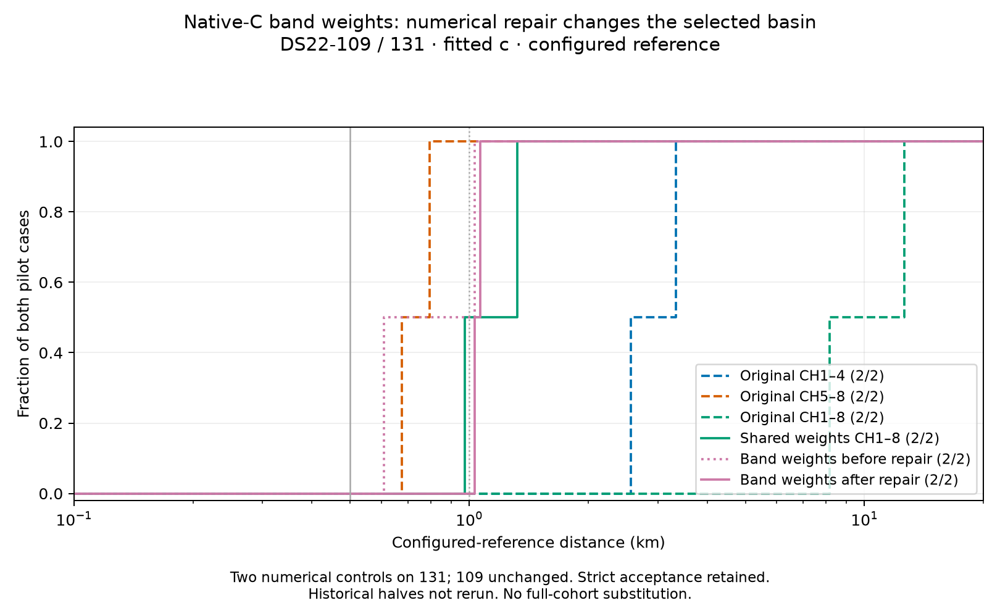

# Numerical repair resolves an exclusion and removes the apparent 0.609 km win

The lower-objective DS22-131 band-model state now passes strict stationarity. Correct selection therefore changes from **0.609056 km to 1.064777 km**. The earlier closer estimate depended on excluding a better-fitting basin; it was not reliable evidence that band-specific weights beat CH5–8.

The repair improves numerical correctness, not the underlying likelihood's localization ranking. The new selected distance is better than the shared-weight model's1.323056km but still worse than historical CH5–8 at0.674606km. DS22-109 is unchanged at1.031476km under the band model, versus shared0.974226km and CH5–8 at0.794920km. These remain development comparisons using the configured station reference, with no cohort substitution.

## The audit isolated a real numerical stopping problem

The unchanged failed state replayed objective30098.339430 and KKT0.007474489. A25-objective,25-explicit-orbit,zero-fit audit completed in33.912seconds. Its dominant original group-calibration derivative was0.007474489, versus central finite difference0.007474955 at step1e-5. Gradient-derived curvature was578820.706 and the estimated one-coordinate improvement was4.83e-11, about13.27objective floating-point steps. Smaller steps confirmed stable curvature. All24 side probes preserved native visibility, temporal support and interpolation cells.

Original group calibration was the acceptance failure. The large raw shared/contrast derivatives belonged to active logit bounds; the strongest centrally feasible shared/contrast derivatives were only2.17e-5 and2.89e-5. The exact-state audit recorded the whole constraint/gradient ledger and applied no constructor margin or projection. It did not infer stationarity from objective resolution.

## Matched numerical controls

Both methods start from the identical failed physical/nuisance state and retain the same band model, observations, candidate bank, original25km disk, global prior and active logit bounds. Each receives60seconds including5seconds for independent audit and at most600actual objective evaluations. An additional one-call original value/NLL/KKT replay qualifies each method before its timed numerical call.

| Method | Objective calls including audit | Numerical time | Final KKT | Strict accepted |
|---|---:|---:|---:|---|
| Unchanged SLSQP retry |23|0.964s|0.007045966|No|
| Active-tangent Newton |459|18.520s|0.000001355|Yes|

SLSQP again reported success, but failed the unchanged0.001 independent threshold. Newton used114 free tangent directions and two complete gradient-derived Hessians. Both were positive definite: minimum eigenvalues0.22542795/0.22542874, maximum596598.269/596598.270; relative matrix change1.536e-5 and relative asymmetry below1.62e-8. No ridge, projection or acceptance relaxation was used.

A single full feasible correction passed the original safeguards. It lowered the source objective by about1.1e-9 and moved its position by only **0.000543 metres**. The selected basin changed because an already-found lower-score state became eligible, not because Newton moved the receiver by hundreds of metres. Both numerical outcomes sealed before any position comparison. Total cost was482numerical objectives plus2qualification replays; no additional fits or retries followed.

## Corrected same-model selection

| Selected state | Objective | NLL | Configured-reference distance |
|---|---:|---:|---:|
| Prior accepted high-origin incumbent |35061.859553|34800.454644|0.609056km|
| Repaired low-origin state |30098.339430|29898.044080|1.064777km|

The repaired state wins by4963.520122objective units. The strict high-origin incumbent remains eligible and preserved. Choosing it because its reference distance is smaller would be an oracle selection and is not used. This resolves the demonstrated numerical exclusion while leaving a genuine model-ranking problem: even with band-specific weights and successful convergence, CH1–8 still loses to CH5–8 on both pilot cases.

The next scientific diagnostic should partition the two converged band states' likelihoods and signal/clutter responsibilities, then distinguish fixed clutter odds, residual calibration and temporally correlated association errors. Additional flexibility must be tested against nested controls and predictive evidence, not accepted solely for a smaller training objective. The full78-case matched-view evaluation remains separate ongoing work; no sub-km or below0.5km-median cohort claim follows.

## Reproducibility

- [Zero-fit audit protocol](DS22_NATIVE_BAND_ENDPOINT_AUDIT_PROTOCOL.md), source`fbc9a0cbb`; two actual-component audit tests passed.
- [Matched repair protocol](DS22_NATIVE_BAND_ENDPOINT_REPAIR_PROTOCOL.md), wrapper`5f7749a32`, unchanged numerical engine`fdd504f4b`; band active-bound transfer test passed, alongside the engine's10tests.
- Post-seal evaluator`231b43ec4` and reference barrier test passed. Plot test verifies that a farther training-selected repair replaces the closer incumbent; Ruff passed.
- Bulk audit: `/srv/bulk/leo-research-ds21-ds22/2026_10_14/ds22-native-band-endpoint-audit-v1`.
- Bulk repair/evaluation: `ds22-native-band-endpoint-repair-v1` and `ds22-native-band-endpoint-repair-evaluation-v1` under the same root.
- [Prior pilot and sealed repair comparison with pinned receipts](native-band-repair-pilot/data.json).
