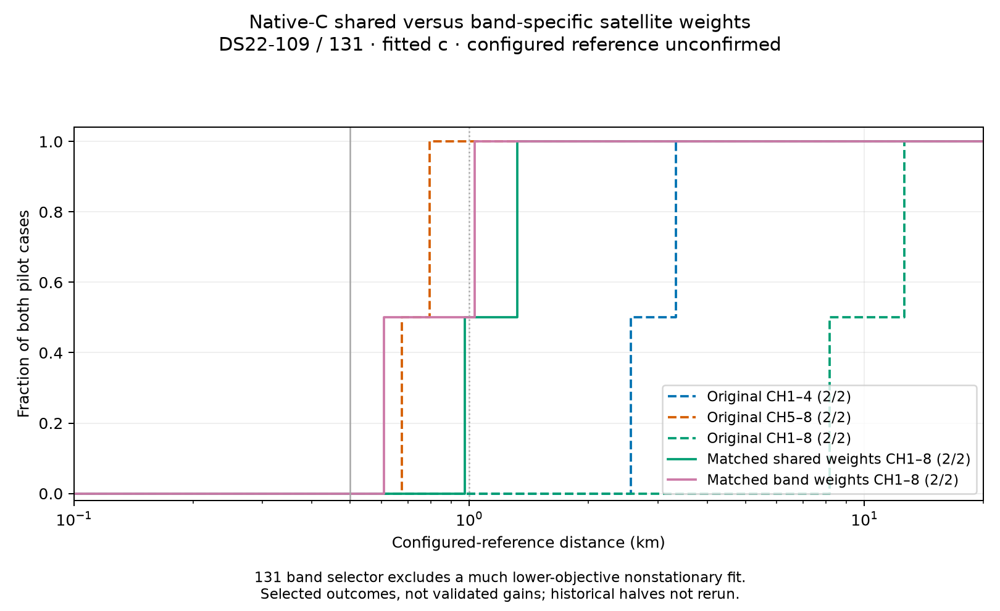

# Native band-specific weights: mixed distances and an unresolved numerical exclusion

Adding a regularized difference between the two bands' satellite weights does **not** establish a fusion fix. DS22-109 becomes slightly less accurate by configured-reference distance despite a lower training objective. DS22-131's selected result is closer, but its selection excludes a much lower-objective state that failed stationarity. The apparent 131 improvement must not be interpreted as a validated model gain.

| Case | Original CH1–4 km | Original CH5–8 km | Original CH1–8 km | Matched shared weights CH1–8 km | Band-specific weights CH1–8 km |
|---|---:|---:|---:|---:|---:|
| DS22-109 | 3.331478 | 0.794920 | 12.624524 | 0.974226 | 1.031476 |
| DS22-131 | 2.562646 | 0.674606 | 8.158713 | 1.323056 | 0.609056* |

*131's band selector has a known numerical exclusion gap. These are training-selected development outcomes with fitted c and an unconfirmed configured station reference. No full-cohort result changes.

## What the controlled extension changes

The new native model uses shared satellite logits plus a regularized band contrast, q+(H−f)d. H identifies the upper band and f is its original training-window fraction. Both vectors use the same zero-sum basis, unit Gaussian prior, bounds ±2 and scale 0.5. Setting d=0 reproduces the shared model, including its prior, at nonzero q. Original timing and calibration priors enter exactly once. The two disjoint band likelihood partitions preserve the existing native prediction, alias and conditional-density physics.

Both arms start from the same two complete anchored states per recording, with zero added tails and the original source disks. Each fit receives 60 seconds including five seconds for audit, 600 iterations and a single optimizer invocation. The band arm calls the native predictor twice per objective, so matched time budgets do not imply equal prediction counts. Previous shared-fit endpoints were not borrowed as band-converged estimates.

## Qualification and actual experiment

Six component/driver tests passed, including all-coordinate finite differences at nonzero contrast with and without receiver clock. The post-seal evaluator barrier and selected-only plot test also passed; Ruff was clean.

Actual qualification used **624 objective evaluations, zero fits**: 300 on109 in40.841seconds and324 on131 in46.257seconds. Raw sources and shared conditional scores replayed. Zero/nonzero tied-band objective, physical/base/shared-gradient and posterior nesting passed, with maximum objective discrepancy7.28e-12. Every group/shared/contrast nuisance derivative was checked at deterministic nonzero contrast; maximum discrepancies were2.14e-7 and2.15e-7. Actual-data qualification did not re-run a full physical-coordinate finite-difference audit; that coverage is synthetic plus actual nesting.

All eight fresh fits completed and sealed before reference comparison. Six passed strict independent stationarity: three shared and three band. They used **3,055 objective evaluations**, including14 independent audits. There were no repeated calls, timeout-based retries or threshold changes. Both shared controls reproduce the previous shared-model outcomes exactly, including the rejected109 low-origin fit.

## Distinguishing likelihood, prior and position

| Case / selected arm | Objective | NLL | Prior penalty | KKT |
|---|---:|---:|---:|---:|
|109 shared |31031.160765|30905.668310|125.492456|0.000721|
|109 band |30448.859493|30312.126124|136.733370|0.000435|
|131 shared |30971.629598|30769.391796|202.237802|0.000560|
|131 band |35061.859553|34800.454644|261.404909|0.000793|

Each arm selects only among its own strict estimates. Training objectives across model families are descriptive, not a cross-model selector. For109, extra flexibility lowers training NLL but worsens configured distance from0.974 to1.031km; score improvement does not imply localization improvement.

For131, the low-origin band fit reaches feasible objective **30098.339430**, which is **4963.520122 lower** than the selected high-origin band state. It reports optimizer success after21.290seconds with489 optimizer evaluations and196 callbacks, but independent audit gives **KKT0.007474489**, above0.001. It is excluded without reference evaluation or promotion. This is not a timeout. Its exclusion changes which basin wins, so the0.609km selected result cannot substantiate improved likelihood ranking. Numerical repair must retain the same objective/domain and strict acceptance gate, then repeat selection honestly.

The other unavailable fit,109 shared-low, is the same numerical result as the previous round: feasibleJ33137.970696, KKT0.003363500. Its feasible score is worse than the accepted shared-high winner. On109 band-high, the accepted trajectory point is1.42e-10 objective units above the minimum feasible point and independently passes KKT; the minimum feasible point itself fails stationarity. This distinction is retained in the receipts.

## Next action and scope

The experiment narrows the problem: a band-specific weight difference alone does not reliably deliver better localization, and strict numerical exclusions can make a performance curve look better by removing a lower-score basin. Diagnose and repair the131 low-origin numerical stopping before interpreting the model comparison. Continue matched half-view and full-cohort qualification separately; no per-case choice among pilot variants belongs in a cohort curve.

Historical halves were not rerun with the additional search budget and inherit shared discovery/initialization. All results are conditional development evidence, not independent half-only pipeline comparisons or verified DS22 station accuracy. The sub-km / below0.5km-median objective remains unmet.

## Provenance

- [Prospective model and experiment protocol](DS22_NATIVE_BAND_PROPENSITY_PROTOCOL.md).
- Model, driver and source freeze: `9daef5b5d`; post-seal evaluator: `2c629c4c1`.
- Bulk namespace: `/srv/bulk/leo-research-ds21-ds22/2026_10_14/ds22-native-band-propensity-v1`.
- Evaluation: `ds22-native-band-propensity-evaluation-v1` under the same root.
- [All evaluated selections, unavailable outcomes and pinned receipts](native-band-propensity-pilot/data.json).
