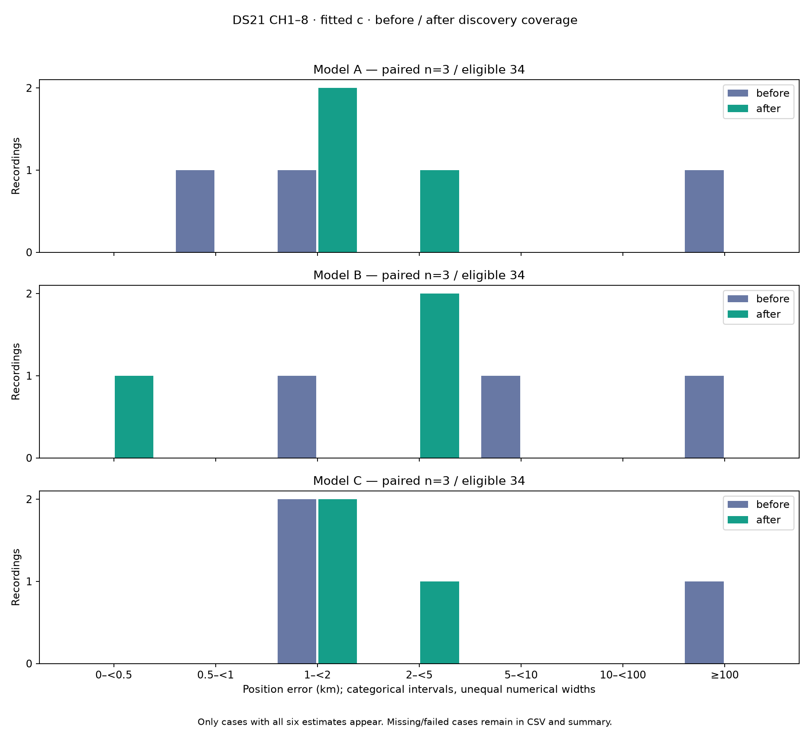

# Matched DS21 histograms: three of 34 development recordings

The updated histogram includes DS21-005, DS21-009 and DS21-013, the three
recordings with all six sealed A/B/C before/after CH1–8 estimates. Both sides
use fitted c. **Before and after both mean CH1–8**: the intervention is expanded
discovery coverage, not adding upper-band channels. Later timing/phase
experiments are excluded from this version comparison.

|Model|Paired median before km|Paired median after km|
|---|---:|---:|
|A|1.871189|1.509542|
|B|5.327196|2.021218|
|C|1.751815|1.846733|

These are three-case descriptive statistics, not full DS21 performance.
Coverage removes the large 013 outlier but has mixed transfer: 005 improves
A from 1.871189 to 1.426279 km and worsens B from 1.421114 to 2.213563 km and
C from 1.751815 to 2.387111 km. C's paired median consequently worsens.
The full 34-case goal and the below-0.5-km median target remain unmet.

Only the same paired cases appear in the plot. The CSV retains all 204
case/model/arm rows, including pending cases. Summary statistics over all
available estimates have different before/after counts and must not be
interpreted as paired improvements; use the table above for the paired cohort.
The wider six-before/three-after availability remains visible in summary.json.

The 005 runtime adapter preserves the exact original coverage scientific
protocol and original fit budgets. Its 12-unit sealed terminal contains 51 new
and three recovered optimizer calls. The collector verifies the original
scientific parent, terminal, evaluation and all unit bindings before accepting
this explicit replacement for a pending original result. No fitting or new
reference lookup was performed to make these plots.

Reproducible collector: tools/ds21_runtime_histograms.py, source commit
8d0a04ac0. Two component tests pass; Ruff passes. The initial plot-only export
histograms-runtime-001 is retained locally; 002 additionally supplies the CSV
and summary named in the figure caption.
