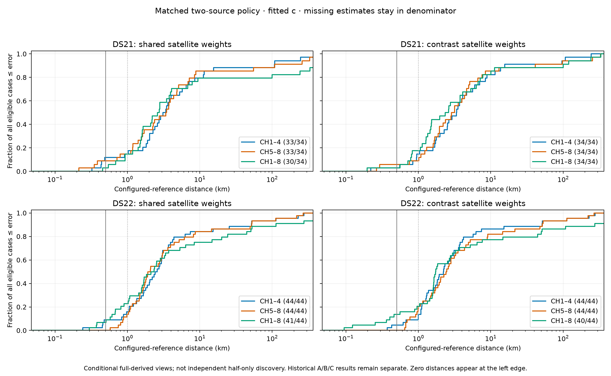

# Consistent two-source A-derived candidate: full 78-case result

The frozen shared and band-contrast satellite-weight policies completed all **34 DS21 coverage and 44 original DS22 recordings**. Neither meets the 0.5 km median target. Available CH1–8 medians are **2.115 km shared** and **1.738 km contrast** across both datasets; only 4/78 and 7/78 eligible recordings, respectively, are within 0.5 km of the configured reference. These are configured-reference distances, not independently verified accuracy.

This is one prospective policy across the complete cohort. It does not substitute successful case-specific pilots or modify historical A/B/C curves. The model and source policy were developed using earlier pilot results, so this is a conditional development comparison, not an untouched validation cohort. All runs use fitted c.

## Matched views and availability

Medians below use available estimates; the availability column preserves the full eligible denominator. The ECDF uses all eligible cases in its denominator and therefore does not silently remove failures.

| Dataset | Family | CH1–8 available / median km | CH1–4 available / median km | CH5–8 available / median km |
|---|---|---:|---:|---:|
| DS21 | Shared | 30/34 · 2.200 | 33/34 · 3.100 | 33/34 · 3.398 |
| DS21 | Contrast | 34/34 · 2.483 | 34/34 · 3.372 | 34/34 · 3.013 |
| DS22 | Shared | 41/44 · 1.832 | 44/44 · 2.493 | 44/44 · 1.997 |
| DS22 | Contrast | 40/44 · 1.666 | 44/44 · 2.220 | 44/44 · 2.436 |
| Combined | Shared | 71/78 · 2.115 | 77/78 · 2.739 | 77/78 · 2.368 |
| Combined | Contrast | 74/78 · 1.738 | 78/78 · 2.561 | 78/78 · 2.627 |

Lower full-view cohort medians do not establish per-recording superiority over both halves. Among complete matched triplets, full beats both halves in only 8/28 DS21 shared, 16/34 DS21 contrast, 14/41 DS22 shared and 17/40 DS22 contrast recordings.

The halves are **conditional full-derived views**. They share the full bank, RF/clock frame, learned frozen shifts, source inventory, original physical priors and original source disks. Discovery, preprocessing and calibration were not independently trained on each half. The absent band's parameters retain the qualified coupled MAP prior and bounds.

## Frozen policy and actual budget

Each recording uses exactly two reference-free complete sources: the genuine original B full-training winner and the eligible original A final minimizing full-view zero-q conditional J, with original-index tie breaking. The same sources are used in all three views and both families; q tails start at zero. These are initializers, not inherited q incumbents. Each own-view/family selector chooses its minimum-J new strictly accepted endpoint. Source kind B does not turn this A-derived method into Model B.

The fixed learned receiver-band contrast remains exact for each source, with its original 50 kHz prior contribution included once. Shared and contrast satellite-weight models use the same compact smooth horizon width 1e-5. Qualification and the narrowly physical-coordinate DS21-035 v2 amendment are documented in [the 78-case admission report](model_a_capped_cohort_78_admission_results.md); the original failed 035 v1 receipt remains preserved.

All **936/936 fresh fits** were attempted. **859 passed strict independent admission and 77 failed**. There were 935 returned independent audits and one preserved optimizer-unreturned objective-cap failure. Exactly **405,915 actual objective evaluations** were recorded, including failed attempts. There were no unknown unfinished counts, process failures or automatic retries.

Each fit had the prospective matched allocation of 15 seconds / 600 iterations for the fitter, with a 20-second total clock and an independent audit reserved within 2,000 actual objective attempts. KKT admission remained at 0.001. Median numerical time was 4.601 seconds, maximum 15.139 seconds. The maximum whole-case time was 180.106 seconds within its 360/375/380 second envelope. Seven separate waves, each at most twelve recordings and six single-thread workers, consumed 1,540.27 seconds of aggregate wave wall time; no wave exceeded 300.28 seconds.

Thirteen selectors are unavailable: DS21 shared-all 029/061/077/085, shared-low 043, shared-high 071; DS22 shared-all 047/093/105 and contrast-all 001/047/093/105. No rejected endpoint is reported as an estimate.

## Frequency fit and position are separate outcomes

Among full-view pairs with both families available, contrast reduces median selected in-sample NLL by 190.870 on DS21 (24/30 improve) and 282.145 on DS22 (33/40 improve). The corresponding median selected J differences are −167.071 and −276.609. Distance improves in only 19/30 and 28/40 pairs. These are matched, finite-search training results; lower frequency-fit scores do not establish better localization or predictive generalization.

Catastrophic full-view errors remain. In the fixed shared version, DS21's worst two are 059 at 333.030 km and 053 at 242.019 km; contrast has the same two at 332.959 and 242.607 km. DS22's worst two are 059 and 019: 274.910/112.951 km shared and 273.723/108.337 km contrast. These rankings keep each algorithm version separate. No per-case best-by-reference mixture is reported.

The capped original-source policy also does not inherit the candidate unions, larger domains, fold-trained states or additional searches used by earlier successful pilots. This result shows that their gains cannot be claimed for a consistent two-original-source cohort recipe. The next diagnosis should distinguish missing domains/basins from strict numerical attrition on these exact sources before expanding another model.

## Outcome barrier and artifacts

All 78 outcomes were genuinely revalidated and globally sealed **before this evaluation accessed the configured reference**. That metadata operation completed in 164.309 seconds with zero objectives/fits. The separately bounded post-seal evaluation completed in 183.130 seconds, also with zero objectives/fits, and emitted the exact 468-row grid with explicit unavailable rows and source bindings. The reference is the unchanged literal pinned by the prior DS22 comparison, status `configured-unconfirmed`; no verified station-continuity or target-achievement claim is permitted.

- [Exact 468-row evaluation JSON](model_a_capped_cohort_evaluation.json) and [CSV](model_a_capped_cohort_evaluation.csv).
- [Metrics and fixed-version worst cases](model_a_capped_cohort_metrics.json).
- [All 936 fit receipts, scores, KKT and costs](model_a_capped_cohort_fit_receipts.json) and [CSV](model_a_capped_cohort_fit_receipts.csv).
- [ECDF PDF](model_a_capped_cohort_curves_2026_10_16/matched_channel_ecdf.pdf), [plot summary](model_a_capped_cohort_curves_2026_10_16/summary.json) and [source manifest](model_a_capped_cohort_curves_2026_10_16/source_manifest.json). The existing parent-owned renderer was executed unchanged; it verified 1,002 source bindings.

Scientific master: `/srv/bulk/leo-research-ds21-ds22/2026_10_14/model-a-capped-cohort-control-v1`. Global outcome authority: `model-a-capped-cohort-global-outcomes-v1` in the same dated bulk root. Original post-seal evaluation: `model-a-capped-cohort-configured-evaluation-v1/evaluation.json` there. The repository copy is byte-identical.

The frozen scientific runner and 035 amendment passed their 37 component tests; the new global evaluator passed four component tests and Ruff. The global evaluator checks source/outcome membership before and after joining the configured reference. No existing frozen scientific source or historical result was edited.
