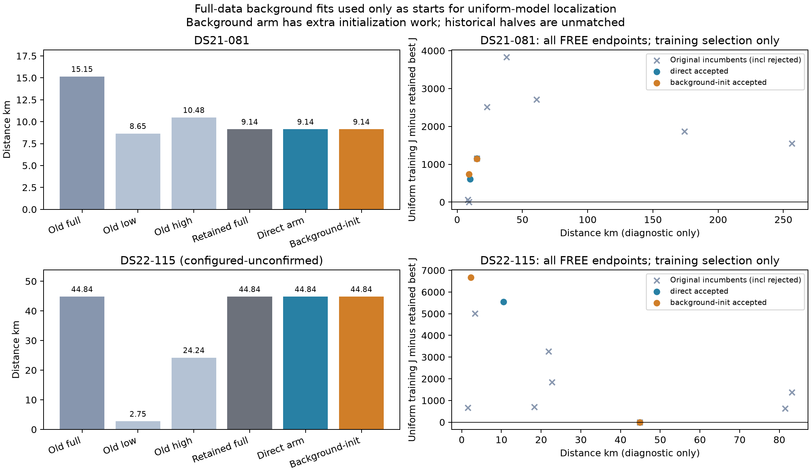

# B081/B115 full-data initialization control

All20 fits passed independent stationarity, but neither initialization arm improves the retained full-data result: B081 stays9.141021769km and B115 stays44.838979009km (DS22 configured reference remains unconfirmed). A new accepted B115 endpoint at2.307910859km loses training J by6681.683062, overwhelmingly likelihood rather than priors. It cannot be selected by its smaller configured distance. Do not promote the background density or replace cohort baselines.

## Prespecified question and source inventory

The [background CV](MODEL_B_EMPIRICAL_CLUTTER_CV_RESULTS.md) was negative for its direct empirical-density contribution. The [uniform restarts](MODEL_B_UNIFORM_BASIN_RESULTS.md) retained B115's alternative parameter basin without that density. This experiment tests localization under the original uniform conditional objective, with empirical background used only to produce complete starts. No opposite-fold winner or reference-selected endpoint seeds this experiment.

No full-data trained-background endpoint existed at declaration. At each case's original selected full XY and existing low-origin FREE XY, both paths begin with the original full complete non-geographic state. The direct path fits a uniform fixed profile then releases it. The background-initialization path first fits the full-training empirical density at fixed XY, exactly replays the complete endpoint under uniform density, then fits a uniform fixed profile and releases it. All original banks, frames, priors, fittedc and original own25km disks are preserved; no recenter or clipping. Both selectors retain every existing independently valid full-target incumbent, including both prior low/high FREE endpoints.

The [20-call protocol](MODEL_B_BACKGROUND_FULL_PROTOCOL.md), source`231b15ff6`, declares4background initialization fits plus8uniform fixed profiles plus8accepted FREE releases, with explicit zero-call outcomes if a prerequisite rejects. Each fit has20s/600iterations/600ACTUAL objectives including independent terminal KKT; strict acceptance≤.001. Background arm's extra initialization work is explicit, so this is not an equal end-to-end budget comparison. Training selection uses only accepted uniform-target J, never background-vs-uniform J or position error. All20 declared outcomes must seal before any position diagnostic. Original held/locked observations remain untouched.

## Qualification and preserved adapter failure

Both v1 full-data qualification slices stopped with omitted `fixed_position` metadata before any numerical objective or optimizer call. Those frozen sources and failed receipts are preserved. [Additive v2](MODEL_B_BACKGROUND_FULL_V2_PROTOCOL.md), source`f8163d358`, records original options and the original fitter's equivalent explicitFalse default for free endpoints. Existing incumbents are checked in their raw feasible domains; a hypothetical initializer adjustment is recorded but never applied. Actual new fixedXY starts still require the original strict initializer-margin rule. No bound or scientific model changed.

V2 passed56objectives/0fits: B08128 in9.687s, B11528 in26.307s, including source checks/preparation. Every incumbent matches original uniform conditional source objective/both gradients/posterior/background/residuals and receives independent target-KKT audit. B081 retains8/8; B115 retains7/8, with original start3 still rejected atKKT.002248134. Historical failure is not silently repaired or erased. Full-training histograms contain2054/2782 selected windows, fixed16bins/32uniform-pseudowindows per exact RX/channel/RF lane, identical across both XY paths. They represent selected observations, not verified physical clutter.

V2 qualification terminal hashes: B081`3f1719fd710994a0e531744c1daf705f3fa16920103ec2cc81290361076dbba9`; B115`aa29478101d4067d59cac61caf8f6fbfd3955dbf13a1c97aa01edaf15a0d6933`. Control/evaluator source`0244cd41f`. Bulk namespaces `model-b-background-full-qualification-v1` (preserved failure), `...-qualification-v2`, and `model-b-background-full-control-v1` under `/srv/bulk/leo-research-ds21-ds22/2026_10_14/`.

Every worker is single-threaded, maximum2 concurrent; whole slices require120s completion plus external135s TERM/140s KILL and30s remaining admission before a fit. Nested signal timers alone are not the authoritative bound. Source/test/metadata interfaces remain frozen. No RF collection or QNAP mutation occurred.

## Complete outcomes and seal

All4 background initializations passed source-model KKT; their complete arrays reproduced original uniform conditional objective/both gradients/posteriors/residuals with independent uniform-target KKT,12objectives/0fits total. All8 uniform fixed profiles then passed, followed by all8 FREE releases. There were no skipped, timed-out or rejected new fits and no above-feasible-initializer warnings. Source-background stationarity was never used as uniform-target acceptance.

Global20-outcome seal SHA256`9dec5b6e92e8ac50c9684e2f7740f62fe6dbe124882a33a3f721b770aa1208ad`. All outcomes, original eligibility, transport receipts and training selectors sealed before reference parsing. Postseal comparison SHA256`69952f9b30481f92e9aa74ecd06527662bb5d2d78f15171ceed2d2574cc9b9a4`, in sibling bulk `model-b-background-full-control-v1-comparison/report.json`.

Background initialization objectives use their own empirical density and are **not comparable** to the uniform objectives below. No cross-density objective selector exists.

|Case|Fixed XY|Background J|Background NLL|Prior|KKT|Actual objectives|
|---|---|---:|---:|---:|---:|---:|
|B081|Original full|24431.687762|24020.143382|411.544380|.000106844|324|
|B081|Low release|24088.660455|23664.793267|423.867187|.000219578|507|
|B115|Original full|30829.764304|30320.048354|509.715951|.000003966|260|
|B115|Low release|37319.799752|36964.051022|355.748731|.000124796|316|

Uniform fixed profiles, always in the same original own25km disk with complete non-geographic state retained from the declared path:

|Case|Fixed XY|Initialization|Uniform J|Uniform NLL|Prior|KKT|Actual objectives|
|---|---|---|---:|---:|---:|---:|---:|
|B081|Original full|Direct|24665.681622|24255.223328|410.458294|.000403954|14|
|B081|Original full|Background|24652.355730|24238.919774|413.435956|.000028522|308|
|B081|Low release|Direct|24183.095974|23802.066082|381.029892|.000103416|534|
|B081|Low release|Background|24249.089227|23819.029329|430.059898|.000105734|321|
|B115|Original full|Direct|30953.942263|30441.837432|512.104831|.000485033|14|
|B115|Original full|Background|30954.070880|30442.074399|511.996481|.000014488|247|
|B115|Low release|Direct|37473.068726|37121.886593|351.182133|.000019530|365|
|B115|Low release|Background|37689.646353|37333.666041|355.980312|.000022873|215|

Every FREE result, including losing endpoints; configured positions were joined only after global sealing:

|Case|Source XY|Initialization|Distance km|Uniform J|Uniform NLL|Prior|KKT|Actual objectives|
|---|---|---|---:|---:|---:|---:|---:|---:|
|B081|Original full|Direct|15.154209993|24665.681622|24255.223328|410.458294|.000403954|14|
|B081|Original full|Background|15.103100390|24652.247027|24238.871128|413.375899|.000043799|309|
|B081|Low release|Direct|9.905992703|24112.253681|23753.551612|358.702069|.000073572|353|
|B081|Low release|Background|8.929589834|24243.461999|23808.866775|434.595224|.000038848|316|
|B115|Original full|Direct|44.838979009|30953.942263|30441.837432|512.104831|.000485033|14|
|B115|Original full|Background|44.841894469|30954.070767|30442.096781|511.973986|.000005763|246|
|B115|Low release|Direct|10.531290564|36504.660859|36101.794421|402.866439|.000117776|329|
|B115|Low release|Background|2.307910859|37635.625325|37280.512602|355.112723|.000082713|259|

Total5265actual fit objectives:1407background,2018uniform fixed,1840FREE. Adding56pre-fit qualification and12transport gives5333objectives/20fits for this experiment, separate from parent discovery/CV/history. Numerical durations .075–3.993s per fit; whole units19.115–44.634s; the2worker staged queue including metadata/preparation/seals completed431.370s. All under declared bounds. Concurrent host load prevents controlled speed conclusions. Component qualification4tests, additive v2 3tests, full stage/evaluation3tests and plotting1test passed with Ruff; no frozen parent source changed.

## Training-selected localization and matched limits

|Case|Historical full km|Historical low km|Historical high km|Retained current full km|Direct-arm selector km|Background-init selector km|
|---|---:|---:|---:|---:|---:|---:|
|B081|15.154209993|8.651799322|10.475954448|9.141021769|9.141021769|9.141021769|
|B115|44.838979009|2.748364071|24.235681703|44.838979009|44.838979009|44.838979009|

B081 both arms retain prior high-origin FREE incumbent J23508.313469,NLL23160.345790,prior347.967679,KKT.000061261. B115 background arm retains original full start0. Direct arm returns the same basin at J30953.942263135654 versus incumbent30953.94226313566: vector maximum change1.42e−14,nuisance exactly unchanged, identical configured distance. This numerical tie is not a recovered geographic basin.

B115's new background-init low release is closer to the configured reference but has J+6681.683062,NLL+6838.675170,prior−156.992108 versus the selected far state. Thus these exact endpoints cannot be repaired by choosing the smaller prior penalty, and choosing by position would violate the training-only selector. The historical accepted low release at3.372km also remains eligible and loses training score. All new fits passed strict KKT, so rejection/optimization attrition does not explain this experiment's selector. This is a limited set of starts under the same likelihood, not proof that global optimization is complete or that the configured DS22 reference is physically confirmed.

Historical halves use original joint-event models and different search histories; this experiment uses the uniform conditional target and extra saved-state work. Their distances remain visible as motivation, not fresh matched-half evidence. B081 still exceeds its old low half, and B115 still exceeds both old halves. No subkilometer or cohort-wide improvement follows.

[Vector figure](MODEL_B_BACKGROUND_FULL.pdf). Both scientific and comparison bindings are verified; figure/evaluator add0objectives/0fits. Plot includes every new FREE endpoint and retains losing candidates rather than taking the best distance.

The empirical-background density is not promoted; neither is its full-data initialization path. The next reviewed direction is shared versus band-specific satellite detectability on the complete original B model, retaining its free group calibration and priors. Existing tested detectability mathematics should be reused with exact zero/nonzero nesting and actual gradient qualification before any new fit. No such fit is part of this report.
