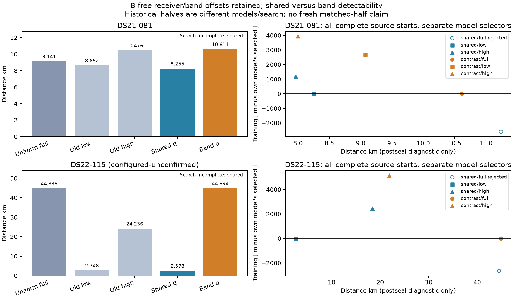

# B081/B115 shared/band detectability with original B group offsets free

The band-specific model did not improve either retained uniform-model location: **10.611129 km on DS21-081 and 44.894456 km on DS22-115**, versus 9.141022 and 44.838979 km. The shared model selects 8.254885 and 2.578340 km, but **both shared selections are search-incomplete**: their lower-scoring full-origin endpoints failed strict stationarity, and the accepted selections score worse than feasible zero-q source states. Those apparent gains cannot establish successful localization or model improvement.

All 12 outcomes sealed before reference evaluation; 9 pass independent strict stationarity. No retry, numerical repair, truth-based selector or original held/locked measurement was used. DS22 comparisons remain **configured-reference, unconfirmed**, not independently verified accuracy. No cohort promotion or sub-kilometre goal achievement is claimed.

[PDF figure](MODEL_B_BAND_Q.pdf). Filled points pass strict stationarity; hollow points are rejected. The unavailable B115 band/low endpoint is recorded below. Each scatter subtracts its own model's selected training objective; there is no cross-model training-objective selector.

## All sealed outcomes

| Case | Retained uniform full, km | Historical low / high, km | Shared q, km | Band q, km |
|---|---:|---:|---:|---:|
| DS21-081 | 9.141022 | 8.651799 / 10.475954 | 8.254885, search-incomplete | 10.611129 |
| DS22-115, configured-unconfirmed | 44.838979 | 2.748364 / 24.235682 | 2.578340, search-incomplete | 44.894456 |

Historical halves use a different model and search history. All new fits use full training observations; no fresh matched q-model half fits or independent predictive validation were performed. The original full baseline before earlier uniform continuations was 15.154210 km on B081 and 44.838979 km on B115.

| Case | Model / complete start | Accepted | J | NLL | KKT | Distance, km | Actual objectives |
|---|---|:---:|---:|---:|---:|---:|---:|
| B081 | shared / full | no | 22069.610476 | 21724.324242 | .001713006 | 11.239668 | 454 |
| B081 | shared / low | yes | 24673.305862 | 24219.446466 | .000078916 | 8.254885 | 452 |
| B081 | shared / high | yes | 25866.402749 | 25425.231087 | .000048096 | 7.962244 | 441 |
| B081 | band / full | yes | 21810.377278 | 21468.243308 | .000735366 | 10.611129 | 473 |
| B081 | band / low | yes | 24495.535066 | 24038.658234 | .000533838 | 9.072025 | 444 |
| B081 | band / high | yes | 25745.549121 | 25300.499519 | .000073555 | 7.997592 | 483 |
| B115 | shared / full | no | 29031.135861 | 28543.772358 | .004790541 | 44.502614 | 335 |
| B115 | shared / low | yes | 31686.854710 | 31373.593468 | .000400127 | 2.578340 | 377 |
| B115 | shared / high | yes | 34133.243427 | 33727.673430 | .000479742 | 18.383948 | 410 |
| B115 | band / full | yes | 28829.066703 | 28310.496283 | .000140143 | 44.894456 | 334 |
| B115 | band / low | no | unavailable | unavailable | unavailable | unavailable | 599 |
| B115 | band / high | yes | 33975.526512 | 33550.669808 | .000207907 | 21.859934 | 388 |

B115 band/low exhausts its optimizer objective allowance at 599 evaluations and 10.527656 seconds, with no returned endpoint. The 600th evaluation is reserved for terminal audit; no endpoint, KKT or position is invented. Both rejected shared/full fits return within their wall allowance: B081 8.255968 seconds, B115 5.629168 seconds. They fail the unchanged KKT threshold .001, not a time limit.

| Case / model | Accepted selected J | Lowest feasible initializer J | Selected minus feasible bound |
|---|---:|---:|---:|
| B081 shared | 24673.305862 | 23508.313469 | **+1164.992392** |
| B081 band | 21810.377278 | 23508.313469 | −1697.936192 |
| B115 shared | 31686.854710 | 30953.942263 | **+732.912447** |
| B115 band | 28829.066703 | 30953.942263 | −2124.875560 |

No accepted endpoint is worse than its own initializer; the shared gaps arise across matched starts. Rejected shared/full endpoints beat accepted shared/low selectors by 2603.695385 and 2655.718849 J. Numerical stopping needs investigation before shared-model conclusions. Feasible source states are bounds, not automatically eligible stationary q-model endpoints.

Stationary band/full B081 beats band/low by 2685.157788 J: NLL improves by 2570.414926 and total prior by 114.742862. It beats band/high by 3935.171843 J. B115 band/full beats accepted band/high by 5146.459809 J, including 5240.173526 better NLL despite 93.713716 worse total prior. These rankings are not prior-only effects; the unavailable B115 band/low fit leaves that basin unresolved.

Full-origin band solutions retain learned group offsets [−19462.576, 39716.960] Hz and [−23689.996, 37841.467] Hz. Their group-prior penalties are .391246 and .398639; q-prior penalties 46.013634 and 38.559894. Group dimensions were fitted, not silently frozen or removed. These coefficients do not establish hardware truth or emitter identities.

## Model and matched initialization

The [full-data background initialization control](MODEL_B_BACKGROUND_FULL_RESULTS.md) did not improve either retained result. This experiment changes satellite detectability using existing tested mathematics, retaining the complete original B calibration. It directly wraps original GroupCalibrationObjective with existing SmoothVisibilityModel or BandDetectabilityModel; **both original receiver/band offsets remain free** with unchanged priors/bounds/scales/design. PathModel, which would require absent/frozen group offsets, is not used.

Both models use normalized conditional folded CFO density, fixed full-bank detection budget1.6 and smooth horizon width1e−5. Shared q has K−1 coefficients; band q has2(K−1), each bounded±2, with the existing fixed shared-plus-contrast prior. The original full-training high fraction is unchanged. Signal sigma125Hz, observations, RF-dependent fittedc, candidate/orbit bank, original common/relative satellite timing and commonclock remain unchanged. The density retains the original selected-CFO approximation, not an asserted complete acquisition/beam model or verified emitter identity.

Exactly three training-only complete starts per case: current accepted minimum uniform-full state, original own-low winner, original own-high winner. Existing exact functional rebase preserves half affine time/RF correction, every clock term and absolute satellite timing in the full original frame; absent half group offsets initialize zero but remain free during fitting. Each start retains its original own 25 km disk. No source, weight or radius is selected by reference or opposite-fold success.

The [model protocol](MODEL_B_BAND_DETECTABILITY_PROTOCOL.md) and [fit envelope](MODEL_B_BAND_Q_FIT_PROTOCOL.md) specify2cases×2families×3starts=12full-view FREE fits. Each20s/600iterations/600ACTUAL objectives including independent terminal KKT≤.001; no retries. A forwarding observer caches the first genuine optimizer evaluation as feasible score bound without adding an objective or reconstructing a hard model. Physical effective-initializer timing margin≤1.1ns and numerical roundtrips are recorded. Source stationarity is never copied after adding q.

Original zero-q states are feasible bounds, not automatically eligible q-model incumbents. Select training J separately within each case/family among accepted new fits only; preserve unavailable/rejected endpoints. Report any accepted endpoint above its own first feasible evaluation, and any selected endpoint worse than another feasible source bound, as search incompleteness. Do not interpret that as a failure of the statistical model. No cross-model training-J selector exists.

## Qualification and frozen authority

[Actual qualification](MODEL_B_BAND_Q_QUALIFICATION_RESULTS.md) passed3474objectives/0fits across all6 complete sources: every physical/clock/freegroup/q coordinate at nonzero q/contrast, zero/nonzero tied objective/gradient/posterior nesting, original legacy full group-gradient oracle and exact nonzero-q free-group gradient formula. Maximum scaled FD error8.392e−5, below absolute3e−4; no blocked directions. Zero-q hard/soft objective nesting is exact at all6 starts, with no horizon transition pairs there. During fitting, transitions may occur and remain part of the declared differentiable model.

Component`c83a19117`, qualifier`82cdc9d2c`, fit/evaluator`4fbdbba36`. Fresh bulk qualification/control namespaces `model-b-band-q-qualification-v1` and `model-b-band-q-control-v1` under `/srv/bulk/leo-research-ds21-ds22/2026_10_14/`. Full source/input authority froze before preparation; no frozen parent edits, original held/locked reads, RF collection or QNAP mutation. Every unit has120s monotonic completion plus external135s TERM/140s KILL and30s remaining admission, maximum2single-thread workers. Extra12fits/240aggregate numerical seconds/7200actual objective cap are separate from3474qualification objectives and all upstream discovery/experiments. All12 scientific outcomes/selectors must seal before any reference/position evaluation; DS22 reference remains configured-unconfirmed.

## Actual budgets and receipts

All 12 fits used **5190 actual objectives / 92.698114 aggregate numerical seconds**. B081: 2747 evaluations / 50.971257 seconds; B115: 2443 / 41.726857. Maximum individual numerical duration 10.527656 seconds. Two single-thread workers completed the queue in 396.830051 seconds including repeated preparation and authority checks; maximum whole unit 74.151133 seconds. Extra preparation and upstream costs are not zero or end-to-end budget equivalent to old baselines.

Postseal comparison namespace `model-b-band-q-control-v1-comparison` and figure namespace `model-b-band-q-figures-v1`, under the same bulk root, each use zero objective evaluations and zero fits. Original held/locked measurements remain untouched.

Scientific seal: `sha256:573def71ca8eb0b2c41e2699020d90f21b9b8fc85c3ff0f1452433871933a055`.

Postseal comparison: `sha256:1efc80618b7a972eb9ebd668d30d2836d038bf8b7fa657d77bdc27fb53026b07`.

Next evidence should address the two rejected shared/full endpoints with a bounded gradient, curvature and objective-precision audit. No extra fit or repair is included here. Do not promote detectability, choose the closer basin by position, or claim superiority over current-model halves that were not fitted.
