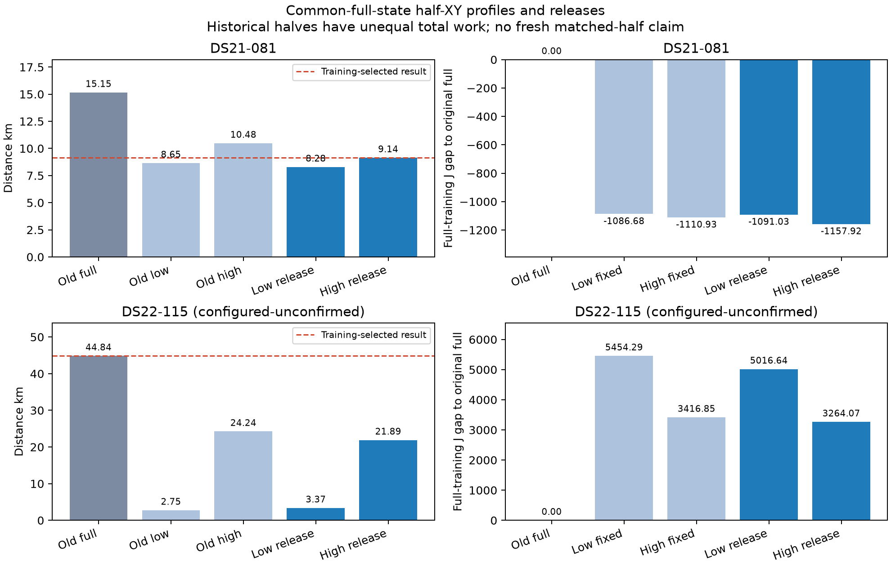

# Common-full-state profiles: B081 improves, B115 remains a score mismatch

The approved eight-call control improves training-selected B081 full distance **15.154210→9.141022km**, but still loses to the original low half8.651799km. B115 retains its original44.838979km full selection: accepted new low/high releases3.372063/21.886538km lose full training objective by5016.644914/3264.066465 and cannot be selected by position. DS22 distances remain configured-unconfirmed. Neither case meets the target; no baseline/cohort promotion is made.

The new full results have additional saved-state optimization work; the original halves have their historical budgets and model frames. These are **not fresh matched full/half comparisons**. B081's full now beats its original high10.475954km but still loses to original low8.651799km; a fresh matched-view experiment would be required before a combined-improvement claim. B115 remains worse than both original halves2.748364/24.235682km. Existing plots and histogram rows remain unchanged; this figure is saved separately as PNG/PDF.

Each fixed profile used the corresponding training-selected half XY with the **same complete selected-full non-geographic state**: calibration, static group offsets, common receiver clocks and common/relative satellite timing. No half calibration function or nuisance coefficients were copied. Original B likelihood, bank55/38, full frame, fitted RF coefficient, priors and physical bounds were unchanged. Both half paths' original25km disks were used. Every accepted profile released its entire endpoint in the same disk, and all original accepted full endpoints remained eligible after independent exact replay. Training objective alone selected the final state.

| Case / path | Stage | Accepted | Full J | Full NLL | Prior | KKT | Postseal distance km |
|---|---|---|---:|---:|---:|---:|---:|
| B081 low | fixed | true | 26106.904893 | 25744.009569 | 362.895325 | .000745451 | 8.651799 |
| B081 high | fixed | true | 26082.653284 | 25732.669317 | 349.983967 | .000187764 | 10.475954 |
| B081 low | FREE | true | 26102.554356 | 25740.831802 | 361.722554 | .000139990 | 8.284058 |
| B081 high **selected** | FREE | true | 26035.667989 | 25687.700309 | 347.967679 | .000061261 | 9.141022 |
| B115 low | fixed | true | 39840.927282 | 39497.390803 | 343.536479 | .000107020 | 2.748364 |
| B115 high | fixed | true | 37803.484903 | 37361.169242 | 442.315661 | .000446554 | 24.235682 |
| B115 low | FREE | true | 39403.284353 | 39055.278959 | 348.005394 | .000043241 | 3.372063 |
| B115 high | FREE | true | 37650.705904 | 37289.066577 | 361.639328 | .000430783 | 21.886538 |

B081's selected high release improves J1157.915632, comprising NLL1095.425017 and prior62.490615. The low release is closer but loses training J66.886367; it is not the selector. Even before geographic release, both fixed profiles already beat the original full J27193.583620 by1086.678727/1110.930337. This is direct evidence of an original optimization/transfer miss in the **unchanged** B model, not evidence requiring a more flexible clock model. The original complete half functions scored worse on full training in the prior RCA; initializing from full nuisance then optimizing at those half positions finds substantially better compatible states. No claim of exhaustive global search follows.

B115's original full J34386.639439/NLL33874.534608/prior512.104831 still wins. The new low release loses NLL5180.744351 despite prior164.099437 LOWER; the high release loses NLL3414.531969 despite prior150.465503 LOWER. Thus stronger priors cannot primarily explain these two losing states. The original full search already had an accepted competing start4 whose J35060.398699 loses673.759260, as documented in the RCA. This control does not prove the likelihood fundamentally prefers the wrong location; it establishes that these particular common-nuisance profile/release paths do not repair its ranking. More calls from the same losing endpoints are not a justified next intervention.

All eight new fits passed unchanged independent KKT≤.001; no skips, retries, repaired acceptance or feasible-initializer warnings occurred. Full originals requalified exactly: all6 B081 and5 B115 remain accepted. B115's original failed start3 remains failed and is retained in the inventory. Fixed profiles are not made eligible as full solutions merely because their training scores are better. All4 fixed outcomes sealed before any release; all4 releases and both case selectors sealed before reference parsing or distance evaluation.

| Call | Actual objectives including independent audit | Complete numerical seconds | Whole worker seconds |
|---|---:|---:|---:|
| B081 low fixed | 584 | 3.242 | 4.318 |
| B081 high fixed | 516 | 2.890 | 3.793 |
| B115 low fixed | 337 | 1.670 | 18.375 |
| B115 high fixed | 585 | 2.927 | 19.609 |
| B081 low FREE | 329 | 1.821 | 2.929 |
| B081 high FREE | 337 | 1.871 | 2.988 |
| B115 low FREE | 307 | 1.542 | 18.538 |
| B115 high FREE | 273 | 1.371 | 18.247 |

Total new fit work3268 actual objectives across8 calls, each below20s/600 including its independent terminal audit. Up to4 single-thread workers were used. Six-original-plus-two-seed qualifications passed8 objectives per case/zero fits in .730/16.892s, with no initializer adjustment or clipping. Source `72213dbc9` passed seven owned tests1.61s and Ruff before source freeze. The whole-unit120s guard has an independent monotonic completion check, with external135s TERM/140s KILL authoritative because nested existing preparation guards can replace an internal signal timer. All actual whole times stayed below20s. The original18 B fits and upstream discovery remain separate historical cost; this is additional work, not equal end-to-end-budget superiority.

The next proposed B115 test is a **prespecified randomized whole20s within-training predictive comparison**, using original full geography and the low-origin accepted release geography, both training-derived before this proposal, with identical original full non-geographic initialization and unchanged B model. Two folds × two fixed positions gives4 additional20s/600 profiles; all4 outcomes seal before opposite-fold scoring. Report original event score and proper conditional-CFO predictive NLL separately, by band/receiver/channel/block and posterior signal/clutter mass, excluding priors; aggregate only accepted fold pairs. No original held/locked data, no truth weighting, no new flexibility or automatic FREE calls. Full-derived bank/frame/geography/seed leakage makes this conditional development evidence, not independent validation. Consistent opposite-fold support could discriminate overfitting/association/calibration effects before adding parameters. This proposal is **not executed** here.

Runtime `/srv/bulk/leo-research-ds21-ds22/2026_10_14/model-b-both-halves-profiles-v1`; case qualification SHA256 `f6d00ecf622c06027fa7f5768113820d4c85ae5d57333809f4d8471cf18d48cc` / `300471cfa02c8d01748e0d807efcc2aba3ac2374086c1a4c507c2b13d50f9fb7`; fixed seal `7c4483a5b1896fe13c87974c38849754dcfe3a6a6b814f58dc48e006d8caf256`; FREE seal `94a7f182590b5e533f57a4d638263e33ce1921bd1c103bb65291f072a1c9c81a`; pair seal `34edb944c50cc4bab0e315963e38c05dc97b368fbc1cd58d0f55c9b7432a0204`. Separate postseal zero-objective/zero-fit comparison sibling `model-b-both-halves-profiles-comparison-v1/report.json`, SHA256 `db78002e76181090862e0e38cbffc047d43325508c17daedf1fb8fb89ae180f2`. Plot source/manifest are under sibling `model-b-both-halves-profiles-figures-v1`. No new data, original held or locked measurements were read.
