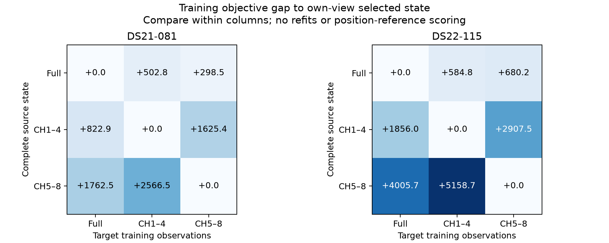

# B081/B115: both halves are closer, but their fitted modes conflict

These are independent examples of the user's full-versus-both-halves regression. Current cohort distances are DS21-B081 **15.154/8.652/10.476km** for full/low/high and DS22-B115 **44.839/2.748/24.236km**. Those rounded distances are retrospective cohort context, not newly evaluated here; DS22 reference remains configured-unconfirmed. The root-cause audit used only sealed training states, made24 objectives and zero fits, and did not read reference/held/locked data or alter existing plots/histograms.

Both cases show **coupled calibration, satellite-timing and association modes**, rather than a simple unavailable geographic seed. Each half fits its own band better; its complete physically rebased state loses badly when scored on the full observations. A one-block correction-only or orbit/timing-only swap also worsens its own band. Geographic coverage and strict acceptance are audited separately below. This supports a controlled coupling test, not a claim that the likelihood inevitably prefers a wrong location or that a new clock model is proven necessary.

Figure: compare within columns only; each column uses identical target observations/model/prior/bank. Off-diagonal states retain source geography, complete correction function and satellite timings, without a refit. The original full/half persisted frames differ. Exact algebraic time/RF/group rebasing, including the source group contribution to receiver intercepts, preserves the total frequency function on every target row. Clock nodes/null bases and candidate orbit arrays match exactly within each case (55/38 candidates). Maximum functional closure error is4.37e−11Hz; no clipping, least-squares projection or coefficient reset was used.

| Source half → full target | Full J disadvantage | NLL disadvantage | Prior disadvantage | Full-target KKT in source disk |
|---|---:|---:|---:|---:|
| B081 low | +822.939963 | +822.523664 | +.416300 | 154.105698 |
| B081 high | +1762.528368 | +1760.637542 | +1.890826 | 271.586838 |
| B115 low | +1855.986867 | +2070.383161 | −214.396294 | 271.493816 |
| B115 high | +4005.727137 | +4118.594891 | −112.867754 | 206.108958 |

All six off-diagonal complete transfers are feasible in their source original disk and target physical/nuisance bounds, but none is stationary on its target. They are diagnostic states, not eligible full solutions. In B115 the better-position halves have lower priors, so stronger original priors cannot primarily explain why their complete states lose full training score. In B081 the prior differences are negligible compared with NLL losses. Half-calibration prediction on its unobserved band is conditional extrapolation; its failure does not isolate geography.

| Case / band | Windows | Full orbit + full correction NLL | Full orbit + half correction | Half orbit + full correction | Half orbit + half correction |
|---|---:|---:|---:|---:|---:|
| B081 low | 1217 | 15928.323830 | 17404.297945 | 17612.076081 | 15424.744578 |
| B081 high | 837 | 10854.801496 | 11852.125411 | 11843.103046 | 10554.023538 |
| B115 low | 1693 | 20286.161327 | 23936.274369 | 23859.405808 | 19915.317626 |
| B115 high | 1089 | 13588.373282 | 15602.773424 | 15486.312963 | 13020.596051 |

Each own half improves its observed band: B081 low−503.579252/high−300.777958; B115 low−370.843701/high−567.777231. Yet opposite-band losses after complete transfer are B081 low-state on high+1326.102916/high-state on low+2061.415500; B115 low-state on high+2441.226862/high-state on low+4686.372122. Neither calibration-only nor orbit-only substitution repairs the mismatch. The orbit block includes geography and common/relative satellite timing; these hybrids are prediction arrays, not new feasible calibration states or calibrated model evidence.

Full/half same-window MAP assignments change553/1217 (45.440%) low and363/837 (43.369%) high on B081; B115 changes679/1693 (40.106%) low and475/1089 (43.618%) high. Mean posterior TV is .450196/.405541 and .407193/.420574 respectively. Total correction differences RMS1650.409/1479.569Hz on B081,439.093/1110.637Hz on B115; relative satellite timing differences RMS2.377/2.197s and5.604/4.632s. These are conditional assignments, not satellite identity truth, and correction components in different centering gauges must not be read as hardware clock evidence.

The half points lie inside existing full-model proposal disks. All three B081 selected points are in original full disks0 and4; low/high are6.937/4.871km from the full point. On B115, low lies in full disks3/4 and high in0/3/4/5; distances from the full point are47.115/20.744km. Original B115 full start4 already reached[-85.700599,−80.142878] with strict KKT.000586129, but loses673.759260 objective to start0: NLL+923.674935 despite prior−249.915675. No truth-selected parameter or seed is needed to establish that the original training search contains this competing basin. This evidence rules out *solely* missing access to those two half geographies; it does not establish exhaustive global coverage.

All B081 full6/low5/high6 original endpoints are accepted; all B115 full5/low6/high6 are accepted. Strict selected own-view KKTs are B081 .000403953/.000168963/.000050864 and B115 .000485032/.000283212/.000281164. B081 rejected low/start0 has objective192.445044 better than the selected low but KKT2.137604, far outside the earlier ULP-scale numerical-repair scope. B115 rejected full/start3 KKT.002248134 has J698.037387 above the selected full, so repairing only its acceptance would not change the selector. Accepted runner-up objective gaps full/low/high are397.544240/374.952564/317.528189 for B081 and640.101212/336.375095/195.517606 for B115. The complete original six-start inventories remain in the audit receipts.

The next discriminating bounded experiment is two cases × both training-selected half XYs: fixed-position full-target nuisance/timing profiles from the **same original selected full complete non-geographic state**, followed by accepted free releases in the half path's original25km disk. Retain every original accepted full endpoint and select only full training J after independent acceptance. This controls the half-function extrapolation confound and tests whether full calibration/timing can adapt at either source-half geography. Both half positions must enter by the declared training-only rule; no distance-selected donor, arbitrary band weighting or new RF/clock parameter. A non-improvement would still not prove structural model bias; a lower-J accepted basin would establish a material optimization/transfer lead. This is a proposed next experiment, not executed in this report.

Source/protocol `3346b6238`; five owned component/runner tests PASS1.50s and Ruff before freeze. Each slice completed exactly12 objectives,3 explicit orbit calls,11 auxiliary likelihood calls and zero optimizers, including preparation/authority checks: B081 .831s, B11516.026s, within120/135/140 bounds. Pure plot generator adds zero numerical objectives/fits and verifies terminal/seal hashes; PNG and PDF are saved without modifying prior figures. Scientific terminal SHA256 B081 `e690a1050d0f1ac64fbad30417423bf1848015a0ad0e30949273b1894a3b5517`, B115 `7b9002733fce76f23d1285e1c007ef2106aafabf5716e9a98a75b20b55411df1`; seals `3313bf25939a5ed3cc6c19694874428778c2de398e3ead069f90b802ebdb716e` / `019697ebdfce97e6ec157b638c02a2a57413f942e28ffa7d4ae973d9ff4ae50d`. Runtime `/srv/bulk/leo-research-ds21-ds22/2026_10_14/model-b-both-halves-rca-v1`; figure source/manifest under sibling `model-b-both-halves-rca-figures-v1`.
