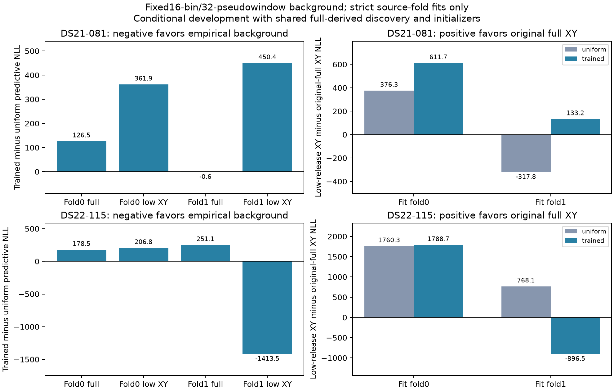

# B081/B115 empirical-background CV: no model promotion

All16 fixed-geography fits passed independent own-fold KKT≤.001. The prespecified background density did **not** improve predictive scoring consistently. At every one of the8 trained-background endpoints, substituting the empirical density for uniform clutter **increased opposite-fold NLL at identical parameters**. B115's low-geography aggregate gain came from a different calibration/timing basin, concentrated in one fold, rather than a predictive benefit from the density itself. Keep the uniform model and investigate that initialization lead separately.

This is conditional development evidence, not external validation. Both randomized whole20s folds share full-training-derived candidates, frames, geographic hypotheses and initial complete non-geographic state. Positions were fixed; no new position-error result or cohort promotion follows. Original held/locked observations and references were not read.

## Frozen method and provenance

The [CV protocol](MODEL_B_EMPIRICAL_CLUTTER_CV_PROTOCOL.md) specifies2cases×2folds×2training-path geographies×2arms. The arms are uniform versus a per-RX/channel/exact-RF circular histogram:16bins,32total uniform pseudowindows per lane, fitted only on the source fold and frozen before opposite-fold scoring. Both arms retain identical B signal physics, candidate banks, complete initial states, priors, fittedc and original25km domains. The likelihood is normalized conditional selected-CFO density; original joint-event NLL is reported separately and is not its training objective. Histogram edges are fixed in observed CFO, so they do not introduce optimizer-coordinate discontinuities. Existing hard visibility remains.

The histogram estimates the distribution of selected observations, including real signals and acquisition artifacts. It is not an independently measured physical clutter density. The original approximate Gaussian signal term also does not model the complete winner-conditioned detector set. No bin/shrinkage tuning or native-event substitution occurred.

**Source closure erratum:** v1 qualification omitted two imported existing model modules from its source inventory. Its numerical outputs remain preserved, but it is not this experiment's authority. The [v2 qualification](MODEL_B_EMPIRICAL_CLUTTER_V2_QUALIFICATION.md) explicitly pins both modules and reproduced all v1 numerical dictionaries and preparation bytes exactly. This CV consumes only v2. Core commit`c5c8436c6`, additive qualification`5792535d4`, CV source`18c3b6c35`; runtime `/srv/bulk/leo-research-ds21-ds22/2026_10_14/model-b-empirical-clutter-cv-v1`.

All16 outcomes sealed before opposite-fold evaluation. Global seal SHA256`a81e0812490a73750655dacf3a5f49203b0405b4807cdff65c12e8cbbf4ddaaa`. Evaluation terminal hashes: B081`322eda51fe28c8ae9e6a944240655faf6c6962d8b9ac9f3fde8f4ad73026543a`, B115`6a7549850b433f6854350fa4b4c3f8e78a6b4e180bebaeb9888c6fbd41f37706`.

## Predictive results

Lower NLL is better. Each row sums both opposite-fold predictions, excludes priors, and includes all2054 B081 or2782 B115 windows. “Full XY” and “low XY” identify the predeclared training-path geographies, not a reference-selected location.

|Case|XY|Uniform predictive NLL|Trained-background predictive NLL|Trained−uniform|
|---|---|---:|---:|---:|
|B081|Full|26414.695692|26540.611244|+125.915552|
|B081|Low|26473.284349|27285.568807|+812.284458|
|B115|Full|34922.726775|35352.317428|+429.590652|
|B115|Low|37451.140042|36244.479534|−1206.660508|

Decompose each paired difference exactly as `(trained density at trained parameters − uniform density at trained parameters) + (uniform density at trained parameters − uniform density at uniform-fit parameters)`. This requires no further objective evaluations: both terms were saved by the postseal evaluator.

|Case / XY|Direct density contribution|Parameter/basin contribution|Total|
|---|---:|---:|---:|
|B081 / Full|+41.045438|+84.870114|+125.915552|
|B081 / Low|+74.193302|+738.091156|+812.284458|
|B115 / Full|+288.660852|+140.929800|+429.590652|
|B115 / Low|+345.924115|−1552.584623|−1206.660508|

All8 individual direct contributions are positive. B115 low's source-fold0 total worsens by206.841964; fold1 improves by1413.502472, comprising a **+126.850938 density penalty** and **−1540.353410 parameter contribution**. Its fold1 improvement occurs in both bands (−857.708846 low,−555.793625 high) and both receivers (−1078.174460,−335.328011); it is not band cancellation. The source-fold0 result does not replicate it.

Geographic preference also fails to replicate: lowXY−fullXY is B081 uniform+376.344050/−317.755393 across folds versus trained+611.712452/+133.245111. B115 uniform favors fullXY in both folds (+1760.317915/+768.095351); trained gives+1788.666408/−896.504302. Aggregate preferences remain fullXY under both models. These comparisons use separately fitted calibration/timing parameters and cannot isolate geography alone.

[Vector figure](MODEL_B_EMPIRICAL_CLUTTER_CV.pdf). Plotting consumes only sealed receipts and performs0 numerical objective calls/0 fits.

## Every training outcome

Each fit used20s/600iterations and at most600 **actual** objective evaluations including independent terminal audit. All were stationary and below their qualified feasible initializer. Priors are J−NLL; training objectives across different density arms are not a model-selection rule.

|Case|Fold|XY|Arm|Training J|Training NLL|KKT|Actual objectives|
|---|---:|---|---|---:|---:|---:|---:|
|B081|0|Full|Uniform|11905.427454|11557.264701|.000022729|347|
|B081|0|Full|Trained|11752.159576|11434.946049|.000055769|414|
|B081|0|Low|Uniform|12097.750442|11782.847842|.000079176|460|
|B081|0|Low|Trained|12152.422581|11841.445565|.000074616|459|
|B081|1|Full|Uniform|12496.876514|12139.307462|.000130781|392|
|B081|1|Full|Trained|12338.302665|11996.181242|.000103683|363|
|B081|1|Low|Uniform|12103.684186|11832.516400|.000200201|479|
|B081|1|Low|Trained|12340.224106|12037.148372|.000100948|426|
|B115|0|Full|Uniform|15573.163344|15255.108547|.000143231|299|
|B115|0|Full|Trained|15622.894655|15308.674924|.000120818|272|
|B115|0|Low|Uniform|18413.693520|18161.090765|.000213338|353|
|B115|0|Low|Trained|17517.024095|17326.505471|.000095662|348|
|B115|1|Full|Uniform|15012.628876|14674.961803|.000125562|288|
|B115|1|Full|Trained|15005.846169|14647.211970|.000146814|301|
|B115|1|Low|Uniform|17963.681307|17633.557324|.000346570|325|
|B115|1|Low|Trained|15534.700024|15299.542342|.000131966|423|

Total5949 actual objectives/16 fits, numerical durations .766–1.457s each. Whole slices including source validation/preparation took8.698–8.960s for B081 and23.960–24.631s for B115, under120s completion and external135s TERM/140s KILL caps. Concurrent research activity limits interpretation of speed. Postseal evaluation added32 objectives/0 fits,6.335s/22.093s by case. Component/CV tests and plot receipt checks passed; all unavailable/rejected outcomes would have remained explicit, but none occurred here.

The next approved discrimination replays **all8** trained-background endpoints under the original uniform conditional target, preserving complete arrays and their own original fixed domains. Eight matched uniform-target continuations can then test the basin lead while retaining every original uniform incumbent. This is additional optimization work, not evidence that the empirical density should be deployed.
