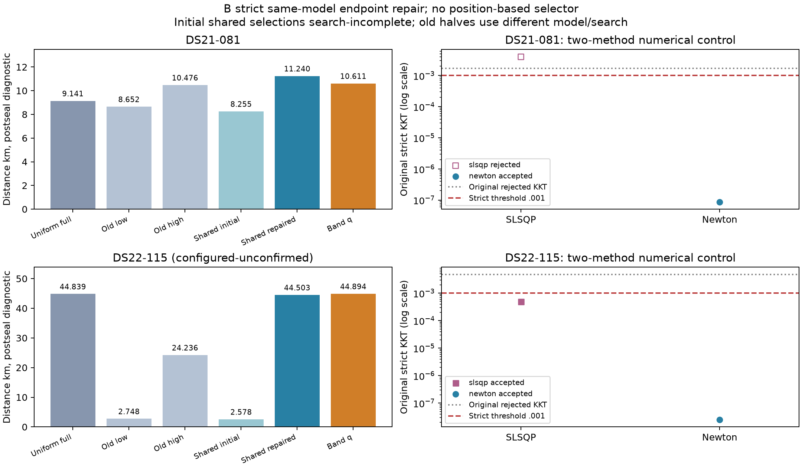

# Shared B numerical repair removes apparent geographic gains

Strict numerical repair changes the shared-model training selectors from **8.254885 to 11.239669 km on DS21-081**, and **2.578340 to 44.502614 km on DS22-115**. Both old closer incumbents remain accepted and eligible; they lose training J to the repaired full-origin states. The earlier closer shared-model selections were artifacts of excluding lower-scoring nonstationary endpoints, not verified improvements from detectability. DS22 distances remain configured-reference and unconfirmed. No sub-kilometre or cohort promotion is supported.

Both Newton controls pass the unchanged independent KKT threshold .001. Original-chart SLSQP also repairs B115, so success is not exclusive to Newton. B081 SLSQP remains rejected. All four controls were sealed before position evaluation; no reference-informed parameter, seed, model, disk or selector was used.

[PDF figure](MODEL_B_SHARED_Q_REPAIR.pdf). “Shared initial” is the original search-incomplete selector, preserved as history. “Shared repaired” is the actual new training selector, including all old eligible endpoints. Old halves have different model/search histories; no fresh matched-half superiority is claimed. Right panels use the original strict KKT, including both free B group offsets.

| Case / method | Accepted | Training J | NLL | Original KKT | Actual objectives | Numerical seconds | Postseal km |
|---|:---:|---:|---:|---:|---:|---:|---:|
| B081 SLSQP | no | 22069.610476315414 | 21724.324240788024 | .004059817458 | 39 | .777590 | 11.239668026 |
| B081 Newton | yes | 22069.610476313640 | 21724.324231639760 | **8.744251e−8** | 528 | 9.894598 | **11.239668645** |
| B115 SLSQP | yes | 29031.135861219987 | 28543.772358466227 | .000489839366 | 28 | .480934 | 44.502613915 |
| B115 Newton | yes | 29031.135861219030 | 28543.772340422285 | **2.511838e−8** | 392 | 6.779440 | **44.502613582** |

| Case | Retained uniform full, km | Historical low / high, km | Initial shared selector, km | Repaired shared selector, km | Band model, km |
|---|---:|---:|---:|---:|---:|
| B081 | 9.141022 | 8.651799 / 10.475954 | 8.254885 | 11.239669 | 10.611129 |
| B115, configured-unconfirmed | 44.838979 | 2.748364 / 24.235682 | 2.578340 | 44.502614 | 44.894456 |

The newly eligible shared/full states beat the old shared/low incumbents by 2603.695385 and 2655.718849 J. These are different basins, not a meaningful geographic movement caused by the numerical step: the old rejected full-origin locations were 11.239668028 and 44.502613916 km, respectively. The actual repair changes J by only approximately 1.8e−9 and 1.0e−9. Thus the material effect is acceptance and model selection, not an accuracy gain from extra local travel. All original accepted low/high endpoints remain eligible under the exact same target objective.

The repaired full-origin states have group offsets [−19446.495, 39772.597] Hz and [−23683.167, 37856.431] Hz, versus sub-kilohertz offsets at the closer old low-origin states. Group-prior penalties are .392005 and .398800. q-prior penalties are 32.415981 and 30.545904. These components coexist with RF calibration and clock parameters and are gauge-dependent; they are not hardware evidence. The next partition must compare complete correction functions in the shared target frame by RX/band, not infer a required hardware band shift from raw offsets alone. Calibration/assignment alias coupling remains a hypothesis, not grounds for reference-tuned prior tightening.

## Numerical and source qualification

The [prespecified protocol](MODEL_B_SHARED_Q_REPAIR_PROTOCOL.md) reuses frozen engine `fdd504f4b` directly on the genuine GroupB + SmoothVisibilityModel, preserving both free receiver/band offsets, all q coefficients, original candidates/observations, common clock, absolute satellite timing, fitted c, original priors and own 25 km disks. No hard-model reconstruction, parameter reset, ridge or relaxed KKT. These are four extra numerical controls, not retries hidden inside the original 20-second budget.

Fresh source `c147c8853` froze before preparation; five owned tests pass in 1.44 seconds and Ruff passes. Actual qualification passes **six objectives / zero fits in 17.121015 seconds**, replaying all six original shared endpoints, including retained eligible incumbents: bit-exact raw chart identity, original J/NLL/acceptance, engine versus independently replayed original KKT, free group precision, and complete additive clock/group/timing/q priors. Maximum prior closure error is 1.705303e−12. The prior [49-probe audits](MODEL_B_Q_STOPPING_RESULTS.md) separately qualify source derivatives/curvature at both rejected states; qualification does not invent a new all-coordinate FD check.

Newton records full tangent Hessians at steps 1e−5 and 5e−6, no regularization:

| Case | Tangent dimension | Minimum eigenvalue, first / second | Maximum eigenvalue, first / second | Relative step change | Maximum relative asymmetry |
|---|---:|---:|---:|---:|---:|
| B081 | 131 | .306065504 / .306065977 | 393347.964676 / 393347.965011 | 8.162e−9 | 1.168e−8 |
| B115 | 97 | .731358365 / .731400752 | 503945.535079 / 503945.535596 | 1.427e−8 | 1.233e−8 |

Each accepts its first safeguarded full step with strict independent terminal replay. Coupled predicted J decreases are 1.782762e−9 and 9.619010e−10. They differ from the earlier one-coordinate group estimates; coordinate curvature was never a coupled minimum certificate. Active q faces are preserved. The full Hessians are positive and stable within the frozen numerical criteria; this is local numerical evidence, not proof of globally correct associations or localization.

## Budgets and receipts

Bulk root `/srv/bulk/leo-research-ds21-ds22/2026_10_14/`, namespace `model-b-shared-q-repair-v1`. Four controls use **987 actual objectives / 17.932562 aggregate numerical seconds**; two single-thread workers complete the queue in 38.853895 seconds including preparation and authority checks. Each retains the 60-second / 600-actual evaluation cap, with engine 55 seconds / 599 evaluations reserving one independent audit. Whole-unit 120-second completion plus external 135-second TERM / 140-second KILL; maximum whole unit 23.843003 seconds. Six qualification evaluations, earlier 98 audit evaluations, original 12 fits and upstream discovery are separate costs.

Qualification: `sha256:8b554085097f242fb71250dd88ccdaaab423c26f91f3a9dd82e564b42ac18c8f`.

Global four-outcome seal: `sha256:9151283364450e9143ec22f62cdaa1404ee34492e3054ae1b62e33f4625b8ec8`.

Postseal comparison `model-b-shared-q-repair-v1-comparison`: `sha256:0dfaf602acfa6f2d6b27e2a952748619eae0edcd5a8ffc3b39569edfa8daba54`; zero objectives and zero fits. Figure namespace `model-b-shared-q-repair-figures-v3`; v1/v2 figures remain separate. Figure erratum: v2 right-panel titles said “four-call numerical control” per case; the corrected titles say “two-method numerical control.” There are two calls per case and four total, as the protocol and tables always record. This is a title correction only, with no scientific changes. Plot test passes / Ruff passes. Original scientific receipts, prior plots and baselines remain unchanged. No original held/locked measurement, new data collection or QNAP write.

Next is a bounded zero-fit same-model NLL/clutter/posterior and physical correction-function partition of repaired full-origin versus old low-origin states. Numerical repair settles these two acceptance failures; it does not explain why distant states rank better or justify another solver iteration.
