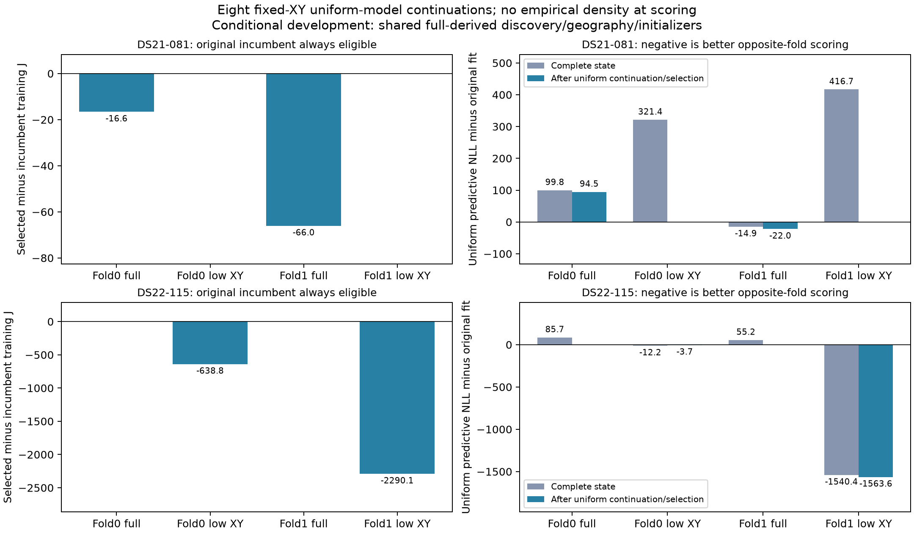

# B081/B115 uniform-target continuation: basin gain, no background promotion

All8 complete trained-background endpoints reproduced the original uniform conditional model exactly, then all8 fixed-XY uniform continuations passed independent KKT≤.001. Training selection retained4 original uniform incumbents and accepted4 restarts. B115's low-geography predictive gain survives **without** empirical clutter density: NLL improves1567.262384, versus1206.660508 in the prior background-model comparison. Most of the gain remains concentrated in one fold. B115 still favors fullXY in aggregate by961.150883; this is not a verified geographic improvement or a reason to promote the background model.

B081's two full-XY restarts improve own training objectives but worsen aggregate opposite-fold NLL by72.539381. Its low-XY incumbents remain selected. These outcomes demonstrate both useful basin discovery and training/prediction disagreement under the same objective. No new free-position fit, reference read, original held/locked read or position-error result occurred.

## Exact replay before continuation

The [protocol](MODEL_B_UNIFORM_BASIN_PROTOCOL.md) prespecified all2cases×2folds×2training-derived XY, with no reference/predictive selection. `model_b_uniform_basin_replay.py` source`2bcbbc123` was frozen before preparation. Each complete trained endpoint was scored under original `ObservationModel(...,"conditional")` and the uniform BackgroundModel; objective, both gradients, signal/background posteriors and residuals matched within declared tolerances. Raw arrays, original mask/frame/bank/priors/fittedc and own fixed25km disk were unchanged. Uniform-target KKT was recomputed rather than borrowed from trained-source stationarity. A third objective independently audited that score/KKT, and a fourth independently requalified the matching original uniform incumbent.

All32 objectives/0fits passed. B081 took9.330s and B11526.481s, including preparation/source validation, within120s completion/external135s TERM/140s KILL. Replay namespace `model-b-uniform-basin-replay-v1` under `/srv/bulk/leo-research-ds21-ds22/2026_10_14/`. Terminal SHA256: B081`894a3d643e20a86c13323c6970ed77f2f4e1fd69c03868aa47767dbafc7a162a`; B115`c10b7dfa49b574ab97c75c29929cf056cedcaa86ace5c053e6a2e649997e1461`.

|Case|Fold|XY|Uniform J at trained endpoint|J−uniform incumbent|Recomputed uniform KKT|
|---|---:|---|---:|---:|---:|
|B081|0|Full|11889.626690|−15.800764|189.026829|
|B081|0|Low|12364.574606|+266.824164|234.241225|
|B081|1|Full|12444.665506|−52.211008|34.447445|
|B081|1|Low|12441.441474|+337.757288|29.152421|
|B115|0|Full|15729.891441|+156.728097|41.074977|
|B115|0|Low|17775.734446|−637.959074|47.118979|
|B115|1|Full|15104.475138|+91.846262|25.129789|
|B115|1|Low|15674.459060|−2289.222247|69.431329|

Every trained endpoint was nonstationary under the uniform target. Feasibility and a better starting score did not automatically confer accepted eligibility.

## Every continuation and training selector

Driver`model_b_uniform_basin_control.py`, immutable source`caf8bf3e3`, used one20s/600iteration/600ACTUAL-objective call per endpoint, including independent terminal audit. Original uniform incumbents remained eligible in their own fold/XY. Selection used minimum accepted **own-training uniform J**. No retry, clipping, new parameters or geography change occurred. Every new fit was below its own feasible starting J; none triggered an optimization-gap warning. A stationary fit worse than its starting state would have remained an explicit optimization gap, not model rejection.

|Case|Fold|XY|Restart J|Restart NLL|Restart−incumbent J|KKT|Actual objectives|Selected|
|---|---:|---|---:|---:|---:|---:|---:|---|
|B081|0|Full|11888.837597|11569.801474|−16.589857|.000042801|290|Restart|
|B081|0|Low|12343.400683|12030.821849|+245.650241|.000099714|303|Incumbent|
|B081|1|Full|12430.835621|12083.279718|−66.040893|.000031921|311|Restart|
|B081|1|Low|12440.466168|12137.763771|+336.781982|.000056348|289|Incumbent|
|B115|0|Full|15729.485607|15415.007239|+156.322263|.000001798|222|Incumbent|
|B115|0|Low|17774.895731|17582.661163|−638.797789|.000037511|201|Restart|
|B115|1|Full|15104.282167|14744.707634|+91.653291|.000002811|226|Incumbent|
|B115|1|Low|15673.614236|15437.888012|−2290.067071|.000004534|213|Restart|

2055actual objectives/8fits; numerical durations .712–1.051s, whole units9.690–32.152s under120/135/140 bounds. Two single-thread workers completed the queue in88.692s; concurrent host activity prevents a controlled speed claim. All8 outcomes and selectors sealed before any new opposite-fold score. Global seal SHA256`30c8fe0f3b9d1b911468c187f71ce1178a6befc551e62a18a315c08dacf4401d`, fresh bulk namespace `model-b-uniform-basin-control-v1`.

## Postseal predictive scores

Only training-selected endpoints were scored opposite-fold. Each case used8objectives/0fits: uniform conditional NLL and separate unchanged original-event diagnostics at4selected endpoints. Priors are excluded. Evaluation took9.916s/24.964s by case. Terminal hashes: B081`a0af3d30b1d26e4f9f495289bb24c13eef5712089f7e56d9168ad3dc3b643bd5`; B115`d975480e1a9220291fb3fc87a5a58973bc00a54d8e2625a65716e8880cfc3ce2`.

|Case|Source fold|XY|Original uniform NLL|Selected uniform NLL|Change|
|---|---:|---|---:|---:|---:|
|B081|0|Full|13080.602865|13175.149977|+94.547112|
|B081|0|Low|13456.946915|13456.946915|0|
|B081|1|Full|13334.092827|13312.085096|−22.007732|
|B081|1|Low|13016.337435|13016.337435|0|
|B115|0|Full|16690.824795|16690.824795|0|
|B115|0|Low|18451.142711|18447.446359|−3.696352|
|B115|1|Full|18231.901980|18231.901980|0|
|B115|1|Low|18999.997331|17436.431299|−1563.566032|

|Case / XY|Original uniform summed NLL|Selected uniform summed NLL|Change|Selected event NLL (diagnostic)|Signal / background mass|
|---|---:|---:|---:|---:|---:|
|B081 / Full|26414.695692|26487.235073|+72.539381|29014.218088|582.487 /1471.513|
|B081 / Low|26473.284349|26473.284349|0|29000.443340|598.998 /1455.002|
|B115 / Full|34922.726775|34922.726775|0|38355.423951|930.566 /1851.434|
|B115 / Low|37451.140042|35883.877658|−1567.262384|39316.574834|752.875 /2029.125|

B115 fold1 low's change improves both bands (low−987.135354,high−576.430678) and both receivers (−1215.380620,−348.185412). Fold0 low improves only3.696352 overall, with low−19.523696/high+15.827344 and RX0−69.954728/RX1+66.258376. There is no replicated large predictive gain in both folds.

The [prior background report](MODEL_B_EMPIRICAL_CLUTTER_CV_RESULTS.md) separated direct density from parameter contributions. At the transferred trained endpoints, B115 low's parameter contribution alone was−1552.584623, while density added+345.924115. Continuing with uniform density yields−1567.262384; the resulting uniform prediction is360.601876 better than the trained-background prediction. Thus the observed benefit does not require the proposed density model. B081's selected full prediction worsens72.539381 despite lower training J, so better optimization does not ensure better prediction.

LowXY−fullXY predictive NLL is now B081+281.796938/−295.747661 (aggregate−13.950724) and B115+1756.621564/−795.470681 (aggregate+961.150883). These are separately calibrated states with different fixed geographies, not pure geographic effects. They do not demonstrate a stable predictive preference for the nearer historical location.

[Vector figure](MODEL_B_UNIFORM_BASIN.pdf). Figure generation validates both scientific seals/evaluation bindings and uses0objectives/0fits. Replay3tests, continuation4tests and plot1test passed with Ruff. No frozen parent source changed.

## Implication and next bounded question

The fixed16bin/32pseudowindow empirical density is not promoted. It helped expose alternative nuisance/timing basins; those are optimizer starts, not evidence of physical clutter. Opposite-fold scoring remains conditional development: full-training-derived discovery, frames, geographic hypotheses and initial complete state are shared upstream. This experiment cannot establish external generalization or new localization accuracy.

No **full-data trained-background endpoint** currently exists: all8 such endpoints came from source folds. The next proposed localization test therefore creates full-training background fits as initialization only, at both original training-derived XY for both cases, with a matched uniform-start arm. Both then use the original uniform objective for fixed profiles and accepted free releases in unchanged own25km disks. Do not select a fold seed by opposite-fold success. Requalify existing full-target incumbents, retain all eligible states, and seal the complete experiment before any position evaluation. Its concrete inventory/budget requires separate review; no such fit has been launched here.
