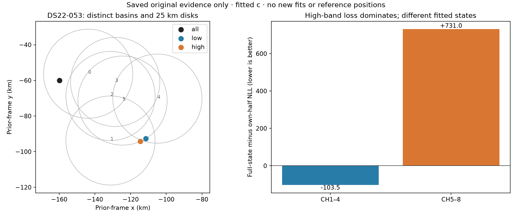

# Why both halves beat the original combined C fit: two different mechanisms

The original comparisons are DS22-053 full/low/high75.781770/27.083146/30.491824km and DS21-081253.242525/11.070/7.866km. These do not have one established common cause. DS21-081's catastrophic selection is explained by convergence attrition; DS22-053 instead exposes a high-band likelihood sacrifice, separated calibration basins and restricted local domains. DS22 distances remain against an unconfirmed configured station. All results below are development evidence, not independent validation.

## DS21-081: the best saved full state was excluded

Original full start0 had objective26250.271183, lower than the selected28251.044115, but failed KKT0.514074 at20.057seconds. Both bands preferred that rejected endpoint: low NLL15555.832 versus16490.347 and high10336.042 versus11348.470. A separately frozen endpoint-start control made it strictly stationary with objective change only−0.000024. Selection changed253.243→15.115km without relaxing acceptance. This isolates why the original catastrophic full result was selected: an already-better combined state was numerically ineligible. It is not evidence that combining the bands inherently prefers253km.

The remaining error has resisted several distinct controls. Native common receiver clocks gave13.934km; matched same-bank/frame low/high gave14.409/9.513km, so at that version full no longer loses to both. A complete fixed-profile/release cycle gave12.785km; the high-geography profile failed KKT1684 and was not released. Complete B calibration/clock/timing transport, with verified receiver alias lifts, produced an accepted21.461km native state that lost training score. The selected12.785km endpoint is interior (radius3.163km of25), and two-step full/nuisance Hessian audits are positive. This argues against another identical local continuation or unsupported disk expansion as the next repair, but does not prove a global optimum.

Evidence: [original acceptance audit](MODEL_C_LATER_FAILURE_RESULTS.md), [clock control](MODEL_C_081_CLOCK_CONTROL_RESULTS.md), [matched views and anchors](MODEL_C_081_VIEWS_AND_ANCHORS_RESULTS.md), [complete B transfer](MODEL_C_081_B_TRANSFER_RESULTS.md), [curvature audit](MODEL_C_081_INTERIOR_CURVATURE.md).

## DS22-053: high-band sacrifice and different constrained basins

Only2/6 original full endpoints are stationary, versus6/6 in each half. However, no rejected full endpoint has lower saved objective than the accepted winner. The simple DS21-081 acceptance explanation is therefore unsupported here.

At the selected full state, low NLL23009.742827 is **103.538439 better** than the own-low optimum's23113.281266, while high NLL22182.107156 is **730.958741 worse** than the own-high state's21451.148414. These are same-band data terms at different fitted states; they do not form a controlled prior intervention. Full prior421.327298 is charged once; the halves'326.901770 and347.390935 cannot be summed and compared as though they were one jointly feasible state. The two bands share geography, satellite timings and some calibration, so independently fitted likelihood minima need not coexist.

The new zero-objective saved-state inventory sharpens the domain issue. Both halves select proposal5 and sit exactly on its25km geographic boundary. Their positions are only3.410419km apart. The full winner selects proposal0 and is interior at16.542514km. The half geographies are48.667244 and47.952662km from the full winner's center, outside its25km disk. They are inside other original search disks, so this is not proof that the total search excludes the half positions; it does show that continuing only the full winner cannot reach them. Full proposal5 failed and had a much worse score, consistent with a coupled nuisance/basin mismatch rather than a valid half-state transfer.

All views use the same44-satellite candidate inventory, but their calibration coordinates differ. Full has two group nuisance coordinates; each half has zero. RF centers are11.8153125GHz/full,11.3153125GHz/low,12.3153125GHz/high; time centers are149.933336s/full and low,149.600496s/high. Direct vector copying or averaging would change the physical receiver correction. A meaningful transplant must preserve the correction function at actual native timestamps, absolute satellite timings and integer receiver lifts, then verify feasibility in its declared disk.

Adding exactly the existing common receiver-clock model separately to each genuine view improved full75.782→68.125km, low27.083→27.383km and high30.492→30.659km. All12 matched calls were stationary. Thus missing common-clock flexibility alone does not repair this local comparison. It does not exclude a better complete-state basin or a broader, training-justified domain.

The plot contains no reference position. Circles are all six original25km disks; dots are selected complete fits. The score bars compare the full state with each own-half state, not matched calibration states. Generated from source-bound saved receipts by `7748c4ef7`, zero objectives and zero fits; metadata and PNG/SVG accompany this report. [Existing band audit](DS22_019_053_FAILURE_INVENTORY.md) and [matched clock controls](DS22_WORST_CLOCK_VIEW_RESULTS.md) provide the numerical replay evidence.

## Prioritized next models and discriminating tests

1. **Retain complete calibration/association basins in joint search.** Qualify both own-half states into a common full candidate/frame model, with native functional transport and source receiver lifts, rather than using only half geography with the full winner's nuisance state. Preserve all original accepted incumbents. Evaluate fixed-geography nuisance profiles before free releases, and use a training-only radial derivative to decide whether a boundary needs a larger disk. This targets the measured DS22-053 basin/domain obstacle and avoids treating the old full disk as globally representative.
2. **A calibrated observation model with shared and band-specific satellite detectability.** Give the two bands shrinkage-controlled differences in satellite-selection probabilities while retaining common position/timing, correctly normalized density and fixed full-bank visibility accounting. Qualify zero-extension, all gradients and signal/clutter mass first. Randomized whole-time-block predictive tests must decide whether it helps; do not select its regularization or starts by position error. Global propensity has already failed to repair C019 geography, and a DS21 folded-band pilot has mixed case-specific predictive outcomes, so this is a testable hypothesis, not a proven repair.
3. **Physically constrained differential calibration, only if a capacity audit warrants it.** Project separately preferred correction functions onto the exact full model at native timestamps, then test the smallest missing receiver×band time/RF component. Use actual effective band bounds and matched half controls. Prior clock/contrast expansion on DS22-001 was negative, so do not repeat a large unconstrained calibration expansion without case-specific evidence. Improved in-sample NLL is insufficient; require opposite-block prediction and eventual localization improvement on a prespecified broader set.

For DS21-081, retain the demonstrated strict numerical repair as a separate search-policy improvement; evaluate future observation models from complete accepted states. For DS22-053, first establish a physically faithful common-frame state/domain comparison. Neither a better frequency fit nor an average of the two reported positions establishes better localization. No new localization fits were run for this RCA.
