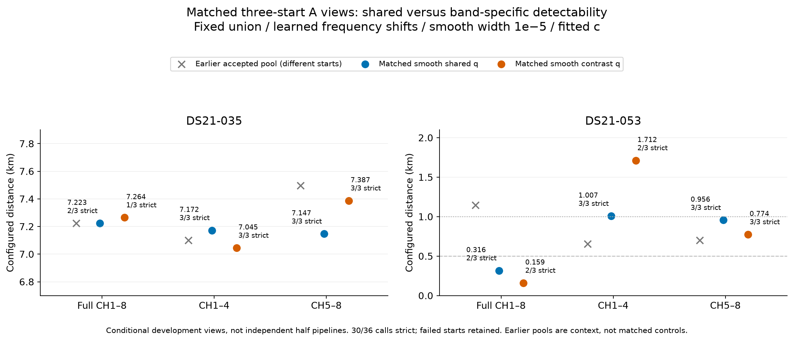

# A band detectability: matched position releases

A053 reaches a training-selected full estimate of **0.159166 km** with band-specific detectability, versus **0.316242 km** with the matched shared model. Both beat their own matched half-view estimates. This is a two-case conditional development pilot; the full cohort and original baselines are unchanged. A035 does not improve.

| Case | Model | Full km | CH1–4 km | CH5–8 km | Full selected start |
|---|---|---:|---:|---:|---|
| DS21-035 | shared | 7.223109 | 7.172105 | 7.147015 | full |
| DS21-035 | contrast | 7.264394 | 7.044676 | 7.386623 | full |
| DS21-053 | shared | 0.316242 | 1.007002 | 0.955570 | fold1 |
| DS21-053 | contrast | 0.159166 | 1.711688 | 0.773879 | fold1 |

Both models receive three complete initializers per view: the common full state and both accepted randomized-fold states from their own model. Complete geography, timing, calibration and q coefficients are retained. The start types and budgets match, but the trained fold states differ between models. There is no q reset, truth seed, changed bank, new disk or free learned receiver-frequency shift. Fixed candidate banks are 55/59; own radii are 25/50 km for 035/053. All views use full-derived banks, frames and shifts; these are conditional views, not independently trained half-only pipelines.

A053's earlier same-width shared full result was 1.148260 km. Its new shared result 0.316242 km already demonstrates an initialization/search effect without adding band q. The additional change to 0.159166 km must not be credited for the entire historical gain. A035 shared full is 7.223109 km and contrast full 7.264394 km. Better training frequency fit does not guarantee better geography, and cross-model J is not a selector.

The earlier A053 shared half pool still contains accepted lower-J endpoints: LOW J12741.246/error0.656590 and HIGH J6132.280/error0.701089, compared with this three-start pool's J12762.350/error1.007002 and J6164.058/error0.955570. New source initializers do not invalidate old accepted endpoints. The table reports the prespecified matched pool rather than best-ever half selectors. Full 0.316242 remains below those earlier shared half distances as well. Earlier 035 gray markers use the hard-q family, so those context markers also differ in horizon model.

**Eligibility and budgets:** 30/36 calls strictly accepted. Total actual objective calls 15213; maximum numerical elapsed 15.509401s. Every recorded numerical call stays below 20 seconds and 600 actual evaluations, including independent audit. Four calls exhaust the 599-call fitter allowance and return no endpoint; no intermediate score is invented. Two A035 contrast full fold calls return nonstationary endpoints and remain excluded. Both rejected J values (29379.411/29351.140) are higher than the accepted incumbent 28647.017, so polishing them is not supported as the cause of the poor selected position.

All 36 outcomes were sealed before the evaluator joined configured reference errors. The independent report also verifies exact unit/launch/receipt inventories and identical complete starts across views. The zero-fit 36-objective qualifier took **141.969965 s**, exceeding its intended 120-second bound because a nested timer canceled the outer timer. This is a preparation-bound defect, not a compliant 120-second qualifier. Numerical fit caps remain independently verified. Failed v1 preparation and all v2 fit failures remain preserved; no retries or threshold relaxation occurred.

**Predictive caution:** the earlier randomized whole 20-second-block CV contrast-minus-shared opposite-fold NLL is **+469.017885 for A035** (worse), and **-158.837155 for A053** (better). Both folds and both bands are retained. CV is conditional development because the bank, frame, geography and warm state were full-derived. The positive A053 pilot is not a general model promotion.

Next A035 diagnosis should compare accepted full/half states and their calibration/timing and association decomposition within each fixed model, including training gradient cancellation and feasibility of earlier genuine basins. The negative CV result supports checking score/assignment behavior; it does not prove a clock or RF hardware defect. The rejected higher-J full fold endpoints do not justify an automatic numerical polish.

Configured receiver distances are retrospective development diagnostics. Physical station continuity is unconfirmed. No reference chooses an initializer, endpoint or model; this report performs no fit, prediction or objective evaluation. All 36 returned scores, including nonstationary endpoints and explicitly unavailable cap failures, are preserved in model_a_endpoints.csv and model_a_results.json.
