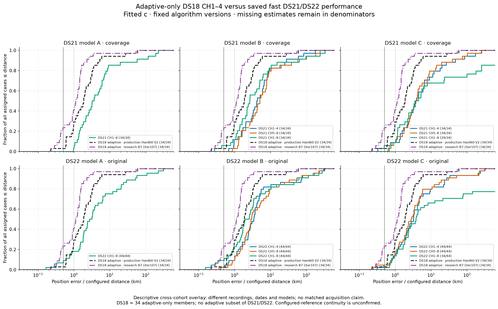

# DS18 adaptive-only overlay of DS21/DS22 performance

The adaptive-only DS18 cohort has 34 assigned recordings and no unavailable selected estimates in either saved version. The two curves remain separate; no per-recording best-of selection is used. All displayed estimates use fitted c.

| DS18 version | Available / assigned | Missing | Median km | Mean km | Worst km |
|---|---:|---:|---:|---:|---:|
| DS18 adaptive · production Hard60 V2 | 34/34 | 0 | 1.852194 | 4.422188 | 58.693871 |
| DS18 adaptive · research B7 (iter107) | 34/34 | 0 | 1.122461 | 2.691656 | 53.400741 |

Fast panels reproduce the current saved complete DS21 coverage cohort (34 development cases) and DS22 original cohort (44 available development inputs). C failures remain in the assigned denominators; CDFs therefore end below one when estimates are unavailable. Cohort-wide A half views were not computed and are not invented.

DS18 covers October 8, 2026, 14:36:56–23:08:51 UTC. It is the latest verified adaptive-only numbered mint. DS21/DS22 fast recordings are later acquisitions. This overlay compares different observations, selected windows, searches, calibration models and versions; it is descriptive, not a controlled adaptive-versus-fast effect.

The DS18 production curve is original published Hard60 V2 (sacramento-hard60-v1); the research curve is iteration 107 B7 baseline, whose candidate selected states are exactly equal. Both contain all 34 whole recordings. The source inventory authenticated 68 B7 scientific receipts. DS18 was consumed development evidence, not unseen validation.

Distances use the saved configured receiver reference (37.84903264307456, −122.4856541910174). Physical station continuity has not been independently verified, especially for DS22. The prior is Sacramento (38.5816, −121.4944), radius 250 km. No new fitting, score evaluation, measurement read or IQ read occurred. Original performance figures are preserved.

Source bytes, complete data and each curve's counts are in model_a_source_manifest.json, model_a_data.json and model_a_curves.json. The PNG and SVG contain identical fixed curves.
