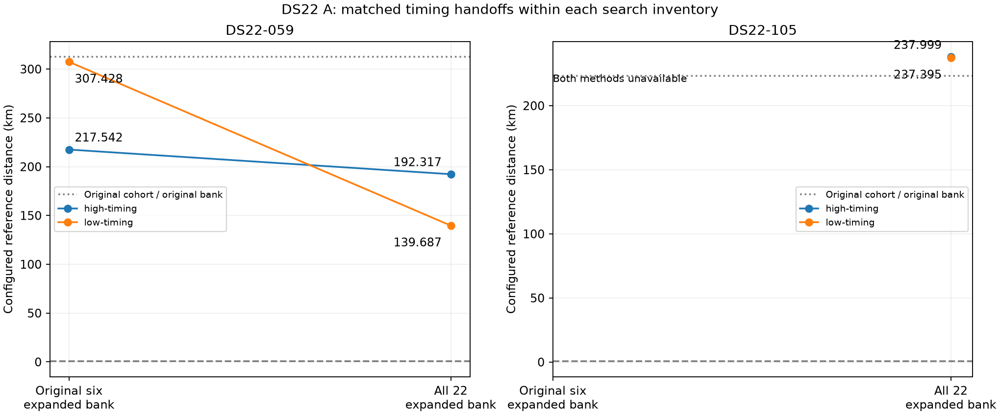

# DS22 A: prior coverage and timing handoff controls

Both case matrices were sealed before joining configured reference distances. All fits use fitted c. The receiver reference is unconfirmed; these distances do not establish verified localization accuracy.

| Case | Method / search inventory | Configured distance km | Selected path |
|---|---|---:|---|
| DS22-059 | Original cohort / original bank | 312.411408 | Historical |
| DS22-059 | high-timing / original-six | 217.542323 | original-4 |
| DS22-059 | high-timing / covered-twenty-two | 192.316703 | coarse-10 |
| DS22-059 | low-timing / original-six | 307.428230 | original-0 |
| DS22-059 | low-timing / covered-twenty-two | 139.687078 | coarse-06 |
| DS22-105 | Original cohort / original bank | 223.157745 | Historical |
| DS22-105 | high-timing / original-six | Unavailable | — |
| DS22-105 | high-timing / covered-twenty-two | 237.998632 | coarse-13 |
| DS22-105 | low-timing / original-six | Unavailable | — |
| DS22-105 | low-timing / covered-twenty-two | 237.394539 | coarse-13 |

The two timing methods share low/high prerequisite fits, the same candidate union, observations, priors, path-specific learned shifts and search disks. Only the final satellite-timing initializer differs. Each method's winner is selected by accepted training objective, never reference distance.

The original-six and covered-twenty-two searches have unequal cost and domain coverage. Historical cohort results use a different candidate bank. These are case controls, not new full-cohort curves or independent half-band evaluations.

The complete call outcomes, failures, objectives, priors and stationarity are retained in the bound scientific receipts. No failed prerequisite is retried.

- DS22-059: 75 optimizer calls, 38044 objective calls including endpoint audits.
- DS22-105: 48 optimizer calls, 26911 objective calls including endpoint audits.

Of 123 attempted fits, 97 passed strict endpoint checks and 26 exhausted the 599-call optimizer allowance (one of the 600 evaluations was reserved for the independent audit). These failures occurred after 3.24–9.00 seconds, before the 20-second wall limit. DS22-059 had eight such failures; DS22-105 had eighteen. Neither timing method produced an eligible original-six result for DS22-105. Missing outcomes are preserved rather than replaced with historical fits from a different bank.

The 600 **actual evaluation** ceiling is stricter than the historical 600 **iteration** limit. Consequently, this experiment demonstrates that geometric coverage and the timing handoff alone do not repair the selected results under this budget; it does not rule out better solutions excluded by that ceiling. The next numerical control should isolate this evaluation-budget restriction while retaining the same observations, union, initializer inventory, 20-second wall limit and training-only selection. The successful coverage proof establishes permitted search domains, not complete optimization of those domains.

On the fixed union, broader coverage improves DS22-059 under both handoffs, but both remain far from the configured reference. DS22-105's expanded search restores availability but its selected distances exceed the historical original-bank result. No method is promoted and no full-cohort CDF is replaced.
