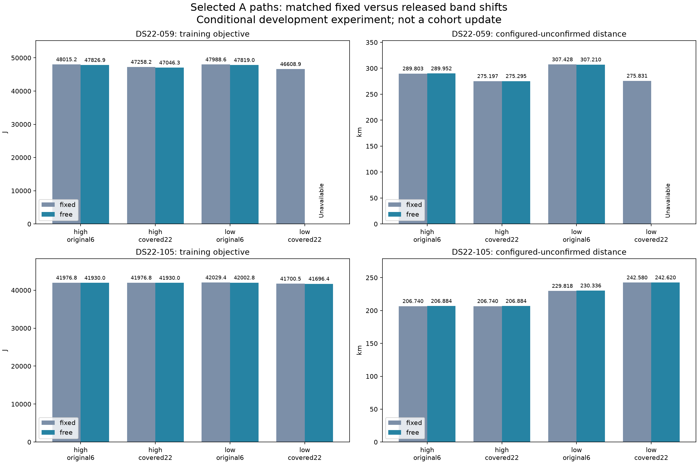

# Releasing A's shifts improves score without repairing selected-path positions

All eight fixed controls are strict; seven of eight free fits are strict. The accepted released fits stay in the same distant regions. This is a negative localization result, despite lower training objectives. DS22 distances remain configured and unconfirmed. No cohort curves or production model change.

| Case / original selector scope | Fixed J | Free J | Fixed km | Free km |
|---|---:|---:|---:|---:|
| DS22-059 / high-timing/original-six | 48015.223571 | 47826.928749 | 289.803028 | 289.952128 |
| DS22-059 / high-timing/covered-twenty-two | 47258.243100 | 47046.347769 | 275.197215 | 275.294591 |
| DS22-059 / low-timing/original-six | 47988.607354 | 47818.955962 | 307.428230 | 307.210343 |
| DS22-059 / low-timing/covered-twenty-two | 46608.922412 | unavailable | 275.830672 | unavailable |
| DS22-105 / high-timing/original-six | 41976.794974 | 41929.977860 | 206.740188 | 206.884449 |
| DS22-105 / high-timing/covered-twenty-two | 41976.794974 | 41929.977860 | 206.740188 | 206.884449 |
| DS22-105 / low-timing/original-six | 42029.378736 | 42002.848351 | 229.818073 | 230.335891 |
| DS22-105 / low-timing/covered-twenty-two | 41700.485197 | 41696.358456 | 242.579662 | 242.620376 |

These are four previously selected source paths per case, each with two matched 20-second / 2000-actual-objective / 600-iteration fits. Both arms start from the same complete physical correction, position and timing. The fixed arm includes the original 50-kHz offset prior once; the free arm is the existing centered B joint family after an exact receiver-intercept rebase. Observations, union banks, fitted c, common-clock/timing priors and original per-path disks stay unchanged. This tests a constraint release, not a new observation likelihood.

The A105 high-timing source is identical in its original6/covered22 scopes; both declared calls were executed and yield the same result. They are not independent evidence. Other paths were not released, so this is not a complete free-model path reranking. Original qualified fixed incumbents remain eligible when a repeat fit returns an inferior score. No nonstationary embedded state is used as a free-model estimate.

A059 low-timing covered22 free fit is rejected at KKT0.002451634 despite its lower J46281.861627. It consumed622 actual objectives and remains unavailable; the acceptance threshold stays0.001. No repeat or relaxed acceptance was applied.

Cost:16 fits,15 strict,4034 actual objective calls (2039/1995 by case). Preceding exact transport qualification cost48 objectives and zero fits; source/fixed/free NLL and physical/clock gradients, original-domain feasibility and centered-offset finite differences passed. The independent frozen-offset diagnosis cost40 objectives. Each case process had a300/305-second external timeout; all fits also retained20-second internal caps and reserved audits. Both case matrices sealed before the configured-reference join. Evaluation and this report add no objectives or fits.

The concrete next distinction is between changing the score within an existing bad basin and changing the evidence that ranks competing basins. This result does not justify using the old lower-error state as a truth-selected fallback.

Sources: qualification f0f0f7ea0, fitting be38b37fb, evaluation284a62bed. [Complete saved data](data.json), input SHA-256 `6c74cde211dc2bb0069bffad13c664f57bf8722322a05e1ece6c13e68d39b8cf`. The data retain all per-arm numerical failures, scores, costs and source bindings.
