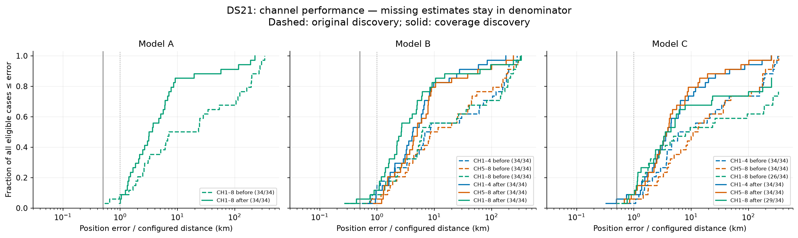
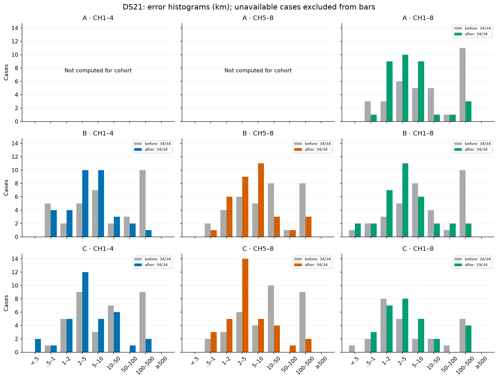
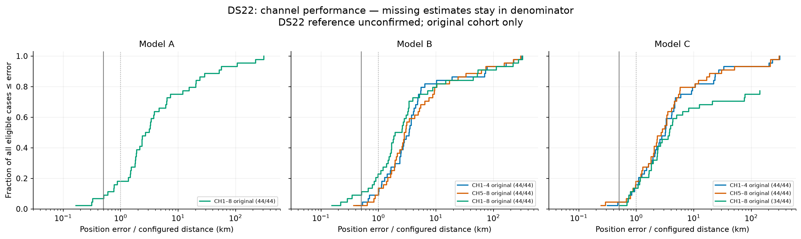
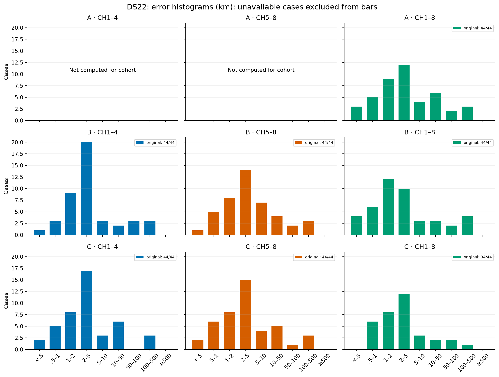
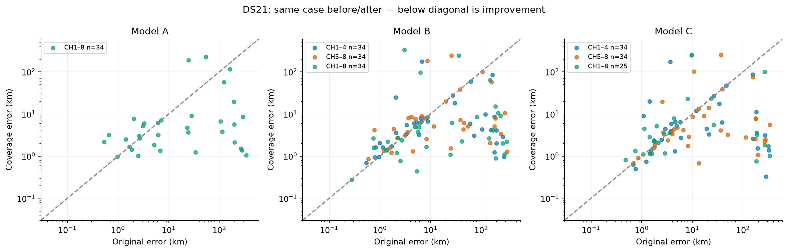
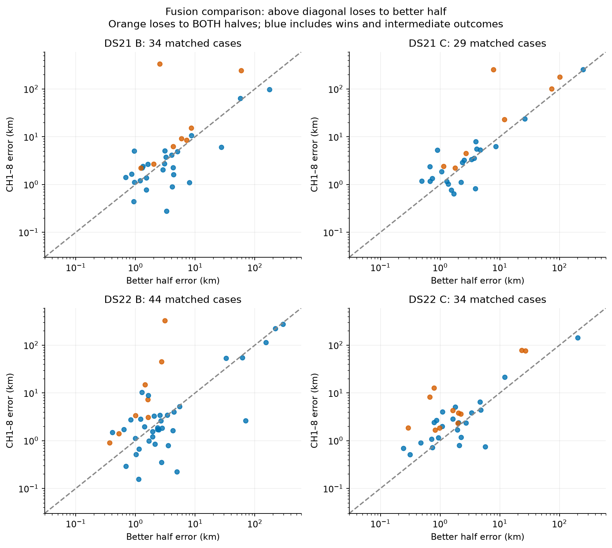
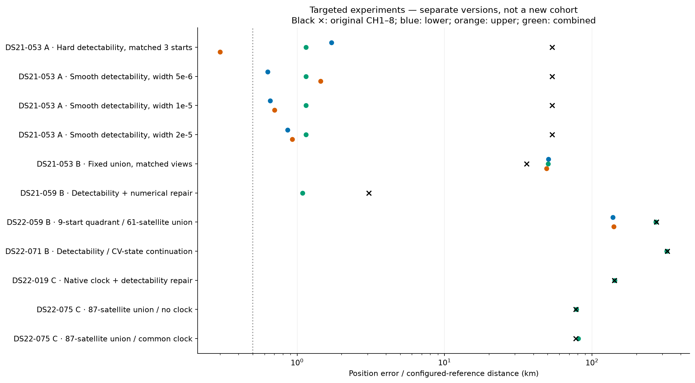

# DS21 and DS22 performance report — 15 October 2026

**The 0.5 km median target is not achieved.** Model B has the strongest completed cohort medians. CH1–8 still frequently loses to one or both halves. All results use fitted `c`.

## What “original” and “latest” mean

- DS21 original = original-discovery pipeline; latest complete cohort = coverage-discovery pipeline. Both have 34 eligible development cases. Later detectability, visibility and numerical-repair pilots are separate below.
- DS22 original = 44 available development inputs. There is no complete rerun of a newer method. The original cohort remains the only cohort-wide result; newer methods are case-specific experiments.
- DS22 station continuity is unconfirmed. Its numbers are distances to the configured reference, not verified accuracy.
- Models: A sequential lower/upper-band fitting with learned shifts; B joint folded-frequency fitting; C native-alias candidate fitting. Pilot variants are named individually.
- Cohort half-band estimates retain shared discovery and initialization. They are channel ablations, not independent half-only pipelines. A has no standalone half-band cohort estimates; these are not imputed from intermediate sequential stages.
- Training objective and strict convergence select outcomes before reference comparison. We never select the closest-to-reference endpoint. These are repeatedly examined development data, not untouched validation. Locked data remain excluded.

## Cohort metrics

Medians and P90 use available estimates; success counts use the entire eligible denominator. Different availability can affect comparisons; matched before/after statistics follow.

| Dataset | Model | Version | Channels | Available / eligible | Median km | P90 km | <0.5 km | <1 km |
|---|---|---|---|---:|---:|---:|---:|---:|
| DS21 | A | before | CH1–8 | 34/34 | 15.180 | 246.280 | 0/34 | 3/34 |
| DS21 | A | after | CH1–8 | 34/34 | 3.439 | 46.048 | 0/34 | 1/34 |
| DS21 | B | before | CH1–4 | 34/34 | 7.721 | 195.021 | 0/34 | 5/34 |
| DS21 | B | before | CH5–8 | 34/34 | 10.125 | 188.214 | 0/34 | 2/34 |
| DS21 | B | before | CH1–8 | 34/34 | 6.145 | 233.382 | 1/34 | 3/34 |
| DS21 | B | after | CH1–4 | 34/34 | 4.229 | 26.776 | 0/34 | 4/34 |
| DS21 | B | after | CH5–8 | 34/34 | 5.071 | 51.761 | 0/34 | 1/34 |
| DS21 | B | after | CH1–8 | 34/34 | 2.652 | 48.847 | 2/34 | 4/34 |
| DS21 | C | before | CH1–4 | 34/34 | 7.779 | 248.624 | 0/34 | 1/34 |
| DS21 | C | before | CH5–8 | 34/34 | 12.002 | 192.381 | 0/34 | 2/34 |
| DS21 | C | before | CH1–8 | 26/34 | 3.200 | 228.491 | 1/34 | 3/34 |
| DS21 | C | after | CH1–4 | 34/34 | 3.860 | 41.009 | 2/34 | 3/34 |
| DS21 | C | after | CH5–8 | 34/34 | 3.789 | 33.327 | 0/34 | 3/34 |
| DS21 | C | after | CH1–8 | 29/34 | 3.215 | 115.622 | 0/34 | 3/34 |
| DS22 | A | original | CH1–8 | 44/44 | 2.939 | 45.154 | 3/44 | 8/44 |
| DS22 | B | original | CH1–4 | 44/44 | 3.432 | 72.750 | 1/44 | 4/44 |
| DS22 | B | original | CH5–8 | 44/44 | 2.924 | 53.499 | 1/44 | 6/44 |
| DS22 | B | original | CH1–8 | 44/44 | 2.268 | 53.940 | 4/44 | 10/44 |
| DS22 | C | original | CH1–4 | 44/44 | 3.230 | 26.052 | 2/44 | 7/44 |
| DS22 | C | original | CH5–8 | 44/44 | 2.796 | 27.032 | 2/44 | 8/44 |
| DS22 | C | original | CH1–8 | 34/44 | 2.378 | 18.674 | 0/44 | 6/44 |

## DS21 distributions

## DS22 distributions

## Matched DS21 before/after

Each row uses only the same cases with estimates in both versions. Cohort versions remain fixed; this is not a best-of-methods selection.

| Model | Channels | Paired cases | Original median km | Coverage median km | Improved | Worsened | Unchanged |
|---|---|---:|---:|---:|---:|---:|---:|
| A | CH1–8 | 34 | 15.180 | 3.439 | 20 | 9 | 5 |
| B | CH1–4 | 34 | 7.721 | 4.229 | 17 | 12 | 5 |
| B | CH5–8 | 34 | 10.125 | 5.071 | 17 | 12 | 5 |
| B | CH1–8 | 34 | 6.145 | 2.652 | 21 | 8 | 5 |
| C | CH1–4 | 34 | 7.779 | 3.860 | 18 | 11 | 5 |
| C | CH5–8 | 34 | 12.002 | 3.789 | 23 | 6 | 5 |
| C | CH1–8 | 25 | 2.876 | 2.874 | 10 | 13 | 2 |

## Does combining channels help?

| Dataset | Model | Complete triplets | Full no worse than either half | Full worse than both |
|---|---|---:|---:|---:|
| DS21 | B | 34 | 14 | 8 |
| DS21 | C | 29 | 10 | 7 |
| DS22 | B | 44 | 25 | 8 |
| DS22 | C | 34 | 8 | 11 |

## Latest targeted methods versus original errors

These experiments differ in candidate banks, search inventories or model families. They do not replace rows in the cohort plots. “—” means that the same experiment did not compute a matched half. Smooth widths are all shown, not chosen by position accuracy. Pilot values are rounded from their linked authoritative reports.

| Case / model | Method | Original low km | Original high km | Original full km | Latest low km | Latest high km | Latest full km |
|---|---|---:|---:|---:|---:|---:|---:|
| DS21-053 / A | [Hard detectability, matched 3 starts](../model_a_hard_visibility_control_results.md) | — | — | 53.798 | 1.710 | 0.300 | 1.148 |
| DS21-053 / A | [Smooth detectability, width 5e-6](../model_a_hard_visibility_control_results.md) | — | — | 53.798 | 0.630 | 1.445 | 1.148 |
| DS21-053 / A | [Smooth detectability, width 1e-5](../model_a_hard_visibility_control_results.md) | — | — | 53.798 | 0.657 | 0.701 | 1.148 |
| DS21-053 / A | [Smooth detectability, width 2e-5](../model_a_hard_visibility_control_results.md) | — | — | 53.798 | 0.861 | 0.928 | 1.148 |
| DS21-053 / B | [Fixed union, matched views](../MODEL_B_053_UNION_VIEWS_RESULTS.md) | 62.196 | 25.659 | 36.080 | 50.610 | 49.232 | 50.505 |
| DS21-059 / B | [Detectability + numerical repair](../model_a_b059_profile_polish_results.md) | 8.833 | 8.260 | 3.060 | — | — | 1.086 |
| DS22-059 / B | [9-start quadrant / 61-satellite union](../DS22_059_QUADRANT_RESULTS.md) | 314.147 | 298.257 | 273.125 | 138.188 | 140.760 | 271.246 |
| DS22-071 / B | [Detectability / CV-state continuation](../DS22_B071_CV_CONTINUATION_RESULTS.md) | 10.222 | 3.124 | 324.778 | — | — | 321.776 |
| DS22-019 / C | [Native clock + detectability repair](../DS22_C019_CLOCK_Q_REPAIR60_RESULTS.md) | 203.397 | 214.751 | 142.114 | — | — | 142.622 |
| DS22-075 / C | [87-satellite union / no clock](../DS22_C075_FULL60_RESULTS.md) | 23.428 | 51.146 | 77.587 | — | — | 78.430 |
| DS22-075 / C | [87-satellite union / common clock](../DS22_C075_FULL60_RESULTS.md) | 23.428 | 51.146 | 77.587 | — | — | 80.766 |

## Interpretation and remaining work

- DS21-053 A: the matched hard model gives 1.148 km combined versus 0.300 km upper-band. Smoothing helps some lower-band fits but does not repair the combined estimate.
- Baseline clarification: DS21-059 B originally measured 3.060 km in the original-discovery cohort. The often-discussed recovery from about 333 km to 1.086 km starts from a later failed experimental version, not this original cohort baseline. Likewise, C019 improves from its matched 143.257 km conditional clock control to 142.622 km, but its original cohort result was 142.114 km. The table keeps these baselines distinct.
- Band-specific detectability passes the mathematical checks and improves conditional predictive NLL on DS21-053 by 158.84, but worsens DS21-035 by 469.02. These are likelihood changes, not kilometres; position experiments are still pending.
- DS22-059: all nine quadrant search disks exclude the configured station; the nearest misses by 45.18 km beyond its radius. The negative quadrant result cannot rule out a complete-prior-coverage repair. See [coverage audit](../DS22_059_QUADRANT_DOMAIN_RESULTS.md).
- DS22-019 C: repaired stationarity makes the clock/detectability result available, but it remains about 142.62 km away. Lower training error did not solve localization.
- Next: matched full/half position fits for band-specific detectability; complete prior coverage for DS22-059/105; matched native union half views for DS22-075. No results from unfinished experiments are plotted.

## Reproducibility and per-case data

[Cohort CSV](cohort-errors.csv) · [Targeted CSV](targeted-errors.csv) · [Summary statistics](statistics.json) · [Matched statistics](paired-statistics.json) · [Source hashes](source-manifest.json). Every cohort row retains its source path; all loaded sources are SHA-256 bound. All seven figures are also available as SVG files beside the PNGs. No fitting or RF collection was performed to generate this report.

The DS21 cohort has 20 locked cases excluded; DS22 has 24 locked cases excluded and unavailable input 137 outside the 44 available cohort. Failure counts are retained in the data and tables. No complete newer DS22 cohort or uncomputed A half-band distribution is claimed.
