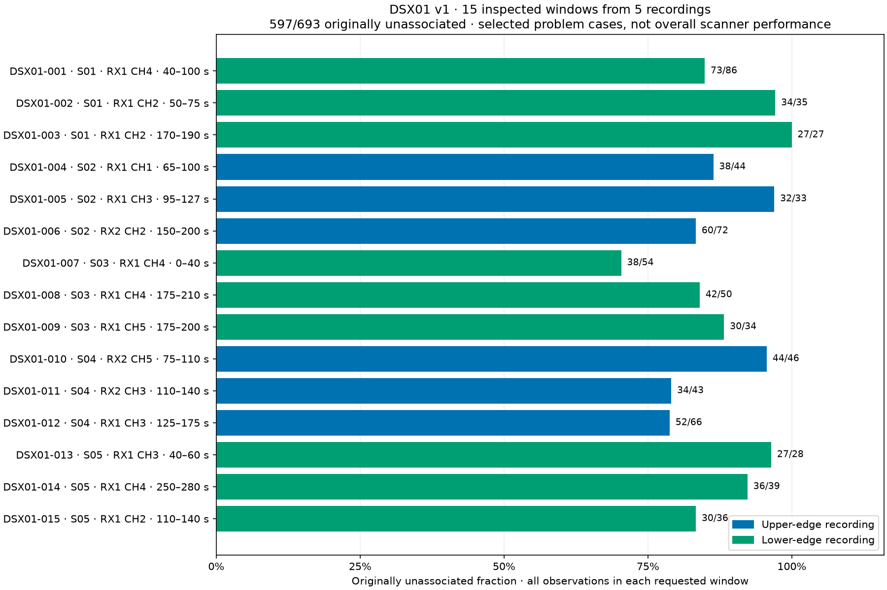

# DSX01 v1: inspected fast-scan association losses

DSX01 contains **15 requested windows from five fast recordings**, with **693
distinct original winning observations**. Originally 597 were unassociated and
96 associated. These are deliberately selected problem windows, not a random
sample or an estimate of overall scanner performance. The full five-scan context
contains 20,084 observations and is retained for regression checks.

The authority is [dataset.json](dataset.json), with exact point IDs in
[membership.csv](membership.csv), an operator-friendly [regions.csv](regions.csv),
verified source receipts in [sources.json](sources.json), and the original measured
CFO/RF/timing and model classifications in
[context-observations.jsonl](context-observations.jsonl). Raw IQ and original
tracking exports remain referenced in place. No recording was acquired or changed.

## Primary regions

Scan codes below are literal substrings of recording IDs, not local wall-clock
times. All ranges are inclusive seconds from each recording's first-sample
estimate. RX labels are one-based, matching the UI. “Unassoc/all” uses **all**
original winning observations in the requested window, not a selected fitted arc.
Satellite numbers are hypotheses, not verified labels.

| DSX01 ID | Scan | RX / channel | Seconds | Original unassoc/all | Candidate hypotheses | Current understanding |
|---|---|---|---|---|---|---|
| 001 | [161535-L](http://gauss:8090/?scan_id=fast8-auto-20261016-161535-99008d35-1-lower&scan_kind=fast) | RX1 CH4 | 40–100 | 73/86 | 69333 | Track-informed timing recovery; generic reverse cold start still fails. |
| 002 | 161535-L | RX1 CH2 | 50–75 | 34/35 | 69433 | Strong conditional candidate and timing explanation; not solved generically. |
| 003 | 161535-L | RX1 CH2 | 170–190 | 27/27 | 69522 | Lower/upper timing conflict; physical cause unresolved. |
| 004 | [210123-U](http://gauss:8090/?scan_id=fast8-auto-20261016-210123-05c5faad-1-upper&scan_kind=fast) | RX1 CH1 | 65–100 | 38/44 | 68711; 49155/67700 alternatives | Preliminary: good whole-arc fit requires large timing; half-arc choices disagree. |
| 005 | 210123-U | RX1 CH3 | 95–127 | 32/33 | 63567 / 67889 | Preliminary: whole-arc and half-arc candidates disagree. |
| 006 | 210123-U | RX2 CH2 | 150–200 | 60/72 | 63434 / 63567 | Preliminary: overlapping fragments, large timing and poor transfer. |
| 007 | [213139-L](http://gauss:8090/?scan_id=fast8-auto-20261016-213139-8bb8d5d7-1-lower&scan_kind=fast) | RX1 CH4 | 0–40 | 38/54 | 66544 | Timing/q diagnostic assigns 34/35 selected coherent points. |
| 008 | 213139-L | RX1 CH4 | 175–210 | 42/50 | 60127 | Timing/q diagnostic assigns 39/42 selected coherent points. |
| 009 | 213139-L | RX1 CH5 | 175–200 | 30/34 | 67704 | Timing/q diagnostic assigns 28/30 selected coherent points. |
| 010 | [220156-U](http://gauss:8090/?scan_id=fast8-auto-20261016-220156-22c968b0-1-upper&scan_kind=fast) | RX2 CH5 | 75–110 | 44/46 | 62502 / 66580 | Timing trap demonstrated; 20/46 assigned after retiming, transfer imperfect. |
| 011 | 220156-U | RX2 CH3 | 110–140 | 34/43 | 61912 / 57985; 52577/53390 alternatives | Geometry/identity ambiguity; low whole-arc RMS does not transfer reliably. |
| 012 | 220156-U | RX1 CH3 | 125–175 | 52/66 | 48117 / 59540 | Geometry-sensitive; forward diagnostic can transfer, reverse remains weak. |
| 013 | [223211-L](http://gauss:8090/?scan_id=fast8-auto-20261016-223211-029a4eef-1-lower&scan_kind=fast) | RX1 CH3 | 40–60 | 27/28 | 66854 | Retained at poor timing; conditional timing-only RMS 237 Hz. |
| 014 | 223211-L | RX1 CH4 | 250–280 | 36/39 | 57864 | Proposed during discovery, dropped from final bank; conditional RMS 152 Hz. |
| 015 | 223211-L | RX1 CH2 | 110–140 | 30/36 | 58362 | Retained at poor timing; conditional timing-only RMS 210 Hz. |

The 101/107 recovery in 213139-L refers to three explicitly selected coherent
subsets inside windows containing 138 observations. It must not be reported as
101/107 recovery over the entire DSX01 dataset. Likewise, the original 16:15 scan
has 129 selected target points inside 148 window observations. Dataset membership
preserves the wider requested windows, including other trajectories and outliers.

## Latest 210123-U investigation

The original saved model associates 1,657/3,524 scan observations. The current
conditional all-regional searches use 855 candidates, frozen saved position and
calibration, a ±20 s timing domain, one constant track offset, and a 2 s timing
prior. These are development diagnostics, not accepted replacement models.

| Region | Diagnostic subset | Whole-subset hypothesis / RMS | Training-half selections and held RMS |
|---|---|---|---|
| 004 | 42 points, 66.39–98.69 s | 68711, +18.2 s, −6.26 kHz, 141 Hz RMS | Early→late selects 49155: 1,572 Hz; reverse selects 67700: 1,186 Hz. |
| 005 | 33 points, 96.29–126.81 s | 63567, +11.9 s, +3.84 kHz, 118 Hz RMS | Both halves select 67889 instead: 1,104 / 1,371 Hz held RMS. |
| 006 | 55-point proposal, 160.47–199.84 s | 63434, +16.7 s, +5.59 kHz, 238 Hz RMS | Early→late selects 63434: 1,235 Hz; reverse selects 63567: 3,900 Hz. |

Region 006 also has an overlapping 65-point proposal spanning 150.17–194.51 s.
It favors 63434 at 577 Hz RMS, with 2,577 / 1,098 Hz held RMS. These 55- and
65-point proposals overlap and must not be added together. Their original
72-observation window remains the authority. Current evidence does not settle
whether a single continuation adequately describes every observed point.

The limited ±5 s timing-only searches without new offsets remain poor on the
initial local proposals: approximately 3.79 kHz, 6.09 kHz and 1.29 kHz for CH1,
RX2 CH2 and RX1 CH3 respectively. Larger timing/offset freedom can reduce
whole-arc RMS while leaving held prediction poor. This scan therefore belongs
in DSX01 as an unresolved geometry/calibration/identity case, rather than being
removed or labelled recovered because an in-sample curve looks good.

## Related regions and controls

These are registered in [auxiliary-controls.json](auxiliary-controls.json),
separately from the 15 primary windows. Their memberships overlap primary data
or were obtained through guided acquisition, so they are not additional
independent failure examples.

| Control | Recording | Region / evidence | Purpose |
|---|---|---|---|
| C01 | 161535-L | RX1 CH5, 181.16–193.23 s; 11 selected points | Carrier/phase comparison, candidate 69522. |
| C02 | 161535-L | RX1 CH6, 195.40–209.24 s; 20 selected points | Before the frame-phase step. |
| C03 | 161535-L | RX1 CH6, 211.72–221.31 s; 5 selected points | After the step; no corresponding large carrier jump. |
| C04 | 161535-L | RX1 CH8, 179.52–194.08 s; 18 selected points | Same-spacecraft versus different-frame-clock hypothesis. |
| C05 | 161535-L | RX1 CH2, 166.48–194.16 s; 38-point continuation | Extends region 003; not a separate denominator. |
| C06 | 161535-L | RX2 CH2, 20 guided raw-IQ counterpart detections | Acquisition recall; not all present in original candidate lists. |
| C07 | 213139-L | RX1 CH4, 24.99–39.19 s; 12 already-associated points | Regression control inside region 007. |

Frame-phase offsets/rates may differ between channels. The measured CH6 step
does not establish a satellite switch or an observation-clock correction.
Late CH4 and CH5 in 213139-L are a different situation: RF-normalized carrier
shapes strongly favor different satellites, and forcing a common identity fails.
A general model must permit both outcomes.

## Recovery approaches to compare

### DSX-A: coherent-track timing rescue, then detection refit

This is the first implementation priority. Extract alias-aware local carrier
segments without orbit labels; connect overlapping support without forcing a
long quadratic through a highly curved pass. Search every eligible regional
satellite against coherent arcs, retain several plausible alternatives, then
offer those timings to the complete scan objective. A candidate's single
physical timing must be shared wherever the model says it is the same satellite.
Refresh the existing detection probabilities after a frequency-aligned proposal
has support. Retain a pointwise clutter option and the original timing priors.

The strongest evidence is regions 007–009: timing edits alone improve the full
objective by 397.70 and q refitting adds 386.90, with 101/107 selected points
assigned to the proposed identities. This does not require a new position,
frequency offset or satellite. It is currently target-informed; the new method
must generate those proposals automatically without using DSX01 IDs or candidate
hypotheses as runtime inputs.

Candidate retention and generic pointwise timing search alone are insufficient.
Earlier generic timing sweeps improved the original scan's objective but still
underperformed its cold baseline on held association coherence. DSX-A must use
whole-arc evidence to find a branch before the pointwise mixture discards it.

### DSX-B: trajectory-level probabilistic association

Carry a shared latent satellite identity through each coherent segment instead
of independently choosing a satellite for every point. Combine evidence along
the curve, keep several candidate identities, and explicitly model isolated
clutter, crossings and supported changes of source. Avoid multiplying evidence
for overlapping segment proposals or forcing every inlier into an association.
Allow separate satellites on simultaneous channels when carrier shapes differ.

This addresses the remaining crossing/prior-driven swaps and clean curves
fragmented among satellites. Success means better excluded-point prediction and
fewer unsupported identity changes, while preserving acquisition outliers and
already-good tracks. A visually smooth assignment alone is not success.

### DSX-C: multiple geometry/calibration hypotheses with candidate alternatives

Keep several position/calibration basins and candidate/timing alternatives until
longer arcs and multiple receivers/channels can discriminate them. Combine the
best supported hypotheses within a fixed total search budget; do not commit to
one position and then interpret every remaining residual as an orbit-time error.
Use actual RF scaling and tightly regularized receiver band contrasts. Compare
causal TLE alternatives using element-age evidence, not just collection time.
Add satellite/band-specific terms only when excluded observations support them.

This targets regions 004–006 and 011–012, where different identities and geometry
can produce excellent all-data RMS but poor temporal transfer. The previous
66 km conditional site change is not a position correction to adopt. A model
with arbitrary per-track frequency/time terms can fit these curves without
learning the correct geometry; complexity must earn its place on excluded data.

### Separate acquisition extension

Guided re-acquisition from the existing IQ, using simultaneous receiver/track
evidence and explicit CFO alias branches, addresses measurements missing from
the candidate list. C06 demonstrates why downstream association cannot recover
a candidate that acquisition never emitted. Use shifted-epoch/CFO negative
controls and bound the replay work. No new RF collection is needed.

Evaluate this as a separate acquisition-stage ablation. DSX-A/B/C first use the
same original observations and candidate eligibility, so their gains are not
confounded by adding measurements. New detections must be reported separately,
not inserted into the frozen DSX01 baseline denominator.

## Comparison protocol

1. **Freeze data, not hypotheses.** Region bounds, original observation IDs and
   source receipts are immutable within DSX01 v1. Findings are timestamped
   hypotheses, with no independent satellite or geographic truth. Keep failed,
   missing and fragmented outputs in the report.
2. **Use complete recording groups.** All windows, continuations and counterpart
   controls from one recording stay in the same retrospective fold. Train/freeze
   position, calibration, identities and timing without held measurements. All
   DSX01 recordings have already been inspected, so leave-one-recording-out
   results are development evidence, not pristine confirmation. Freeze the
   method before evaluating uninspected existing recordings.
3. **Keep budgets matched.** Declare regional eligibility, TLE policy, timing
   priors, initializations and wall/CPU allowances. Compare against the exact
   saved baseline and an equal-budget baseline continuation. Include the same
   fitted-c versus c=0 ablation for large calibration/localization comparisons.
4. **Report the correct denominators.** Show output coverage over all 693 window
   observations; frequency prediction over separately declared fixed coherent
   subsets; assignment continuity and stability; clutter/competitor exceptions;
   and runtime. Label agreement with a candidate hypothesis is not measured
   identity accuracy. Never remove outliers to improve the headline curve.
5. **Preserve outside-window performance.** Use the 20,084 whole-scan context
   observations to measure full-objective effects, loss of existing support and
   regression on C07 and other already-supported tracks. Neither more
   associations nor lower in-sample objective alone proves correctness.
6. **Keep frequency and position results separate.** Plot held absolute carrier
   residual CDFs with failures in the denominator and per-region support counts.
   Show separate panels by recording and receiver/channel, plus macro averages
   over regions/recordings. Plot position error in km only where independent
   geographic references exist; retain DS21/DS22 as separate position benchmarks.

A promotion gate should require reproducible, automatic proposals, improvements
in both temporal directions on the difficult cases, no unexplained regression
on controls/outside-window support, and confirmation beyond these inspected
examples. A whole-arc 100 Hz fit with a 1 kHz held residual does not pass.

## Provenance and validation

`build_dataset.py` reads existing production evidence through the public shared
scan store. It verifies input/terminal identities, replays the original scan's
published classification and snapshots the newer cached analyses. It refuses to
overwrite an existing v1 manifest. It does not refit a model or contact hardware.

`python3 validate.py` independently regenerates every requested RX/channel/time
selection from full-scan context, verifies membership and evidence hashes,
checks causal TLE collection, and rejects dropped, duplicated or misbound
members. The executed result is in [validation.json](validation.json).

Scientific source reports:
[original three-track investigation](../three-track-20261016/report.md),
[cold-start replay limitations](../three-track-recovery-replay-20261016/report.md),
[213139-L](../lower-213139-three-segments-20261016/report.html),
[220156-U](../upper-three-segments-20261016/report.html),
[223211-L](../new-three-segments-20261016/report.html),
[frame/carrier controls](../three-track-frame-clock-20261016/report.md).
The latest 210123-U evidence is snapshotted in `evidence/S02-*`; it remains
preliminary and is not represented as a completed recovery.
