# DSX01 S01 complete figure and table inventory

All saved study figures are included below with their PDF variants when present. Table links retain every exported observation and tuning trial. Historical figures retain their original policies; the report identifies which stage supports each claim.

## Generated report tables

- [all-tuning-trials](tables/all-tuning-trials.csv) · [Markdown](tables/all-tuning-trials.md)
- [historical-holdout](tables/historical-holdout.csv) · [Markdown](tables/historical-holdout.md)
- [host-runtime](tables/host-runtime.csv) · [Markdown](tables/host-runtime.md)
- [initial-comparison](tables/initial-comparison.csv) · [Markdown](tables/initial-comparison.md)
- [latest-quality](tables/latest-quality.csv) · [Markdown](tables/latest-quality.md)
- [latest-results](tables/latest-results.csv) · [Markdown](tables/latest-results.md)
- [pairwise-comparison](tables/pairwise-comparison.csv) · [Markdown](tables/pairwise-comparison.md)
- [residual-recovery](tables/residual-recovery.csv) · [Markdown](tables/residual-recovery.md)
- [reviewed-fragments](tables/reviewed-fragments.csv) · [Markdown](tables/reviewed-fragments.md)
- [selected-synthetic](tables/selected-synthetic.csv) · [Markdown](tables/selected-synthetic.md)
- [tuned-selection](tables/tuned-selection.csv) · [Markdown](tables/tuned-selection.md)

## Figures

### Figure 1 2026_10_16_dsx01_fast_association_losses baseline-unassociated

Source: [reports/2026_10_16_dsx01_fast_association_losses/baseline-unassociated.png](../2026_10_16_dsx01_fast_association_losses/baseline-unassociated.png). Frozen DSX01 observations; panel labels specify the population and stage. GLRT views use seconds and kHz; residual and RMS views use Hz; comparison plots show counts, fractions, or runtimes as labeled. These are fitted curve and sensitivity diagnostics, without spacecraft identity labels.

### Figure 2 baseline clusters-by-receiver

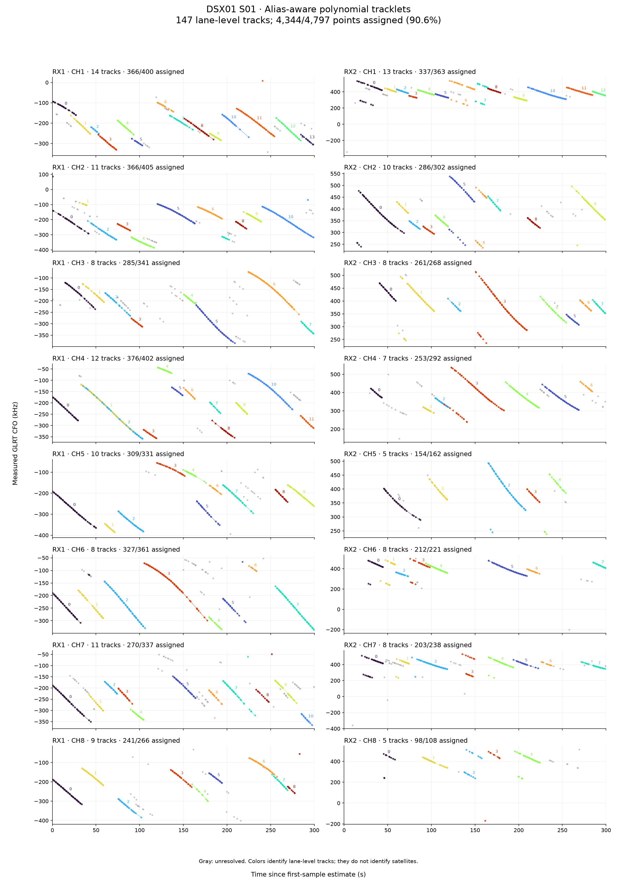

Source: [reports/2026_10_17_dsx01_four_methods/baseline/clusters-by-receiver.png](../2026_10_17_dsx01_four_methods/baseline/clusters-by-receiver.png). [PDF](../2026_10_17_dsx01_four_methods/baseline/clusters-by-receiver.pdf). Frozen DSX01 observations; panel labels specify the population and stage. GLRT views use seconds and kHz; residual and RMS views use Hz; comparison plots show counts, fractions, or runtimes as labeled. These are fitted curve and sensitivity diagnostics, without spacecraft identity labels.

### Figure 3 baseline residuals

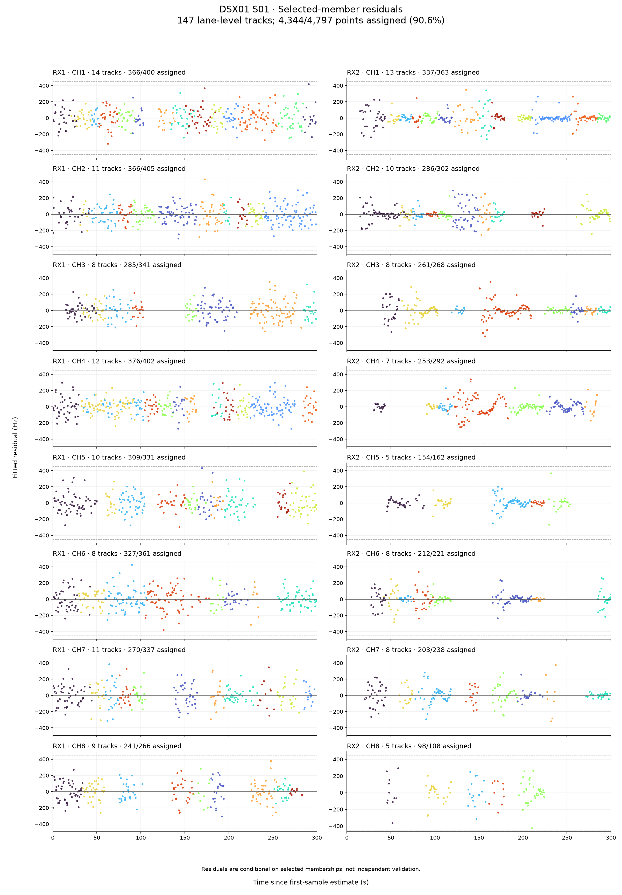

Source: [reports/2026_10_17_dsx01_four_methods/baseline/residuals.png](../2026_10_17_dsx01_four_methods/baseline/residuals.png). [PDF](../2026_10_17_dsx01_four_methods/baseline/residuals.pdf). Frozen DSX01 observations; panel labels specify the population and stage. GLRT views use seconds and kHz; residual and RMS views use Hz; comparison plots show counts, fractions, or runtimes as labeled. These are fitted curve and sensitivity diagnostics, without spacecraft identity labels.

### Figure 4 baseline track-distributions

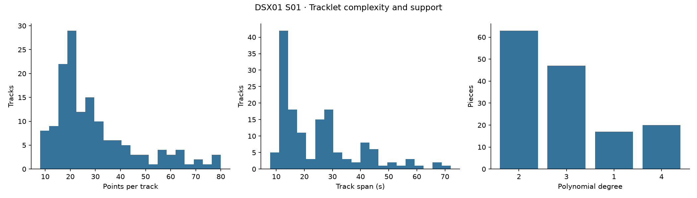

Source: [reports/2026_10_17_dsx01_four_methods/baseline/track-distributions.png](../2026_10_17_dsx01_four_methods/baseline/track-distributions.png). [PDF](../2026_10_17_dsx01_four_methods/baseline/track-distributions.pdf). Frozen DSX01 observations; panel labels specify the population and stage. GLRT views use seconds and kHz; residual and RMS views use Hz; comparison plots show counts, fractions, or runtimes as labeled. These are fitted curve and sensitivity diagnostics, without spacecraft identity labels.

### Figure 5 2026_10_17_dsx01_four_methods comparison

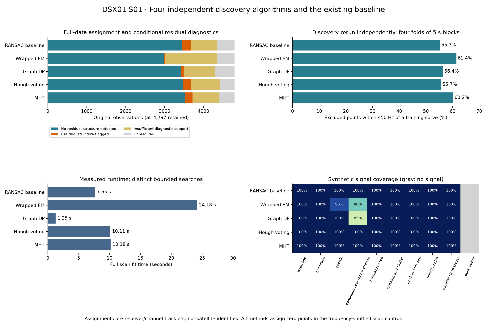

Source: [reports/2026_10_17_dsx01_four_methods/comparison.png](../2026_10_17_dsx01_four_methods/comparison.png). [PDF](../2026_10_17_dsx01_four_methods/comparison.pdf). Frozen DSX01 observations; panel labels specify the population and stage. GLRT views use seconds and kHz; residual and RMS views use Hz; comparison plots show counts, fractions, or runtimes as labeled. These are fitted curve and sensitivity diagnostics, without spacecraft identity labels.

### Figure 6 em clusters-by-receiver

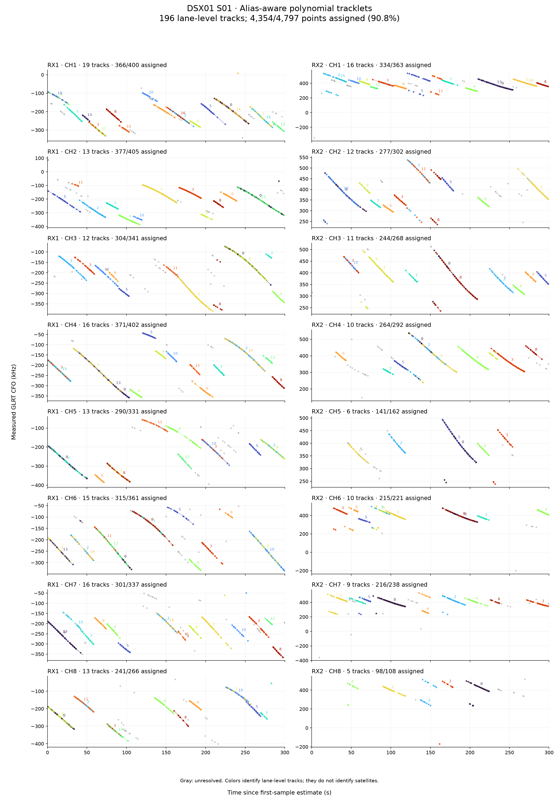

Source: [reports/2026_10_17_dsx01_four_methods/em/clusters-by-receiver.png](../2026_10_17_dsx01_four_methods/em/clusters-by-receiver.png). [PDF](../2026_10_17_dsx01_four_methods/em/clusters-by-receiver.pdf). Frozen DSX01 observations; panel labels specify the population and stage. GLRT views use seconds and kHz; residual and RMS views use Hz; comparison plots show counts, fractions, or runtimes as labeled. These are fitted curve and sensitivity diagnostics, without spacecraft identity labels.

### Figure 7 em residuals

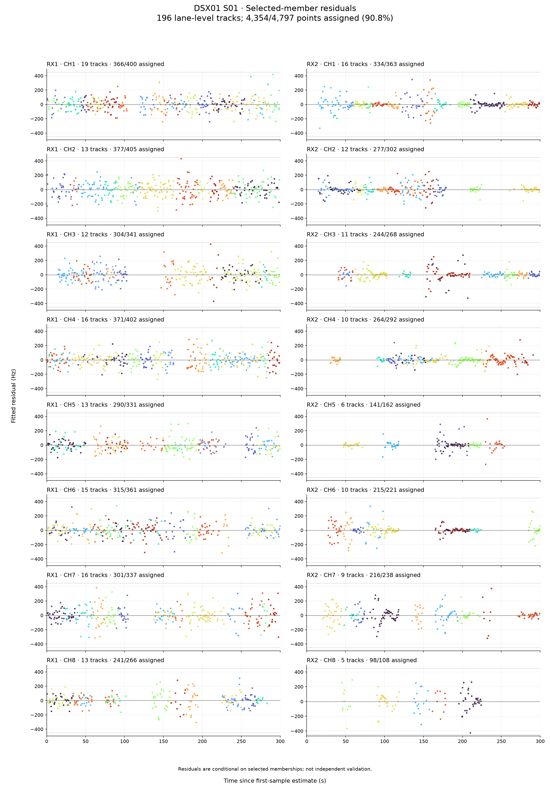

Source: [reports/2026_10_17_dsx01_four_methods/em/residuals.png](../2026_10_17_dsx01_four_methods/em/residuals.png). [PDF](../2026_10_17_dsx01_four_methods/em/residuals.pdf). Frozen DSX01 observations; panel labels specify the population and stage. GLRT views use seconds and kHz; residual and RMS views use Hz; comparison plots show counts, fractions, or runtimes as labeled. These are fitted curve and sensitivity diagnostics, without spacecraft identity labels.

### Figure 8 em track-distributions

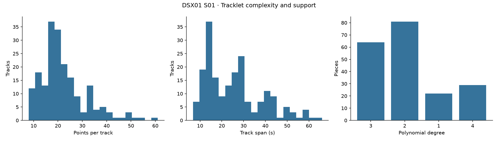

Source: [reports/2026_10_17_dsx01_four_methods/em/track-distributions.png](../2026_10_17_dsx01_four_methods/em/track-distributions.png). [PDF](../2026_10_17_dsx01_four_methods/em/track-distributions.pdf). Frozen DSX01 observations; panel labels specify the population and stage. GLRT views use seconds and kHz; residual and RMS views use Hz; comparison plots show counts, fractions, or runtimes as labeled. These are fitted curve and sensitivity diagnostics, without spacecraft identity labels.

### Figure 9 graph clusters-by-receiver

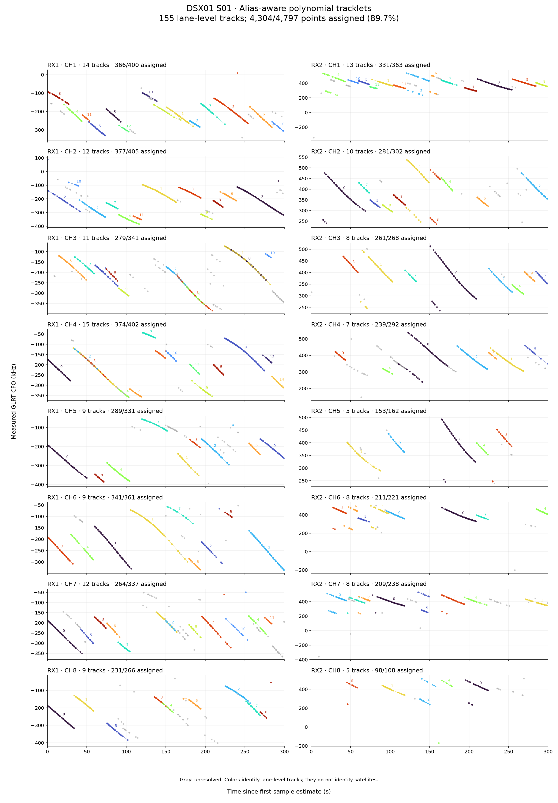

Source: [reports/2026_10_17_dsx01_four_methods/graph/clusters-by-receiver.png](../2026_10_17_dsx01_four_methods/graph/clusters-by-receiver.png). [PDF](../2026_10_17_dsx01_four_methods/graph/clusters-by-receiver.pdf). Frozen DSX01 observations; panel labels specify the population and stage. GLRT views use seconds and kHz; residual and RMS views use Hz; comparison plots show counts, fractions, or runtimes as labeled. These are fitted curve and sensitivity diagnostics, without spacecraft identity labels.

### Figure 10 graph residuals

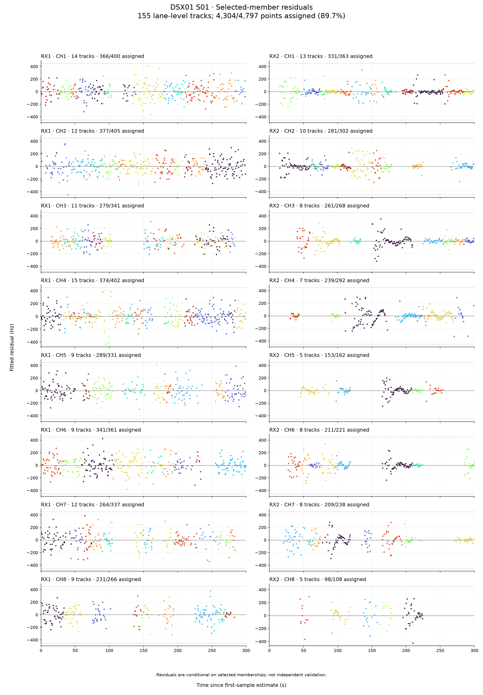

Source: [reports/2026_10_17_dsx01_four_methods/graph/residuals.png](../2026_10_17_dsx01_four_methods/graph/residuals.png). [PDF](../2026_10_17_dsx01_four_methods/graph/residuals.pdf). Frozen DSX01 observations; panel labels specify the population and stage. GLRT views use seconds and kHz; residual and RMS views use Hz; comparison plots show counts, fractions, or runtimes as labeled. These are fitted curve and sensitivity diagnostics, without spacecraft identity labels.

### Figure 11 graph track-distributions

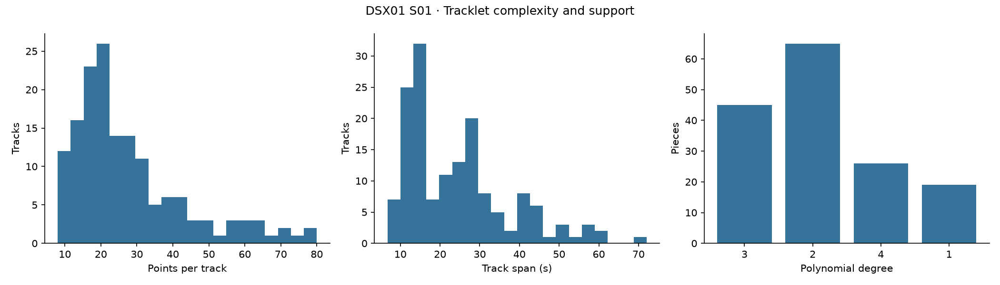

Source: [reports/2026_10_17_dsx01_four_methods/graph/track-distributions.png](../2026_10_17_dsx01_four_methods/graph/track-distributions.png). [PDF](../2026_10_17_dsx01_four_methods/graph/track-distributions.pdf). Frozen DSX01 observations; panel labels specify the population and stage. GLRT views use seconds and kHz; residual and RMS views use Hz; comparison plots show counts, fractions, or runtimes as labeled. These are fitted curve and sensitivity diagnostics, without spacecraft identity labels.

### Figure 12 hough clusters-by-receiver

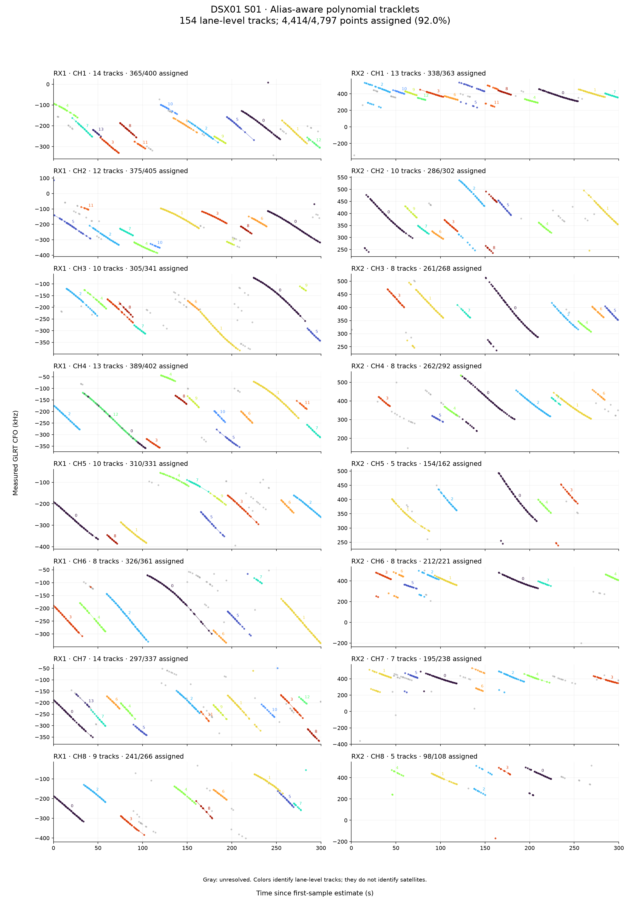

Source: [reports/2026_10_17_dsx01_four_methods/hough/clusters-by-receiver.png](../2026_10_17_dsx01_four_methods/hough/clusters-by-receiver.png). [PDF](../2026_10_17_dsx01_four_methods/hough/clusters-by-receiver.pdf). Frozen DSX01 observations; panel labels specify the population and stage. GLRT views use seconds and kHz; residual and RMS views use Hz; comparison plots show counts, fractions, or runtimes as labeled. These are fitted curve and sensitivity diagnostics, without spacecraft identity labels.

### Figure 13 hough residuals

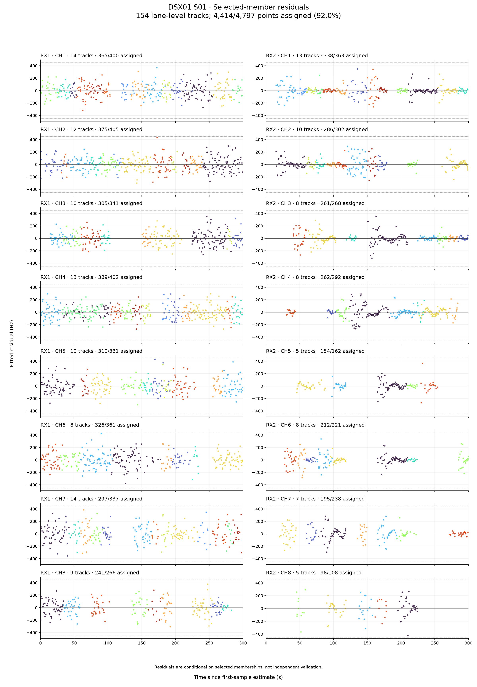

Source: [reports/2026_10_17_dsx01_four_methods/hough/residuals.png](../2026_10_17_dsx01_four_methods/hough/residuals.png). [PDF](../2026_10_17_dsx01_four_methods/hough/residuals.pdf). Frozen DSX01 observations; panel labels specify the population and stage. GLRT views use seconds and kHz; residual and RMS views use Hz; comparison plots show counts, fractions, or runtimes as labeled. These are fitted curve and sensitivity diagnostics, without spacecraft identity labels.

### Figure 14 hough track-distributions

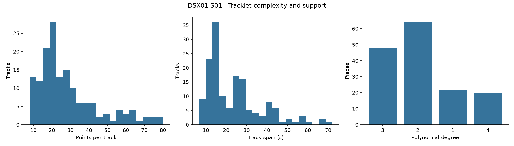

Source: [reports/2026_10_17_dsx01_four_methods/hough/track-distributions.png](../2026_10_17_dsx01_four_methods/hough/track-distributions.png). [PDF](../2026_10_17_dsx01_four_methods/hough/track-distributions.pdf). Frozen DSX01 observations; panel labels specify the population and stage. GLRT views use seconds and kHz; residual and RMS views use Hz; comparison plots show counts, fractions, or runtimes as labeled. These are fitted curve and sensitivity diagnostics, without spacecraft identity labels.

### Figure 15 mht clusters-by-receiver

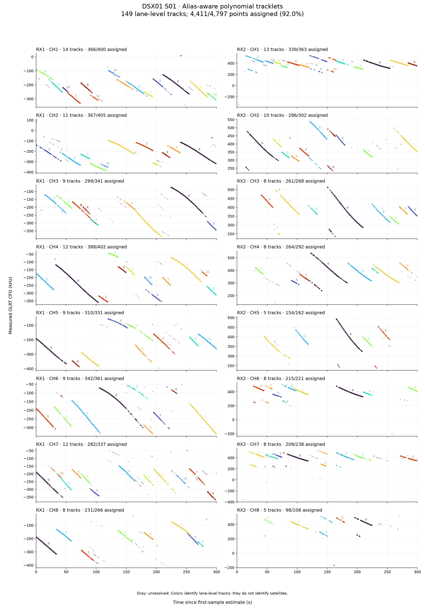

Source: [reports/2026_10_17_dsx01_four_methods/mht/clusters-by-receiver.png](../2026_10_17_dsx01_four_methods/mht/clusters-by-receiver.png). [PDF](../2026_10_17_dsx01_four_methods/mht/clusters-by-receiver.pdf). Frozen DSX01 observations; panel labels specify the population and stage. GLRT views use seconds and kHz; residual and RMS views use Hz; comparison plots show counts, fractions, or runtimes as labeled. These are fitted curve and sensitivity diagnostics, without spacecraft identity labels.

### Figure 16 mht residuals

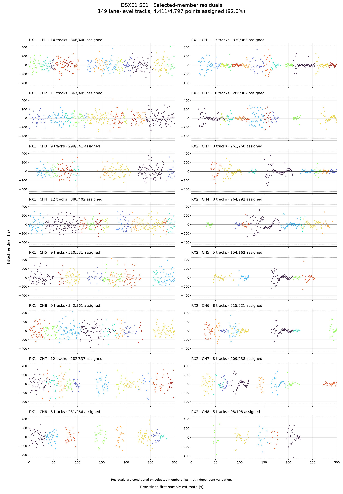

Source: [reports/2026_10_17_dsx01_four_methods/mht/residuals.png](../2026_10_17_dsx01_four_methods/mht/residuals.png). [PDF](../2026_10_17_dsx01_four_methods/mht/residuals.pdf). Frozen DSX01 observations; panel labels specify the population and stage. GLRT views use seconds and kHz; residual and RMS views use Hz; comparison plots show counts, fractions, or runtimes as labeled. These are fitted curve and sensitivity diagnostics, without spacecraft identity labels.

### Figure 17 mht track-distributions

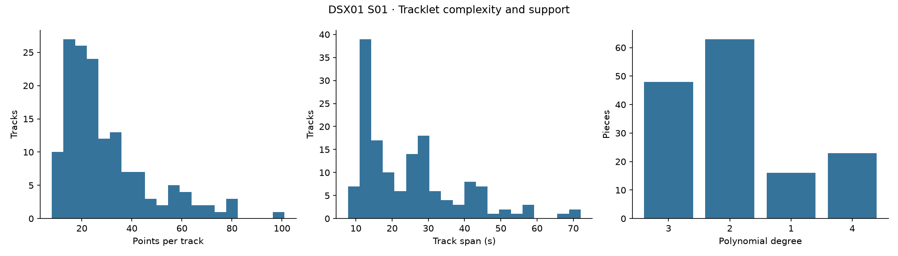

Source: [reports/2026_10_17_dsx01_four_methods/mht/track-distributions.png](../2026_10_17_dsx01_four_methods/mht/track-distributions.png). [PDF](../2026_10_17_dsx01_four_methods/mht/track-distributions.pdf). Frozen DSX01 observations; panel labels specify the population and stage. GLRT views use seconds and kHz; residual and RMS views use Hz; comparison plots show counts, fractions, or runtimes as labeled. These are fitted curve and sensitivity diagnostics, without spacecraft identity labels.

### Figure 18 baseline associations

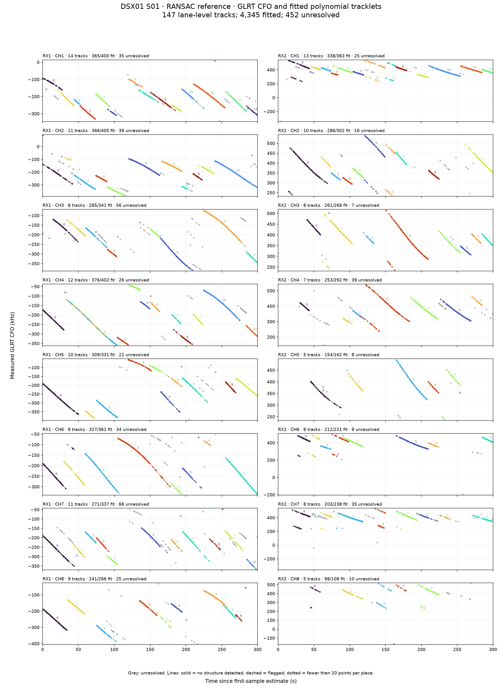

Source: [reports/2026_10_17_dsx01_full_data_tuning/baseline/associations.png](../2026_10_17_dsx01_full_data_tuning/baseline/associations.png). [PDF](../2026_10_17_dsx01_full_data_tuning/baseline/associations.pdf). Frozen DSX01 observations; panel labels specify the population and stage. GLRT views use seconds and kHz; residual and RMS views use Hz; comparison plots show counts, fractions, or runtimes as labeled. These are fitted curve and sensitivity diagnostics, without spacecraft identity labels.

### Figure 19 baseline residuals

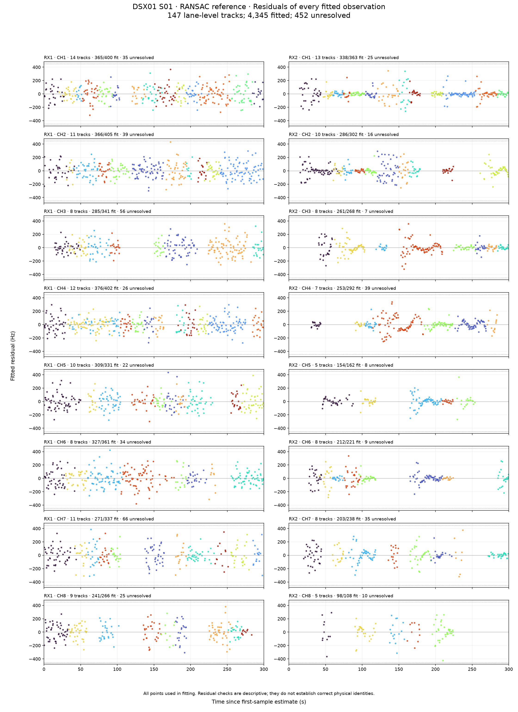

Source: [reports/2026_10_17_dsx01_full_data_tuning/baseline/residuals.png](../2026_10_17_dsx01_full_data_tuning/baseline/residuals.png). [PDF](../2026_10_17_dsx01_full_data_tuning/baseline/residuals.pdf). Frozen DSX01 observations; panel labels specify the population and stage. GLRT views use seconds and kHz; residual and RMS views use Hz; comparison plots show counts, fractions, or runtimes as labeled. These are fitted curve and sensitivity diagnostics, without spacecraft identity labels.

### Figure 20 baseline supported

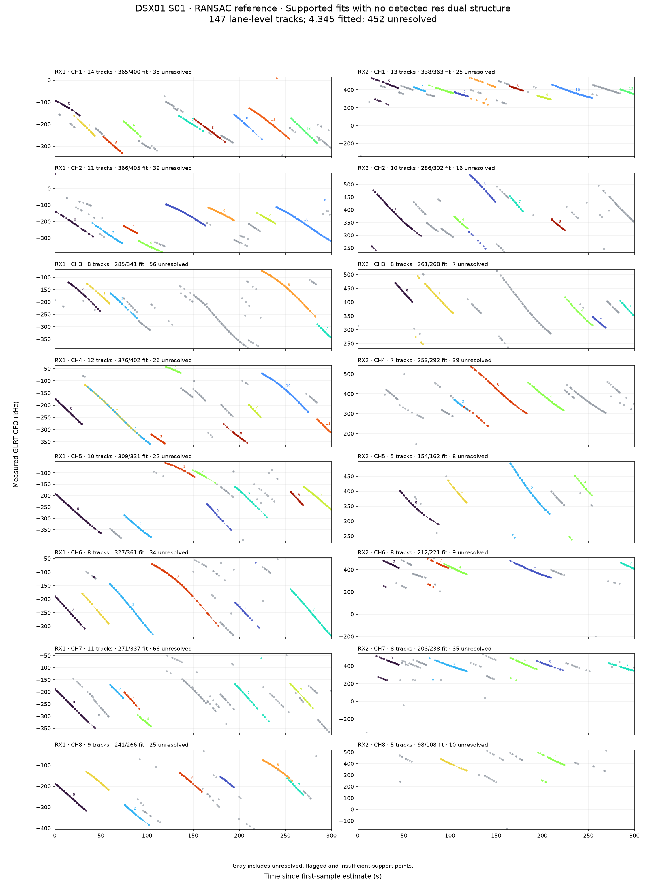

Source: [reports/2026_10_17_dsx01_full_data_tuning/baseline/supported.png](../2026_10_17_dsx01_full_data_tuning/baseline/supported.png). [PDF](../2026_10_17_dsx01_full_data_tuning/baseline/supported.pdf). Frozen DSX01 observations; panel labels specify the population and stage. GLRT views use seconds and kHz; residual and RMS views use Hz; comparison plots show counts, fractions, or runtimes as labeled. These are fitted curve and sensitivity diagnostics, without spacecraft identity labels.

### Figure 21 baseline unassociated

Source: [reports/2026_10_17_dsx01_full_data_tuning/baseline/unassociated.png](../2026_10_17_dsx01_full_data_tuning/baseline/unassociated.png). [PDF](../2026_10_17_dsx01_full_data_tuning/baseline/unassociated.pdf). Frozen DSX01 observations; panel labels specify the population and stage. GLRT views use seconds and kHz; residual and RMS views use Hz; comparison plots show counts, fractions, or runtimes as labeled. These are fitted curve and sensitivity diagnostics, without spacecraft identity labels.

### Figure 22 2026_10_17_dsx01_full_data_tuning comparison

Source: [reports/2026_10_17_dsx01_full_data_tuning/comparison.png](../2026_10_17_dsx01_full_data_tuning/comparison.png). [PDF](../2026_10_17_dsx01_full_data_tuning/comparison.pdf). Frozen DSX01 observations; panel labels specify the population and stage. GLRT views use seconds and kHz; residual and RMS views use Hz; comparison plots show counts, fractions, or runtimes as labeled. These are fitted curve and sensitivity diagnostics, without spacecraft identity labels.

### Figure 23 em associations

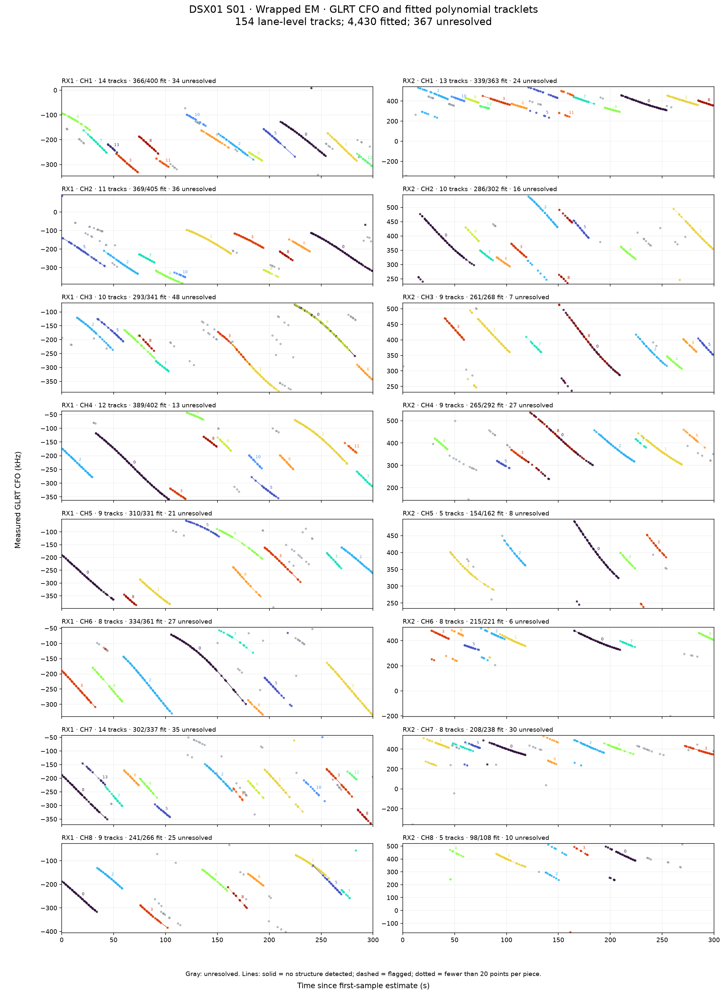

Source: [reports/2026_10_17_dsx01_full_data_tuning/em/associations.png](../2026_10_17_dsx01_full_data_tuning/em/associations.png). [PDF](../2026_10_17_dsx01_full_data_tuning/em/associations.pdf). Frozen DSX01 observations; panel labels specify the population and stage. GLRT views use seconds and kHz; residual and RMS views use Hz; comparison plots show counts, fractions, or runtimes as labeled. These are fitted curve and sensitivity diagnostics, without spacecraft identity labels.

### Figure 24 maximum-coverage associations

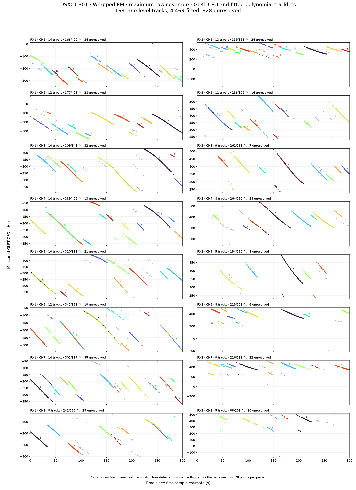

Source: [reports/2026_10_17_dsx01_full_data_tuning/em/maximum-coverage/associations.png](../2026_10_17_dsx01_full_data_tuning/em/maximum-coverage/associations.png). [PDF](../2026_10_17_dsx01_full_data_tuning/em/maximum-coverage/associations.pdf). Frozen DSX01 observations; panel labels specify the population and stage. GLRT views use seconds and kHz; residual and RMS views use Hz; comparison plots show counts, fractions, or runtimes as labeled. These are fitted curve and sensitivity diagnostics, without spacecraft identity labels.

### Figure 25 maximum-coverage residuals

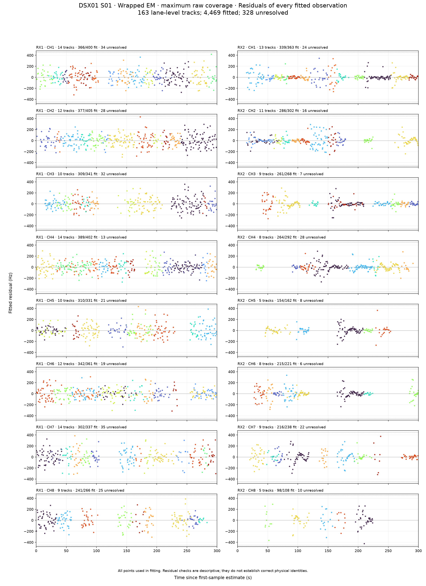

Source: [reports/2026_10_17_dsx01_full_data_tuning/em/maximum-coverage/residuals.png](../2026_10_17_dsx01_full_data_tuning/em/maximum-coverage/residuals.png). [PDF](../2026_10_17_dsx01_full_data_tuning/em/maximum-coverage/residuals.pdf). Frozen DSX01 observations; panel labels specify the population and stage. GLRT views use seconds and kHz; residual and RMS views use Hz; comparison plots show counts, fractions, or runtimes as labeled. These are fitted curve and sensitivity diagnostics, without spacecraft identity labels.

### Figure 26 maximum-coverage supported

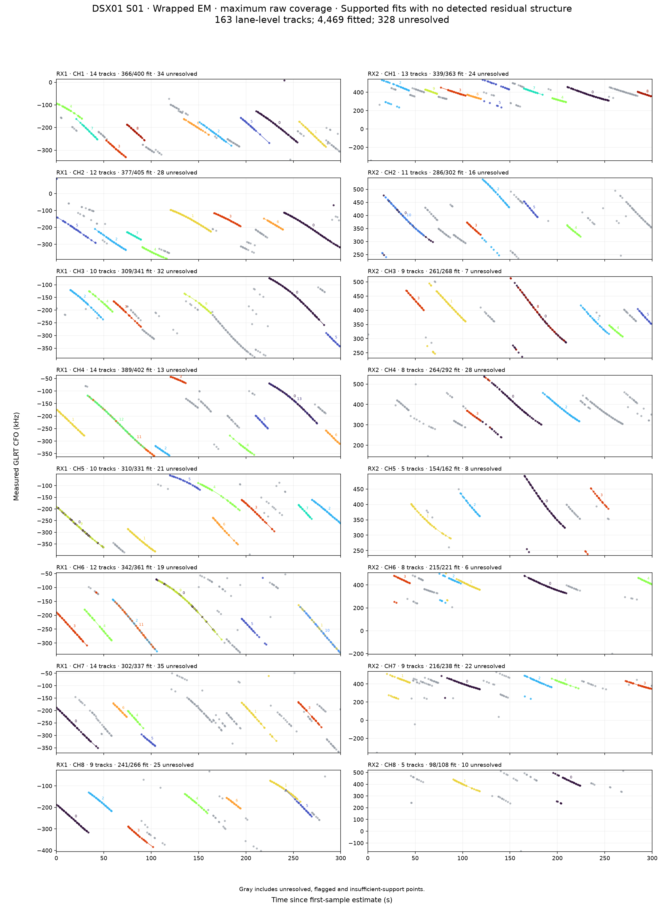

Source: [reports/2026_10_17_dsx01_full_data_tuning/em/maximum-coverage/supported.png](../2026_10_17_dsx01_full_data_tuning/em/maximum-coverage/supported.png). [PDF](../2026_10_17_dsx01_full_data_tuning/em/maximum-coverage/supported.pdf). Frozen DSX01 observations; panel labels specify the population and stage. GLRT views use seconds and kHz; residual and RMS views use Hz; comparison plots show counts, fractions, or runtimes as labeled. These are fitted curve and sensitivity diagnostics, without spacecraft identity labels.

### Figure 27 maximum-coverage unassociated

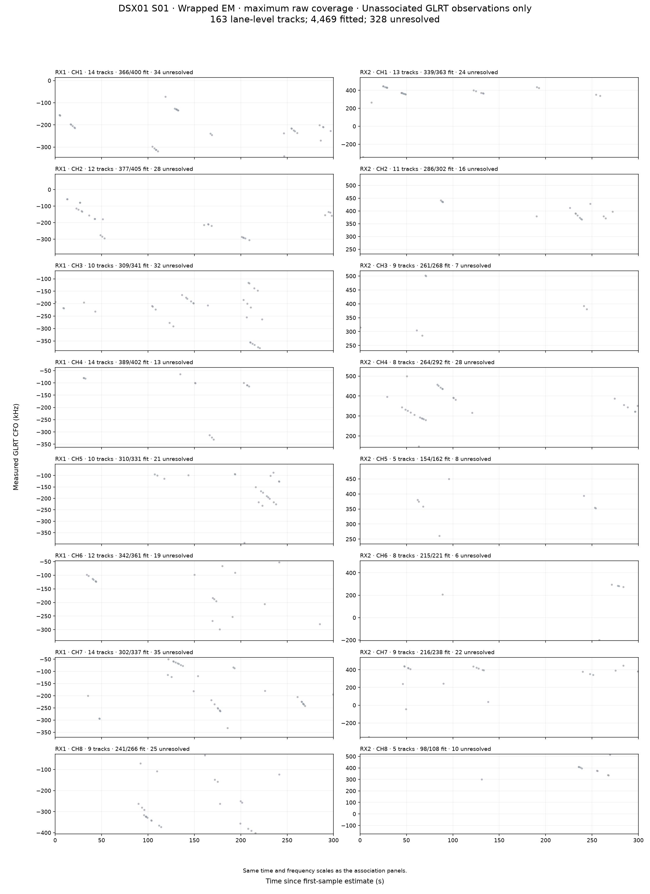

Source: [reports/2026_10_17_dsx01_full_data_tuning/em/maximum-coverage/unassociated.png](../2026_10_17_dsx01_full_data_tuning/em/maximum-coverage/unassociated.png). [PDF](../2026_10_17_dsx01_full_data_tuning/em/maximum-coverage/unassociated.pdf). Frozen DSX01 observations; panel labels specify the population and stage. GLRT views use seconds and kHz; residual and RMS views use Hz; comparison plots show counts, fractions, or runtimes as labeled. These are fitted curve and sensitivity diagnostics, without spacecraft identity labels.

### Figure 28 em residuals

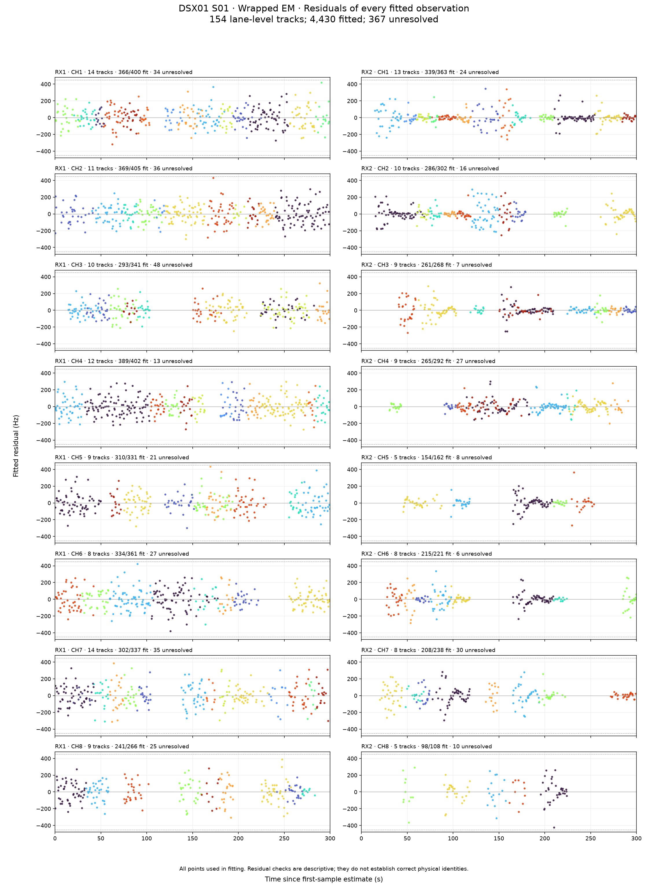

Source: [reports/2026_10_17_dsx01_full_data_tuning/em/residuals.png](../2026_10_17_dsx01_full_data_tuning/em/residuals.png). [PDF](../2026_10_17_dsx01_full_data_tuning/em/residuals.pdf). Frozen DSX01 observations; panel labels specify the population and stage. GLRT views use seconds and kHz; residual and RMS views use Hz; comparison plots show counts, fractions, or runtimes as labeled. These are fitted curve and sensitivity diagnostics, without spacecraft identity labels.

### Figure 29 em supported

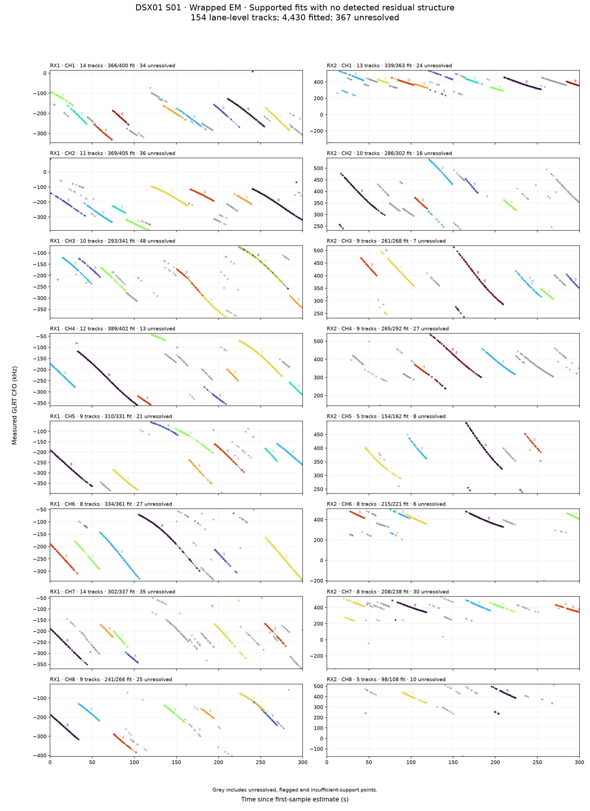

Source: [reports/2026_10_17_dsx01_full_data_tuning/em/supported.png](../2026_10_17_dsx01_full_data_tuning/em/supported.png). [PDF](../2026_10_17_dsx01_full_data_tuning/em/supported.pdf). Frozen DSX01 observations; panel labels specify the population and stage. GLRT views use seconds and kHz; residual and RMS views use Hz; comparison plots show counts, fractions, or runtimes as labeled. These are fitted curve and sensitivity diagnostics, without spacecraft identity labels.

### Figure 30 em unassociated

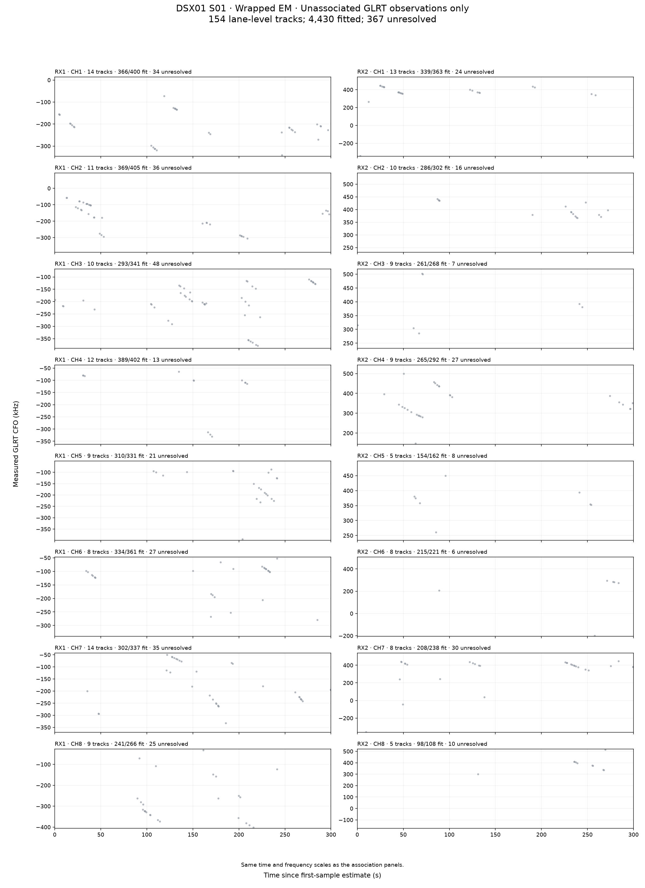

Source: [reports/2026_10_17_dsx01_full_data_tuning/em/unassociated.png](../2026_10_17_dsx01_full_data_tuning/em/unassociated.png). [PDF](../2026_10_17_dsx01_full_data_tuning/em/unassociated.pdf). Frozen DSX01 observations; panel labels specify the population and stage. GLRT views use seconds and kHz; residual and RMS views use Hz; comparison plots show counts, fractions, or runtimes as labeled. These are fitted curve and sensitivity diagnostics, without spacecraft identity labels.

### Figure 31 graph associations

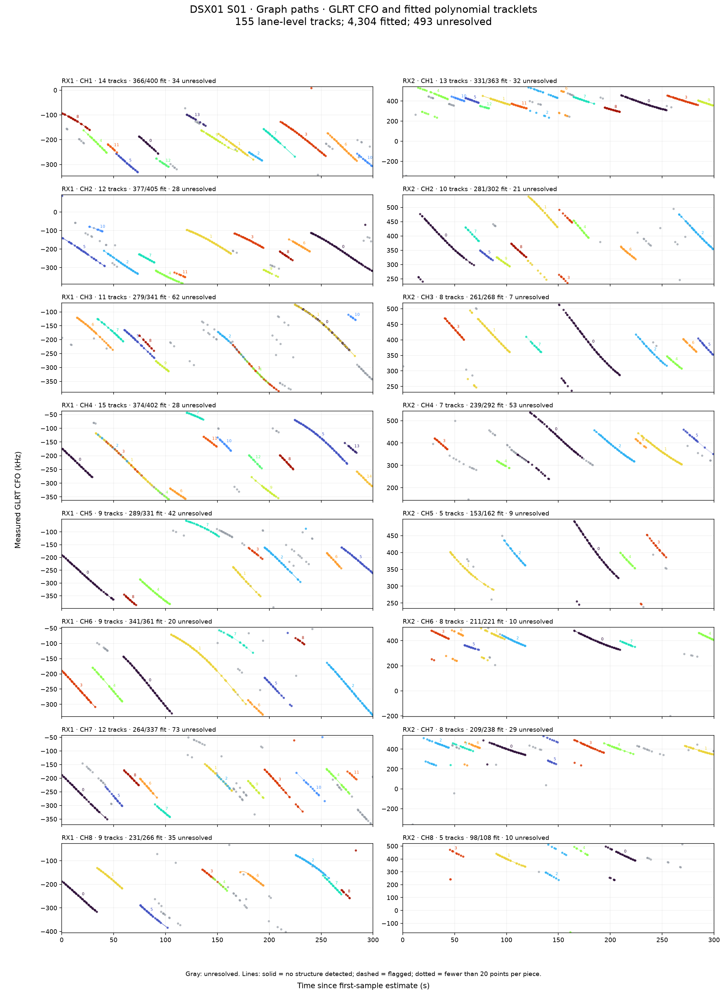

Source: [reports/2026_10_17_dsx01_full_data_tuning/graph/associations.png](../2026_10_17_dsx01_full_data_tuning/graph/associations.png). [PDF](../2026_10_17_dsx01_full_data_tuning/graph/associations.pdf). Frozen DSX01 observations; panel labels specify the population and stage. GLRT views use seconds and kHz; residual and RMS views use Hz; comparison plots show counts, fractions, or runtimes as labeled. These are fitted curve and sensitivity diagnostics, without spacecraft identity labels.

### Figure 32 graph residuals

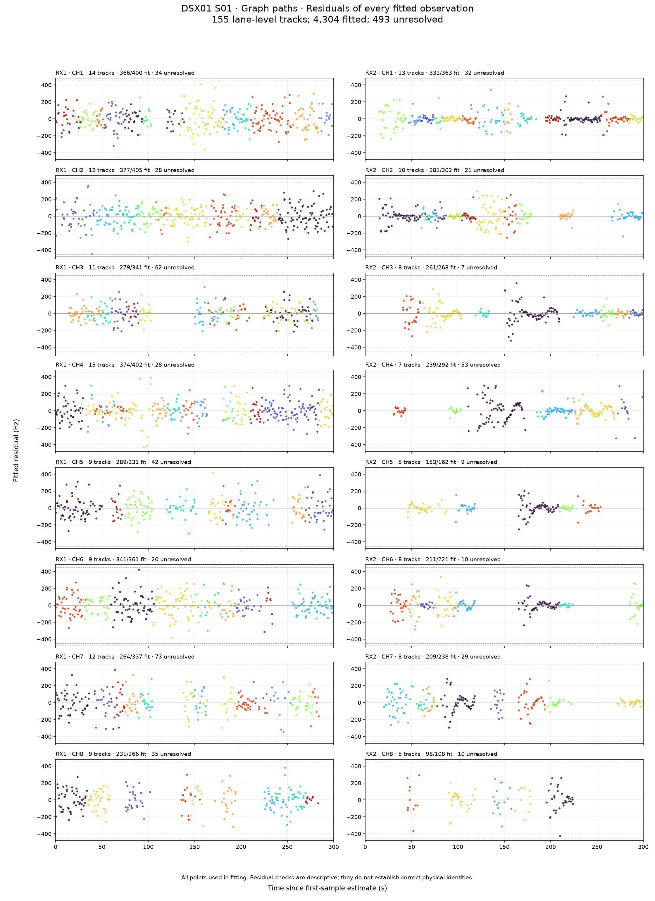

Source: [reports/2026_10_17_dsx01_full_data_tuning/graph/residuals.png](../2026_10_17_dsx01_full_data_tuning/graph/residuals.png). [PDF](../2026_10_17_dsx01_full_data_tuning/graph/residuals.pdf). Frozen DSX01 observations; panel labels specify the population and stage. GLRT views use seconds and kHz; residual and RMS views use Hz; comparison plots show counts, fractions, or runtimes as labeled. These are fitted curve and sensitivity diagnostics, without spacecraft identity labels.

### Figure 33 graph supported

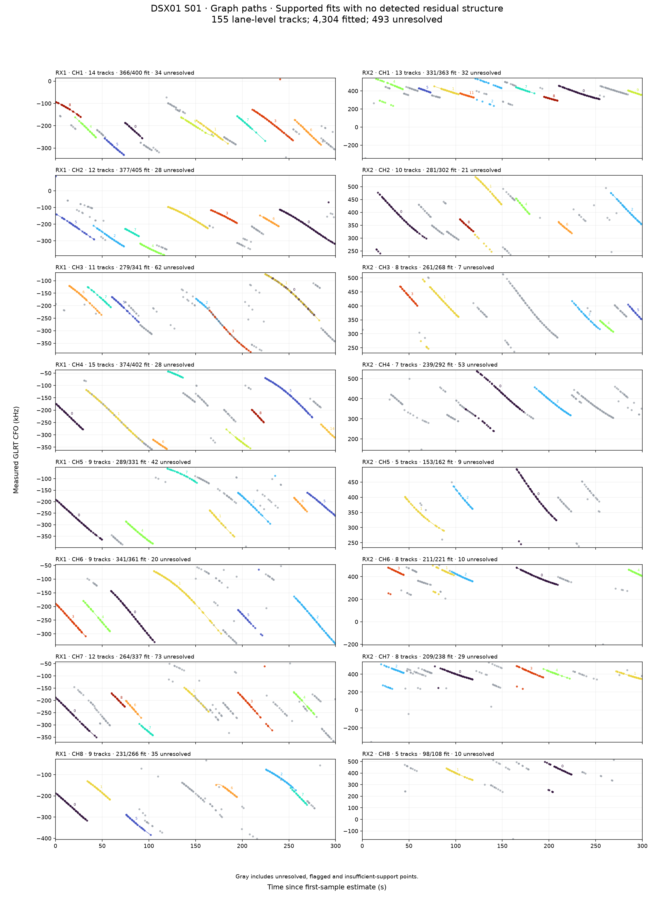

Source: [reports/2026_10_17_dsx01_full_data_tuning/graph/supported.png](../2026_10_17_dsx01_full_data_tuning/graph/supported.png). [PDF](../2026_10_17_dsx01_full_data_tuning/graph/supported.pdf). Frozen DSX01 observations; panel labels specify the population and stage. GLRT views use seconds and kHz; residual and RMS views use Hz; comparison plots show counts, fractions, or runtimes as labeled. These are fitted curve and sensitivity diagnostics, without spacecraft identity labels.

### Figure 34 graph unassociated

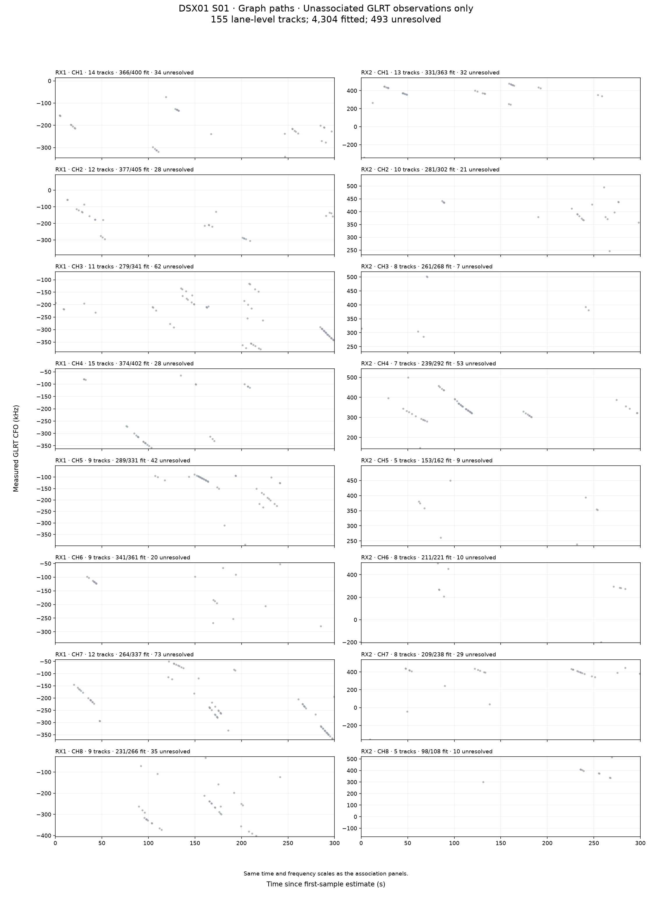

Source: [reports/2026_10_17_dsx01_full_data_tuning/graph/unassociated.png](../2026_10_17_dsx01_full_data_tuning/graph/unassociated.png). [PDF](../2026_10_17_dsx01_full_data_tuning/graph/unassociated.pdf). Frozen DSX01 observations; panel labels specify the population and stage. GLRT views use seconds and kHz; residual and RMS views use Hz; comparison plots show counts, fractions, or runtimes as labeled. These are fitted curve and sensitivity diagnostics, without spacecraft identity labels.

### Figure 35 hough associations

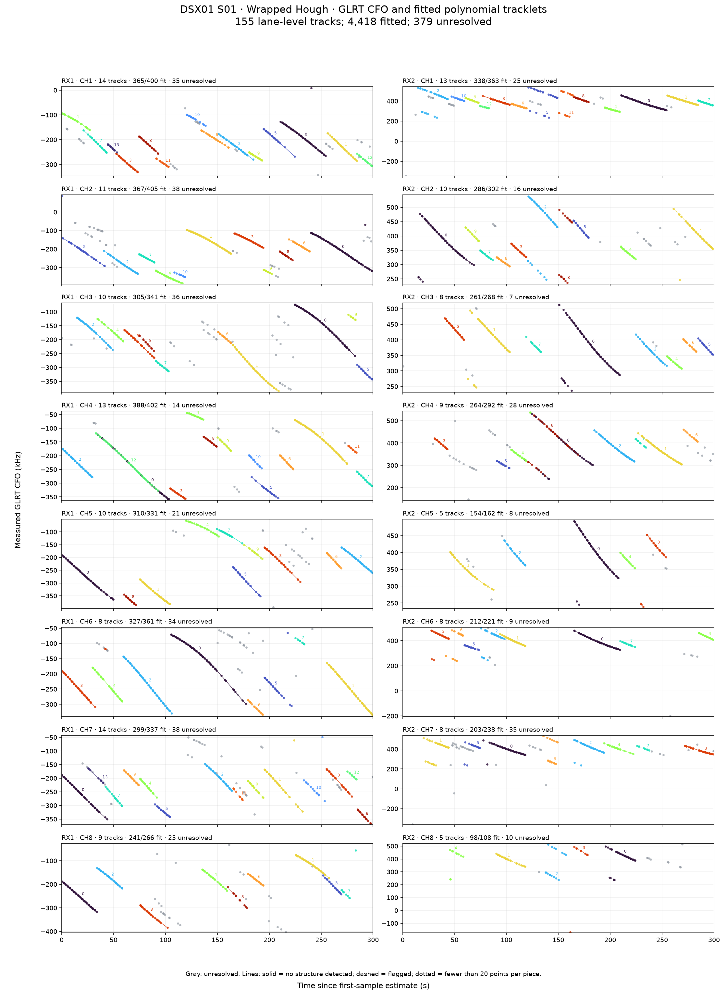

Source: [reports/2026_10_17_dsx01_full_data_tuning/hough/associations.png](../2026_10_17_dsx01_full_data_tuning/hough/associations.png). [PDF](../2026_10_17_dsx01_full_data_tuning/hough/associations.pdf). Frozen DSX01 observations; panel labels specify the population and stage. GLRT views use seconds and kHz; residual and RMS views use Hz; comparison plots show counts, fractions, or runtimes as labeled. These are fitted curve and sensitivity diagnostics, without spacecraft identity labels.

### Figure 36 hough residuals

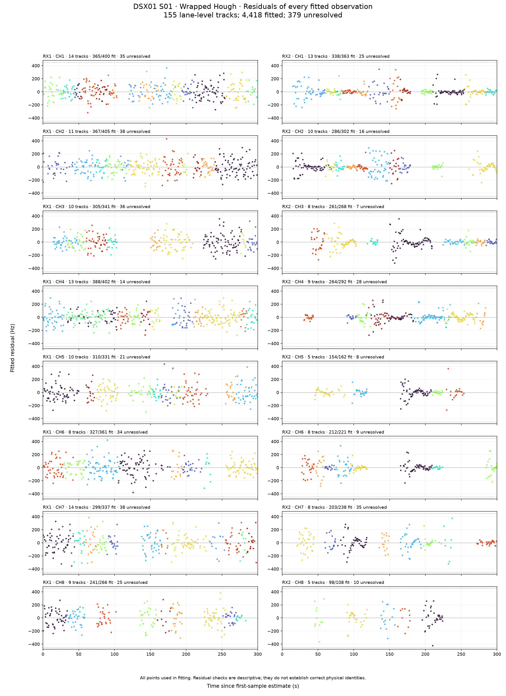

Source: [reports/2026_10_17_dsx01_full_data_tuning/hough/residuals.png](../2026_10_17_dsx01_full_data_tuning/hough/residuals.png). [PDF](../2026_10_17_dsx01_full_data_tuning/hough/residuals.pdf). Frozen DSX01 observations; panel labels specify the population and stage. GLRT views use seconds and kHz; residual and RMS views use Hz; comparison plots show counts, fractions, or runtimes as labeled. These are fitted curve and sensitivity diagnostics, without spacecraft identity labels.

### Figure 37 hough supported

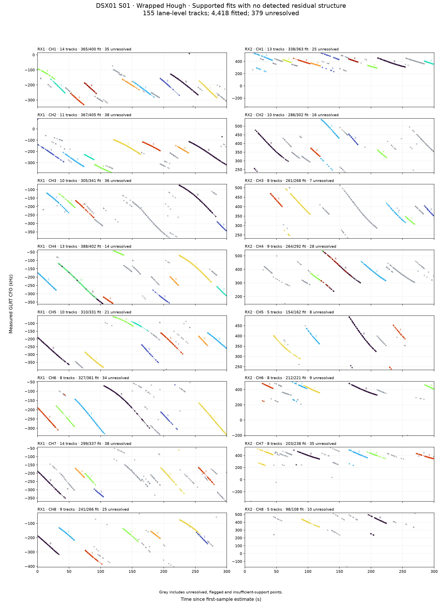

Source: [reports/2026_10_17_dsx01_full_data_tuning/hough/supported.png](../2026_10_17_dsx01_full_data_tuning/hough/supported.png). [PDF](../2026_10_17_dsx01_full_data_tuning/hough/supported.pdf). Frozen DSX01 observations; panel labels specify the population and stage. GLRT views use seconds and kHz; residual and RMS views use Hz; comparison plots show counts, fractions, or runtimes as labeled. These are fitted curve and sensitivity diagnostics, without spacecraft identity labels.

### Figure 38 hough unassociated

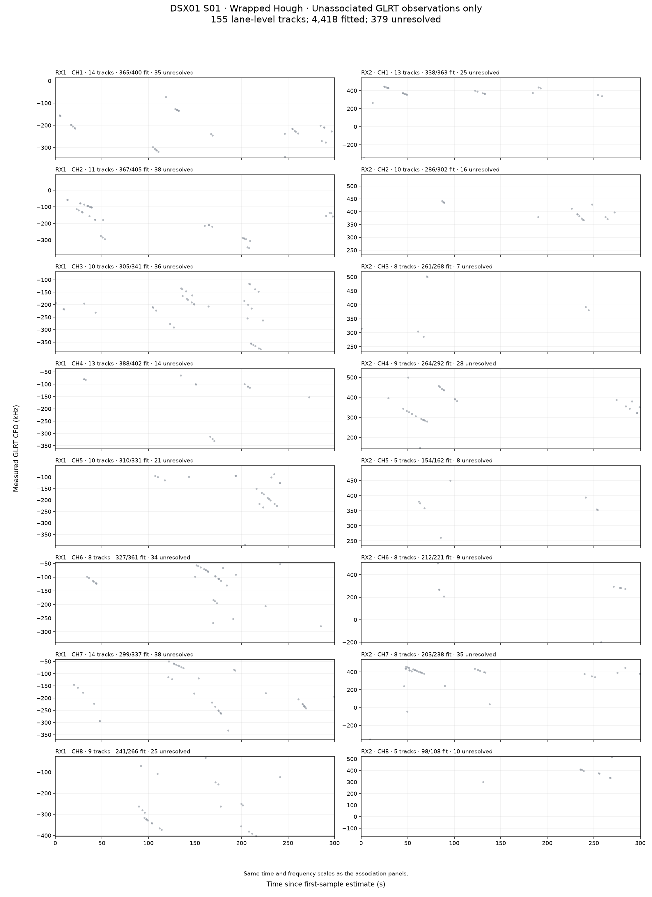

Source: [reports/2026_10_17_dsx01_full_data_tuning/hough/unassociated.png](../2026_10_17_dsx01_full_data_tuning/hough/unassociated.png). [PDF](../2026_10_17_dsx01_full_data_tuning/hough/unassociated.pdf). Frozen DSX01 observations; panel labels specify the population and stage. GLRT views use seconds and kHz; residual and RMS views use Hz; comparison plots show counts, fractions, or runtimes as labeled. These are fitted curve and sensitivity diagnostics, without spacecraft identity labels.

### Figure 39 mht associations

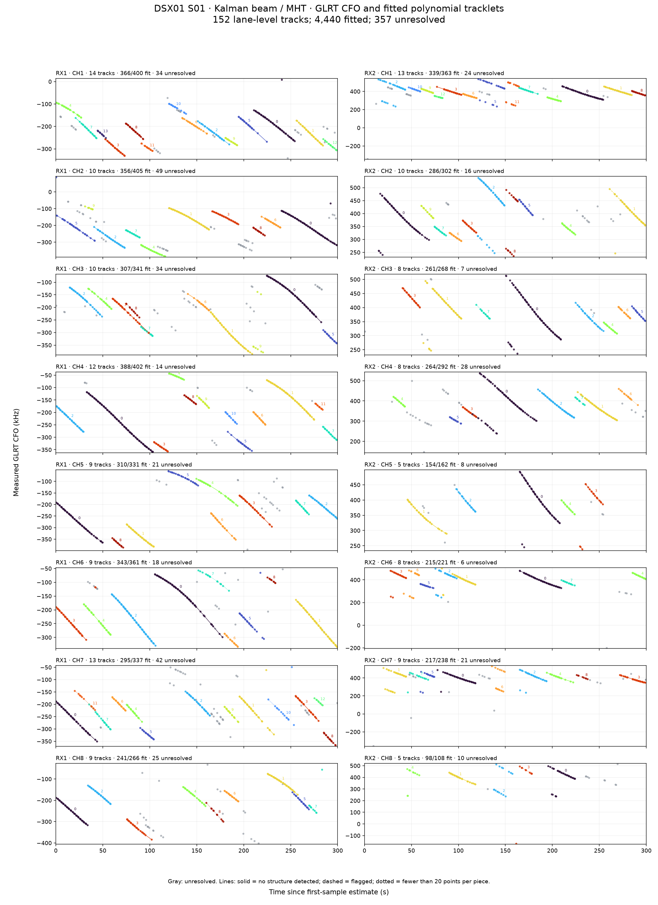

Source: [reports/2026_10_17_dsx01_full_data_tuning/mht/associations.png](../2026_10_17_dsx01_full_data_tuning/mht/associations.png). [PDF](../2026_10_17_dsx01_full_data_tuning/mht/associations.pdf). Frozen DSX01 observations; panel labels specify the population and stage. GLRT views use seconds and kHz; residual and RMS views use Hz; comparison plots show counts, fractions, or runtimes as labeled. These are fitted curve and sensitivity diagnostics, without spacecraft identity labels.

### Figure 40 mht residuals

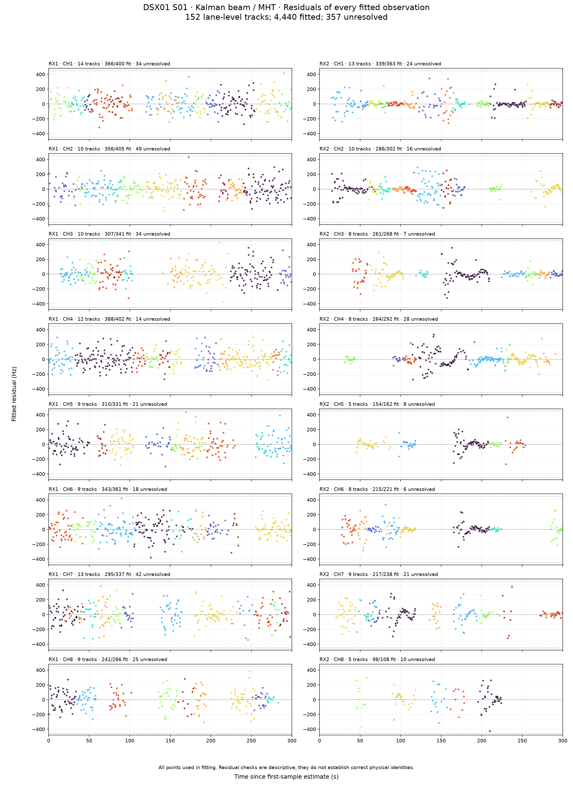

Source: [reports/2026_10_17_dsx01_full_data_tuning/mht/residuals.png](../2026_10_17_dsx01_full_data_tuning/mht/residuals.png). [PDF](../2026_10_17_dsx01_full_data_tuning/mht/residuals.pdf). Frozen DSX01 observations; panel labels specify the population and stage. GLRT views use seconds and kHz; residual and RMS views use Hz; comparison plots show counts, fractions, or runtimes as labeled. These are fitted curve and sensitivity diagnostics, without spacecraft identity labels.

### Figure 41 mht supported

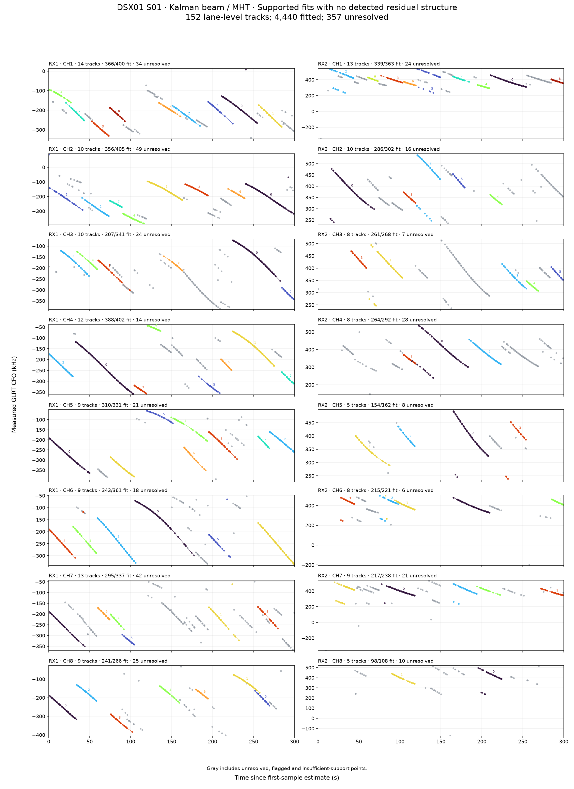

Source: [reports/2026_10_17_dsx01_full_data_tuning/mht/supported.png](../2026_10_17_dsx01_full_data_tuning/mht/supported.png). [PDF](../2026_10_17_dsx01_full_data_tuning/mht/supported.pdf). Frozen DSX01 observations; panel labels specify the population and stage. GLRT views use seconds and kHz; residual and RMS views use Hz; comparison plots show counts, fractions, or runtimes as labeled. These are fitted curve and sensitivity diagnostics, without spacecraft identity labels.

### Figure 42 mht unassociated

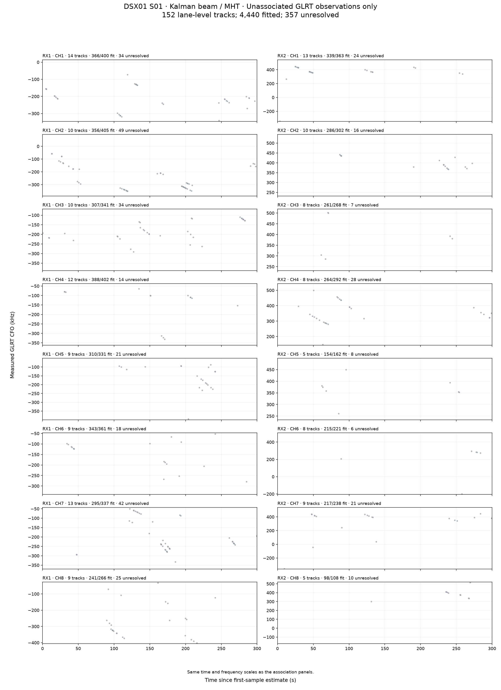

Source: [reports/2026_10_17_dsx01_full_data_tuning/mht/unassociated.png](../2026_10_17_dsx01_full_data_tuning/mht/unassociated.png). [PDF](../2026_10_17_dsx01_full_data_tuning/mht/unassociated.pdf). Frozen DSX01 observations; panel labels specify the population and stage. GLRT views use seconds and kHz; residual and RMS views use Hz; comparison plots show counts, fractions, or runtimes as labeled. These are fitted curve and sensitivity diagnostics, without spacecraft identity labels.

### Figure 43 pairwise similarity

Source: [reports/2026_10_17_dsx01_full_data_tuning/pairwise/similarity.png](../2026_10_17_dsx01_full_data_tuning/pairwise/similarity.png). [PDF](../2026_10_17_dsx01_full_data_tuning/pairwise/similarity.pdf). Frozen DSX01 observations; panel labels specify the population and stage. GLRT views use seconds and kHz; residual and RMS views use Hz; comparison plots show counts, fractions, or runtimes as labeled. These are fitted curve and sensitivity diagnostics, without spacecraft identity labels.

### Figure 44 2026_10_17_dsx01_random_holdout comparison

Source: [reports/2026_10_17_dsx01_random_holdout/comparison.png](../2026_10_17_dsx01_random_holdout/comparison.png). [PDF](../2026_10_17_dsx01_random_holdout/comparison.pdf). Frozen DSX01 observations; panel labels specify the population and stage. GLRT views use seconds and kHz; residual and RMS views use Hz; comparison plots show counts, fractions, or runtimes as labeled. These are fitted curve and sensitivity diagnostics, without spacecraft identity labels.

### Figure 45 baseline recovered-leftovers

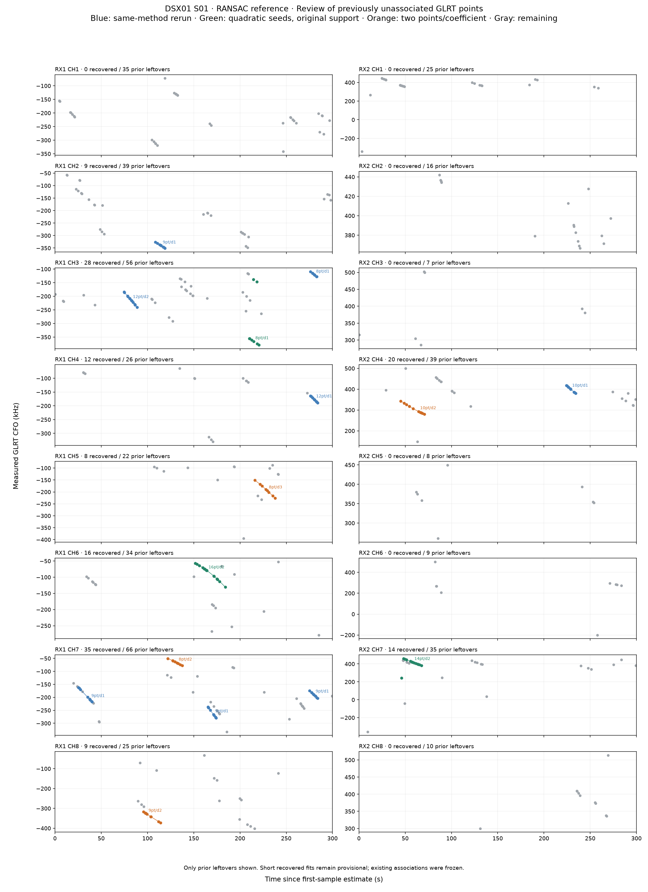

Source: [reports/2026_10_17_dsx01_residual_review/baseline/recovered-leftovers.png](../2026_10_17_dsx01_residual_review/baseline/recovered-leftovers.png). [PDF](../2026_10_17_dsx01_residual_review/baseline/recovered-leftovers.pdf). Frozen DSX01 observations; panel labels specify the population and stage. GLRT views use seconds and kHz; residual and RMS views use Hz; comparison plots show counts, fractions, or runtimes as labeled. These are fitted curve and sensitivity diagnostics, without spacecraft identity labels.

### Figure 46 em recovered-leftovers

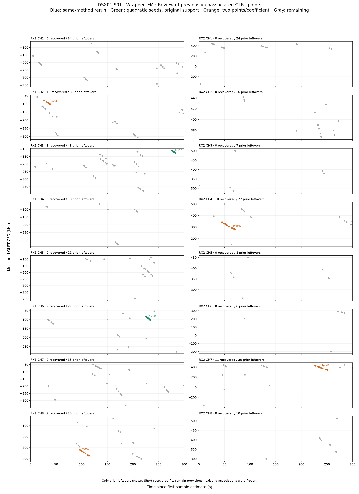

Source: [reports/2026_10_17_dsx01_residual_review/em/recovered-leftovers.png](../2026_10_17_dsx01_residual_review/em/recovered-leftovers.png). [PDF](../2026_10_17_dsx01_residual_review/em/recovered-leftovers.pdf). Frozen DSX01 observations; panel labels specify the population and stage. GLRT views use seconds and kHz; residual and RMS views use Hz; comparison plots show counts, fractions, or runtimes as labeled. These are fitted curve and sensitivity diagnostics, without spacecraft identity labels.

### Figure 47 graph recovered-leftovers

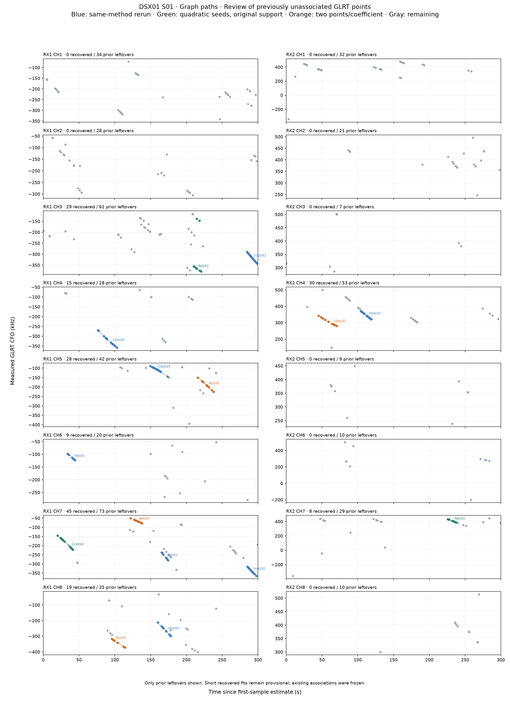

Source: [reports/2026_10_17_dsx01_residual_review/graph/recovered-leftovers.png](../2026_10_17_dsx01_residual_review/graph/recovered-leftovers.png). [PDF](../2026_10_17_dsx01_residual_review/graph/recovered-leftovers.pdf). Frozen DSX01 observations; panel labels specify the population and stage. GLRT views use seconds and kHz; residual and RMS views use Hz; comparison plots show counts, fractions, or runtimes as labeled. These are fitted curve and sensitivity diagnostics, without spacecraft identity labels.

### Figure 48 hough recovered-leftovers

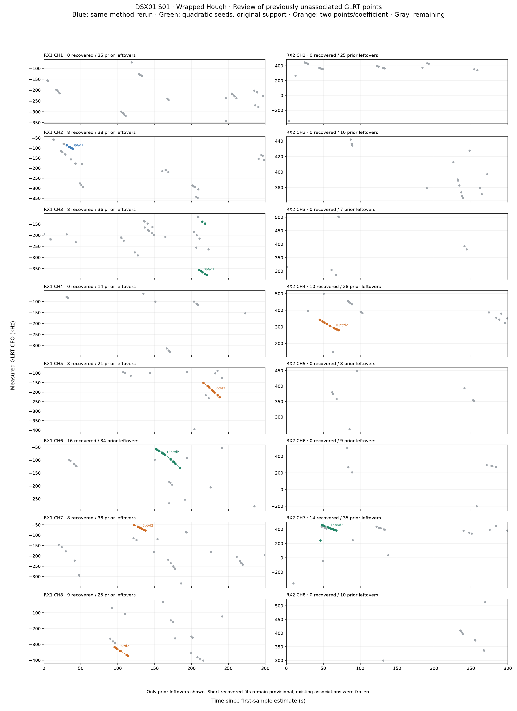

Source: [reports/2026_10_17_dsx01_residual_review/hough/recovered-leftovers.png](../2026_10_17_dsx01_residual_review/hough/recovered-leftovers.png). [PDF](../2026_10_17_dsx01_residual_review/hough/recovered-leftovers.pdf). Frozen DSX01 observations; panel labels specify the population and stage. GLRT views use seconds and kHz; residual and RMS views use Hz; comparison plots show counts, fractions, or runtimes as labeled. These are fitted curve and sensitivity diagnostics, without spacecraft identity labels.

### Figure 49 mht recovered-leftovers

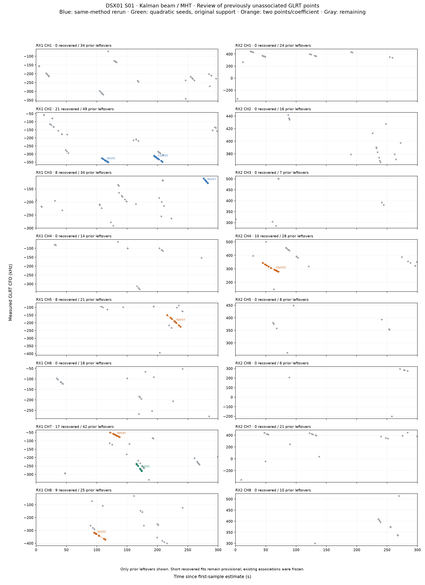

Source: [reports/2026_10_17_dsx01_residual_review/mht/recovered-leftovers.png](../2026_10_17_dsx01_residual_review/mht/recovered-leftovers.png). [PDF](../2026_10_17_dsx01_residual_review/mht/recovered-leftovers.pdf). Frozen DSX01 observations; panel labels specify the population and stage. GLRT views use seconds and kHz; residual and RMS views use Hz; comparison plots show counts, fractions, or runtimes as labeled. These are fitted curve and sensitivity diagnostics, without spacecraft identity labels.

### Figure 50 2026_10_17_dsx01_residual_review reviewed-fragments

Source: [reports/2026_10_17_dsx01_residual_review/reviewed-fragments.png](../2026_10_17_dsx01_residual_review/reviewed-fragments.png). [PDF](../2026_10_17_dsx01_residual_review/reviewed-fragments.pdf). Frozen DSX01 observations; panel labels specify the population and stage. GLRT views use seconds and kHz; residual and RMS views use Hz; comparison plots show counts, fractions, or runtimes as labeled. These are fitted curve and sensitivity diagnostics, without spacecraft identity labels.

### Figure 51 baseline associations

Source: [reports/2026_10_17_dsx01_residual_review/track-plots/baseline/associations.png](../2026_10_17_dsx01_residual_review/track-plots/baseline/associations.png). [PDF](../2026_10_17_dsx01_residual_review/track-plots/baseline/associations.pdf). Frozen DSX01 observations; panel labels specify the population and stage. GLRT views use seconds and kHz; residual and RMS views use Hz; comparison plots show counts, fractions, or runtimes as labeled. These are fitted curve and sensitivity diagnostics, without spacecraft identity labels.

### Figure 52 baseline track-rms

Source: [reports/2026_10_17_dsx01_residual_review/track-plots/baseline/track-rms.png](../2026_10_17_dsx01_residual_review/track-plots/baseline/track-rms.png). [PDF](../2026_10_17_dsx01_residual_review/track-plots/baseline/track-rms.pdf). Frozen DSX01 observations; panel labels specify the population and stage. GLRT views use seconds and kHz; residual and RMS views use Hz; comparison plots show counts, fractions, or runtimes as labeled. These are fitted curve and sensitivity diagnostics, without spacecraft identity labels.

### Figure 53 baseline unassociated

Source: [reports/2026_10_17_dsx01_residual_review/track-plots/baseline/unassociated.png](../2026_10_17_dsx01_residual_review/track-plots/baseline/unassociated.png). [PDF](../2026_10_17_dsx01_residual_review/track-plots/baseline/unassociated.pdf). Frozen DSX01 observations; panel labels specify the population and stage. GLRT views use seconds and kHz; residual and RMS views use Hz; comparison plots show counts, fractions, or runtimes as labeled. These are fitted curve and sensitivity diagnostics, without spacecraft identity labels.

### Figure 54 em associations

Source: [reports/2026_10_17_dsx01_residual_review/track-plots/em/associations.png](../2026_10_17_dsx01_residual_review/track-plots/em/associations.png). [PDF](../2026_10_17_dsx01_residual_review/track-plots/em/associations.pdf). Frozen DSX01 observations; panel labels specify the population and stage. GLRT views use seconds and kHz; residual and RMS views use Hz; comparison plots show counts, fractions, or runtimes as labeled. These are fitted curve and sensitivity diagnostics, without spacecraft identity labels.

### Figure 55 em track-rms

Source: [reports/2026_10_17_dsx01_residual_review/track-plots/em/track-rms.png](../2026_10_17_dsx01_residual_review/track-plots/em/track-rms.png). [PDF](../2026_10_17_dsx01_residual_review/track-plots/em/track-rms.pdf). Frozen DSX01 observations; panel labels specify the population and stage. GLRT views use seconds and kHz; residual and RMS views use Hz; comparison plots show counts, fractions, or runtimes as labeled. These are fitted curve and sensitivity diagnostics, without spacecraft identity labels.

### Figure 56 em unassociated

Source: [reports/2026_10_17_dsx01_residual_review/track-plots/em/unassociated.png](../2026_10_17_dsx01_residual_review/track-plots/em/unassociated.png). [PDF](../2026_10_17_dsx01_residual_review/track-plots/em/unassociated.pdf). Frozen DSX01 observations; panel labels specify the population and stage. GLRT views use seconds and kHz; residual and RMS views use Hz; comparison plots show counts, fractions, or runtimes as labeled. These are fitted curve and sensitivity diagnostics, without spacecraft identity labels.

### Figure 57 graph associations

Source: [reports/2026_10_17_dsx01_residual_review/track-plots/graph/associations.png](../2026_10_17_dsx01_residual_review/track-plots/graph/associations.png). [PDF](../2026_10_17_dsx01_residual_review/track-plots/graph/associations.pdf). Frozen DSX01 observations; panel labels specify the population and stage. GLRT views use seconds and kHz; residual and RMS views use Hz; comparison plots show counts, fractions, or runtimes as labeled. These are fitted curve and sensitivity diagnostics, without spacecraft identity labels.

### Figure 58 graph track-rms

Source: [reports/2026_10_17_dsx01_residual_review/track-plots/graph/track-rms.png](../2026_10_17_dsx01_residual_review/track-plots/graph/track-rms.png). [PDF](../2026_10_17_dsx01_residual_review/track-plots/graph/track-rms.pdf). Frozen DSX01 observations; panel labels specify the population and stage. GLRT views use seconds and kHz; residual and RMS views use Hz; comparison plots show counts, fractions, or runtimes as labeled. These are fitted curve and sensitivity diagnostics, without spacecraft identity labels.

### Figure 59 graph unassociated

Source: [reports/2026_10_17_dsx01_residual_review/track-plots/graph/unassociated.png](../2026_10_17_dsx01_residual_review/track-plots/graph/unassociated.png). [PDF](../2026_10_17_dsx01_residual_review/track-plots/graph/unassociated.pdf). Frozen DSX01 observations; panel labels specify the population and stage. GLRT views use seconds and kHz; residual and RMS views use Hz; comparison plots show counts, fractions, or runtimes as labeled. These are fitted curve and sensitivity diagnostics, without spacecraft identity labels.

### Figure 60 hough associations

Source: [reports/2026_10_17_dsx01_residual_review/track-plots/hough/associations.png](../2026_10_17_dsx01_residual_review/track-plots/hough/associations.png). [PDF](../2026_10_17_dsx01_residual_review/track-plots/hough/associations.pdf). Frozen DSX01 observations; panel labels specify the population and stage. GLRT views use seconds and kHz; residual and RMS views use Hz; comparison plots show counts, fractions, or runtimes as labeled. These are fitted curve and sensitivity diagnostics, without spacecraft identity labels.

### Figure 61 hough track-rms

Source: [reports/2026_10_17_dsx01_residual_review/track-plots/hough/track-rms.png](../2026_10_17_dsx01_residual_review/track-plots/hough/track-rms.png). [PDF](../2026_10_17_dsx01_residual_review/track-plots/hough/track-rms.pdf). Frozen DSX01 observations; panel labels specify the population and stage. GLRT views use seconds and kHz; residual and RMS views use Hz; comparison plots show counts, fractions, or runtimes as labeled. These are fitted curve and sensitivity diagnostics, without spacecraft identity labels.

### Figure 62 hough unassociated

Source: [reports/2026_10_17_dsx01_residual_review/track-plots/hough/unassociated.png](../2026_10_17_dsx01_residual_review/track-plots/hough/unassociated.png). [PDF](../2026_10_17_dsx01_residual_review/track-plots/hough/unassociated.pdf). Frozen DSX01 observations; panel labels specify the population and stage. GLRT views use seconds and kHz; residual and RMS views use Hz; comparison plots show counts, fractions, or runtimes as labeled. These are fitted curve and sensitivity diagnostics, without spacecraft identity labels.

### Figure 63 mht associations

Source: [reports/2026_10_17_dsx01_residual_review/track-plots/mht/associations.png](../2026_10_17_dsx01_residual_review/track-plots/mht/associations.png). [PDF](../2026_10_17_dsx01_residual_review/track-plots/mht/associations.pdf). Frozen DSX01 observations; panel labels specify the population and stage. GLRT views use seconds and kHz; residual and RMS views use Hz; comparison plots show counts, fractions, or runtimes as labeled. These are fitted curve and sensitivity diagnostics, without spacecraft identity labels.

### Figure 64 mht track-rms

Source: [reports/2026_10_17_dsx01_residual_review/track-plots/mht/track-rms.png](../2026_10_17_dsx01_residual_review/track-plots/mht/track-rms.png). [PDF](../2026_10_17_dsx01_residual_review/track-plots/mht/track-rms.pdf). Frozen DSX01 observations; panel labels specify the population and stage. GLRT views use seconds and kHz; residual and RMS views use Hz; comparison plots show counts, fractions, or runtimes as labeled. These are fitted curve and sensitivity diagnostics, without spacecraft identity labels.

### Figure 65 mht unassociated

Source: [reports/2026_10_17_dsx01_residual_review/track-plots/mht/unassociated.png](../2026_10_17_dsx01_residual_review/track-plots/mht/unassociated.png). [PDF](../2026_10_17_dsx01_residual_review/track-plots/mht/unassociated.pdf). Frozen DSX01 observations; panel labels specify the population and stage. GLRT views use seconds and kHz; residual and RMS views use Hz; comparison plots show counts, fractions, or runtimes as labeled. These are fitted curve and sensitivity diagnostics, without spacecraft identity labels.

## Exported tables

- [reports/2026_10_16_dsx01_fast_association_losses/membership.csv](../2026_10_16_dsx01_fast_association_losses/membership.csv)
- [reports/2026_10_16_dsx01_fast_association_losses/regions.csv](../2026_10_16_dsx01_fast_association_losses/regions.csv)
- [reports/2026_10_17_dsx01_four_methods/baseline/assignments.csv](../2026_10_17_dsx01_four_methods/baseline/assignments.csv)
- [reports/2026_10_17_dsx01_four_methods/baseline/lanes.csv](../2026_10_17_dsx01_four_methods/baseline/lanes.csv)
- [reports/2026_10_17_dsx01_four_methods/comparison.csv](../2026_10_17_dsx01_four_methods/comparison.csv)
- [reports/2026_10_17_dsx01_four_methods/coverage-agreement.csv](../2026_10_17_dsx01_four_methods/coverage-agreement.csv)
- [reports/2026_10_17_dsx01_four_methods/em/assignments.csv](../2026_10_17_dsx01_four_methods/em/assignments.csv)
- [reports/2026_10_17_dsx01_four_methods/em/lanes.csv](../2026_10_17_dsx01_four_methods/em/lanes.csv)
- [reports/2026_10_17_dsx01_four_methods/graph/assignments.csv](../2026_10_17_dsx01_four_methods/graph/assignments.csv)
- [reports/2026_10_17_dsx01_four_methods/graph/lanes.csv](../2026_10_17_dsx01_four_methods/graph/lanes.csv)
- [reports/2026_10_17_dsx01_four_methods/graph-development/assignments.csv](../2026_10_17_dsx01_four_methods/graph-development/assignments.csv)
- [reports/2026_10_17_dsx01_four_methods/graph-development/lanes.csv](../2026_10_17_dsx01_four_methods/graph-development/lanes.csv)
- [reports/2026_10_17_dsx01_four_methods/hough/assignments.csv](../2026_10_17_dsx01_four_methods/hough/assignments.csv)
- [reports/2026_10_17_dsx01_four_methods/hough/lanes.csv](../2026_10_17_dsx01_four_methods/hough/lanes.csv)
- [reports/2026_10_17_dsx01_four_methods/hough-development/assignments.csv](../2026_10_17_dsx01_four_methods/hough-development/assignments.csv)
- [reports/2026_10_17_dsx01_four_methods/hough-development/lanes.csv](../2026_10_17_dsx01_four_methods/hough-development/lanes.csv)
- [reports/2026_10_17_dsx01_four_methods/mht/assignments.csv](../2026_10_17_dsx01_four_methods/mht/assignments.csv)
- [reports/2026_10_17_dsx01_four_methods/mht/lanes.csv](../2026_10_17_dsx01_four_methods/mht/lanes.csv)
- [reports/2026_10_17_dsx01_four_methods/mht-development/assignments.csv](../2026_10_17_dsx01_four_methods/mht-development/assignments.csv)
- [reports/2026_10_17_dsx01_four_methods/mht-development/lanes.csv](../2026_10_17_dsx01_four_methods/mht-development/lanes.csv)
- [reports/2026_10_17_dsx01_full_data_tuning/baseline/trials/base/assignments.csv](../2026_10_17_dsx01_full_data_tuning/baseline/trials/base/assignments.csv)
- [reports/2026_10_17_dsx01_full_data_tuning/baseline/trials/base/lanes.csv](../2026_10_17_dsx01_full_data_tuning/baseline/trials/base/lanes.csv)
- [reports/2026_10_17_dsx01_full_data_tuning/baseline/trials/degree3/assignments.csv](../2026_10_17_dsx01_full_data_tuning/baseline/trials/degree3/assignments.csv)
- [reports/2026_10_17_dsx01_full_data_tuning/baseline/trials/degree3/lanes.csv](../2026_10_17_dsx01_full_data_tuning/baseline/trials/degree3/lanes.csv)
- [reports/2026_10_17_dsx01_full_data_tuning/baseline/trials/penalty10/assignments.csv](../2026_10_17_dsx01_full_data_tuning/baseline/trials/penalty10/assignments.csv)
- [reports/2026_10_17_dsx01_full_data_tuning/baseline/trials/penalty10/lanes.csv](../2026_10_17_dsx01_full_data_tuning/baseline/trials/penalty10/lanes.csv)
- [reports/2026_10_17_dsx01_full_data_tuning/baseline/trials/seed1702/assignments.csv](../2026_10_17_dsx01_full_data_tuning/baseline/trials/seed1702/assignments.csv)
- [reports/2026_10_17_dsx01_full_data_tuning/baseline/trials/seed1702/lanes.csv](../2026_10_17_dsx01_full_data_tuning/baseline/trials/seed1702/lanes.csv)
- [reports/2026_10_17_dsx01_full_data_tuning/baseline/trials/slope12000/assignments.csv](../2026_10_17_dsx01_full_data_tuning/baseline/trials/slope12000/assignments.csv)
- [reports/2026_10_17_dsx01_full_data_tuning/baseline/trials/slope12000/lanes.csv](../2026_10_17_dsx01_full_data_tuning/baseline/trials/slope12000/lanes.csv)
- [reports/2026_10_17_dsx01_full_data_tuning/baseline/trials/slope12000-penalty10/assignments.csv](../2026_10_17_dsx01_full_data_tuning/baseline/trials/slope12000-penalty10/assignments.csv)
- [reports/2026_10_17_dsx01_full_data_tuning/baseline/trials/slope12000-penalty10/lanes.csv](../2026_10_17_dsx01_full_data_tuning/baseline/trials/slope12000-penalty10/lanes.csv)
- [reports/2026_10_17_dsx01_full_data_tuning/baseline/trials/slope16000/assignments.csv](../2026_10_17_dsx01_full_data_tuning/baseline/trials/slope16000/assignments.csv)
- [reports/2026_10_17_dsx01_full_data_tuning/baseline/trials/slope16000/lanes.csv](../2026_10_17_dsx01_full_data_tuning/baseline/trials/slope16000/lanes.csv)
- [reports/2026_10_17_dsx01_full_data_tuning/baseline/trials/slope16000-penalty6/assignments.csv](../2026_10_17_dsx01_full_data_tuning/baseline/trials/slope16000-penalty6/assignments.csv)
- [reports/2026_10_17_dsx01_full_data_tuning/baseline/trials/slope16000-penalty6/lanes.csv](../2026_10_17_dsx01_full_data_tuning/baseline/trials/slope16000-penalty6/lanes.csv)
- [reports/2026_10_17_dsx01_full_data_tuning/baseline/unassociated.csv](../2026_10_17_dsx01_full_data_tuning/baseline/unassociated.csv)
- [reports/2026_10_17_dsx01_full_data_tuning/comparison.csv](../2026_10_17_dsx01_full_data_tuning/comparison.csv)
- [reports/2026_10_17_dsx01_full_data_tuning/em/maximum-coverage/unassociated.csv](../2026_10_17_dsx01_full_data_tuning/em/maximum-coverage/unassociated.csv)
- [reports/2026_10_17_dsx01_full_data_tuning/em/selected-shuffled-control/assignments.csv](../2026_10_17_dsx01_full_data_tuning/em/selected-shuffled-control/assignments.csv)
- [reports/2026_10_17_dsx01_full_data_tuning/em/selected-shuffled-control/lanes.csv](../2026_10_17_dsx01_full_data_tuning/em/selected-shuffled-control/lanes.csv)
- [reports/2026_10_17_dsx01_full_data_tuning/em/trials/slope08000-pen18-degree4/assignments.csv](../2026_10_17_dsx01_full_data_tuning/em/trials/slope08000-pen18-degree4/assignments.csv)
- [reports/2026_10_17_dsx01_full_data_tuning/em/trials/slope08000-pen18-degree4/lanes.csv](../2026_10_17_dsx01_full_data_tuning/em/trials/slope08000-pen18-degree4/lanes.csv)
- [reports/2026_10_17_dsx01_full_data_tuning/em/trials/slope08000-pen26-degree4/assignments.csv](../2026_10_17_dsx01_full_data_tuning/em/trials/slope08000-pen26-degree4/assignments.csv)
- [reports/2026_10_17_dsx01_full_data_tuning/em/trials/slope08000-pen26-degree4/lanes.csv](../2026_10_17_dsx01_full_data_tuning/em/trials/slope08000-pen26-degree4/lanes.csv)
- [reports/2026_10_17_dsx01_full_data_tuning/em/trials/slope08000-pen36-degree4/assignments.csv](../2026_10_17_dsx01_full_data_tuning/em/trials/slope08000-pen36-degree4/assignments.csv)
- [reports/2026_10_17_dsx01_full_data_tuning/em/trials/slope08000-pen36-degree4/lanes.csv](../2026_10_17_dsx01_full_data_tuning/em/trials/slope08000-pen36-degree4/lanes.csv)
- [reports/2026_10_17_dsx01_full_data_tuning/em/trials/slope08000-pen48-degree4/assignments.csv](../2026_10_17_dsx01_full_data_tuning/em/trials/slope08000-pen48-degree4/assignments.csv)
- [reports/2026_10_17_dsx01_full_data_tuning/em/trials/slope08000-pen48-degree4/lanes.csv](../2026_10_17_dsx01_full_data_tuning/em/trials/slope08000-pen48-degree4/lanes.csv)
- [reports/2026_10_17_dsx01_full_data_tuning/em/trials/slope08000-pen64-degree4/assignments.csv](../2026_10_17_dsx01_full_data_tuning/em/trials/slope08000-pen64-degree4/assignments.csv)
- [reports/2026_10_17_dsx01_full_data_tuning/em/trials/slope08000-pen64-degree4/lanes.csv](../2026_10_17_dsx01_full_data_tuning/em/trials/slope08000-pen64-degree4/lanes.csv)
- [reports/2026_10_17_dsx01_full_data_tuning/em/trials/slope12000-pen06-degree4/assignments.csv](../2026_10_17_dsx01_full_data_tuning/em/trials/slope12000-pen06-degree4/assignments.csv)
- [reports/2026_10_17_dsx01_full_data_tuning/em/trials/slope12000-pen06-degree4/lanes.csv](../2026_10_17_dsx01_full_data_tuning/em/trials/slope12000-pen06-degree4/lanes.csv)
- [reports/2026_10_17_dsx01_full_data_tuning/em/trials/slope12000-pen10-degree3/assignments.csv](../2026_10_17_dsx01_full_data_tuning/em/trials/slope12000-pen10-degree3/assignments.csv)
- [reports/2026_10_17_dsx01_full_data_tuning/em/trials/slope12000-pen10-degree3/lanes.csv](../2026_10_17_dsx01_full_data_tuning/em/trials/slope12000-pen10-degree3/lanes.csv)
- [reports/2026_10_17_dsx01_full_data_tuning/em/trials/slope12000-pen10-degree4/assignments.csv](../2026_10_17_dsx01_full_data_tuning/em/trials/slope12000-pen10-degree4/assignments.csv)
- [reports/2026_10_17_dsx01_full_data_tuning/em/trials/slope12000-pen10-degree4/lanes.csv](../2026_10_17_dsx01_full_data_tuning/em/trials/slope12000-pen10-degree4/lanes.csv)
- [reports/2026_10_17_dsx01_full_data_tuning/em/trials/slope12000-pen10-degree4-seed1702/assignments.csv](../2026_10_17_dsx01_full_data_tuning/em/trials/slope12000-pen10-degree4-seed1702/assignments.csv)
- [reports/2026_10_17_dsx01_full_data_tuning/em/trials/slope12000-pen10-degree4-seed1702/lanes.csv](../2026_10_17_dsx01_full_data_tuning/em/trials/slope12000-pen10-degree4-seed1702/lanes.csv)
- [reports/2026_10_17_dsx01_full_data_tuning/em/trials/slope12000-pen18-degree4/assignments.csv](../2026_10_17_dsx01_full_data_tuning/em/trials/slope12000-pen18-degree4/assignments.csv)
- [reports/2026_10_17_dsx01_full_data_tuning/em/trials/slope12000-pen18-degree4/lanes.csv](../2026_10_17_dsx01_full_data_tuning/em/trials/slope12000-pen18-degree4/lanes.csv)
- [reports/2026_10_17_dsx01_full_data_tuning/em/trials/slope16000-pen10-degree4/assignments.csv](../2026_10_17_dsx01_full_data_tuning/em/trials/slope16000-pen10-degree4/assignments.csv)
- [reports/2026_10_17_dsx01_full_data_tuning/em/trials/slope16000-pen10-degree4/lanes.csv](../2026_10_17_dsx01_full_data_tuning/em/trials/slope16000-pen10-degree4/lanes.csv)
- [reports/2026_10_17_dsx01_full_data_tuning/em/trials/slope16000-pen18-degree4/assignments.csv](../2026_10_17_dsx01_full_data_tuning/em/trials/slope16000-pen18-degree4/assignments.csv)
- [reports/2026_10_17_dsx01_full_data_tuning/em/trials/slope16000-pen18-degree4/lanes.csv](../2026_10_17_dsx01_full_data_tuning/em/trials/slope16000-pen18-degree4/lanes.csv)
- [reports/2026_10_17_dsx01_full_data_tuning/em/unassociated.csv](../2026_10_17_dsx01_full_data_tuning/em/unassociated.csv)
- [reports/2026_10_17_dsx01_full_data_tuning/graph/trials/base/assignments.csv](../2026_10_17_dsx01_full_data_tuning/graph/trials/base/assignments.csv)
- [reports/2026_10_17_dsx01_full_data_tuning/graph/trials/base/lanes.csv](../2026_10_17_dsx01_full_data_tuning/graph/trials/base/lanes.csv)
- [reports/2026_10_17_dsx01_full_data_tuning/graph/trials/penalty10/assignments.csv](../2026_10_17_dsx01_full_data_tuning/graph/trials/penalty10/assignments.csv)
- [reports/2026_10_17_dsx01_full_data_tuning/graph/trials/penalty10/lanes.csv](../2026_10_17_dsx01_full_data_tuning/graph/trials/penalty10/lanes.csv)
- [reports/2026_10_17_dsx01_full_data_tuning/graph/trials/penalty10-degree3/assignments.csv](../2026_10_17_dsx01_full_data_tuning/graph/trials/penalty10-degree3/assignments.csv)
- [reports/2026_10_17_dsx01_full_data_tuning/graph/trials/penalty10-degree3/lanes.csv](../2026_10_17_dsx01_full_data_tuning/graph/trials/penalty10-degree3/lanes.csv)
- [reports/2026_10_17_dsx01_full_data_tuning/graph/trials/penalty10-gap6/assignments.csv](../2026_10_17_dsx01_full_data_tuning/graph/trials/penalty10-gap6/assignments.csv)
- [reports/2026_10_17_dsx01_full_data_tuning/graph/trials/penalty10-gap6/lanes.csv](../2026_10_17_dsx01_full_data_tuning/graph/trials/penalty10-gap6/lanes.csv)
- [reports/2026_10_17_dsx01_full_data_tuning/graph/trials/penalty10-knot5/assignments.csv](../2026_10_17_dsx01_full_data_tuning/graph/trials/penalty10-knot5/assignments.csv)
- [reports/2026_10_17_dsx01_full_data_tuning/graph/trials/penalty10-knot5/lanes.csv](../2026_10_17_dsx01_full_data_tuning/graph/trials/penalty10-knot5/lanes.csv)
- [reports/2026_10_17_dsx01_full_data_tuning/graph/trials/penalty6/assignments.csv](../2026_10_17_dsx01_full_data_tuning/graph/trials/penalty6/assignments.csv)
- [reports/2026_10_17_dsx01_full_data_tuning/graph/trials/penalty6/lanes.csv](../2026_10_17_dsx01_full_data_tuning/graph/trials/penalty6/lanes.csv)
- [reports/2026_10_17_dsx01_full_data_tuning/graph/trials/slope12000/assignments.csv](../2026_10_17_dsx01_full_data_tuning/graph/trials/slope12000/assignments.csv)
- [reports/2026_10_17_dsx01_full_data_tuning/graph/trials/slope12000/lanes.csv](../2026_10_17_dsx01_full_data_tuning/graph/trials/slope12000/lanes.csv)
- [reports/2026_10_17_dsx01_full_data_tuning/graph/trials/slope12000-penalty10/assignments.csv](../2026_10_17_dsx01_full_data_tuning/graph/trials/slope12000-penalty10/assignments.csv)
- [reports/2026_10_17_dsx01_full_data_tuning/graph/trials/slope12000-penalty10/lanes.csv](../2026_10_17_dsx01_full_data_tuning/graph/trials/slope12000-penalty10/lanes.csv)
- [reports/2026_10_17_dsx01_full_data_tuning/graph/trials/slope12000-penalty10-degree3/assignments.csv](../2026_10_17_dsx01_full_data_tuning/graph/trials/slope12000-penalty10-degree3/assignments.csv)
- [reports/2026_10_17_dsx01_full_data_tuning/graph/trials/slope12000-penalty10-degree3/lanes.csv](../2026_10_17_dsx01_full_data_tuning/graph/trials/slope12000-penalty10-degree3/lanes.csv)
- [reports/2026_10_17_dsx01_full_data_tuning/graph/trials/slope12000-penalty10-knot5/assignments.csv](../2026_10_17_dsx01_full_data_tuning/graph/trials/slope12000-penalty10-knot5/assignments.csv)
- [reports/2026_10_17_dsx01_full_data_tuning/graph/trials/slope12000-penalty10-knot5/lanes.csv](../2026_10_17_dsx01_full_data_tuning/graph/trials/slope12000-penalty10-knot5/lanes.csv)
- [reports/2026_10_17_dsx01_full_data_tuning/graph/trials/slope12000-penalty6/assignments.csv](../2026_10_17_dsx01_full_data_tuning/graph/trials/slope12000-penalty6/assignments.csv)
- [reports/2026_10_17_dsx01_full_data_tuning/graph/trials/slope12000-penalty6/lanes.csv](../2026_10_17_dsx01_full_data_tuning/graph/trials/slope12000-penalty6/lanes.csv)
- [reports/2026_10_17_dsx01_full_data_tuning/graph/trials/slope16000/assignments.csv](../2026_10_17_dsx01_full_data_tuning/graph/trials/slope16000/assignments.csv)
- [reports/2026_10_17_dsx01_full_data_tuning/graph/trials/slope16000/lanes.csv](../2026_10_17_dsx01_full_data_tuning/graph/trials/slope16000/lanes.csv)
- [reports/2026_10_17_dsx01_full_data_tuning/graph/unassociated.csv](../2026_10_17_dsx01_full_data_tuning/graph/unassociated.csv)
- [reports/2026_10_17_dsx01_full_data_tuning/hough/trials/base/assignments.csv](../2026_10_17_dsx01_full_data_tuning/hough/trials/base/assignments.csv)
- [reports/2026_10_17_dsx01_full_data_tuning/hough/trials/base/lanes.csv](../2026_10_17_dsx01_full_data_tuning/hough/trials/base/lanes.csv)
- [reports/2026_10_17_dsx01_full_data_tuning/hough/trials/degree3/assignments.csv](../2026_10_17_dsx01_full_data_tuning/hough/trials/degree3/assignments.csv)
- [reports/2026_10_17_dsx01_full_data_tuning/hough/trials/degree3/lanes.csv](../2026_10_17_dsx01_full_data_tuning/hough/trials/degree3/lanes.csv)
- [reports/2026_10_17_dsx01_full_data_tuning/hough/trials/penalty10/assignments.csv](../2026_10_17_dsx01_full_data_tuning/hough/trials/penalty10/assignments.csv)
- [reports/2026_10_17_dsx01_full_data_tuning/hough/trials/penalty10/lanes.csv](../2026_10_17_dsx01_full_data_tuning/hough/trials/penalty10/lanes.csv)
- [reports/2026_10_17_dsx01_full_data_tuning/hough/trials/seed1702/assignments.csv](../2026_10_17_dsx01_full_data_tuning/hough/trials/seed1702/assignments.csv)
- [reports/2026_10_17_dsx01_full_data_tuning/hough/trials/seed1702/lanes.csv](../2026_10_17_dsx01_full_data_tuning/hough/trials/seed1702/lanes.csv)
- [reports/2026_10_17_dsx01_full_data_tuning/hough/trials/slope12000/assignments.csv](../2026_10_17_dsx01_full_data_tuning/hough/trials/slope12000/assignments.csv)
- [reports/2026_10_17_dsx01_full_data_tuning/hough/trials/slope12000/lanes.csv](../2026_10_17_dsx01_full_data_tuning/hough/trials/slope12000/lanes.csv)
- [reports/2026_10_17_dsx01_full_data_tuning/hough/trials/slope12000-penalty10/assignments.csv](../2026_10_17_dsx01_full_data_tuning/hough/trials/slope12000-penalty10/assignments.csv)
- [reports/2026_10_17_dsx01_full_data_tuning/hough/trials/slope12000-penalty10/lanes.csv](../2026_10_17_dsx01_full_data_tuning/hough/trials/slope12000-penalty10/lanes.csv)
- [reports/2026_10_17_dsx01_full_data_tuning/hough/trials/slope16000/assignments.csv](../2026_10_17_dsx01_full_data_tuning/hough/trials/slope16000/assignments.csv)
- [reports/2026_10_17_dsx01_full_data_tuning/hough/trials/slope16000/lanes.csv](../2026_10_17_dsx01_full_data_tuning/hough/trials/slope16000/lanes.csv)
- [reports/2026_10_17_dsx01_full_data_tuning/hough/trials/slope16000-penalty6/assignments.csv](../2026_10_17_dsx01_full_data_tuning/hough/trials/slope16000-penalty6/assignments.csv)
- [reports/2026_10_17_dsx01_full_data_tuning/hough/trials/slope16000-penalty6/lanes.csv](../2026_10_17_dsx01_full_data_tuning/hough/trials/slope16000-penalty6/lanes.csv)
- [reports/2026_10_17_dsx01_full_data_tuning/hough/unassociated.csv](../2026_10_17_dsx01_full_data_tuning/hough/unassociated.csv)
- [reports/2026_10_17_dsx01_full_data_tuning/mht/trials/trial-01/assignments.csv](../2026_10_17_dsx01_full_data_tuning/mht/trials/trial-01/assignments.csv)
- [reports/2026_10_17_dsx01_full_data_tuning/mht/trials/trial-01/lanes.csv](../2026_10_17_dsx01_full_data_tuning/mht/trials/trial-01/lanes.csv)
- [reports/2026_10_17_dsx01_full_data_tuning/mht/trials/trial-02/assignments.csv](../2026_10_17_dsx01_full_data_tuning/mht/trials/trial-02/assignments.csv)
- [reports/2026_10_17_dsx01_full_data_tuning/mht/trials/trial-02/lanes.csv](../2026_10_17_dsx01_full_data_tuning/mht/trials/trial-02/lanes.csv)
- [reports/2026_10_17_dsx01_full_data_tuning/mht/trials/trial-03/assignments.csv](../2026_10_17_dsx01_full_data_tuning/mht/trials/trial-03/assignments.csv)
- [reports/2026_10_17_dsx01_full_data_tuning/mht/trials/trial-03/lanes.csv](../2026_10_17_dsx01_full_data_tuning/mht/trials/trial-03/lanes.csv)
- [reports/2026_10_17_dsx01_full_data_tuning/mht/trials/trial-04/assignments.csv](../2026_10_17_dsx01_full_data_tuning/mht/trials/trial-04/assignments.csv)
- [reports/2026_10_17_dsx01_full_data_tuning/mht/trials/trial-04/lanes.csv](../2026_10_17_dsx01_full_data_tuning/mht/trials/trial-04/lanes.csv)
- [reports/2026_10_17_dsx01_full_data_tuning/mht/trials/trial-05/assignments.csv](../2026_10_17_dsx01_full_data_tuning/mht/trials/trial-05/assignments.csv)
- [reports/2026_10_17_dsx01_full_data_tuning/mht/trials/trial-05/lanes.csv](../2026_10_17_dsx01_full_data_tuning/mht/trials/trial-05/lanes.csv)
- [reports/2026_10_17_dsx01_full_data_tuning/mht/trials/trial-06/assignments.csv](../2026_10_17_dsx01_full_data_tuning/mht/trials/trial-06/assignments.csv)
- [reports/2026_10_17_dsx01_full_data_tuning/mht/trials/trial-06/lanes.csv](../2026_10_17_dsx01_full_data_tuning/mht/trials/trial-06/lanes.csv)
- [reports/2026_10_17_dsx01_full_data_tuning/mht/trials/trial-07/assignments.csv](../2026_10_17_dsx01_full_data_tuning/mht/trials/trial-07/assignments.csv)
- [reports/2026_10_17_dsx01_full_data_tuning/mht/trials/trial-07/lanes.csv](../2026_10_17_dsx01_full_data_tuning/mht/trials/trial-07/lanes.csv)
- [reports/2026_10_17_dsx01_full_data_tuning/mht/trials/trial-08/assignments.csv](../2026_10_17_dsx01_full_data_tuning/mht/trials/trial-08/assignments.csv)
- [reports/2026_10_17_dsx01_full_data_tuning/mht/trials/trial-08/lanes.csv](../2026_10_17_dsx01_full_data_tuning/mht/trials/trial-08/lanes.csv)
- [reports/2026_10_17_dsx01_full_data_tuning/mht/trials/trial-09/assignments.csv](../2026_10_17_dsx01_full_data_tuning/mht/trials/trial-09/assignments.csv)
- [reports/2026_10_17_dsx01_full_data_tuning/mht/trials/trial-09/lanes.csv](../2026_10_17_dsx01_full_data_tuning/mht/trials/trial-09/lanes.csv)
- [reports/2026_10_17_dsx01_full_data_tuning/mht/unassociated.csv](../2026_10_17_dsx01_full_data_tuning/mht/unassociated.csv)
- [reports/2026_10_17_dsx01_full_data_tuning/pairwise/comparison.csv](../2026_10_17_dsx01_full_data_tuning/pairwise/comparison.csv)
- [reports/2026_10_17_dsx01_full_data_tuning/pairwise/per-lane.csv](../2026_10_17_dsx01_full_data_tuning/pairwise/per-lane.csv)
- [reports/2026_10_17_dsx01_full_data_tuning/pairwise/point-consensus.csv](../2026_10_17_dsx01_full_data_tuning/pairwise/point-consensus.csv)
- [reports/2026_10_17_dsx01_random_holdout/baseline/folds.csv](../2026_10_17_dsx01_random_holdout/baseline/folds.csv)
- [reports/2026_10_17_dsx01_random_holdout/comparison.csv](../2026_10_17_dsx01_random_holdout/comparison.csv)
- [reports/2026_10_17_dsx01_random_holdout/em/folds.csv](../2026_10_17_dsx01_random_holdout/em/folds.csv)
- [reports/2026_10_17_dsx01_random_holdout/folds.csv](../2026_10_17_dsx01_random_holdout/folds.csv)
- [reports/2026_10_17_dsx01_random_holdout/graph/folds.csv](../2026_10_17_dsx01_random_holdout/graph/folds.csv)
- [reports/2026_10_17_dsx01_random_holdout/hough/folds.csv](../2026_10_17_dsx01_random_holdout/hough/folds.csv)
- [reports/2026_10_17_dsx01_random_holdout/mht/folds.csv](../2026_10_17_dsx01_random_holdout/mht/folds.csv)
- [reports/2026_10_17_dsx01_residual_review/baseline/strict/assignments.csv](../2026_10_17_dsx01_residual_review/baseline/strict/assignments.csv)
- [reports/2026_10_17_dsx01_residual_review/baseline/strict/lanes.csv](../2026_10_17_dsx01_residual_review/baseline/strict/lanes.csv)
- [reports/2026_10_17_dsx01_residual_review/baseline/support2/assignments.csv](../2026_10_17_dsx01_residual_review/baseline/support2/assignments.csv)
- [reports/2026_10_17_dsx01_residual_review/baseline/support2/lanes.csv](../2026_10_17_dsx01_residual_review/baseline/support2/lanes.csv)
- [reports/2026_10_17_dsx01_residual_review/comparison.csv](../2026_10_17_dsx01_residual_review/comparison.csv)
- [reports/2026_10_17_dsx01_residual_review/em/strict/assignments.csv](../2026_10_17_dsx01_residual_review/em/strict/assignments.csv)
- [reports/2026_10_17_dsx01_residual_review/em/strict/lanes.csv](../2026_10_17_dsx01_residual_review/em/strict/lanes.csv)
- [reports/2026_10_17_dsx01_residual_review/em/support2/assignments.csv](../2026_10_17_dsx01_residual_review/em/support2/assignments.csv)
- [reports/2026_10_17_dsx01_residual_review/em/support2/lanes.csv](../2026_10_17_dsx01_residual_review/em/support2/lanes.csv)
- [reports/2026_10_17_dsx01_residual_review/graph/strict/assignments.csv](../2026_10_17_dsx01_residual_review/graph/strict/assignments.csv)
- [reports/2026_10_17_dsx01_residual_review/graph/strict/lanes.csv](../2026_10_17_dsx01_residual_review/graph/strict/lanes.csv)
- [reports/2026_10_17_dsx01_residual_review/graph/support2/assignments.csv](../2026_10_17_dsx01_residual_review/graph/support2/assignments.csv)
- [reports/2026_10_17_dsx01_residual_review/graph/support2/lanes.csv](../2026_10_17_dsx01_residual_review/graph/support2/lanes.csv)
- [reports/2026_10_17_dsx01_residual_review/hough/strict/assignments.csv](../2026_10_17_dsx01_residual_review/hough/strict/assignments.csv)
- [reports/2026_10_17_dsx01_residual_review/hough/strict/lanes.csv](../2026_10_17_dsx01_residual_review/hough/strict/lanes.csv)
- [reports/2026_10_17_dsx01_residual_review/hough/support2/assignments.csv](../2026_10_17_dsx01_residual_review/hough/support2/assignments.csv)
- [reports/2026_10_17_dsx01_residual_review/hough/support2/lanes.csv](../2026_10_17_dsx01_residual_review/hough/support2/lanes.csv)
- [reports/2026_10_17_dsx01_residual_review/mht/strict/assignments.csv](../2026_10_17_dsx01_residual_review/mht/strict/assignments.csv)
- [reports/2026_10_17_dsx01_residual_review/mht/strict/lanes.csv](../2026_10_17_dsx01_residual_review/mht/strict/lanes.csv)
- [reports/2026_10_17_dsx01_residual_review/mht/support2/assignments.csv](../2026_10_17_dsx01_residual_review/mht/support2/assignments.csv)
- [reports/2026_10_17_dsx01_residual_review/mht/support2/lanes.csv](../2026_10_17_dsx01_residual_review/mht/support2/lanes.csv)
- [reports/2026_10_17_dsx01_residual_review/track-plots/all-track-rms.csv](../2026_10_17_dsx01_residual_review/track-plots/all-track-rms.csv)
- [reports/2026_10_17_dsx01_residual_review/track-plots/baseline/track-rms.csv](../2026_10_17_dsx01_residual_review/track-plots/baseline/track-rms.csv)
- [reports/2026_10_17_dsx01_residual_review/track-plots/baseline/unassociated.csv](../2026_10_17_dsx01_residual_review/track-plots/baseline/unassociated.csv)
- [reports/2026_10_17_dsx01_residual_review/track-plots/em/track-rms.csv](../2026_10_17_dsx01_residual_review/track-plots/em/track-rms.csv)
- [reports/2026_10_17_dsx01_residual_review/track-plots/em/unassociated.csv](../2026_10_17_dsx01_residual_review/track-plots/em/unassociated.csv)
- [reports/2026_10_17_dsx01_residual_review/track-plots/graph/track-rms.csv](../2026_10_17_dsx01_residual_review/track-plots/graph/track-rms.csv)
- [reports/2026_10_17_dsx01_residual_review/track-plots/graph/unassociated.csv](../2026_10_17_dsx01_residual_review/track-plots/graph/unassociated.csv)
- [reports/2026_10_17_dsx01_residual_review/track-plots/hough/track-rms.csv](../2026_10_17_dsx01_residual_review/track-plots/hough/track-rms.csv)
- [reports/2026_10_17_dsx01_residual_review/track-plots/hough/unassociated.csv](../2026_10_17_dsx01_residual_review/track-plots/hough/unassociated.csv)
- [reports/2026_10_17_dsx01_residual_review/track-plots/method-summary.csv](../2026_10_17_dsx01_residual_review/track-plots/method-summary.csv)
- [reports/2026_10_17_dsx01_residual_review/track-plots/mht/track-rms.csv](../2026_10_17_dsx01_residual_review/track-plots/mht/track-rms.csv)
- [reports/2026_10_17_dsx01_residual_review/track-plots/mht/unassociated.csv](../2026_10_17_dsx01_residual_review/track-plots/mht/unassociated.csv)
